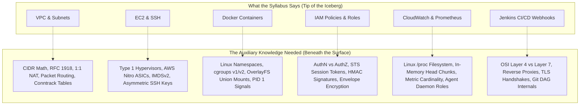

# Prerequisite & Auxiliary Knowledge Atlas

> *"Advanced cloud architectures are simply foundational computer science primitives (networking, operating systems, cryptography, distributed state) composed and automated through software APIs."*

---

## 1. Why Auxiliary Knowledge Matters (The "Iceberg" Reality)

When a DevOps syllabus says **"Launch an EC2 instance in a VPC and deploy Prometheus,"** it takes for granted dozens of foundational concepts. If you do not understand what sits beneath the surface, you end up memorizing commands without knowing **why** they work or **how** to debug them when they fail.

---

## 2. Topic-to-Prerequisite Dependency Matrix

Use this matrix to identify what you must understand **before** tackling any Unit or Lab:

| Core Topic / Lab in INT378 | The Unspoken Question You Face | Foundational Prerequisite Guide |
| :--- | :--- | :--- |
| **VPC, Subnets, Gateways** ([[Unit 1 - Advanced Cloud Infrastructure & Services]], [[Lab 01 - AWS EC2, VPC, Security Groups & Web Server]]) | *What makes an IP "private"? Why does AWS reserve 5 IPs? What does an Internet Gateway actually do? Why is NAT needed?* | **[[Aux 01 - Computer Networking & VPC Primitives]]** |
| **Security Groups vs NACLs** ([[Lab 01 - AWS EC2, VPC, Security Groups & Web Server]]) | *Why don't I need an outbound rule in a Security Group? How does AWS track active network states?* | **[[Aux 01 - Computer Networking & VPC Primitives]]** |
| **Docker Engine & Containers** ([[Unit 1 - Advanced Cloud Infrastructure & Services]], [[Lab 04 - Docker Architecture, Containerization & Hub]]) | *Are containers real machines? How do `namespaces` and `cgroups` isolate processes? Why does `exit code 137` happen?* | **[[Aux 02 - Linux Operating System & Kernel Primitives]]** |
| **EC2, Nitro & User Data** ([[Unit 1 - Advanced Cloud Infrastructure & Services]], [[Lab 01 - AWS EC2, VPC, Security Groups & Web Server]]) | *What is a hypervisor? Why was AWS Nitro revolutionary? What is `169.254.169.254`? Why `chmod 400` on `.pem` keys?* | **[[Aux 03 - Cloud Compute, Virtualization & Hypervisors]]** |
| **IAM, RBAC & STS** ([[Unit 5 - DevSecOps, IAM and Cloud Security]], [[Lab 02 - AWS IAM, MFA, Custom Policies & RBAC]]) | *What is the difference between AuthN and AuthZ? How does AWS evaluate policies? How do EC2 instances get credentials without hardcoding?* | **[[Aux 04 - Identity, Access Management & Cryptographic Foundations]]** |
| **KMS & Secrets** ([[Unit 5 - DevSecOps, IAM and Cloud Security]], [[Lab 07 - DevSecOps Pipeline (SAST, Trivy & Secret Mgmt)]]) | *Why shouldn't I encrypt big files with KMS directly? What is Envelope Encryption? How does symmetric vs asymmetric crypto differ?* | **[[Aux 04 - Identity, Access Management & Cryptographic Foundations]]** |
| **Monitoring Agents (CloudWatch / Prometheus)** ([[Unit 4 - Monitoring, Metrics and Observability]], [[Lab 08 - Prometheus & Node Exporter Metrics & Alerting]]) | *How does an agent actually extract CPU/RAM from an OS? What IAM policy does CloudWatch Agent require? Why is cardinality dangerous?* | **[[Aux 05 - Monitoring Agents, Telemetry & Time-Series Data]]** |
| **Nginx & Web Servers** ([[Lab 01 - AWS EC2, VPC, Security Groups & Web Server]], [[Lab 04 - Docker Architecture, Containerization & Hub]]) | *What is the difference between a Web Server and an App Server? What is a Reverse Proxy? How does TLS termination work?* | **[[Aux 06 - Web Servers, Reverse Proxies & Application Protocols]]** |
| **Jenkins Webhooks & CI/CD** ([[Unit 3 - Agile and CI-CD Practices for Scalable Systems]], [[Lab 06 - Automated CI-CD with Jenkins & GitHub Webhooks]]) | *What is a Webhook under the hood? How does GitHub securely notify Jenkins using HMAC SHA-256 signatures?* | **[[Aux 06 - Web Servers, Reverse Proxies & Application Protocols]]** |

---

## 3. The 6 Auxiliary Knowledge Modules

Explore each module in depth:

1. **[[Aux 01 - Computer Networking & VPC Primitives]]**:
   - IPv4 vs IPv6, RFC 1918 Private IP Blocks, CIDR math.
   - What a VPC actually is (Software-Defined Overlay Network / VXLAN).
   - What makes a Subnet "Public" vs "Private".
   - Internet Gateways (stateless 1:1 NAT) vs NAT Gateways (stateful outbound PAT).
   - Route Tables, Security Groups (stateful conntrack), NACLs (stateless packet filter), and VPC Endpoints / PrivateLink.

2. **[[Aux 02 - Linux Operating System & Kernel Primitives]]**:
   - Process hierarchy, `PID 1` init responsibilities, and Linux signal handling (`SIGTERM`, `SIGKILL`, Exit 137).
   - The 7 Linux Namespaces (`mnt`, `pid`, `net`, `ipc`, `uts`, `user`, `cgroup`) and syscalls (`clone`, `unshare`, `setns`).
   - Control Groups (`cgroups` v1 & v2), CFS CPU quotas, and memory OOM killer mechanics.
   - Union filesystems and OverlayFS (LowerDir, UpperDir, MergedDir, Copy-on-Write).
   - The pseudo-filesystems `/proc` and `/sys` (where monitoring agents actually get their data).

3. **[[Aux 03 - Cloud Compute, Virtualization & Hypervisors]]**:
   - Type 1 (Bare-Metal) vs Type 2 (Hosted) Hypervisors.
   - The AWS Nitro System (Hardware offloading of VPC, EBS, and hypervisor to dedicated PCIe ASIC cards).
   - Link-local address `169.254.169.254` and the Instance Metadata Service (IMDSv1 vs IMDSv2 SSRF mitigation).
   - Asymmetric Cryptography in SSH (`.pem` private key, `authorized_keys`, file permissions).
   - `cloud-init` lifecycle and User Data bootstrap execution.
   - Ephemeral Instance Store vs Network-Attached EBS volumes (IOPS, burst credits).

4. **[[Aux 04 - Identity, Access Management & Cryptographic Foundations]]**:
   - Authentication (AuthN) vs Authorization (AuthZ) vs Accounting (Audit).
   - Cryptography 101: Symmetric (AES-256), Asymmetric (RSA/ECC), Hashing (SHA-256), and HMAC.
   - AWS IAM Policy Evaluation Hierarchy (Default Deny, Explicit Deny, SCPs, Boundaries, Identity/Resource Allow).
   - AWS STS (Security Token Service) temporary credentials and role assumption mechanics.
   - EC2 Instance Profiles (how VMs retrieve credentials without static access keys).
   - Hardware Security Modules (HSMs) & Envelope Encryption (KMS Key vs Data Encryption Key).

5. **[[Aux 05 - Monitoring Agents, Telemetry & Time-Series Data]]**:
   - What an "Agent" is: daemons reading `/proc/meminfo`, `/proc/stat`, and `/proc/diskstats`.
   - AWS CloudWatch Agent architecture and required IAM policies (`CloudWatchAgentServerPolicy`).
   - Time-Series Database (TSDB) fundamentals: Why relational DBs fail for metrics, how TSDBs compress samples via Gorilla algorithms.
   - Metric types: Counters, Gauges, Histograms, Summaries.
   - The Cardinality Explosion hazard (why putting User IDs in Prometheus labels crashes your cluster).
   - Distributed Tracing foundations: Context propagation, W3C Trace Context headers, Spans and Traces.

6. **[[Aux 06 - Web Servers, Reverse Proxies & Application Protocols]]**:
   - OSI Layer 4 (Transport) vs Layer 7 (Application) packet inspection.
   - Web Server (static files, TLS) vs Application Server (dynamic business logic).
   - Reverse Proxy architecture: SSL/TLS termination, request buffering, and path routing.
   - HTTP/HTTPS protocol mechanics: Methods, headers, status code classes, and connection keep-alive.
   - Webhooks: Event-driven HTTP POST callbacks, Polling vs Push, and HMAC SHA-256 payload verification.
   - Git internals: Immutable DAG of commits, trees, blobs, and Git hooks.
