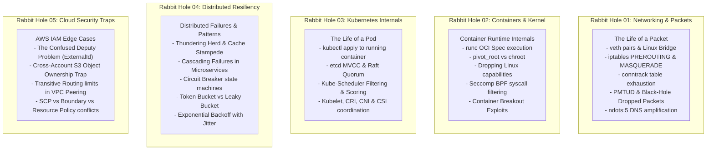

	
# The DevOps Rabbit Hole Compendium

> *"Junior engineers learn how to make tools work. Senior engineers understand how tools work when they succeed. Staff engineers know the exact kernel, network, and distributed failure modes that occur when they break."*

---

## 1. What is a "DevOps Rabbit Hole"?

Most online tutorials guide you through the **"Happy Path"**:
- `docker run -p 80:80 nginx` $\to$ *It works!*
- `kubectl apply -f pod.yaml` $\to$ *It's running!*
- `terraform apply` $\to$ *Infrastructure created!*

However, technical interviews at top engineering firms (FAANG, tier-1 tech startups, high-frequency finance) and real-world production post-mortems do not test the happy path. They ask:
1. *When a container makes an HTTP request to `google.com`, what are the exact Linux kernel netfilter chains, virtual interfaces, ARP lookups, and AWS Nitro packet transformations that happen along the way?*
2. *Why does Kubernetes suffer from a 5x DNS amplification penalty due to `/etc/resolv.conf` `ndots:5`?*
3. *What prevents a malicious multi-tenant container from executing a kernel escape to steal host credentials?*
4. *How does Raft consensus prevent split-brain, and why is an etcd cluster of 4 nodes strictly worse than a cluster of 3 nodes?*
5. *What is the Confused Deputy problem in AWS IAM, and why does neglecting `sts:ExternalId` open SaaS providers to cross-tenant hijacking?*

---

## 2. The 5 Rabbit Hole Deep Dives

---

## 3. Interview Scenario Mapping

| Interview Question / Production War Story | The Core Rabbit Hole to Master |
| :--- | :--- |
| *"Our microservice pods in Kubernetes are intermittently timing out on external HTTPS requests during high traffic, but CPU and memory are at 20%. What do you check?"* | **[[Rabbit Hole 01 - The Life of a Packet (From Container to Internet and Back)]]** (Linux `nf_conntrack` table overflow dropping packets, or `ndots:5` DNS query storms). |
| *"Why is mounting `/var/run/docker.sock` into a CI/CD runner container a catastrophic security vulnerability?"* | **[[Rabbit Hole 02 - Container Runtime Internals, Syscalls & Escapes]]** (Docker socket grants unauthenticated root execution over the host daemon). |
| *"Explain every single component and syscall invoked between running `kubectl apply -f pod.yaml` and the container serving traffic."* | **[[Rabbit Hole 03 - Kubernetes Under the Hood (The Life of a Pod)]]** (API Server $\to$ Admission Webhooks $\to$ etcd $\to$ Scheduler $\to$ Kubelet $\to$ CRI $\to$ CNI $\to$ CSI $\to$ runc). |
| *"Our Redis cache crashed. When it rebooted, our backend PostgreSQL database immediately crashed under 100% CPU and stayed dead even after restarts. What happened and how do you fix it?"* | **[[Rabbit Hole 04 - Distributed Systems Resiliency, Failures & Circuit Breakers]]** (Thundering Herd / Cache Stampede; fixed via probabilistic early expiration and Circuit Breakers). |
| *"A multi-tenant SaaS vendor asks for an IAM Role ARN in your AWS account so their monitoring service can read your CloudWatch metrics. What critical security parameter must you enforce?"* | **[[Rabbit Hole 05 - AWS IAM Edge Cases & The Confused Deputy Problem]]** (`sts:ExternalId` condition block to eliminate Confused Deputy attack vectors). |
