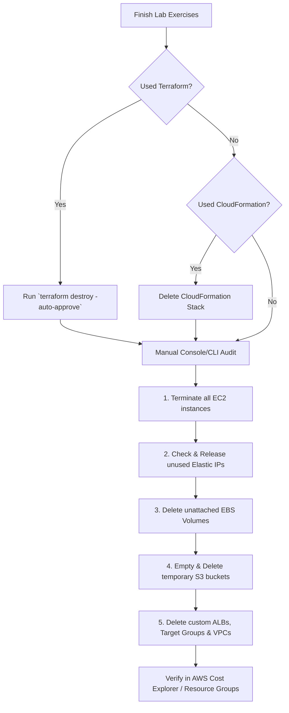

# AWS Student Account Survival & Zero-Cost Playbook

> [!CAUTION]
> Cloud providers bill by the second. An unmonitored `t3.xlarge` instance or a forgotten NAT Gateway can exhaust a \$100 student grant or trigger credit card charges in less than a week. Follow these rules before launching any cloud resources.

---

## 1. Student Account Variants & How to Navigate Them

| Account Type | Description | IAM Access | Quotas / Limits | Best For |
| :--- | :--- | :--- | :--- | :--- |
| **AWS Academy Learner Lab** | Pre-funded sandbox (\$100 credit) assigned via university courses. | **Restricted / Read-Only** (Cannot create new IAM users, cannot modify root account policies). | Hard \$100 cap; turns off automatically when budget depletes. | Safe for beginners; for IAM lab (Lab 02), use AWS Policy Simulator or LocalStack. |
| **AWS Educate** | Individual student learning accounts without credit cards. | Pre-configured sandbox environments for specific modules. | Highly restricted set of services. | Introductory labs only. |
| **AWS Free Tier (Standard)** | Personal AWS account with credit card attached; gets 12 months free tier + student promo credits. | **Full Admin / Root Access**. Can create IAM users, roles, organizations, budgets. | Normal AWS quotas. High risk of surprise charges if misconfigured. | Best for full freedom (Lab 02, Lab 03, Lab 05, Lab 11). Requires rigorous billing alerts. |

---

## 2. The Golden Rules of Zero-Cost AWS Usage

### Rule 1: Master the Free Tier Limits
- **Compute**: 750 hours/month of `t2.micro` or `t3.micro` (Linux, RHEL, or Windows). 750 hours = running 1 instance continuously 24/7 for a month. *If you run 2 instances simultaneously, your 750 hours exhaust in 15 days!*
- **Storage**: 30 GB of Amazon EBS (General Purpose SSD `gp2` or `gp3`) storage per month.
- **Object Storage**: 5 GB of Amazon S3 standard storage, 20,000 GET requests, 2,000 PUT requests.
- **Serverless**: 1,000,000 free AWS Lambda requests and 3.2 million seconds of compute time per month.
- **Databases**: 750 hours/month of `db.t2.micro` or `db.t3.micro` on Amazon RDS (Single-AZ).

### Rule 2: Services That Are NEVER Free (Avoid in Student Labs)
1. **AWS NAT Gateways**: Costs ~\$0.045/hour + \$0.045/GB data processed. That is ~\$32.40/month just for sitting idle! Use a public subnet or a lightweight NAT instance on `t2.micro` if private internet is needed.
2. **Unattached Elastic IP Addresses (EIP)**: AWS charges for public IPv4 addresses when they are **not** associated with a running instance (\$0.005/hour). If you stop an instance, release the Elastic IP!
3. **Application Load Balancers (ALB / NLB)**: Free tier includes only 750 hours of ALB for the first 12 months, but LCU (Load Balancer Capacity Units) data fees can accumulate. Delete immediately after testing.
4. **AWS KMS Customer Managed Keys (CMK)**: \$1.00 per key/month. Always use default AWS-managed keys (`aws/s3`, `aws/ebs`) during student labs.
5. **Multi-AZ Deployments**: Always choose Single-AZ for student RDS/EC2 configurations.

---

## 3. Mandatory Day-1 Setup: Alarms & Budgets

Run these commands or set them up in the AWS Console on Day 1.

### Step 1: Enable Billing Alerts
1. Log in as Root User.
2. Navigate to **Billing and Cost Management** $\to$ **Billing Preferences**.
3. Check **Receive CloudWatch Billing Alerts** and **Receive PDF Invoice by Email** $\to$ Save Preferences.

### Step 2: Configure AWS Budget (CLI or Console)
Using AWS CLI:
```bash
aws budgets create-budget \
    --account-id $(aws sts get-caller-identity --query Account --output text) \
    --budget '{
        "BudgetName": "Student-Zero-Cost-Safety-Net",
        "BudgetLimit": {
            "Amount": "2.00",
            "Unit": "USD"
        },
        "CostFilters": {},
        "CostTypes": {
            "IncludeTax": true,
            "IncludeSubscription": true,
            "UseBlended": false,
            "IncludeRefund": false,
            "IncludeCredit": false,
            "IncludeUpfront": true,
            "IncludeRecurring": true,
            "IncludeOtherSubscription": true,
            "IncludeSupport": true,
            "IncludeDiscount": true,
            "UseAmortized": false
        },
        "TimeUnit": "MONTHLY",
        "BudgetType": "COST"
    }' \
    --notifications-with-subscribers '[
        {
            "Notification": {
                "NotificationType": "ACTUAL",
                "ComparisonOperator": "GREATER_THAN",
                "Threshold": 50,
                "ThresholdType": "PERCENTAGE"
            },
            "Subscribers": [
                {
                    "SubscriptionType": "EMAIL",
                    "Address": "your-student-email@university.edu"
                }
            ]
        }
    ]'
```

---

## 4. End-of-Lab Teardown Checklist

Run through this checklist at the end of every practical session:



### Quick CLI Cleanup Script (PowerShell / Bash)
Save this as `cloud-sweep.sh` to check what is still running in your active region:
```bash
#!/bin/bash
REGION="us-east-1"
echo "=== Running EC2 Instances ==="
aws ec2 describe-instances --region $REGION \
    --filters "Name=instance-state-name,Values=running,pending" \
    --query "Reservations[*].Instances[*].[InstanceId,InstanceType,Tags[?Key=='Name'].Value|[0]]" --output table

echo "=== Unattached Elastic IPs ==="
aws ec2 describe-addresses --region $REGION \
    --query "Addresses[?AssociationId==null].[PublicIp,AllocationId]" --output table

echo "=== Available (Unattached) EBS Volumes ==="
aws ec2 describe-volumes --region $REGION \
    --filters "Name=status,Values=available" \
    --query "Volumes[*].[VolumeId,Size,VolumeType]" --output table

echo "=== Active Load Balancers ==="
aws elbv2 describe-load-balancers --region $REGION \
    --query "LoadBalancers[*].[LoadBalancerName,DNSName]" --output table
```

---

## 5. Zero-Cost Local Emulation: LocalStack & Docker

If you do not want to use AWS credits or if your student account has restricted IAM privileges:

1. **LocalStack**: Emulates AWS core services (S3, Lambda, DynamoDB, IAM, SQS, SNS) locally on your PC via Docker.
   ```bash
   docker run --rm -it -p 4566:4566 -p 4510-4559:4510-4559 localstack/localstack
   ```
2. **AWS CLI with LocalStack**:
   ```bash
   aws --endpoint-url=http://localhost:4566 s3 mb s3://my-test-bucket
   aws --endpoint-url=http://localhost:4566 s3 ls
   ```
3. **Docker Compose for Jenkins, Prometheus & Grafana**:
   Running Jenkins, Prometheus, and Grafana on local Docker requires **zero AWS resources** and saves your cloud hours strictly for cloud-specific practicals (EC2, VPC, IAM, CloudFormation, Terraform, Lambda).
