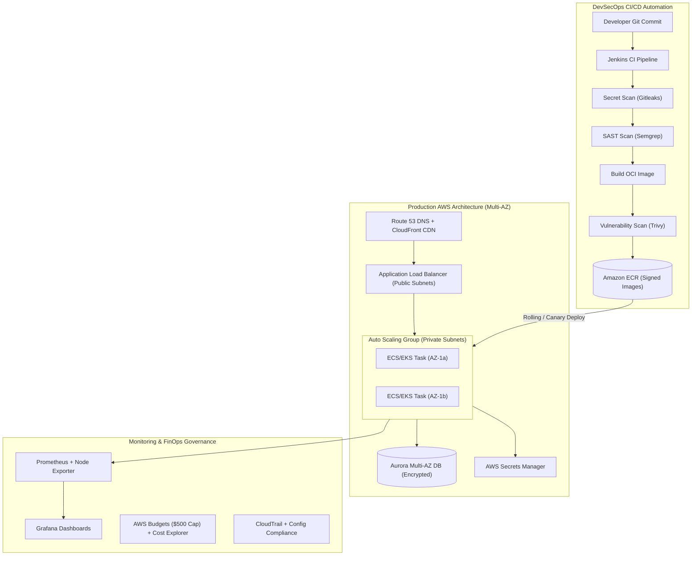

# INT378: Comprehensive Exam & Viva Voce Guide
**Course:** Advancements in Cloud and DevOps (INT378)  
**Credits:** 3 (L:2, T:0, P:2)  
**Course Outcomes:** CO1 through CO6  

---

## 1. High-Yield Architectural Comparison Matrices

### Table 1: Virtualization vs. Containerization (Unit 1 & Lab 04)
| Dimension | Virtual Machines (VMs) | Docker Containers |
| :--- | :--- | :--- |
| **Kernel Architecture** | Runs distinct Guest OS on top of Hypervisor (Type 1 or 2). | Shares Host Linux OS kernel using `cgroups` & `namespaces`. |
| **Startup Latency** | Minutes (boots full operating system). | Sub-seconds (spawns isolated host process). |
| **Resource Overhead** | High (Gigabytes of disk and reserved memory). | Minimal (Megabytes, only application binaries & libraries). |
| **Security Isolation** | Hardware-level isolation via hypervisor CPU rings. | Process-level isolation; kernel vulnerabilities can affect host. |
| **Portability** | Heavy VM images (OVF/OVA), hypervisor dependent. | OCI standard image format, portable across any Docker host. |

---

### Table 2: CloudFormation vs. Terraform / OpenTofu (Unit 2, Lab 03 & Lab 05)
| Dimension | AWS CloudFormation | HashiCorp Terraform / OpenTofu |
| :--- | :--- | :--- |
| **Scope** | AWS-native (first-party ecosystem). | Multi-Cloud & Multi-Provider (AWS, Azure, GCP, K8s). |
| **Configuration Format** | JSON or YAML. | HashiCorp Configuration Language (HCL). |
| **State Storage** | Managed transparently inside AWS CloudFormation backend. | Explicit `terraform.tfstate` file (requires S3 + DynamoDB locking). |
| **Previewing Changes** | CloudFormation Change Sets. | `terraform plan` execution graph. |
| **Rollback Behavior** | Automated server-side rollback on stack update failure. | State reconciliation; requires Git commit revert and re-apply. |

---

### Table 3: Scaling Agile: SAFe vs. LeSS (Unit 3)
| Dimension | Scaled Agile Framework (SAFe) | Large-Scale Scrum (LeSS) |
| :--- | :--- | :--- |
| **Core Philosophy** | Prescriptive, top-down enterprise governance. | Minimalist, bottom-up scaling of single-team Scrum. |
| **Product Backlog** | Multiple tiered backlogs (Portfolio, Solution, Program, Team). | Single, unified Product Backlog across all feature teams. |
| **Key Cadence** | Program Increment (PI) Planning (8–12 week horizon). | Sprint Planning 1 (collective) and Sprint Planning 2 (team). |
| **Organizational Overhead** | Introduces new roles: Release Train Engineer (RTE), Product Managers. | Zero new management layers; expands Product Owner & Scrum Master scope. |

---

### Table 4: Monitoring vs. Observability (Unit 4, Lab 08 & Lab 09)
| Dimension | Traditional Monitoring | Modern Observability |
| :--- | :--- | :--- |
| **Paradigm** | Black-box inspection of predetermined failure modes. | White-box inference of internal state via telemetry outputs. |
| **Question Answered** | *"Is the system broken right now?"* (Known-Unknowns). | *"Why is the system behaving this way?"* (Unknown-Unknowns). |
| **Pillars / Telemetry** | Server uptime, ping, threshold alarms. | Metrics (Prometheus), Logs (Loki), Distributed Traces (Jaeger). |
| **Best Suited For** | Static monoliths in private datacenters. | Ephemeral microservices, serverless, and multi-region clouds. |

---

### Table 5: IAM Authentication vs. Authorization (Unit 5 & Lab 02)
| Dimension | Authentication (AuthN) | Authorization (AuthZ) |
| :--- | :--- | :--- |
| **Definition** | Verifying the identity of the actor/entity. | Determining the permissions and boundaries of the authenticated actor. |
| **Mechanism** | Passwords, SSH Keys, AWS Access Keys, TOTP MFA. | IAM JSON Policies (Identity-based, Resource-based, SCPs). |
| **Evaluation Order** | Evaluated first at connection boundary. | Evaluated second upon each API action request. |

---

## 2. Top 30 Viva Voce & Technical Interview Questions

### Core Cloud & Containers (Unit 1 & Lab 01, 04)
1. **Q: What are the three primary building blocks of Linux container isolation?**  
   *Answer:* `namespaces` (isolates process tree, network interfaces, mount points, IPC), `cgroups` (limits CPU, memory, and disk I/O), and UnionFS/OverlayFS (layered copy-on-write filesystems).
2. **Q: What is the purpose of an EC2 User Data script?**  
   *Answer:* It is a bootstrap script executed once as `root` during the initial instance launch to install packages, configure web servers, and pull application code.
3. **Q: Why is an Application Load Balancer (ALB) preferred over a Network Load Balancer (NLB) for microservices?**  
   *Answer:* ALB operates at Layer 7 (HTTP/HTTPS) and supports content-based routing (path-based `/api/v1` and host-based `api.domain.com`), whereas NLB operates at Layer 4 (TCP/UDP) with no payload visibility.
4. **Q: Explain Chaos Engineering and how Netflix uses Chaos Monkey.**  
   *Answer:* Chaos Engineering is the discipline of experimenting on a distributed system to build confidence in its capability to withstand production turbulent conditions. Netflix's Chaos Monkey randomly terminates production EC2 instances during business hours to ensure architecture auto-heals without human intervention.
5. **Q: What is a multi-stage Docker build and why is it recommended?**  
   *Answer:* Multi-stage builds separate the compilation/build environment from the runtime environment. Build tools and compilers are excluded from the final image, drastically reducing image size and attack surface.

---

### Infrastructure as Code (Unit 2 & Lab 03, 05)
6. **Q: What is meant by idempotency in IaC?**  
   *Answer:* Executing the same IaC configuration multiple times produces the exact same end state without unintended side effects or duplicate resource creation.
7. **Q: What is configuration drift and how does Terraform solve it?**  
   *Answer:* Drift occurs when infrastructure is modified manually outside of code. `terraform plan` refreshes state against real-world APIs, detects discrepancies, and plans corrective actions to restore the declared state.
8. **Q: How does Terraform manage distributed state locking?**  
   *Answer:* By configuring an S3 remote backend paired with an Amazon DynamoDB table. When `apply` is invoked, a lock item is written to DynamoDB, preventing concurrent pipeline runs from corrupting the state file.
9. **Q: What is a CloudFormation Change Set?**  
   *Answer:* A preview summary of proposed infrastructure modifications that details whether resources will undergo in-place updates or destructive recreation before changes are committed.
10. **Q: What is the difference between Terraform Modules and CloudFormation Nested Stacks?**  
    *Answer:* Terraform modules are client-side reusable HCL blueprints compiled locally during planning; CloudFormation nested stacks are separate server-side child stacks referenced via template URLs and orchestrated by AWS.

---

### Agile, CI/CD & DevSecOps (Unit 3 & 5, Lab 06 & 07)
11. **Q: Differentiate Continuous Delivery from Continuous Deployment.**  
    *Answer:* Continuous Delivery automates builds and testing up to staging, requiring a single manual business approval to push to production. Continuous Deployment automates the entire flow directly to production with zero human intervention.
12. **Q: Explain the Blue/Green deployment strategy.**  
    *Answer:* Two identical environments: Blue (active production running v1) and Green (idle staging receiving v2). Once green passes smoke tests, the router or load balancer switches $100\%$ of user traffic to Green. If issues occur, traffic instantly rolls back to Blue.
13. **Q: What is Shift-Left Security?**  
    *Answer:* Moving security practices earlier in the software development lifecycle (pre-commit, build, and test phases) rather than waiting for post-deployment penetration testing.
14. **Q: Differentiate between SAST and DAST.**  
    *Answer:* SAST (Static Application Security Testing) analyzes raw source code without running it to detect security flaws (white-box); DAST (Dynamic Application Security Testing) evaluates running web applications from the outside by injecting malicious payloads (black-box).
15. **Q: How does Aqua Trivy scan Docker containers for vulnerabilities?**  
    *Answer:* Trivy inspects OS package manifests (Alpine APK, Debian dpkg) and application language lockfiles (npm, pip, pom.xml), matching discovered versions against known CVE databases (NVD).
16. **Q: How should credentials be passed to applications running on EC2 instances?**  
    *Answer:* Never hardcode access keys. Attach an IAM Role via an EC2 Instance Profile. The AWS Security Token Service (STS) injects temporary, self-rotating credentials into the Instance Metadata Service (IMDS).

---

### Monitoring & Observability (Unit 4 & Lab 08, 09)
17. **Q: What are Google's Four Golden Signals of monitoring?**  
    *Answer:* Latency (request duration), Traffic (requests per second), Errors (rate of 5xx/4xx responses), and Saturation (how full a resource is, e.g., memory headroom).
18. **Q: Differentiate between a Prometheus Counter and a Gauge.**  
    *Answer:* A Counter is a cumulative metric that only increases or resets to zero on restart (e.g., total requests served). A Gauge is a metric that fluctuates arbitrarily up and down (e.g., CPU temperature, memory usage).
19. **Q: Why does Prometheus use a pull model instead of a push model?**  
    *Answer:* Pulling allows the monitoring server to regulate scrape rates, detect crashing targets immediately when scrapes fail (`up == 0`), and avoids managing push authentication keys across target hosts.
20. **Q: What is PromQL and how does `rate()` handle counter resets?**  
    *Answer:* PromQL is Prometheus Query Language. The `rate()` function calculates the per-second average rate of increase over a range vector and automatically adjusts for counter resets caused by target server restarts.
21. **Q: What role does Thanos play in a Prometheus architecture?**  
    *Answer:* Thanos extends Prometheus by providing unlimited long-term metric storage in cloud object stores (S3/GCS), global cross-cluster querying, and deduplication of high-availability Prometheus pairs.

---

### Cloud-Native, Serverless & FinOps (Unit 6 & Lab 10, 11)
22. **Q: What is a 12-Factor App's rule regarding configuration?**  
    *Answer:* Factor III states: Store configuration in the environment. Never hardcode credentials or endpoints in source code; inject them via OS environment variables.
23. **Q: What is the Cold Start phenomenon in AWS Lambda?**  
    *Answer:* The latency overhead during an initial invocation while AWS provisions a new microVM execution environment (Firecracker), boots the runtime, and executes function initialization code.
24. **Q: What are the three phases of the FinOps lifecycle?**  
    *Answer:* **Inform** (gain spending visibility, tagging, benchmarking), **Optimize** (rightsize instances, leverage Spot/Savings Plans, configure lifecycle rules), and **Operate** (continuous tracking against business KPIs).
25. **Q: What is an unattached Elastic IP and why does AWS bill for it?**  
    *Answer:* An allocated public IPv4 address not currently associated with a running EC2 instance. AWS charges an hourly fee to prevent address hoarding and waste of scarce IPv4 address space.
26. **Q: How do Amazon S3 Lifecycle Rules optimize storage costs?**  
    *Answer:* They automatically transition objects from S3 Standard to S3 Infrequent Access (30 days), to S3 Glacier (90 days), and ultimately expire/delete them, reducing storage costs by over $80\%-95\%$.
27. **Q: Explain the AWS IAM Policy evaluation logic.**  
    *Answer:* Explicit Deny trumps everything. If an explicit Deny is present, access is blocked. If an explicit Allow exists and no Deny is present, access is granted. Otherwise, default deny applies.
28. **Q: What is the purpose of AWS Service Control Policies (SCPs)?**  
    *Answer:* SCPs are organizational guardrails applied at the AWS Organizations level that define the maximum allowable permissions for member accounts, overriding even root account administrators.
29. **Q: What is Envelope Encryption in AWS KMS?**  
    *Answer:* Encrypting application plaintext data with a unique Data Key (DEK), and encrypting that Data Key with a top-level Key Encryption Key (KEK) inside the AWS KMS Hardware Security Module.
30. **Q: What is the difference between AWS CloudTrail and AWS Config?**  
    *Answer:* CloudTrail is an audit log recording *who* made *what* API call and *when*. AWS Config is a configuration compliance service recording *how* resource configurations change over time against compliance rules.

---

## 3. End-Term Scenario-Based Architecture Question & Model Answer

### Exam Scenario:
> **Question:** A banking enterprise wants to migrate an existing monolithic transaction portal to a highly scalable, secure, and cost-effective cloud-native architecture on AWS. The solution must support automated CI/CD deployments, zero-downtime releases, automated vulnerability scanning, least-privilege access, and proactive infrastructure monitoring.  
> **Task:** Architect a complete end-to-end DevOps and Cloud solution addressing these requirements.

### Model Architecture Breakdown:
1. **Compute & Scalability**:
   - Deploy containerized microservices on Amazon EKS or Amazon ECS across two Availability Zones for high availability.
   - Configure Application Load Balancer (ALB) with an Auto Scaling Group using Target Tracking scaling policies (maintain average CPU at $65\%$).
2. **Security & Identity (DevSecOps & IAM)**:
   - Compute instances operate in private subnets with no public IPs.
   - Attach IAM Roles using EC2/EKS Service Accounts (IRSA) with least privilege; zero static credentials.
   - Dynamic credentials injected at runtime via AWS Secrets Manager.
   - CI/CD pipeline enforces Gitleaks, Semgrep SAST, and Trivy CVE scanning before images are pushed to Amazon ECR.
3. **Continuous Deployment Strategy**:
   - Canary deployment strategy: Route $10\%$ of production traffic to the new release, verify latency and error rates in Grafana for 10 minutes, and complete cutover.
4. **Monitoring & Observability**:
   - Prometheus cluster scrapes container endpoints and Node Exporters; Alertmanager routes critical alerts to PagerDuty.
   - Grafana provides operations teams with Four Golden Signals dashboards.
5. **FinOps & Governance**:
   - AWS Budgets configured with automated SMS/Email alerts at $80\%$ threshold.
   - S3 Lifecycle policies transition archival transaction records to Glacier Deep Archive.
   - AWS CloudTrail and AWS Config continuously enforce regulatory compliance.
