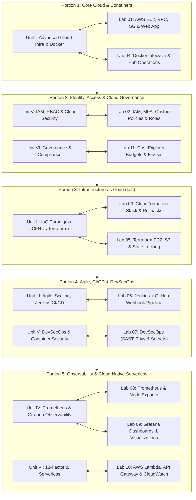

---
title: "INT378 Master Strategy & Curriculum Roadmap"
course_code: "INT378"
course_title: "Advancements in Cloud and DevOps"
academic_session: "2026-27"
category: "course-hub"
credits: 3
lecture_hours: 2
tutorial_hours: 0
practical_hours: 2
total_units: 6
total_labs: 11
course_outcomes:
  - "CO1: Fundamentals of cloud models & security"
  - "CO2: Methods & tools for scalability"
  - "CO3: Network security & authentication"
  - "CO4: Cost optimization & cloud-native dev"
  - "CO5: Security in dev & deployment (DevSecOps)"
  - "CO6: Emerging trends, governance & compliance"
theory_units:
  - "[[Unit 1 - Advanced Cloud Infrastructure & Services]]"
  - "[[Unit 2 - Infrastructure as Code (IaC)]]"
  - "[[Unit 3 - Agile and CI-CD Practices for Scalable Systems]]"
  - "[[Unit 4 - Monitoring, Metrics and Observability]]"
  - "[[Unit 5 - DevSecOps, IAM and Cloud Security]]"
  - "[[Unit 6 - Cloud-Native Development, Serverless & FinOps]]"
practical_labs:
  - "[[Lab 01 - AWS EC2, VPC, Security Groups & Web Server]]"
  - "[[Lab 02 - AWS IAM, MFA, Custom Policies & RBAC]]"
  - "[[Lab 03 - AWS CloudFormation Templates, Stacks & Rollbacks]]"
  - "[[Lab 04 - Docker Architecture, Containerization & Hub]]"
  - "[[Lab 05 - Terraform IaC (EC2, S3 & State Management)]]"
  - "[[Lab 06 - Automated CI-CD with Jenkins & GitHub Webhooks]]"
  - "[[Lab 07 - DevSecOps Pipeline (SAST, Trivy & Secret Mgmt)]]"
  - "[[Lab 08 - Prometheus & Node Exporter Metrics & Alerting]]"
  - "[[Lab 09 - Grafana Dashboards & Prometheus Data Source]]"
  - "[[Lab 10 - Serverless Microservice (Lambda, API GW, CloudWatch)]]"
  - "[[Lab 11 - AWS Cost Explorer, Budgets & FinOps Optimization]]"
reference_guides:
  - "[[AWS Student Survival & Zero-Cost Playbook]]"
  - "[[INT378 Comprehensive Exam & Viva Voce Guide]]"
  - "[[00 - Prerequisite & Auxiliary Knowledge Atlas]]"
  - "[[00 - The DevOps Rabbit Hole Compendium]]"
prerequisite_foundations:
  - "[[Aux 01 - Computer Networking & VPC Primitives]]"
  - "[[Aux 02 - Linux Operating System & Kernel Primitives]]"
  - "[[Aux 03 - Cloud Compute, Virtualization & Hypervisors]]"
  - "[[Aux 04 - Identity, Access Management & Cryptographic Foundations]]"
  - "[[Aux 05 - Monitoring Agents, Telemetry & Time-Series Data]]"
  - "[[Aux 06 - Web Servers, Reverse Proxies & Application Protocols]]"
rabbit_hole_deep_dives:
  - "[[Rabbit Hole 01 - The Life of a Packet (From Container to Internet and Back)]]"
  - "[[Rabbit Hole 02 - Container Runtime Internals, Syscalls & Escapes]]"
  - "[[Rabbit Hole 03 - Kubernetes Under the Hood (The Life of a Pod)]]"
  - "[[Rabbit Hole 04 - Distributed Systems Resiliency, Failures & Circuit Breakers]]"
  - "[[Rabbit Hole 05 - AWS IAM Edge Cases & The Confused Deputy Problem]]"
tags:
  - int378
  - course-hub
  - cloud-computing
  - devops
  - obsidian-hub
status: "active"
last_updated: 2026-11-03
---

# INT378: Advancements in Cloud and DevOps
**L: 2 | T: 0 | P: 2 | Credits: 3**  
**Academic Session:** 2026–27  
**Vault Hub:** `Cloud and DevOps`

---

## 1. Course Overview & Outcomes Alignment

The objective of **INT378** is to bridge modern cloud architecture with enterprise DevOps automation, observability, DevSecOps, and cost engineering (FinOps). 

### Course Outcomes (COs)
- **CO1**: Recall fundamental concepts and models related to cloud computing and security.
- **CO2**: Analyze key methods and tools for achieving scalability in cloud-based solutions.
- **CO3**: Explain the importance of network security and authentication in cloud environments.
- **CO4**: Evaluate strategies for optimizing costs and methodologies for cloud-native development.
- **CO5**: Apply security practices in the development and deployment processes (DevSecOps).
- **CO6**: Explore emerging trends and best practices in cloud technologies and governance.

---

## 2. The Dual-Track Learning Strategy: "Concept $\iff$ Implementation"

Traditional courses fail DevOps learners in two ways:
1. **Pure Theory**: Memorizing AWS service acronyms and 12-factor rules without ever SSH-ing into an instance or resolving a broken pipeline.
2. **Pure Tutorial Hell**: Blindly copy-pasting bash commands or clicking AWS console buttons without understanding the underlying network routing, IAM boundary evaluation, or cost accumulation.

To excel academically (exams, vivas) and professionally (interviews, real systems), we structure this curriculum into **5 Synergistic Portions**. Every portion pairs foundational theory with exact hands-on lab experiments.



---

## 3. The 5 Learning Portions Breakdown

| Portion | Focus Area | Theory Units | Hands-on Practicals | Primary Skills Acquired | COs Addressed |
| :--- | :--- | :--- | :--- | :--- | :--- |
| **Portion 1** | **Cloud Compute, Networking & Containers** | **Unit I**: Cloud Services (AWS vs Azure), Resource Optimization, Docker Architecture, Case Studies (Netflix, Uber, Amazon). | **Lab 01**: AWS EC2, VPC, Subnets, Security Groups, Web Server deployment.<br>**Lab 04**: Dockerizing web applications, multi-stage builds, port mappings, Docker Hub. | Cloud foundations, virtualization vs containerization, Linux sysadmin, microservices packaging. | CO1, CO2 |
| **Portion 2** | **Identity, Access Control & Cloud Governance** | **Unit V (Part A)**: IAM, Least Privilege, RBAC, Multi-Factor Authentication.<br>**Unit VI (Part A)**: Governance, compliance auditing, cloud security framework. | **Lab 02**: IAM Users, Groups, Roles, Custom JSON Policies, MFA enforcement, Role Assumption. | Enterprise authorization, root account isolation, credential hygiene, zero-trust foundations. | CO1, CO3, CO5 |
| **Portion 3** | **Infrastructure as Code (IaC) Automation** | **Unit II**: IaC Concepts, Declarative vs Imperative, State Drift, CloudFormation vs Terraform, OpenTofu, Future IaC trends. | **Lab 03**: AWS CloudFormation template authoring, stack lifecycle, updates & rollbacks.<br>**Lab 05**: Terraform syntax (HCL), `init`, `plan`, `apply`, `destroy`, remote state in S3. | Reproducible infrastructure, state management, version-controlled cloud environments. | CO2, CO4 |
| **Portion 4** | **Agile, Automated CI/CD & DevSecOps** | **Unit III**: Scaling Agile (SAFe, LeSS), TDD/BDD, CI/CD, A/B Testing, Jenkins automation.<br>**Unit V (Part B)**: Shift-left security, SAST/DAST, Container scanning, Secrets management. | **Lab 06**: Jenkins installation, GitHub Webhook triggers, automated build/test/deploy.<br>**Lab 07**: DevSecOps Pipeline integration: static code analysis, Trivy vulnerability scanner, secret masking. | Pipeline-as-code, automated release management, vulnerability scanning before deployment. | CO2, CO5 |
| **Portion 5** | **Observability, Serverless & FinOps Cost Optimization** | **Unit IV**: Observability pillars (Metrics, Logs, Traces), Prometheus TSDB, PromQL, Grafana.<br>**Unit VI (Part B)**: 12-Factor App, Serverless architectures, AWS Cost Explorer, Budgets, FinOps. | **Lab 08**: Prometheus setup, Node Exporter, alert rules.<br>**Lab 09**: Grafana dashboards, PromQL queries, system trend analysis.<br>**Lab 10**: Serverless microservice with AWS Lambda, API Gateway, CloudWatch.<br>**Lab 11**: AWS Cost Explorer, Budget alerts, idle resource identification. | Telemetry instrumentation, event-driven architectures, cloud financial engineering. | CO2, CO4, CO6 |

---

## 4. Student AWS Account Strategy & Zero-Cost Guardrails

Working with an **AWS Student Account** (whether AWS Academy Learner Lab, AWS Educate, or a personal AWS Free-Tier account with student credits) requires **strict discipline** to avoid unexpected balance drain or account lockouts.

### Student Account Constraints & Differences
1. **AWS Academy Learner Lab**:
   - Gives a fixed grant (e.g., \$100 credit per course).
   - **Crucial limitation**: The IAM console is often locked or restricted to read-only; students cannot create real IAM users or access AWS Organizations.
   - *Strategy for Lab 02*: We provide both real AWS IAM steps (for Free-Tier accounts) AND a LocalStack / policy simulator fallback so students on restricted Academy accounts can still test and verify policies completely.
2. **AWS Free Tier / Credit Account**:
   - Provides 750 hours/month of `t2.micro` or `t3.micro`, 30 GB EBS, 5 GB S3, 1,000,000 Lambda requests, 10 custom CloudWatch metrics.
   - Requires payment method; running resources beyond free limits incurs charges.

### The 4 Non-Negotiable Guardrails
Before launching any resource, execute these guardrails:

> [!IMPORTANT]
> 1. **Immediate Zero-Cost Billing Alert**:
>    - Set up a CloudWatch Billing Alarm for **\$0.50** and **\$2.00**.
>    - Configure an AWS Budget alert with notifications sent to your primary email address.
> 2. **Never Create NAT Gateways for Practice**:
>    - A managed AWS NAT Gateway costs **\$0.045 per hour** (\$32/month) even with zero traffic!
>    - For private subnet internet in student labs, use public subnets directly or a cheap NAT instance on `t2.micro`.
> 3. **The Unattached Resource Trap**:
>    - AWS charges for unattached Elastic IPs (\$0.005/hour) and detached EBS volumes (\$0.08/GB-month).
>    - Always release Elastic IPs and terminate EBS volumes when stopping EC2 instances.
> 4. **The Post-Lab Teardown Protocol**:
>    - Every lab file in this vault contains an explicit **Teardown & Cleanup Checklist**.
>    - Terraform: Always run `terraform destroy` when finished.
>    - CloudFormation: Delete the stack through CLI or console.
>    - EC2/VPC: Terminate instances and delete custom security groups.

---

## 5. Folder & File Directory Map (Integrated Pod Architecture)

```text
Cloud and DevOps/
├── 00 - Course Hub & Survival Guide/
│   ├── INT378 Master Strategy & Curriculum Roadmap.md
│   ├── AWS Student Survival & Zero-Cost Playbook.md
│   ├── INT378 Comprehensive Exam & Viva Voce Guide.md
│   ├── 00 - Prerequisite & Auxiliary Knowledge Atlas.md
│   ├── 00 - The DevOps Rabbit Hole Compendium.md
│   └── Components of AWS.md
├── 01 - Cloud Fundamentals, Linux & Containers/
│   ├── Aux 01 - Computer Networking & VPC Primitives.md
│   ├── Aux 02 - Linux Operating System & Kernel Primitives.md
│   ├── Aux 03 - Cloud Compute, Virtualization & Hypervisors.md
│   ├── Unit 1 - Advanced Cloud Infrastructure & Services.md
│   ├── Lab 01 - AWS EC2, VPC, Security Groups & Web Server.md
│   ├── Lab 04 - Docker Architecture, Containerization & Hub.md
│   ├── Rabbit Hole 01 - The Life of a Packet (From Container to Internet and Back).md
│   ├── Rabbit Hole 02 - Container Runtime Internals, Syscalls & Escapes.md
│   └── code/lab04-docker/
│       ├── Dockerfile
│       ├── app.py
│       ├── requirements.txt
│       └── .dockerignore
├── 02 - Identity, Access Management & Security/
│   ├── Aux 04 - Identity, Access Management & Cryptographic Foundations.md
│   ├── Unit 5 - DevSecOps, IAM and Cloud Security.md
│   ├── Lab 02 - AWS IAM, MFA, Custom Policies & RBAC.md
│   └── Rabbit Hole 05 - AWS IAM Edge Cases & The Confused Deputy Problem.md
├── 03 - Infrastructure as Code (Terraform & CloudFormation)/
│   ├── Unit 2 - Infrastructure as Code (IaC).md
│   ├── Lab 03 - AWS CloudFormation Templates, Stacks & Rollbacks.md
│   ├── Lab 05 - Terraform IaC (EC2, S3 & State Management).md
│   └── code/
│       ├── lab03-cloudformation/
│       │   └── vpc-ec2-web-stack.yaml
│       └── lab05-terraform/
│           ├── main.tf
│           ├── variables.tf
│           ├── outputs.tf
│           └── terraform.tfvars.example
├── 04 - CI-CD, Agile & DevSecOps Pipelines/
│   ├── Aux 06 - Web Servers, Reverse Proxies & Application Protocols.md
│   ├── Unit 3 - Agile and CI-CD Practices for Scalable Systems.md
│   ├── Lab 06 - Automated CI-CD with Jenkins & GitHub Webhooks.md
│   ├── Lab 07 - DevSecOps Pipeline (SAST, Trivy & Secret Mgmt).md
│   └── code/lab06-07-jenkins-devsecops/
│       ├── Jenkinsfile.basic
│       └── Jenkinsfile.devsecops
├── 05 - Observability, Telemetry & SRE/
│   ├── Aux 05 - Monitoring Agents, Telemetry & Time-Series Data.md
│   ├── Unit 4 - Monitoring, Metrics and Observability.md
│   ├── Lab 08 - Prometheus & Node Exporter Metrics & Alerting.md
│   ├── Lab 09 - Grafana Dashboards & Prometheus Data Source.md
│   └── code/lab08-09-monitoring/
│       ├── docker-compose.yml
│       ├── prometheus.yml
│       └── alert_rules.yml
├── 06 - Cloud-Native, Serverless & FinOps/
│   ├── Unit 6 - Cloud-Native Development, Serverless & FinOps.md
│   ├── Lab 10 - Serverless Microservice (Lambda, API GW, CloudWatch).md
│   ├── Lab 11 - AWS Cost Explorer, Budgets & FinOps Optimization.md
│   └── code/lab10-serverless/
│       ├── lambda_function.py
│       └── template.yaml
└── 07 - Advanced Orchestration & Distributed Resiliency/
    ├── Rabbit Hole 03 - Kubernetes Under the Hood (The Life of a Pod).md
    └── Rabbit Hole 04 - Distributed Systems Resiliency, Failures & Circuit Breakers.md
```

---

## 6. How to Use This Vault for Study & Exam Success

1. **Integrated Pod Learning**: Each numbered track (Track 01 through Track 07) is a self-contained learning module. When learning a topic, you have the **prerequisites**, **deep-dive theory**, **hands-on labs**, and **ready-to-run code templates** in the exact same folder.
2. **For Lab Sessions**: Open the matching Lab document inside its track. Follow the architectural flow first, inspect the pre-written code in the track's `code/` directory, execute the steps in your student account or local environment, verify the expected outputs, and complete the cleanup checklist.
3. **For Mid-Term / End-Term Examinations**: Review `00 - Course Hub & Survival Guide/INT378 Comprehensive Exam & Viva Voce Guide.md`, which contains unit-by-unit concept summaries, scenario-based system design questions, and common viva questions asked by external examiners.
4. **For Technical Interviews & Deep Dives**: Dive into the **Rabbit Holes** located within each track to master packet flows, container escapes, IAM confused deputy problems, and distributed circuit breaking.
