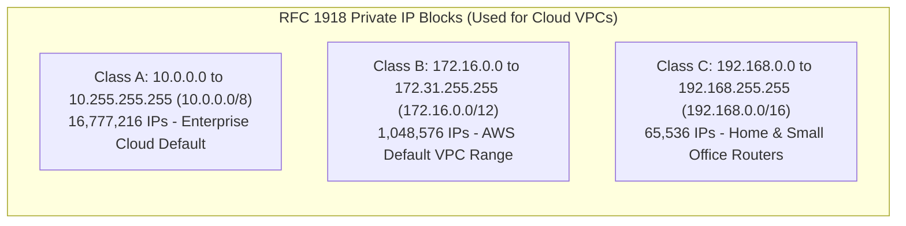
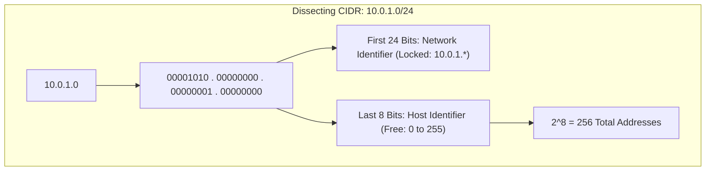
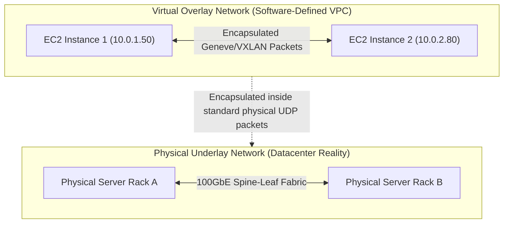
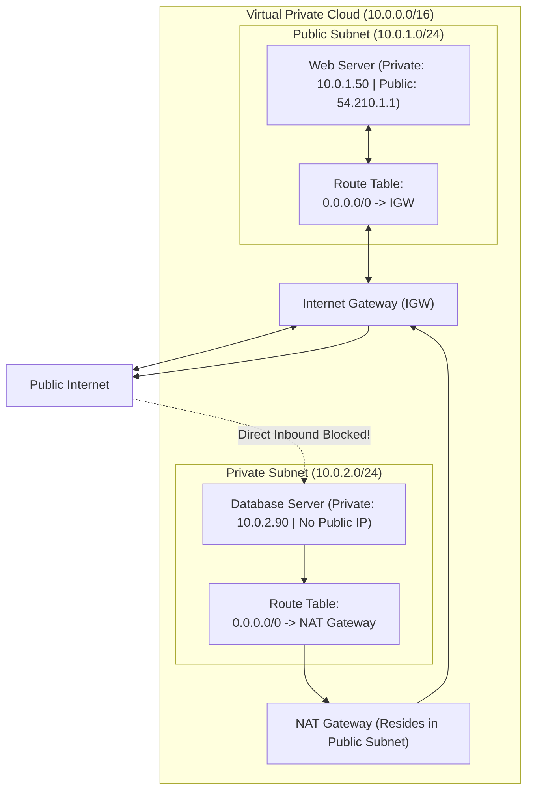
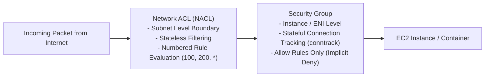
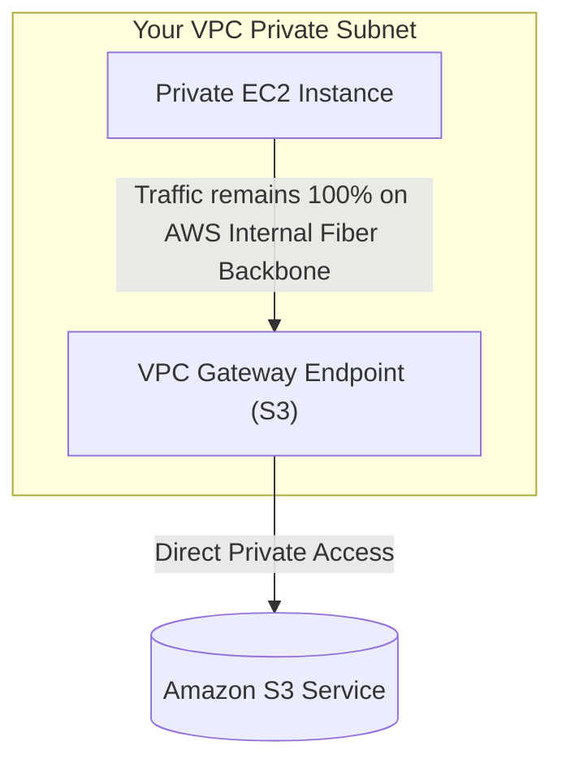

# Aux 01: Computer Networking & VPC Primitives

Before launching cloud virtual machines or setting up multi-tier architectures, you must understand the foundational networking protocols that dictate how packets traverse physical and virtual wires.

---

## 1. IP Addressing & The RFC 1918 Standard

An **IP address** is a logical numerical label assigned to every device connected to a computer network that uses the Internet Protocol for communication.

### 1.1 IPv4 vs. IPv6
- **IPv4 (32-bit)**: Formatted as 4 octets separated by dots (e.g., `192.0.2.1`). Total address space is $2^{32} \approx 4.29\text{ billion}$ addresses. Because the internet exhausted IPv4 addresses, private addressing and NAT became mandatory.
- **IPv6 (128-bit)**: Formatted as 8 groups of 4 hexadecimal digits separated by colons (e.g., `2001:0db8:85a3::8a2e:0370:7334`). Total address space is $2^{128} \approx 3.4 \times 10^{38}$ addresses, ensuring every device on Earth can have a unique public address.

### 1.2 Public vs. Private IPs (RFC 1918)
- **Public IP**: Globally unique and routable across the public internet. Controlled and assigned by IANA/regional registries.
- **Private IP (RFC 1918)**: Non-routable on the public internet. Reserved specifically for private local area networks (LANs) and cloud virtual networks. Internet routers immediately drop packets destined for RFC 1918 ranges.

---

## 2. CIDR Notation & Subnet Calculation Math

**CIDR (Classless Inter-Domain Routing)** replaced old rigid IP classes with a flexible prefix representing the number of fixed network bits:

$$\text{IP Address} \quad / \quad \text{Prefix Length}$$

$$\text{Host Bits} = 32 - \text{Prefix Length}$$
$$\text{Total IP Addresses} = 2^{(32 - \text{Prefix})}$$

### 2.1 Common Cloud CIDR Sizes
- `/16`: $32 - 16 = 16\text{ host bits} \implies 2^{16} = \mathbf{65{,}536\text{ IPs}}$ (Standard AWS VPC size).
- `/24`: $32 - 24 = 8\text{ host bits} \implies 2^8 = \mathbf{256\text{ IPs}}$ (Standard Subnet size).
- `/28`: $32 - 28 = 4\text{ host bits} \implies 2^4 = \mathbf{16\text{ IPs}}$ (Smallest allowed AWS VPC subnet).

### 2.2 The 5 Reserved IPs in Every AWS Subnet
When you allocate a `/24` subnet ($256$ total IPs) in AWS, you **only get 251 usable IPs**. AWS reserves the first 4 and the last 1 address for internal infrastructure:

| Reserved IP (e.g., in `10.0.1.0/24`) | Architectural Purpose in AWS |
| :--- | :--- |
| `10.0.1.0` | **Network Address**: Identifies the subnet boundary; cannot be assigned to an instance. |
| `10.0.1.1` | **VPC Router**: The default virtual gateway for the subnet routing table. |
| `10.0.1.2` | **AmazonProvidedDNS / Route 53 Resolver**: Internal DNS server mapping private hostnames. |
| `10.0.1.3` | **Reserved by AWS**: Earmarked for future internal cloud routing capabilities. |
| `10.0.1.255` | **Network Broadcast Address**: Standard TCP/IP broadcast (AWS does not allow broadcast, but reserves it). |

$$\text{Usable IPs in AWS Subnet} = 2^{(32 - \text{Prefix})} - 5$$

---

## 3. What is a VPC Under the Hood? (Software-Defined Networking)

A **Virtual Private Cloud (VPC)** is not a physical room with hardware cables. It is a **Software-Defined Overlay Network (SDN)** running on top of AWS's physical datacenter backbone (the "Underlay").

- **Physical Underlay**: Massive Spine-Leaf Clos network topology connecting physical servers via redundant 100GbE / 400GbE fiber lines.
- **Virtual Overlay**: When your EC2 instance sends an Ethernet frame to `10.0.2.80`, the **AWS Nitro card** on the physical host intercepts the packet, encapsulates it inside an outer packet using **Geneve / VXLAN** headers containing your unique Virtual Network Identifier (VNI), and forwards it across the physical datacenter to the destination host, where it is decapsulated.
- **Isolation Guarantee**: Even if two customers choose the exact same private subnet IP (`10.0.1.50`), their packets have different VNIs in the encapsulation header. They can never intercept or see each other's traffic.

---

## 4. What Actually Makes a Subnet "Public" vs. "Private"?

A common student misconception is that subnets are configured as "public" or "private" when you create them. In reality, **all subnets are created identical**.

> [!IMPORTANT]
> A subnet is **Public** if and only if:
> 1. Its associated Route Table has an explicit default route directing `0.0.0.0/0` to an **Internet Gateway (IGW)**.
> 2. Instances launched inside it receive a **Public IPv4 address**.
>
> If a subnet routes `0.0.0.0/0` to a NAT Gateway, or has no internet route at all, it is **Private**.

---

## 5. Internet Gateway vs. NAT Gateway: The Mechanics

### 5.1 The Internet Gateway (IGW) - 1:1 Stateless NAT
- An Internet Gateway is not a physical appliance or single point of failure; it is a horizontally scaled, redundant software service on the AWS edge.
- **Function**: Performs **Stateless 1-to-1 Network Address Translation (1:1 NAT)**.
  - When an EC2 instance sends a packet out: IGW swaps the source private IP (`10.0.1.50`) with the instance's public IP (`54.210.1.1`) and updates the IP packet header checksum.
  - When an inbound packet arrives: IGW swaps the destination public IP (`54.210.1.1`) back to the private IP (`10.0.1.50`).

### 5.2 The NAT Gateway - Stateful Outbound PAT
Private instances (like backend database servers) frequently need to access the internet to download Linux security patches (`dnf update`) or pull third-party API data, but they must **never** be reachable from inbound internet traffic.
- **Function**: Performs **Stateful Port Address Translation (PAT / Many-to-One NAT)**.
- Multiple private EC2 instances route their outbound internet requests through one shared NAT Gateway.
- The NAT Gateway records outgoing connection sockets in its state table, replaces the source IP with its own single public **Elastic IP**, and forwards the packet to the IGW. When the external server responds, the NAT Gateway routes the response back to the correct internal instance.
- **Inbound Connections Rejected**: An external client on the internet cannot initiate an inbound connection to an instance behind a NAT Gateway.

---

## 6. Route Tables & The Longest Prefix Match Rule

A **Route Table** is a set of rules (routes) that determine where network traffic from your subnet or gateway is directed.

### Example Route Table
| Destination CIDR | Target | Explanation |
| :--- | :--- | :--- |
| `10.0.0.0/16` | `local` | **Default local route**: Any packet destined for another machine in this VPC stays internal. |
| `0.0.0.0/0` | `igw-0a1b2c3d` | **Default internet route**: Any packet destined for anywhere else in the world goes to the IGW. |

### The Longest Prefix Match Rule
If an instance attempts to send a packet to `10.0.1.50`, which route does the kernel pick?
- Route A: `10.0.0.0/16` (Matches first 16 bits).
- Route B: `0.0.0.0/0` (Matches 0 bits).

> [!TIP]
> Routers always select the **most specific route** (the one with the longest subnet mask prefix). Since `/16` is more specific than `/0`, the packet is routed locally within the VPC without ever touching the Internet Gateway.

---

## 7. Security Groups vs. Network ACLs (NACLs)

Understanding the distinction between Security Groups and NACLs is the most common technical interview and practical lab question in cloud security.

| Dimension | Security Group (SG) | Network ACL (NACL) |
| :--- | :--- | :--- |
| **Operating Layer** | **Instance / Virtual NIC Level** (Elastic Network Interface). | **Subnet Boundary Level**. |
| **State Tracking** | **Stateful**: Uses connection tracking (`conntrack`). If an inbound packet is allowed, return outbound traffic is **automatically allowed**, regardless of outbound rules. | **Stateless**: Inbound and outbound traffic must be explicitly and independently permitted. |
| **Rule Types** | **Allow rules only**. Anything not explicitly allowed is implicitly denied. | **Allow AND Deny rules**. |
| **Evaluation Order** | All rules are evaluated simultaneously before making a decision. | Rules are processed **in numerical order** (Rule 100, then 200). The first matching rule applies immediately. |
| **Return Traffic (Ephemeral Ports)** | Handled automatically by the state engine. | You must explicitly allow outbound traffic on **ephemeral ports** (`1024-65535`) so responses can leave! |

---

## 8. VPC Endpoints & AWS PrivateLink

### The Architectural Problem
By default, core AWS managed services like **Amazon S3** and **Amazon DynamoDB** are public cloud services with public IP addresses outside your VPC. If an EC2 instance in a private subnet wants to read files from S3, its packets must exit the private subnet via a NAT Gateway, traverse the public internet to S3, and come back. This introduces:
1. High NAT Gateway data processing fees (\$0.045/GB).
2. Security risks (traffic technically leaves your private VPC boundary).

### The Solution: VPC Endpoints
VPC Endpoints allow private connections between your VPC and supported AWS services without requiring an Internet Gateway or NAT Gateway.

1. **Gateway Endpoints (Free)**: Supported for **Amazon S3** and **Amazon DynamoDB**. Modifies your VPC route table with a direct route pointing to the AWS private storage fabric.
2. **Interface Endpoints (AWS PrivateLink - Paid)**: Deploys an Elastic Network Interface (ENI) with a private IP directly into your subnet for services like KMS, CloudWatch, and Secrets Manager.
