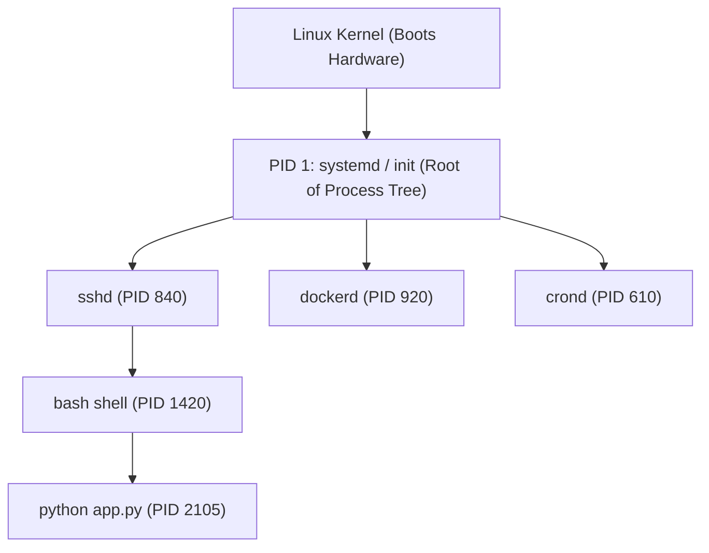
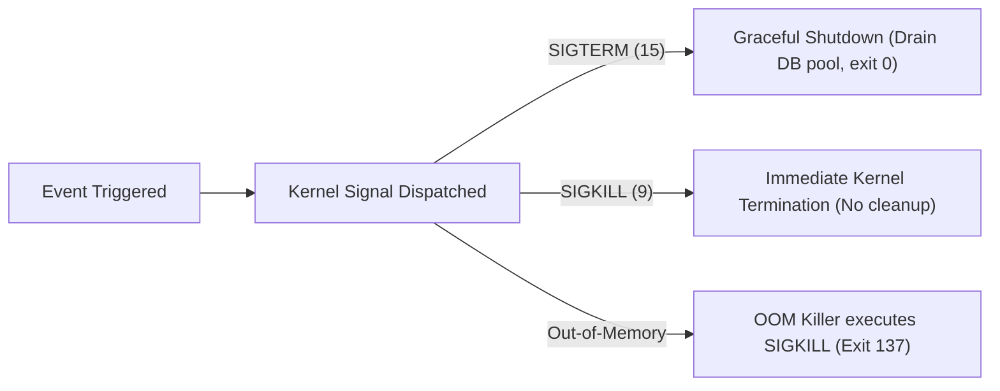
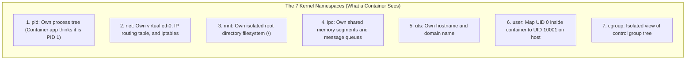
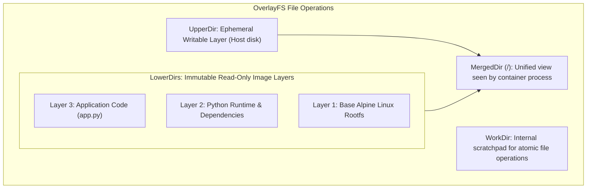
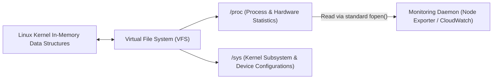

# Aux 02: Linux Operating System & Kernel Primitives

Docker containers and cloud monitoring agents are not self-contained virtual machines; they are ordinary Linux processes governed directly by the Linux kernel. To understand containers, telemetry, and debugging, you must understand kernel internals.

---

## 1. The Linux Process Hierarchy & The `PID 1` Mystery

Every running program on a Linux system is a **process**, identified by an integer called a **Process ID (PID)**. Processes form a tree, rooted at **PID 1**.

### 1.1 The Dual Duties of PID 1 in Linux
1. **Adopting and Reaping Zombie Processes**: When a child process terminates, it leaves behind an exit status in the process table until its parent reads it via `wait()`. If the parent dies first, the child becomes an **orphan**, adopted by `PID 1`. PID 1 must continuously call `wait()` to clear these entries. If PID 1 fails to reap them, the process table fills with "Zombie" processes (`<defunct>`), eventually exhausting system PID capacity.
2. **Handling System Signals**: PID 1 receives shutdown signals (`SIGTERM`, `SIGINT`) and propagates them to child processes.

### 1.2 The "Container Hang" Trap: Why PID 1 in Docker is Different
When you run a container (e.g., `docker run my-python-app`), **your Python script is executed directly as PID 1** inside the container's isolated PID namespace.

> [!WARNING]
> In standard Linux, if a process does not define a custom handler for `SIGTERM`, the kernel applies the **default action**: killing the process.
> **However, for PID 1, the kernel disables default signal actions!**
> If your application (like basic Node.js or Python scripts) does not explicitly catch `SIGTERM`, the signal is ignored. When you execute `docker stop`, Docker sends `SIGTERM`, waits 10 seconds while the container ignores it, and finally issues a brutal `SIGKILL` (Exit 137).
> *Solution*: Use lightweight init wrappers like `tini` or `dumb-init` inside Dockerfiles to act as proper PID 1 signal forwarders.

---

## 2. Linux Signals & Exit Code Arithmetic

Signals are asynchronous notifications sent by the kernel to a process to notify it of an event.

| Signal Name | Number | Can Catch/Block? | Typical Purpose |
| :--- | :--- | :--- | :--- |
| **`SIGHUP`** | 1 | Yes | Hangup. Commonly used to tell daemons (like Prometheus/Nginx) to reload configuration files without restarting. |
| **`SIGINT`** | 2 | Yes | Interrupt from keyboard (`Ctrl + C`). |
| **`SIGKILL`** | 9 | **NO** | Immediate, non-catchable process termination by the kernel. |
| **`SIGTERM`** | 15 | Yes | Graceful termination request. Application should clean up sockets and exit. |

### The Exit Code Formula
When a process terminates due to an unhandled signal, the Linux kernel calculates its exit status using:

$$\text{Exit Code} = 128 + \text{Signal Number}$$

- **Exit Code 143**: $128 + 15\text{ (SIGTERM)} \implies$ Process was gracefully terminated by Docker or Kubernetes.
- **Exit Code 137**: $128 + 9\text{ (SIGKILL)} \implies$ Process was forcefully killed by the kernel, most commonly triggered by the **Linux Out-Of-Memory (OOM) Killer**!
- **Exit Code 130**: $128 + 2\text{ (SIGINT)} \implies$ Process terminated by user typing `Ctrl + C`.

---

## 3. The 7 Linux Namespaces: How Virtualization is Simulated

Namespaces isolate system resources for a collection of processes. A process inside a namespace has its own view of that resource.

### The C Syscalls Powering Containers
Docker does not use hypervisors; it invokes low-level C system calls:
1. **`clone(..., flags)`**: Like `fork()`, but accepts flags like `CLONE_NEWPID | CLONE_NEWNET | CLONE_NEWNS` to create the child process inside brand-new namespaces.
2. **`unshare()`**: Detaches the current process from its inherited parent namespace.
3. **`setns()`**: Attaches a process to an existing namespace (this is how `docker exec -it <container> sh` works under the hood!).

---

## 4. Control Groups (`cgroups`): Resource Throttling & OOM Killer

While namespaces control **visibility** (what a process can see), `cgroups` control **resource consumption** (what a process can use).

### 4.1 CPU CFS Bandwidth Quota Math
Inside `/sys/fs/cgroup/cpu/`:
- `cpu.cfs_period_us`: The scheduling enforcement window (default: $100{,}000\ \mu\text{s} = 100\text{ ms}$).
- `cpu.cfs_quota_us`: The total allowed CPU execution time in that window.

If you specify `docker run --cpus="1.5"`:
$$\text{Quota} = 1.5 \times 100{,}000\ \mu\text{s} = \mathbf{150{,}000\ \mu\text{s}}$$
The Completely Fair Scheduler (CFS) allows the container's processes to run for a total of $150\text{ ms}$ across all cores every $100\text{ ms}$ interval. If it exceeds this, the kernel throttles the process until the next window begins.

### 4.2 Memory Limits & The Out-Of-Memory (OOM) Killer
When a container exceeds its memory limit (e.g., `-m 512m`):
1. The kernel attempts to reclaim memory by flushing filesystem page caches.
2. If memory remains saturated, the kernel's **OOM Killer** routine is invoked.
3. The kernel computes `oom_score` (based on memory percentage consumed vs limit).
4. The process with the highest score is issued an uncatchable `SIGKILL` (Signal 9), producing **Exit Code 137**.

---

## 5. OverlayFS: The Union Mount Filesystem

Docker image layering relies on **OverlayFS**, a Linux kernel filesystem driver that merges multiple directories into a single unified mount point.

### The 3 Core Operations of OverlayFS
1. **Reading a File**: OverlayFS searches from top to bottom (`UpperDir` $\to$ `Layer 3` $\to$ `Layer 2` $\to$ `Layer 1`). The first match found is returned.
2. **Writing to an Existing File (Copy-on-Write)**: If the container attempts to edit `/etc/nginx/nginx.conf` (which lives in read-only `Layer 1`), OverlayFS intercepts the write, copies the file up into the writable `UpperDir`, and modifies the copy. The original image layer remains completely unchanged!
3. **Deleting a File (Whiteout Devices)**: A container cannot delete a file from a read-only lower layer. Instead, OverlayFS creates a **Whiteout character device** (`c 0 0`) in the `UpperDir` with the exact same name. In the `MergedDir`, the whiteout file masks the lower file, making it appear deleted.

---

## 6. The `/proc` and `/sys` Pseudo-Filesystems (Telemetry Engines)

Students frequently ask: *"How does Node Exporter or CloudWatch Agent read CPU and memory without installing kernel drivers?"*

The answer is **Pseudo-Filesystems**: directories generated dynamically in RAM by the Linux kernel. They take zero disk space and act as a window into kernel data structures.

### Key Files Read by Monitoring Daemons
- **/proc/meminfo**: Exposes memory status directly:
  - `MemTotal`: Physical RAM.
  - `MemFree`: Completely unallocated RAM.
  - `MemAvailable`: The true SRE metric—estimates how much memory is available for starting new applications without swapping (accounts for page cache).
- **/proc/stat**: Exposes cumulative CPU jiffies (ticks) spent in `user`, `nice`, `system`, `idle`, `iowait`, `irq`. Prometheus calculates CPU % by taking the delta between two reads:
  $$\text{CPU \%} = 100 \times \left(1 - \frac{\Delta \text{idle}}{\Delta \text{total}}\right)$$
- **/proc/net/dev**: Network interface counters (bytes received, packets dropped, collisions).
- **/proc/diskstats**: Disk I/O read/write sectors and queue time.
