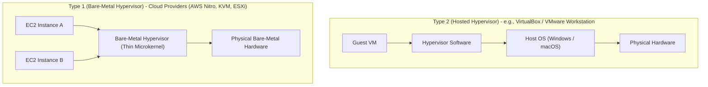
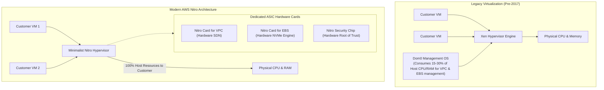
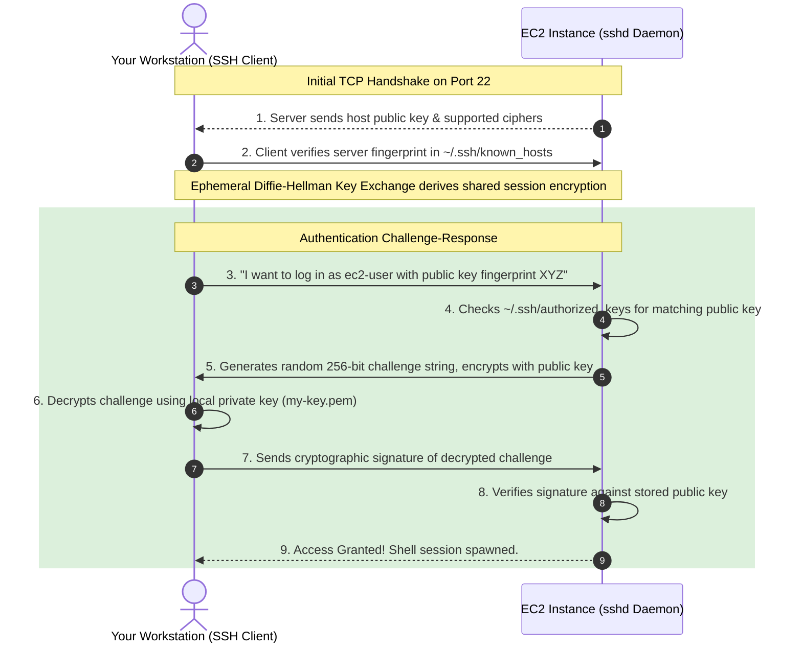
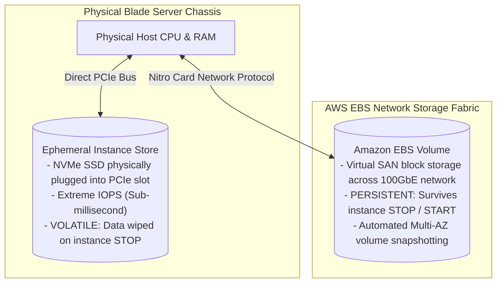

# Aux 03: Cloud Compute, Virtualization & Hypervisors

When you click "Launch EC2 Instance" in AWS, a cascade of hardware abstractions, hypervisor allocations, cryptographic handshakes, and bootstrap daemons execute in seconds. Here is how compute virtualization works under the hood.

---

## 1. Hypervisor Architecture: Type 1 vs. Type 2

Virtualization is the process of partitioning a single physical host computer into multiple isolated virtual machines (VMs) using software called a **Hypervisor** (Virtual Machine Monitor - VMM).



- **Type 2 (Hosted)**: Sits on top of an ordinary operating system. Every I/O request must travel through the Guest OS $\to$ Hypervisor $\to$ Host OS $\to$ Hardware, introducing significant performance overhead. Used for desktop testing.
- **Type 1 (Bare-Metal)**: Sits directly on bare-metal hardware. Leverages hardware CPU virtualization rings (**Intel VT-x / AMD-V / Ring -1**). Virtual machines execute hardware instructions directly on the physical CPU without software emulation. Used by all enterprise clouds.

---

## 2. The AWS Nitro System Revolution

In the early days of AWS, physical EC2 servers ran the open-source **Xen** hypervisor.



### Why Nitro Changed Cloud Economics
- **Elimination of Host Tax**: Previously, $15\% - 30\%$ of a physical server's CPU and RAM was reserved for AWS's internal management processes (encryption, EBS packet routing, VPC encapsulation). With Nitro, all networking, storage, and management tasks are offloaded to **custom PCI-e ASIC hardware expansion cards**.
- **100% Performance Delivery**: The host server's physical CPU and RAM are delivered $100\%$ to customer virtual machines.
- **Bare-Metal Instances**: Because the hypervisor was reduced to microscopic size, AWS was able to offer `*.metal` instances where customers run raw operating systems directly on the motherboard while Nitro handles networking and storage via PCIe.

---

## 3. The Instance Metadata Service (IMDS) & Link-Local IP `169.254.169.254`

Every EC2 instance has access to a built-in HTTP server at `http://169.254.169.254/latest/meta-data/`.

### What is `169.254.169.254`?
In networking, `169.254.0.0/16` is an **IPv4 Link-Local address block (RFC 3927)**. Link-local packets are **strictly non-routable**—routers will never forward them across networks. In AWS, this IP communicates directly with the local Nitro card/hypervisor on the physical motherboard hosting your instance.

### IMDSv1 vs. IMDSv2 (The Capital One Breach Mitigation)
- **IMDSv1 (Vulnerable)**: Relied on simple HTTP `GET` requests:
  ```bash
  curl http://169.254.169.254/latest/meta-data/iam/security-credentials/<role-name>
  ```
  *The Threat*: In a **Server-Side Request Forgery (SSRF)** attack, an attacker tricks a vulnerable web application into making a backend HTTP request to `169.254.169.254`, dumping the instance's temporary IAM security keys directly to the attacker.
- **IMDSv2 (Session-Oriented Security)**: Requires a **two-step token-based flow**:
  ```bash
  # Step 1: Request a session token via PUT (Token TTL = 6 hours)
  TOKEN=$(curl -s -X PUT "http://169.254.169.254/latest/api/token" \
      -H "X-aws-ec2-metadata-token-ttl-seconds: 21600")

  # Step 2: Use the token in an HTTP GET request
  curl -s -H "X-aws-ec2-metadata-token: $TOKEN" \
      http://169.254.169.254/latest/meta-data/instance-id
  ```
  *Security Guarantee*: Most basic SSRF attacks can only send simple `GET` requests and cannot forge arbitrary HTTP `PUT` requests or inject custom request headers (`X-aws-ec2-metadata-token`), rendering SSRF attacks against IMDSv2 ineffective.

---

## 4. SSH & Asymmetric Public Key Cryptography

When you connect to an EC2 instance using:
```bash
ssh -i my-key.pem ec2-user@54.210.12.34
```
What is happening mathematically?



### Why `chmod 400 my-key.pem` is Mandatory
The SSH client enforces strict security checks on the private key file. If other users on your local machine could read the file (`chmod 644` or `chmod 777`), the SSH client aborts with:
```text
@@@@@@@@@@@@@@@@@@@@@@@@@@@@@@@@@@@@@@@@@@@@@@@@@@@@@@@@@@@
@         WARNING: UNPROTECTED PRIVATE KEY FILE!          @
@@@@@@@@@@@@@@@@@@@@@@@@@@@@@@@@@@@@@@@@@@@@@@@@@@@@@@@@@@@
Permissions 0644 for 'my-key.pem' are too open.
```
Running `chmod 400` restricts read access strictly to the file owner (`-r--------`), satisfying the SSH client's security policy.

---

## 5. Bootstrapping with `cloud-init` & User Data

When you paste a bash script into the EC2 **User Data** field, how does it execute?

### The `cloud-init` Architecture
`cloud-init` is an open-source, industry-standard package installed in virtually all cloud Linux AMIs (Amazon Linux, Ubuntu, RHEL, Debian).
1. **Early Boot**: The instance boots the Linux kernel.
2. **Metadata Fetch**: `cloud-init` queries the local link-local metadata service (`http://169.254.169.254/latest/user-data/`) and downloads your User Data script.
3. **Execution**: On the **first instance boot only**, `cloud-init` executes the script as the `root` superuser.
4. **Logging**: All standard output and error messages generated by the script are logged to:
   ```bash
   cat /var/log/cloud-init-output.log
   ```

> [!TIP]
> If an EC2 instance boots successfully but your web server or application fails to start, **always inspect `/var/log/cloud-init-output.log` first**. 99% of bootstrap errors are syntax mistakes or package download failures captured in this log file.

---

## 6. Cloud Storage Primitives: EBS vs. Instance Store

Virtual compute requires storage, but cloud storage comes in two distinct physical paradigms:



| Dimension | Amazon Elastic Block Store (EBS) | Ephemeral Instance Store |
| :--- | :--- | :--- |
| **Physical Architecture** | **Network-Attached Virtual Disk**: Resides on independent storage servers connected via redundant network fabric. | **Direct-Attached Physical NVMe**: Physically mounted inside the host server chassis. |
| **Data Persistence** | **Persistent**: Data remains intact when the EC2 instance is stopped or restarted. | **Ephemeral (Volatile)**: Data is **permanently destroyed** if the instance is stopped or hardware fails. |
| **Performance** | High, but bounded by network bandwidth (`gp3`: 3,000 baseline IOPS up to 16,000 IOPS). | **Extreme**: Millions of IOPS with sub-millisecond latencies. |
| **Ideal Use Case** | OS boot drives, relational databases, stateful microservices. | High-speed scratch disks, in-memory cache buffers (Redis), video rendering scratchpads. |
