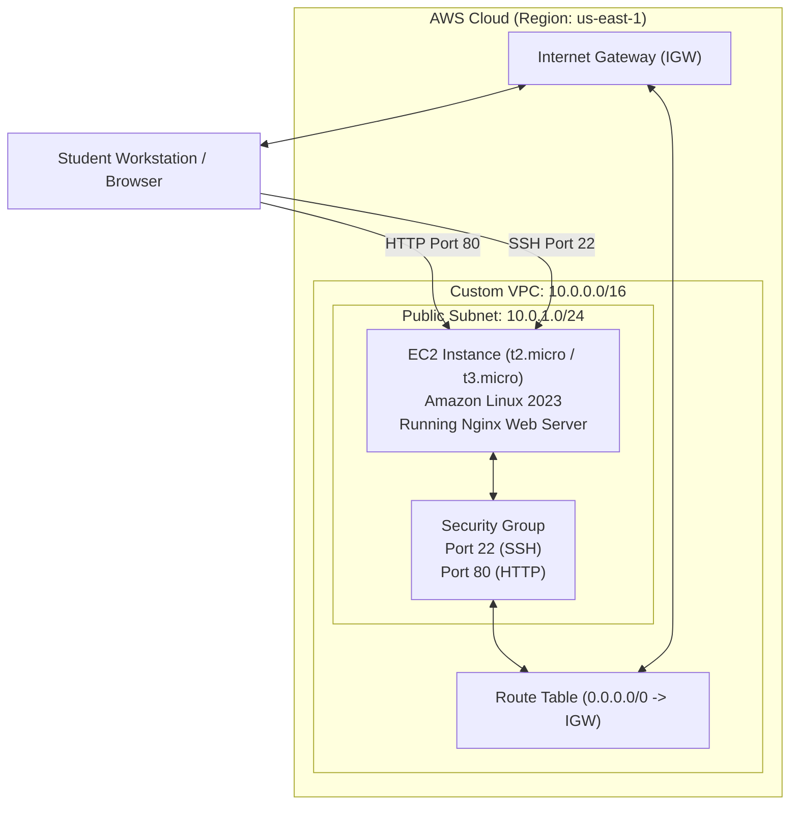
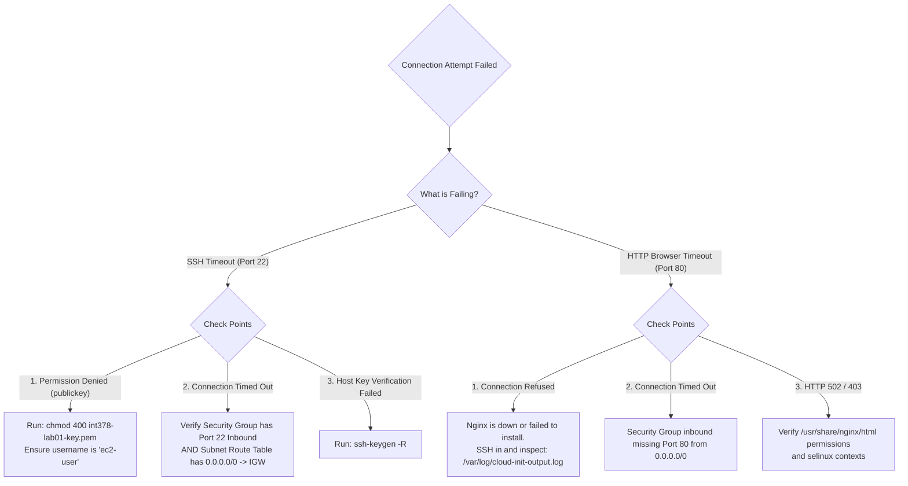

# Lab 01: AWS EC2, VPC, Security Groups & Web Server Deployment

**Course Outcome Alignment:** CO1, CO2, CO3  
**Target Environment:** AWS Free Tier / AWS Academy Learner Lab  
**Estimated Run Time:** 45 minutes  
**Cost Warning:** Free-tier eligible (`t2.micro` or `t3.micro`). Always terminate instance after the lab.

---

## 1. Architectural Blueprint

In this experiment, you will construct a basic cloud infrastructure architecture: creating a Virtual Private Cloud (VPC), attaching an Internet Gateway, setting up a public subnet with a route table, configuring a Security Group (stateful firewall), launching an Amazon Linux 2023 EC2 instance, and deploying an Nginx web server.



---

## 2. Theoretical Concepts Covered

1. **Virtual Private Cloud (VPC)**: A logically isolated virtual network dedicated to your AWS account. It gives you complete control over IP address ranges, subnets, route tables, and network gateways.
2. **Security Groups vs. NACLs**:
   - **Security Group (SG)**: Operates at the **Instance Level**. It is **stateful** (if inbound traffic is allowed, outbound response is automatically permitted regardless of outbound rules).
   - **Network ACL (NACL)**: Operates at the **Subnet Level**. It is **stateless** (inbound and outbound rules must be explicitly permitted).
3. **EC2 User Data**: A bootstrap shell script executed once as `root` during the first instance boot. Perfect for installing packages, configuring services, and deploying code automatically.

---

## 3. Student Account Considerations & Safeguards

- Choose `t2.micro` (or `t3.micro` where `t2.micro` is unavailable).
- Select **General Purpose SSD (gp3)** with a size of **8 GB** to remain well within the 30 GB monthly EBS limit.
- **Do not** allocate Elastic IPs for simple testing; use the dynamic public IPv4 address assigned automatically by the public subnet.

---

## 4. Step-by-Step Implementation Guide

### Step 1: Create a Key Pair
Before launching an instance, create an SSH key pair to authenticate securely:
```bash
# Using AWS CLI
aws ec2 create-key-pair \
    --key-name int378-lab01-key \
    --query "KeyMaterial" \
    --output text > int378-lab01-key.pem

# Set appropriate permissions (Linux/macOS)
chmod 400 int378-lab01-key.pem

# On Windows PowerShell:
# Keep the .pem file secure in your user directory
```

### Step 2: Configure Networking (VPC, Subnet, IGW)
If using the Default VPC, you can skip to Step 3. To build a custom VPC:
```bash
# 1. Create VPC
VPC_ID=$(aws ec2 create-vpc --cidr-block 10.0.0.0/16 --query "Vpc.VpcId" --output text)
aws ec2 create-tags --resources $VPC_ID --tags Key=Name,Value=int378-vpc

# 2. Create Internet Gateway and attach to VPC
IGW_ID=$(aws ec2 create-internet-gateway --query "InternetGateway.InternetGatewayId" --output text)
aws ec2 attach-internet-gateway --vpc-id $VPC_ID --internet-gateway-id $IGW_ID

# 3. Create Public Subnet
SUBNET_ID=$(aws ec2 create-subnet --vpc-id $VPC_ID --cidr-block 10.0.1.0/24 --availability-zone us-east-1a --query "Subnet.SubnetId" --output text)

# 4. Create Route Table and route all traffic (0.0.0.0/0) to IGW
RTB_ID=$(aws ec2 create-route-table --vpc-id $VPC_ID --query "RouteTable.RouteTableId" --output text)
aws ec2 create-route --route-table-id $RTB_ID --destination-cidr-block 0.0.0.0/0 --gateway-id $IGW_ID
aws ec2 associate-route-table --subnet-id $SUBNET_ID --route-table-id $RTB_ID

# 5. Enable auto-assign public IP on the subnet
aws ec2 modify-subnet-attribute --subnet-id $SUBNET_ID --map-public-ip-on-launch
```

### Step 3: Create and Configure Security Group
```bash
# Create Security Group
SG_ID=$(aws ec2 create-security-group \
    --group-name int378-web-sg \
    --description "Allow SSH and HTTP traffic" \
    --vpc-id $VPC_ID \
    --query "GroupId" --output text)

# Allow Inbound SSH (Port 22) - Best practice: restrict to your IP
aws ec2 authorize-security-group-ingress \
    --group-id $SG_ID \
    --protocol tcp \
    --port 22 \
    --cidr 0.0.0.0/0

# Allow Inbound HTTP (Port 80)
aws ec2 authorize-security-group-ingress \
    --group-id $SG_ID \
    --protocol tcp \
    --port 80 \
    --cidr 0.0.0.0/0
```

### Step 4: Launch EC2 Instance with User Data Bootstrap
Create a bootstrap script named `userdata.sh`:
```bash
cat << 'EOF' > userdata.sh
#!/bin/bash
dnf update -y
dnf install -y nginx
systemctl enable nginx
systemctl start nginx

cat << 'HTML' > /usr/share/nginx/html/index.html
<!DOCTYPE html>
<html>
<head>
    <title>INT378 Cloud Lab 01</title>
    <style>
        body { font-family: Arial, sans-serif; text-align: center; margin-top: 50px; background: #f4f6f9; }
        .card { background: white; max-width: 600px; margin: auto; padding: 30px; border-radius: 10px; box-shadow: 0 4px 6px rgba(0,0,0,0.1); }
        h1 { color: #232f3e; }
        p { color: #555; }
        .tag { background: #ff9900; color: white; padding: 5px 10px; border-radius: 4px; font-weight: bold; }
    </style>
</head>
<body>
    <div class="card">
        <h1>INT378: Advancements in Cloud and DevOps</h1>
        <p class="tag">Lab 01: Successful Deployment</p>
        <p>Instance provisioned via AWS EC2 & Nginx Web Server.</p>
        <p>Hostname: $(hostname -f)</p>
    </div>
</body>
</html>
HTML
EOF
```

Launch the instance:
```bash
# Query latest Amazon Linux 2023 AMI
AMI_ID=$(aws ssm get-parameter --name /aws/service/ami-amazon-linux-latest/al2023-ami-kernel-default-x86_64 --query "Parameter.Value" --output text)

# Launch Instance
INSTANCE_ID=$(aws ec2 run-instances \
    --image-id $AMI_ID \
    --instance-type t2.micro \
    --key-name int378-lab01-key \
    --security-group-ids $SG_ID \
    --subnet-id $SUBNET_ID \
    --user-data file://userdata.sh \
    --tag-specifications 'ResourceType=instance,Tags=[{Key=Name,Value=int378-web-server}]' \
    --query "Instances[0].InstanceId" --output text)

echo "Launched Instance: $INSTANCE_ID"
```

---

## 5. Verification & Testing Checklist

1. **Verify Instance Running State**:
   ```bash
   aws ec2 describe-instances --instance-ids $INSTANCE_ID \
       --query "Reservations[0].Instances[0].[State.Name,PublicIpAddress]" --output table
   ```
2. **Access via Browser**:
   - Copy the `PublicIpAddress` into your browser: `http://<YOUR_PUBLIC_IP>`
   - Verify the custom HTML greeting renders.
3. **Connect via SSH**:
   ```bash
   ssh -i int378-lab01-key.pem ec2-user@<YOUR_PUBLIC_IP>
   ```
   - Check Nginx status:
     ```bash
     systemctl status nginx
     ```

### 5.1 Connectivity Troubleshooting Decision Engine



#### Diagnostic Commands
```bash
# Check bootstrap script execution log
sudo cat /var/log/cloud-init-output.log

# Verify Nginx listening socket on port 80
sudo ss -tulpn | grep :80

# Verify security group ingress rules
aws ec2 describe-security-groups --group-ids $SG_ID --query "SecurityGroups[0].IpPermissions"
```

---

## 6. Teardown & Cleanup Checklist

> [!CAUTION]
> Always terminate resources immediately after completing the verification.

```bash
# 1. Terminate the EC2 instance
aws ec2 terminate-instances --instance-ids $INSTANCE_ID

# 2. Wait for instance to terminate completely
aws ec2 wait instance-terminated --instance-ids $INSTANCE_ID

# 3. Delete Security Group
aws ec2 delete-security-group --group-id $SG_ID

# 4. Detach and delete Internet Gateway
aws ec2 detach-internet-gateway --internet-gateway-id $IGW_ID --vpc-id $VPC_ID
aws ec2 delete-internet-gateway --internet-gateway-id $IGW_ID

# 5. Delete Subnet and VPC
aws ec2 delete-subnet --subnet-id $SUBNET_ID
aws ec2 delete-vpc --vpc-id $VPC_ID

# 6. Delete Key Pair
aws ec2 delete-key-pair --key-name int378-lab01-key
rm -f int378-lab01-key.pem userdata.sh
```

---

## 7. Viva Voce & Interview Questions

1. **What is the difference between a Security Group and a Network Access Control List (NACL)?**
   - *Answer*: Security Groups operate at the instance/NIC level and are stateful. NACLs operate at the subnet boundary and are stateless.
2. **Why do we need an Internet Gateway attached to a VPC?**
   - *Answer*: A VPC is an isolated network. An Internet Gateway performs Network Address Translation (1:1 NAT) between the instance's private IPv4 and its allocated public IPv4 address, and routes packets to the Internet.
3. **What is EC2 User Data and at what stage of the lifecycle does it run?**
   - *Answer*: It is an initialization script executed by `cloud-init` with root privileges on the first boot cycle of the EC2 instance.
