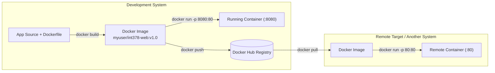

---
title: "Lab 04: Docker Architecture, Containerization & Docker Hub Lifecycle"
course: "INT378: Advancements in Cloud and DevOps"
category: "practical-lab"
lab_number: 4
portion: "Portion 1: Core Cloud Compute & Containers"
hub: "[[INT378 Master Strategy & Curriculum Roadmap]]"
previous_lab: "[[Lab 03 - AWS CloudFormation Templates, Stacks & Rollbacks]]"
next_lab: "[[Lab 05 - Terraform IaC (EC2, S3 & State Management)]]"
companion_theory:
  - "[[Unit 1 - Advanced Cloud Infrastructure & Services]]"
course_outcomes:
  - "CO1"
  - "CO2"
  - "CO5"
code_directory: "01 - Cloud Fundamentals, Linux & Containers/code/lab04-docker"
target_environment: "Local Docker Engine / Linux CLI"
cost_profile: "$0.00 (Local Docker & Docker Hub Free Plan)"
estimated_duration: "40m"
tools_used:
  - "Docker CLI"
  - "Docker Hub"
  - "Python Flask"
  - "Multi-Stage Dockerfile"
teardown_required: false
verification_status: "ready"
tags:
  - int378/lab-04
  - docker
  - containers
  - docker-hub
  - multi-stage-build
last_updated: 2026-11-03
---

# Lab 04: Docker Architecture, Containerization & Docker Hub Lifecycle

**Course Outcome Alignment:** CO1, CO2, CO5  
**Target Environment:** Local Machine (Docker Desktop / Docker CLI) OR Cloud EC2 Runner  
**Estimated Run Time:** 40 minutes  
**Cost:** \$0.00 (Docker Engine and Docker Hub are free)  
**Code Location:** `01 - Cloud Fundamentals, Linux & Containers/code/lab04-docker/`

---

## 1. Architectural Blueprint

In this experiment, you will containerize a web application using an optimized multi-stage `Dockerfile`, enforce security best practices (non-root user), execute the full container lifecycle, expose and test networking ports, and distribute the image across environments via Docker Hub.



---

## 2. Concept & Theoretical Foundations

1. **Docker Image Layers**: A read-only template composed of stacked filesystem layers. Every instruction in a `Dockerfile` (`FROM`, `RUN`, `COPY`) creates an immutable layer cached by Docker.
2. **Multi-Stage Builds**: Drastically reduces final image footprint and security vulnerabilities by using heavy compiler environments only in the build stage, copying only the final binary into a lightweight, stripped runtime image.
3. **Container Port Mapping (`-p host:container`)**: Containers run in their own network namespace with private bridge IPs (e.g., `172.17.0.2`). Port forwarding binds a host port (e.g., `8080`) to the container's listening port (e.g., `80`).
4. **Volume Persistence vs. Ephemeral Containers**: Containers are disposable. Data written to the container layer is deleted upon container removal unless persisted to Docker Volumes or Bind Mounts.

---

## 3. Step-by-Step Implementation Guide

### Step 1: Prepare the Web Application Source Code
Navigate to `01 - Cloud Fundamentals, Linux & Containers/code/lab04-docker/` where you will find:
- `app.py`: A lightweight Python Flask web application.
- `requirements.txt`: Dependencies (`flask`).
- `Dockerfile`: Multi-stage build manifest.
- `.dockerignore`: Excludes unnecessary local files (`.git`, `__pycache__`).

### Step 2: Build the Docker Image
From the `01 - Cloud Fundamentals, Linux & Containers/code/lab04-docker/` directory:
```bash
# Build the image with a local tag
docker build -t int378-webapp:1.0 .

# Verify image creation and size
docker images | grep int378-webapp
```
*Notice how using Alpine Linux keeps the final image footprint under 60 MB!*

### Step 3: Container Lifecycle Operations

```bash
# 1. Run container in detached mode (-d) with port forwarding (-p 8080:5000)
docker run -d --name int378-container -p 8080:5000 int378-webapp:1.0

# 2. Inspect running containers
docker ps

# 3. View live application logs
docker logs int378-container

# 4. Execute a command inside the running container (White-box inspection)
docker exec -it int378-container sh -c "id && ps aux"
# Notice that the process runs as non-root UID 1001!

# 5. Test container responsiveness
curl http://localhost:8080

# 6. Pause and unpause container
docker pause int378-container
# (Requests to http://localhost:8080 will now freeze/hang)
docker unpause int378-container
# (Requests respond immediately)

# 7. Stop container gracefully (sends SIGTERM, then SIGKILL after 10s)
docker stop int378-container

# 8. Restart container
docker start int378-container
```

### Step 4: Tag and Push Image to Docker Hub

1. Log in to Docker Hub:
   ```bash
   docker login -u <YOUR_DOCKERHUB_USERNAME>
   ```
2. Tag the image with your Docker Hub repository prefix:
   ```bash
   docker tag int378-webapp:1.0 <YOUR_DOCKERHUB_USERNAME>/int378-webapp:v1.0
   ```
3. Push image layers to Docker Hub:
   ```bash
   docker push <YOUR_DOCKERHUB_USERNAME>/int378-webapp:v1.0
   ```

### Step 5: Pull and Verify on a Second System
Simulate a secondary system by removing local images or pulling on an EC2 instance:
```bash
# Remove local image copies to test clean pull
docker stop int378-container
docker rm int378-container
docker rmi int378-webapp:1.0 <YOUR_DOCKERHUB_USERNAME>/int378-webapp:v1.0

# Pull freshly pushed image from Docker Hub
docker pull <YOUR_DOCKERHUB_USERNAME>/int378-webapp:v1.0

# Run pulled image
docker run -d --name remote-test-app -p 8080:5000 <YOUR_DOCKERHUB_USERNAME>/int378-webapp:v1.0

# Verify
curl http://localhost:8080
```

---

## 4. Verification Checklist

- [ ] `docker ps` confirms container status is `Up`.
- [ ] Non-root execution confirmed via `docker exec int378-container id` returning `uid=1001(appuser)`.
- [ ] Image publicly visible on your Docker Hub web dashboard.
- [ ] HTTP response returns `{"status": "healthy", "course": "INT378"}`.

---

## 5. Teardown & Cleanup Checklist

```bash
# Stop and remove running container
docker stop remote-test-app
docker rm remote-test-app

# Prune unused images and build cache
docker rmi <YOUR_DOCKERHUB_USERNAME>/int378-webapp:v1.0
docker system prune -f
```

---

## 6. Viva Voce & Interview Questions

1. **What is the difference between `CMD` and `ENTRYPOINT` in a Dockerfile?**
   - *Answer*: `ENTRYPOINT` specifies the core binary that should always run when the container starts. `CMD` provides default arguments to that binary, which can easily be overridden by CLI arguments.
2. **Why should you avoid running containers as the `root` user?**
   - *Answer*: If an attacker executes a container breakout via a Linux kernel exploit or misconfigured volume mount, they will automatically obtain `root` privileges on the host operating system.
3. **What is the purpose of `.dockerignore`?**
   - *Answer*: It prevents sensitive files (`.env`, private keys), huge directories (`node_modules`), and build artifacts from being sent to the Docker daemon build context, speeding up builds and preventing secret leaks.
