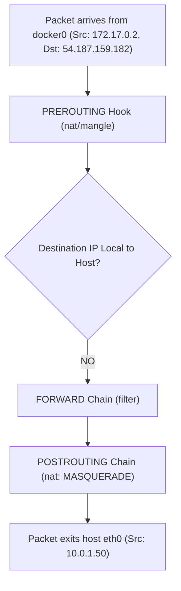
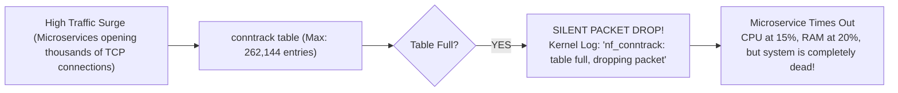
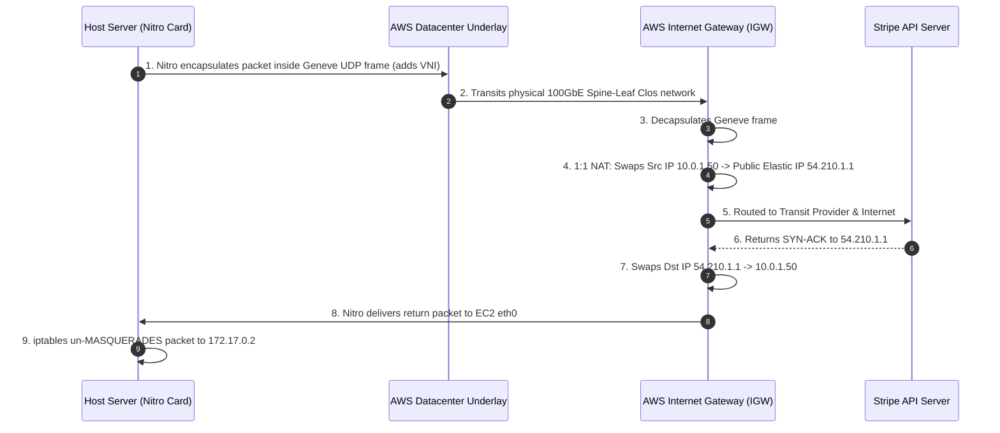
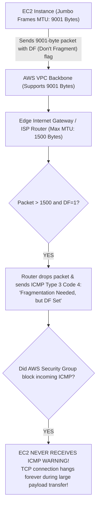
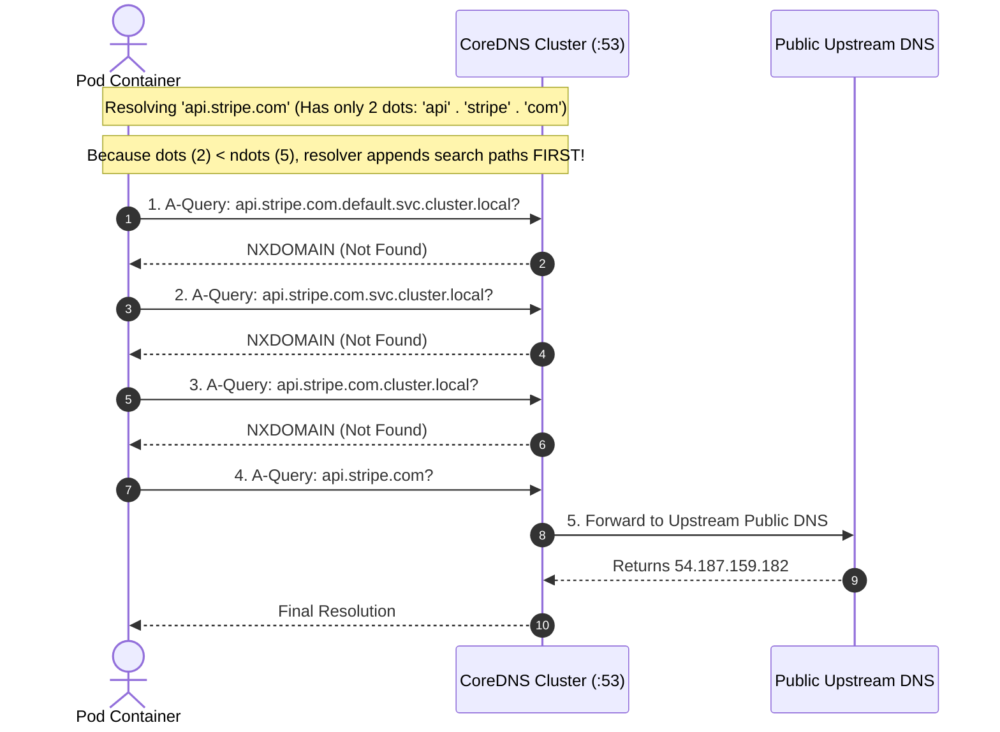

# Rabbit Hole 01: The Life of a Packet (From Container to Internet and Back)

When a microservice inside a Docker container executes:
```python
requests.get("https://api.stripe.com/v1/charges")
```
It looks like a simple one-line API call. In reality, that single line triggers a multi-stage packet journey traversing virtual cables, kernel netfilter hooks, state-tracking memory tables, Geneve encapsulation, and MTU boundary negotiations.

Here is the exact, unvarnished journey of that packet.

---

## 1. Stage 1: Escaping the Container (The `veth` Pair)

The container process lives inside its own **Network Namespace (`netns`)**. It has its own private loopback interface (`lo`), a private `eth0` interface with IP `172.17.0.2`, and its own isolated routing table.

```mermaid
flowchart LR
    subgraph ContainerNS["Container Network Namespace (netns)"]
        App["App Process (curl / python)"] -->|"Writes to socket"| C_Eth0["eth0 (172.17.0.2)"]
    end

    subgraph HostNS["Host Root Network Namespace"]
        Veth["veth4a9b (Peer Interface)"]
        Bridge["docker0 (Virtual Linux Bridge / Switch)"]
        Host_Eth0["eth0 (Host Physical / Nitro NIC: 10.0.1.50)"]
    end

    C_Eth0 <===="Virtual Ethernet Cable (veth pair)"====> Veth
    Veth --- Bridge
    Bridge -.->|"Layer 3 Routing"| Host_Eth0
```

1. **The Virtual Ethernet Pair (`veth`)**:
   - When Docker creates a container, it creates a pair of connected virtual network interfaces using the Linux kernel driver `veth`.
   - Think of a `veth` pair as a **virtual Cat6 Ethernet cable**: one end is plugged into the container's namespace as `eth0`, and the other end (`veth4a9b...`) remains in the host's root namespace, plugged into the software bridge **`docker0`**.
2. **Container Routing Table Lookup**:
   - The application writes bytes to a TCP socket destined for `api.stripe.com` (`54.187.159.182`).
   - The container kernel checks its local routing table (`ip route`):
     ```text
     default via 172.17.0.1 dev eth0
     ```
   - Because the target IP is outside `172.17.0.0/16`, the packet is addressed to the MAC address of the default gateway (`172.17.0.1` - the `docker0` bridge) and transmitted across the `veth` cable.

---

## 2. Stage 2: The Netfilter & `iptables` Gauntlet

The packet arrives on the host bridge `docker0`. The host operating system recognizes that the packet is destined for an IP address outside the local bridge. The Linux kernel's **Netfilter** architecture intercepts the packet.



### The Source NAT (`MASQUERADE`) Transformation
1. The packet enters the **FORWARD** chain. Docker configures iptables rules allowing forwarded traffic from `docker0` to the external interface.
2. The packet enters the **POSTROUTING** chain in the `nat` table:
   ```bash
   iptables -t nat -A POSTROUTING -s 172.17.0.0/16 ! -o docker0 -j MASQUERADE
   ```
3. **What MASQUERADE Does**:
   - The private RFC 1918 container IP (`172.17.0.2`) cannot travel onto the VPC network.
   - The kernel rewrites the IP header:
     - **Original**: `Src: 172.17.0.2:48912` $\to$ `Dst: 54.187.159.182:443`
     - **Translated**: `Src: 10.0.1.50:52110` $\to$ `Dst: 54.187.159.182:443`
   - The kernel writes this translation into its memory table called **`conntrack`**.

---

## 3. Stage 3: The `conntrack` Table Overflow Disaster

Every single stateful firewall (Security Groups, iptables, Kubernetes service proxies) relies on the Linux kernel's **Connection Tracking (`nf_conntrack`)** module.

```text
# Reading the conntrack table:
$ cat /proc/net/nf_conntrack
ipv4 2 tcp 6 431999 ESTABLISHED src=172.17.0.2 dst=54.187.159.182 sport=48912 dport=443 src=54.187.159.182 dst=10.0.1.50 sport=443 dport=52110 [ASSURED] mark=0 use=2
```

### The Production Nightmare: Table Full
The connection tracking table has a hard limit set by `net.netfilter.nf_conntrack_max`.



> [!CAUTION]
> **Staff Engineer Interview War Story**:
> *"Our microservices were failing with connection timeouts during a Black Friday traffic surge, but CPU, memory, and disk were completely healthy. Why?"*
> **Answer**: `nf_conntrack` table saturation. High connection churn filled the conntrack table. The kernel silently dropped new SYN packets before they could even hit iptables!
> - *Immediate Diagnostic*: `dmesg -T | grep "nf_conntrack: table full"`
> - *Fix*: Increase table size (`sysctl -w net.netfilter.nf_conntrack_max=1048576`) and reduce stale connection timeouts (`sysctl -w net.netfilter.nf_conntrack_tcp_timeout_established=600`).

---

## 4. Stage 4: VPC Nitro Encapsulation & The Internet Gateway

The packet leaves the host OS network interface `eth0` with:
- `Src IP`: `10.0.1.50` (VPC Private IP)
- `Dst IP`: `54.187.159.182` (Stripe Public IP)



---

## 5. Stage 5: Path MTU Discovery (PMTUD) & Black-Hole Dropped Connections

This is one of the most insidious network bugs in cloud computing.



### The Mechanics of the PMTUD Black Hole
1. Inside an AWS VPC, instances support **Jumbo Frames (MTU 9001 bytes)**.
2. The public internet strictly enforces standard Ethernet **MTU (1500 bytes)**.
3. When sending small packets (like the initial 64-byte TCP handshake), everything works perfectly.
4. When the server attempts to transmit a large 8 KB HTTP payload, it sets the IP header flag **`DF` (Don't Fragment)**.
5. The edge router cannot forward a 9001-byte packet onto a 1500-byte link. It drops the packet and sends an **ICMP Type 3, Code 4** error message back to the sender containing the maximum allowed MTU (`Next-Hop MTU: 1500`).
6. **The Fatal Security Group Mistake**: If a junior DevOps engineer configured the Security Group to allow only Port 80 and 443 while blocking all ICMP traffic, **the ICMP notification is dropped by the firewall**!
7. The sender never learns that the packet was too large. It keeps retrying the 9001-byte transmission until the connection times out.
8. *The Fix*: Never blanket-deny ICMP. Always allow **ICMP Type 3 (Destination Unreachable)** in Security Groups and firewalls.

---

## 6. Stage 6: The Kubernetes DNS `ndots:5` Amplification Bug

Before a packet can be sent to `api.stripe.com`, the container must resolve its IP address via DNS.

Inside a container or Kubernetes pod, inspect `/etc/resolv.conf`:
```text
nameserver 10.96.0.10
search default.svc.cluster.local svc.cluster.local cluster.local
options ndots:5
```



### Why `ndots:5` Causes Outages
- In Linux, `ndots:N` means: *"If a hostname has fewer than $N$ dots in it, try searching with internal search domains first before attempting an absolute external query."*
- `api.stripe.com` has **2 dots**. Because $2 < 5$, the resolver generates **3 wasted failing queries (`NXDOMAIN`)** before sending the real query.
- For every external HTTP call, CoreDNS is hit with **4x to 8x the query volume** (counting IPv4 `A` and IPv6 `AAAA` records), leading to CoreDNS CPU throttling and intermittent 5-second DNS timeouts!
- *The Senior Fix*:
  1. Append a **trailing dot** to absolute external domains in application configs (`https://api.stripe.com./v1/charges`). A trailing dot tells the kernel resolver that this is an absolute Fully Qualified Domain Name (FQDN), bypassing the search list instantly.
  2. Or configure `dnsConfig` in the pod manifest to set `ndots:2`.
