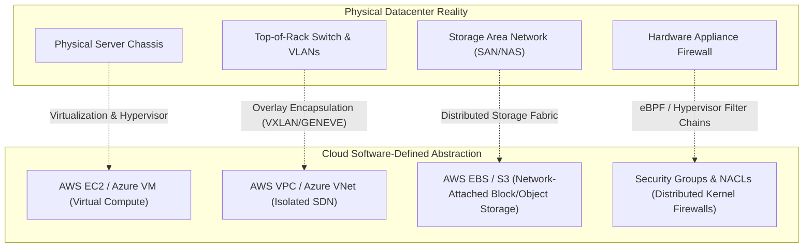
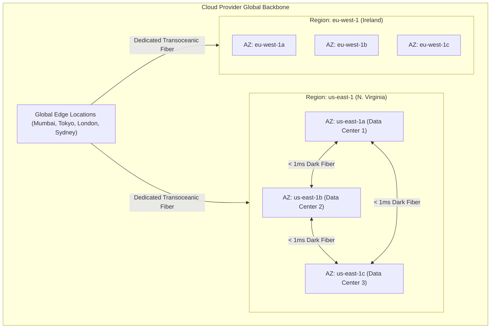
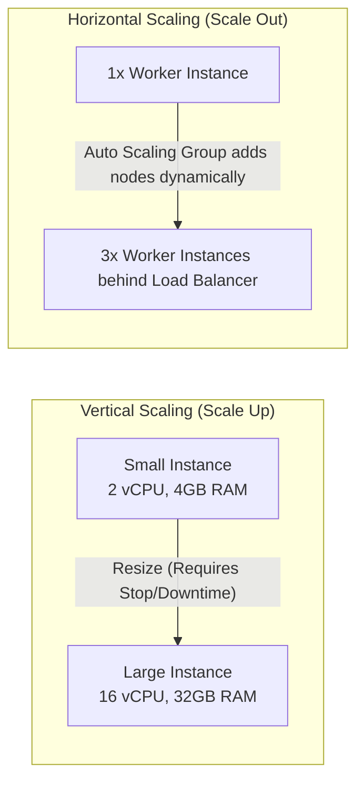
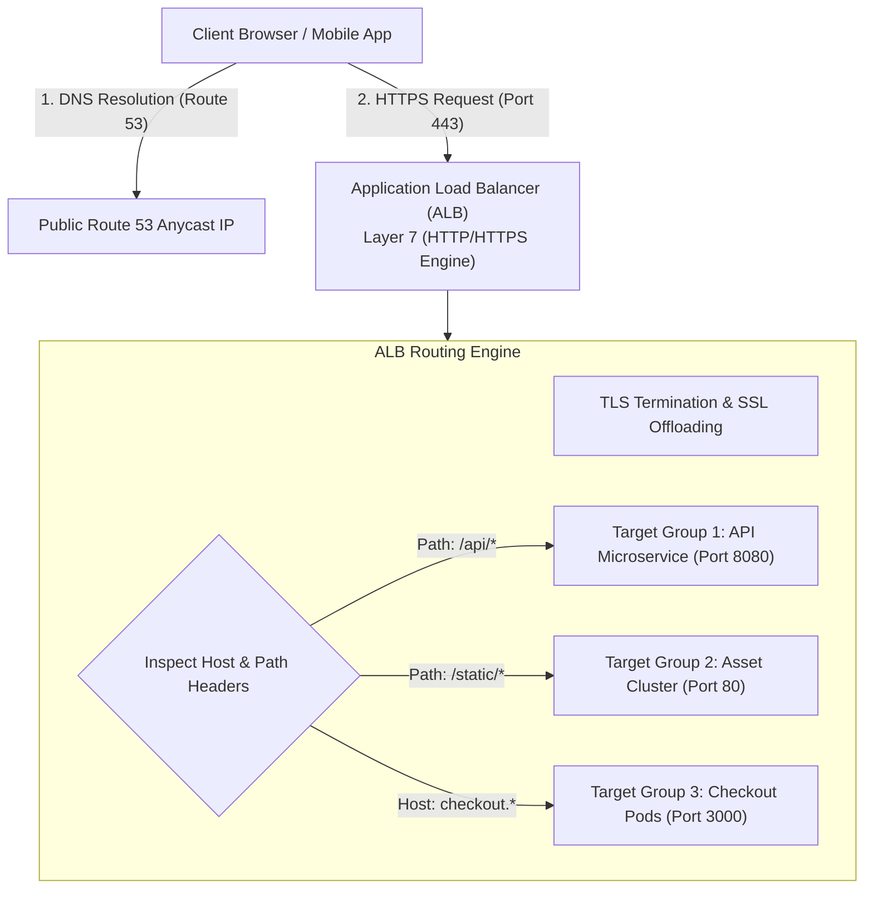
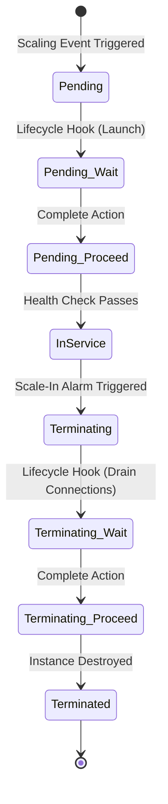
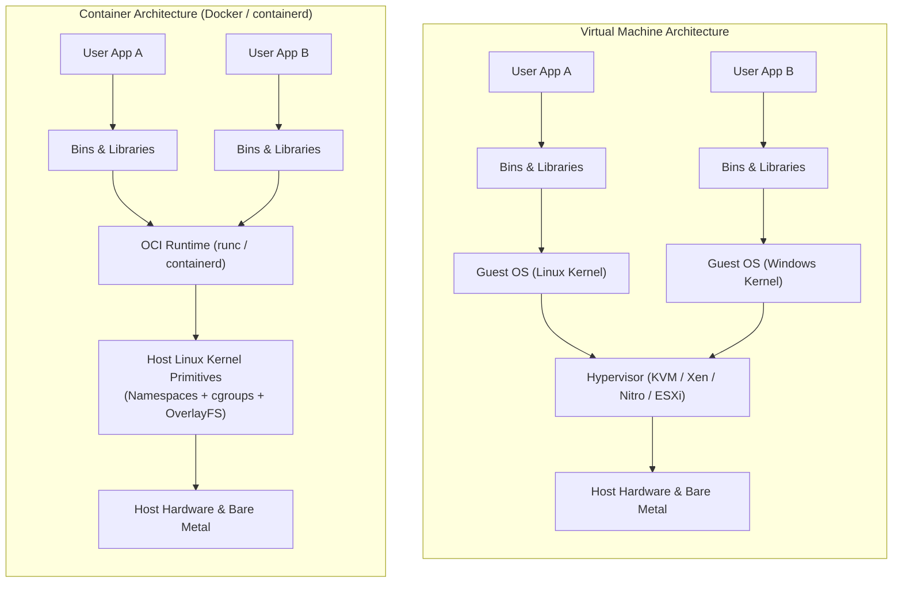
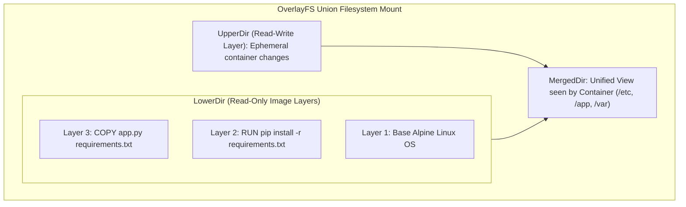
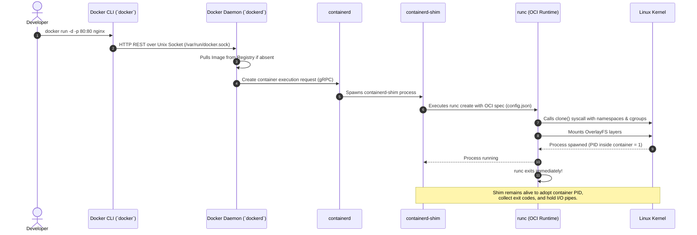
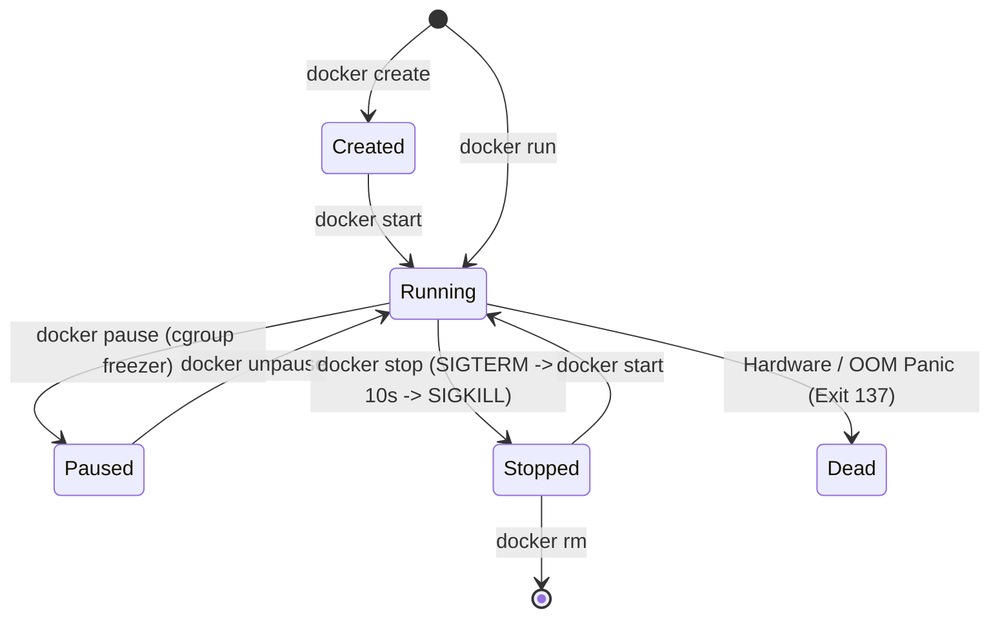

 
# Unit 1: Advanced Cloud Infrastructure and Services

---

## 1. Executive Summary & Mental Model

Modern cloud computing is not merely "someone else's computer"; it is **software-defined, programmable infrastructure** operated at planet scale. Instead of physical cables, racks, and hardware switches, infrastructure is managed via distributed APIs that provision, scale, and decommission resources in seconds.

### The Mental Model: From Datacenter Racks to Cloud Primitives
To master cloud architecture, picture the physical datacenter translated into software abstractions:

---

## 2. Advanced Cloud Infrastructure: AWS vs. Microsoft Azure

Both AWS and Azure provide global infrastructure, but their terminology, architectural boundaries, and networking models differ in critical ways.

### 2.1 Global Infrastructure Anatomy
1. **Regions**:
   - A distinct geographic area (e.g., AWS `us-east-1` in N. Virginia, Azure `East US`).
   - Every region is completely isolated from other regions to prevent blast-radius propagation during catastrophic network or power failures.
   - Designed with round-trip latencies typically $< 2\text{ ms}$ internally.
2. **Availability Zones (AZs)**:
   - Each Region contains **at least three physically separate Availability Zones**.
   - An AZ consists of one or more physical datacenters with independent utility power feeds, backup generators, cooling, and physical fiber loops.
   - AZs within a region are connected via redundant ultra-low-latency dark fiber networks ($< 1\text{ ms}$).
   - *Crucial Engineering Principle*: Designing for **Multi-AZ** protects your application against single datacenter power/flood failures; designing for **Multi-Region** protects against regional natural disasters or global fiber cuts.
3. **Edge Locations & Points of Presence (PoP)**:
   - Hundreds of caching endpoints worldwide connected to the cloud backbone (AWS CloudFront, Azure Front Door).
   - Terminates TLS handshakes close to the end user and caches static/dynamic assets to eliminate transit latency across transoceanic cables.

### 2.2 Comprehensive AWS vs. Azure Service Mapping

| Infrastructure Domain | AWS Primitive | Azure Equivalent | Deep Technical Function & Architectural Role |
| :--- | :--- | :--- | :--- |
| **Virtual Networking** | **VPC** (Virtual Private Cloud) | **VNet** (Virtual Network) | Software-defined isolated network. In AWS, subnets are strictly tied to a single AZ; in Azure, subnets can span the entire region. |
| **Compute (IaaS)** | **EC2** (Elastic Compute Cloud) | **Virtual Machines** | On-demand virtualized servers running on hypervisors (AWS Nitro System / Azure Hyper-V). |
| **Container Engine (CaaS)** | **Amazon ECS** | **Azure Container Apps** | Lightweight, opinionated managed container orchestration without Kubernetes management overhead. |
| **Managed Kubernetes** | **Amazon EKS** | **Azure Kubernetes Service (AKS)** | Enterprise-grade managed Kubernetes control plane with automated etcd patching and multi-AZ worker nodes. |
| **Object Storage** | **Amazon S3** | **Azure Blob Storage** | Exabyte-scale, key-value flat namespace object storage with 11 9s ($99.999999999\%$) durability via erasure coding across multiple facilities. |
| **Block Storage** | **Amazon EBS** | **Azure Managed Disks** | Network-attached virtual hard drives attached to single compute instances for OS boots and low-latency disk IOPS. |
| **Relational Database** | **Amazon Aurora / RDS** | **Azure SQL Database / Cosmos (Postgres)** | Distributed, cloud-native relational engine with compute decoupled from multi-AZ replication storage tiers. |
| **Identity & Access** | **AWS IAM** | **Microsoft Entra ID (Azure AD)** | Identity boundary. AWS uses JSON policies with resource/identity boundaries; Azure uses Azure AD OAuth2/OIDC directory tokens with Azure RBAC assignments. |

---

## 3. Resource Provisioning & Optimization Mechanics

Scalability is not just adding horsepower; it is the **elastic orchestration of resources matching traffic curves while minimizing financial waste**.

### 3.1 Scaling Paradigms: Vertical vs. Horizontal

- **Vertical Scaling (Scale-Up)**:
  - *Mechanism*: Altering instance type (e.g., from `t3.medium` to `m5.4xlarge`).
  - *Failure Modes*: Hard hardware limit ceiling (largest current instance is 448 vCPUs); requires reboot/interruption; single point of failure (if hardware faults, entire application dies).
- **Horizontal Scaling (Scale-Out)**:
  - *Mechanism*: Adding identical stateless compute nodes behind an Elastic Load Balancer (ELB).
  - *Engineering Advantage*: Infinite theoretical scale; zero-downtime rolling upgrades; fault tolerance across Availability Zones.

### 3.2 Elastic Load Balancing (ELB) Architecture & Packet Flow
AWS ELB distributes incoming application traffic across multiple targets (EC2 instances, containers, IP addresses, Lambda functions) in multiple Availability Zones.

#### Layer 7 (ALB) vs. Layer 4 (NLB) Technical Distinction
1. **Application Load Balancer (ALB - OSI Layer 7)**:
   - Terminates the TCP connection, unwraps the TLS encryption, and inspects the HTTP request headers, query strings, and payloads.
   - Supports advanced routing rules: path-based (`/auth` vs `/billing`), host-based (`app.example.com` vs `admin.example.com`), and WebSocket protocol upgrades.
   - Injects `X-Forwarded-For` header so backend servers can read the client's original IP address.
2. **Network Load Balancer (NLB - OSI Layer 4)**:
   - Operates strictly at the transport layer (TCP/UDP). Does not unwrap HTTP payloads.
   - Capable of processing **tens of millions of requests per second** with ultra-low sub-millisecond latencies.
   - Supports static Anycast IP addresses and source IP preservation down to the instance network interface.

### 3.3 Auto Scaling Group (ASG) Lifecycle & Algorithms
An Auto Scaling Group ensures you run the exact number of healthy EC2 instances required to handle application load.

#### The 3 Scaling Policies
1. **Target Tracking Scaling**: Operates like a household thermostat. You define a metric target (e.g., *"keep average ASG CPU utilization at $60\%$"*). AWS automatically adds or removes instances dynamically as traffic fluctuates.
2. **Step Scaling**: Increases or decreases capacity in steps based on CloudWatch alarm breach magnitude:
   - If CPU between $60\% - 75\% \to$ add 1 instance.
   - If CPU between $75\% - 90\% \to$ add 3 instances.
   - If CPU $> 90\% \to$ add 5 instances.
3. **Scheduled Scaling**: Anticipates known recurring traffic surges (e.g., scaling up 20 instances every Monday at 8:00 AM before financial markets open).

---

## 4. Containerization Deep-Dive: Virtualization vs. Containerization

Why did containers take over modern cloud deployments? To understand Docker, we must examine what happens at the **Linux kernel** boundary.

### 4.1 Hypervisors vs. Container Runtimes
- **Virtual Machines (Type 1 & Type 2 Hypervisors)**:
  - Emulate physical computer hardware (virtual CPU, virtual RAM, virtual PCI bus, virtual BIOS).
  - Every single VM must boot an entire independent **Guest Operating System kernel** (consuming 500MB–2GB RAM and 20GB disk before running a single line of user code).
  - Boot time is measured in minutes because the guest kernel must initialize device drivers, systemd, and background daemons.
- **Containers**:
  - Do **NOT** run a guest operating system.
  - A container is simply a **standard Linux host process** isolated by kernel primitives and sharing the host's Linux kernel.
  - Startup latency is measured in **milliseconds** (equivalent to starting a standard process).
  - Image footprints are megabytes rather than gigabytes.

### 4.2 The Linux Kernel Magic: Namespaces & cgroups
Docker containers are not real physical objects; they are an illusion created by three core Linux kernel features:

#### 1. Linux Namespaces (Process Isolation)
Namespaces restrict **what a process can see**. A process inside a container believes it is the sole operating system running on the machine.

| Namespace | Syscall Flag | What It Isolates | Practical Effect Inside Container |
| :--- | :--- | :--- | :--- |
| **`pid`** | `CLONE_NEWPID` | Process IDs | Container process has `PID 1`. It cannot see or kill processes running on the host or in other containers. |
| **`net`** | `CLONE_NEWNET` | Network interfaces & routes | Container gets its own virtual `eth0` interface, IP address (`172.17.0.x`), and private routing table. |
| **`mnt`** | `CLONE_NEWNS` | Filesystem mount points | Container sees its own isolated `/` root directory and cannot access host files unless mounted via volumes. |
| **`ipc`** | `CLONE_NEWIPC` | Inter-Process Communication | Isolates POSIX message queues and shared memory segments between containers. |
| **`uts`** | `CLONE_NEWUTS` | Hostname and Domain name | Container can have its own hostname (e.g., `web-container-01`) without altering the host's hostname. |
| **`user`** | `CLONE_NEWUSER`| User and Group IDs | UID 0 (`root`) inside the container can be mapped to an unprivileged UID (e.g., 10001) on the host for security. |

#### 2. Control Groups (`cgroups` - Resource Restriction)
While namespaces restrict what a process can *see*, `cgroups` restrict what a process can **use**.
- Located in the Linux pseudo-filesystem at `/sys/fs/cgroup/`.
- Prevents the **"Noisy Neighbor"** problem where one rogue container consumes $100\%$ CPU or memory, crashing all other services on the host.
- **CPU Quota**: If you set `--cpus="1.5"`, `cgroups` enforces the Completely Fair Scheduler (CFS) period to grant that process exactly $150\text{ ms}$ of CPU time every $100\text{ ms}$ wall-clock window.
- **OOM Killer (Out-of-Memory)**: If a container exceeds its memory limit (e.g., `-m 512m`), the Linux kernel triggers the Out-Of-Memory Killer (`SIGKILL`, exit code 137) terminating that container instantly without taking down the host.

#### 3. OverlayFS (Layered Union Filesystem)
Docker images are built out of immutable, read-only layers stacked on top of each other.
- **LowerDir (Read-Only)**: The stacked layers of the Docker image (base OS, installed packages, application source code).
- **UpperDir (Read-Write)**: A thin, ephemeral writable layer created the moment `docker run` is executed.
- **MergedDir (Unified View)**: The union mount presenting a single cohesive filesystem to the container process.
- **Copy-on-Write (CoW) Mechanism**: When a container process modifies a file belonging to a lower read-only layer, OverlayFS copies the file up into the `UpperDir` before modifying it. The underlying image layer remains untouched, allowing hundreds of containers to share the exact same base image on disk without duplication!

---

## 5. Docker Architecture & Lifecycle Internals

### 5.1 The Engine Anatomy
When you execute `docker run -d -p 80:80 nginx`, what actually happens under the hood?

- **`dockerd`**: High-level daemon handling image building, REST API endpoints, volume plugins, and network drivers.
- **`containerd`**: CNCF-graduated core runtime managing complete container lifecycles, image transfers, and execution supervisors.
- **`containerd-shim`**: A tiny daemon running per container. It allows the Docker daemon to restart or crash without killing running containers, and retains stdin/stdout pipes and exit statuses.
- **`runc`**: The OCI-compliant low-level CLI wrapper around the Linux kernel `clone()`, `unshare()`, and `pivot_root()` syscalls. Once the container process starts, `runc` exits.

### 5.2 Container Lifecycle State Transitions & Signal Mechanics

#### Signal Handling Demystified
- **`docker stop`**: Sends `SIGTERM` (signal 15) to `PID 1` inside the container. This gives the application a grace period (default 10 seconds) to flush database transactions, close active network sockets, and terminate cleanly. If the process does not terminate within 10 seconds, Docker issues `SIGKILL` (signal 9) for hard process termination.
- **`docker kill`**: Bypasses the grace period entirely and dispatches an immediate `SIGKILL` (signal 9) to the kernel.
- **Exit Code 137**: Process terminated by an external `SIGKILL` ($128 + 9 = 137$). Common symptom of **Linux Out-Of-Memory (OOM) Killer**.
- **Exit Code 143**: Process terminated gracefully by `SIGTERM` ($128 + 15 = 143$).

---

## 6. Enterprise Case Studies: Architectures of Extreme Scale

### 6.1 Netflix: The Cloud Pioneer
- **The Crucible (2008)**: A database corruption paralyzed Netflix DVD shipping for 3 days. Realizing monolithic datacenters are fragile, Netflix management resolved to eliminate all single points of failure by migrating $100\%$ of customer-facing workloads to AWS.
- **Core Architectural Innovations**:
  1. **Microservices Mesh**: Over 1,000 independent microservices communicate via REST and gRPC. If the recommendation service crashes, the UI degrades gracefully by displaying a generic static "Popular Titles" row without breaking video playback.
  2. **The Simian Army (Chaos Engineering)**:
     - *Chaos Monkey*: Randomly kills production EC2 instances during business hours. Developers are forced to engineer services that automatically survive instance losses without alerting on-call engineers.
     - *Chaos Gorilla*: Simulates the loss of an entire AWS Availability Zone.
     - *Chaos Kong*: Drops an entire AWS geographic Region, forcing global DNS traffic redirection to surviving regions in under 7 minutes.
  3. **Spinnaker**: Netflix created and open-sourced Spinnaker, a multi-cloud continuous delivery platform supporting automated Canary releases, automated rollbacks, and fast red/black (blue/green) cluster cutovers.
  4. **Open Connect CDN**: While search, billing, and recommendations run in AWS, streaming heavy video bits directly from AWS would be economically prohibitive and congest internet transit backbones. Netflix built **Open Connect**, custom physical storage appliances placed directly inside Internet Service Provider (ISP) exchange points globally to serve $95\%+$ of video bits locally.

### 6.2 Amazon: Two-Pizza Teams & Prime Day Scaling
- **The Crucible (2001)**: The monolithic "Obidos" C++ codebase became so tangled that deploying a single feature required massive merge trains, weeks of regression testing, and cross-team locks.
- **Core Architectural Innovations**:
  1. **Two-Pizza Teams**: Organizational rule mandating that engineering teams must be small enough to be fed with two pizzas (typically 6–8 people). Each team owns a single bounded-context microservice end-to-end: *they design it, write it, test it, deploy it, and support it on-call* ("You build it, you run it").
  2. **Cell-Based Architecture**: Large services are partitioned into completely independent, self-contained units called **Cells**. Each cell serves a fixed subset of customers (e.g., users whose IDs hash to bucket 4). If a critical database bug or poison-pill packet crashes Cell 4, only $1/N\text{th}$ of global customers are affected, preventing global outages.
  3. **Prime Day Elasticity**: During Prime Day, Amazon's systems process hundreds of millions of customer orders, invoking AWS DynamoDB at peaks exceeding **105 million requests per second**. Auto Scaling Groups dynamically provision hundreds of thousands of EC2 instances and release them hours later, saving millions in idle datacenter hardware.

### 6.3 Uber: Real-Time Geospatial Dispatch Mesh
- **The Crucible (2014)**: Monolithic Python backends were collapsing under the real-time demands of calculating sub-second rider-driver matching, dynamic surge pricing, and live GPS telemetry across 500+ cities simultaneously.
- **Core Architectural Innovations**:
  1. **H3 Spatial Hexagonal Hierarchical Spatial Index**: Uber divided the surface of the entire planet into discrete hexagonal cells of varying resolutions. Hexagons have the mathematical property that all neighboring cells share equal centroid distances (unlike squares). This allows Uber's dispatch algorithms to execute spatial nearest-neighbor search queries in sub-milliseconds.
  2. **Ringpop & Consistent Hashing**: Uber engineered Ringpop, an open-source decentralized Go framework implementing a gossip protocol (SWIM) and consistent hashing ring. Driver location updates hash directly to the specific node in the cluster holding state for that geographic area, enabling high-throughput stateful streaming without database bottlenecks.
  3. **Multi-Datacenter Active-Active Setup**: Uber operates active-active across multiple cloud and datacenter facilities. If one region suffers a total network collapse, client mobile apps automatically retry against alternate regions with zero state desynchronization.

---

## 7. Review, Exam & Viva Questions with Model Answers

### Question 1: Differentiate between Virtualization and Containerization across 4 technical parameters.
**Model Answer:**
1. *Kernel Architecture*: Virtual machines run distinct guest operating systems on top of a hypervisor. Containers share the host Linux kernel via namespaces and cgroups.
2. *Resource Overhead*: VMs require gigabytes of storage for guest OS binaries and pre-allocated memory pools. Containers require only megabytes for application binaries and libraries.
3. *Startup Latency*: VMs take 1 to 5 minutes to boot full OS services and systemd. Containers start in sub-seconds (milliseconds) as standard host processes.
4. *Isolation Boundary*: VMs provide hardware-level isolation enforced by hypervisor CPU rings (Ring -1/VT-x). Containers provide process-level isolation; a kernel exploit can potentially allow a root container breakout to the host.

### Question 2: Explain the internal role of Linux namespaces and cgroups during a `docker run` execution.
**Model Answer:**
When `docker run` is executed, the OCI runtime (`runc`) issues the `clone()` syscall with flags creating new **namespaces**: `CLONE_NEWPID` isolates the process ID space so the application becomes `PID 1`; `CLONE_NEWNET` provides an isolated virtual network stack with its own IP and routing table; `CLONE_NEWNS` isolates filesystem mount points. Simultaneously, `runc` creates control directories under `/sys/fs/cgroup/` to enforce **cgroups**: configuring CPU CFS scheduler quotas to restrict CPU cycles and memory limits to trigger OOM kills if consumption exceeds thresholds.

### Question 3: How does Netflix utilize Chaos Engineering to ensure high availability on AWS?
**Model Answer:**
Netflix assumes that cloud infrastructure is inherently unreliable and instances can fail at any time. Through the Simian Army (specifically Chaos Monkey), Netflix systematically injects pseudo-random failures into production systems during business hours by terminating EC2 instances and degrading network connections. This forces software architects to design resilient patterns (such as Hystrix circuit breakers, client-side load balancing via Ribbon, and graceful UI degradation) so that end-user streaming continues uninterrupted even during unexpected cloud infrastructure failures.

### Question 4: Compare AWS On-Demand, Reserved, and Spot instance purchasing models.
**Model Answer:**
- **On-Demand**: Highest hourly cost, maximum flexibility with second-by-second billing and zero commitment. Best for unpredictable, spiky, or newly developed workloads.
- **Reserved Instances (RI) / Savings Plans**: 1- or 3-year commitment to consistent compute usage offering up to a $72\%$ discount. Best for steady-state production databases and baseline microservices.
- **Spot Instances**: Spare unused AWS compute capacity offered at up to a $90\%$ discount. However, AWS can reclaim the instance with a 2-minute warning notification. Best for stateless, fault-tolerant batch processing, big data analysis, and CI/CD test runners.
