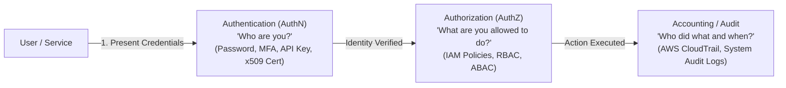
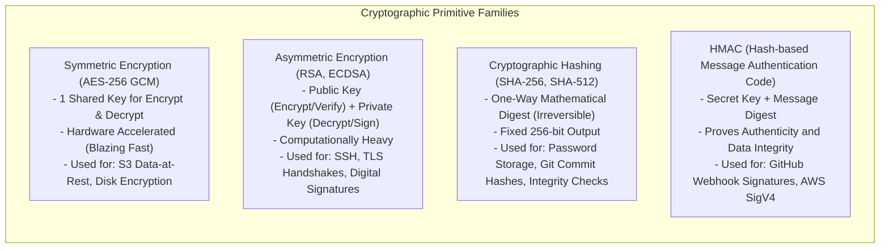
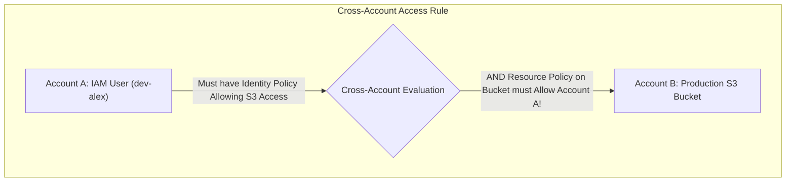
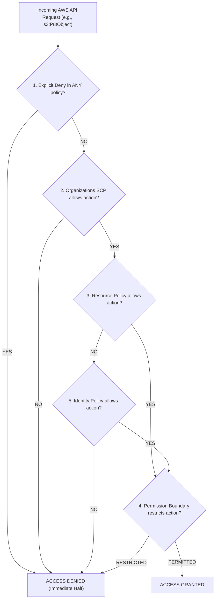
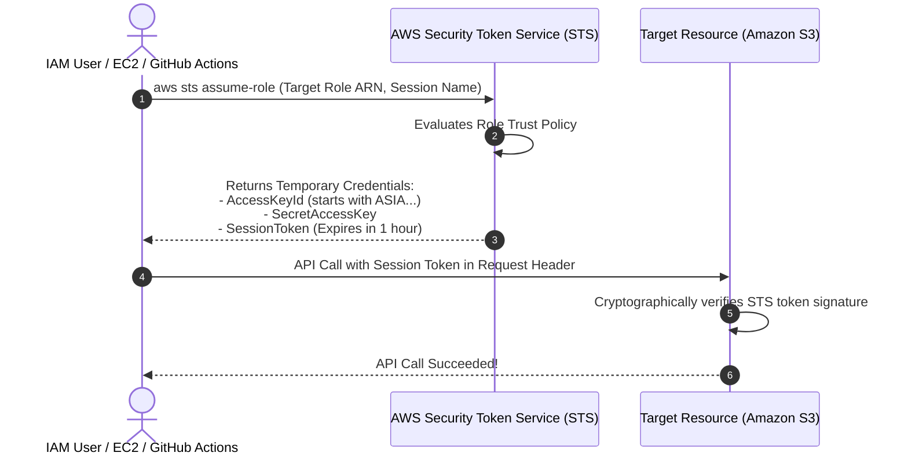
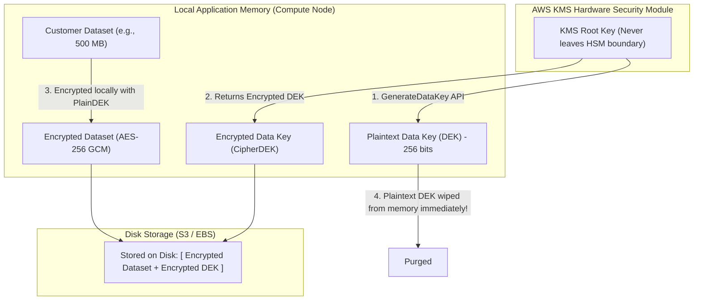

# Aux 04: Identity, Access Management & Cryptographic Foundations

Cloud security is governed by identity boundaries, cryptographic proofs, and policy evaluation engines. When you configure IAM permissions or encrypt data in S3, these are the cryptographic and authorization foundations at work.

---

## 1. The Security Triad: AuthN vs. AuthZ vs. Accounting

Engineers frequently confuse authentication with authorization. They are distinct operational stages:



1. **Authentication (AuthN)**: Validating that an entity is genuinely who they claim to be.
2. **Authorization (AuthZ)**: Evaluating whether the authenticated entity has permission to perform a specific action on a specific resource.
3. **Accounting (Audit)**: Chronologically logging the event for security forensics and regulatory compliance.

---

## 2. Cryptography 101 for Cloud & DevOps Engineers



> [!CAUTION]
> **Base64 is NOT Encryption or Hashing!**
> Base64 is merely an **encoding format** designed to convert raw binary bytes into ASCII text for safe transport over HTTP or JSON. Anyone can decode Base64 in one second (`echo "c2VjcmV0" | base64 -d`). Never assume storing a secret in Base64 (like Kubernetes Secrets) provides security.

---

## 3. AWS IAM Policy Mechanics Under the Microscope

An IAM Policy is a formal JSON grammar evaluated by the AWS authorization engine.

### 3.1 Identity-Based Policies vs. Resource-Based Policies
- **Identity-Based Policies**: Attached to a User, Group, or Role. Defines what that identity can do across AWS resources.
- **Resource-Based Policies**: Attached directly to the AWS resource itself (e.g., **S3 Bucket Policy**, **AWS KMS Key Policy**, **Amazon SQS Policy**). Defines *who* (which principals) can access that specific resource.



> [!NOTE]
> - **Same AWS Account**: Access is granted if **either** the Identity Policy OR the Resource Policy allows it.
> - **Cross-Account**: Access is granted **only if BOTH** the Identity Policy in the caller's account AND the Resource Policy in the destination account explicitly allow it!

### 3.2 The Complete 6-Step IAM Policy Evaluation Hierarchy
When any AWS API call is received, the IAM policy engine evaluates the request through this strict evaluation flow:



---

## 4. AWS Security Token Service (STS) & Temporary Credentials

Static AWS Access Keys (`AKIA...` + Secret Key) stored in config files are the leading cause of enterprise cloud security compromises. AWS solves this via **AWS STS**.



- **Prefix Indicator**:
  - `AKIA...`: Permanent long-term credential (IAM User).
  - `ASIA...`: Short-lived temporary credential issued by STS.
- **The Session Token**: When using temporary credentials, requests must provide **both** the Access/Secret keys AND the `SessionToken` parameter. When the expiration time arrives, the credentials become mathematically invalid.

---

## 5. EC2 Instance Profiles: How Virtual Machines Access AWS

How does an application running on an EC2 instance read files from an S3 bucket or write metrics to CloudWatch without hardcoding access keys in the code?

```mermaid
flowchart TD
    subgraph IAM_Control["IAM Control Plane"]
        Role["IAM Role: WebAppS3Role<br>- Permissions: s3:GetObject on 'my-bucket/*'<br>- Trust Policy: Allows ec2.amazonaws.com to assume"]
    end

    subgraph EC2_VM["EC2 Instance (Virtual Machine)"]
        Prof["EC2 Instance Profile (Container for the Role)"]
        App["Your Application (Python Boto3 / AWS SDK)"]
        IMDS["Instance Metadata Service (169.254.169.254)"]
        
        App -->|"1. SDK automatically requests credentials"| IMDS
        IMDS -->|"2. Fetches short-lived STS tokens"| Prof
        Prof -.->|"Associated"| Role
        IMDS -->>|"3. Injects ASIA... keys into memory"| App
    end

    App -->|"4. Calls S3 using temporary STS credentials"| S3[("Amazon S3 Bucket")]
```

---

## 6. AWS KMS & Envelope Encryption

### Why Direct KMS Encryption Fails at Scale
AWS Key Management Service (KMS) protects Customer Master Keys (CMKs) inside tamper-resistant **Hardware Security Modules (HSMs)**.
- *Limitation*: The KMS API restricts direct cryptographic operations to payloads under **4 KB**.
- If you have a 500 MB database backup or 10 GB video file, streaming gigabytes of data over the network to KMS would cause massive latency and cost thousands in API fees.

### The Solution: Envelope Encryption
Envelope encryption encrypts plaintext data with a unique, local **Data Encryption Key (DEK)**, and encrypts that Data Key with the root **KMS Key**.



#### How Decryption Works
1. To read the file, the application reads the stored `Encrypted DEK` and calls `kms:Decrypt(Encrypted DEK)`.
2. KMS decrypts the 256-bit key inside its HSM and returns the `Plaintext DEK` to application RAM.
3. The application decrypts the 500 MB dataset locally using fast CPU instructions and immediately zeroes the plaintext key from memory.
