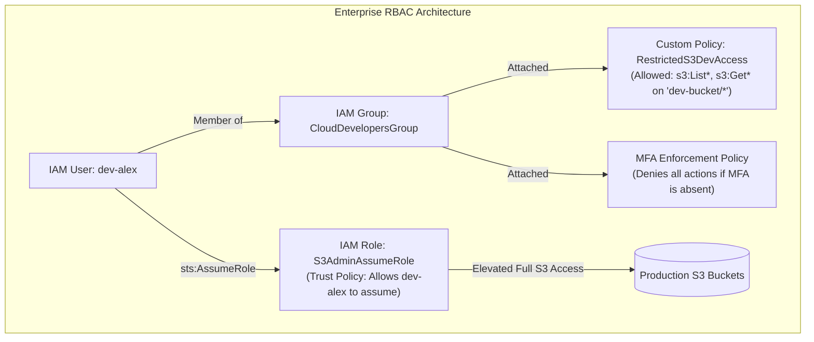
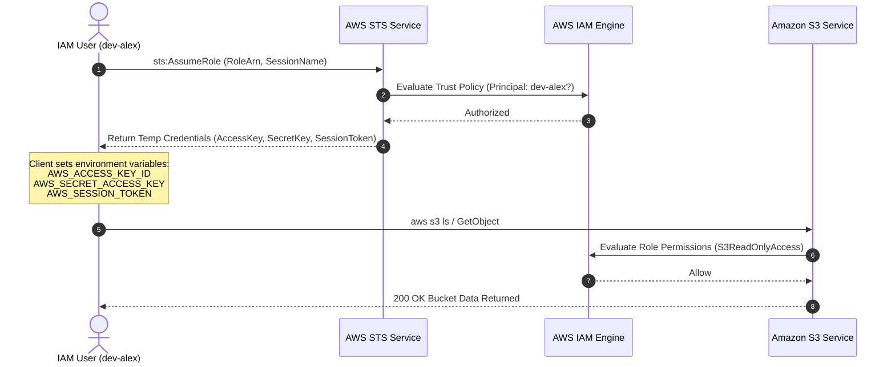

# Lab 02: AWS IAM, MFA, Custom Policies & Role-Based Access Control (RBAC)

**Course Outcome Alignment:** CO1, CO3, CO5  
**Target Environment:** AWS Free Tier / AWS Academy / LocalStack (Fallback)  
**Estimated Run Time:** 40 minutes  
**Cost:** \$0.00 (IAM is a zero-cost global AWS service)

---

## 1. Architectural Blueprint

This experiment explores Identity & Access Management (IAM). You will create a structured Role-Based Access Control (RBAC) hierarchy consisting of IAM Groups, IAM Users, Custom JSON Least-Privilege Policies, Multi-Factor Authentication (MFA) enforcement conditions, and IAM Role Assumption via the AWS Security Token Service (STS).



---

## 2. Concept & Theoretical Foundations

1. **Principle of Least Privilege (PoLP)**: A user or service must be granted only the minimal permissions necessary to perform its intended job function, and nothing more.
2. **Authentication (AuthN) vs. Authorization (AuthZ)**:
   - *AuthN*: Verifying who the entity is (Username/Password, Access Key/Secret Key, MFA token).
   - *AuthZ*: Verifying what actions the entity is allowed to perform (IAM JSON Policies).
3. **Role Assumption (`sts:AssumeRole`)**: Allows a user to temporarily shed their default permissions and adopt elevated permissions granted to an IAM Role. STS returns temporary security credentials consisting of an `AccessKeyId`, `SecretAccessKey`, and `SessionToken` valid for a short window (15 minutes to 12 hours).

---

## 3. Student Account Considerations & Workarounds

> [!NOTE]
> If your university enrolled you in an **AWS Academy Learner Lab**, the `iam:CreateUser` and `iam:CreatePolicy` APIs are locked by default to prevent sandbox abuse.
> - **If using a standard AWS Free-Tier Account**: Run all the AWS CLI commands below directly.
> - **If using AWS Academy**: Use the **AWS IAM Policy Simulator** in the console OR use the **LocalStack** commands provided in Section 6 to test the exact same JSON policies without account restrictions.

---

## 4. Step-by-Step Implementation Guide

### Step 1: Create an IAM Group and IAM User
```bash
# 1. Create the IAM Group
aws iam create-group --group-name CloudDevelopersGroup

# 2. Create the IAM User
aws iam create-user --user-name dev-alex

# 3. Add the User to the Group
aws iam add-user-to-group \
    --group-name CloudDevelopersGroup \
    --user-name dev-alex

# 4. Generate Programmatic Access Keys for dev-alex
aws iam create-access-key --user-name dev-alex > dev-alex-keys.json
```

### Step 2: Author a Custom Least-Privilege IAM Policy
Create a file named `developer-s3-policy.json`. This policy allows listing all buckets, but strictly limits `GetObject` and `PutObject` to a specific development bucket prefix:

```json
{
  "Version": "2012-10-17",
  "Statement": [
    {
      "Sid": "AllowListAllBuckets",
      "Effect": "Allow",
      "Action": "s3:ListAllMyBuckets",
      "Resource": "*"
    },
    {
      "Sid": "AllowDevBucketAccessOnly",
      "Effect": "Allow",
      "Action": [
        "s3:ListBucket",
        "s3:GetObject",
        "s3:PutObject"
      ],
      "Resource": [
        "arn:aws:s3:::int378-dev-storage-*",
        "arn:aws:s3:::int378-dev-storage-*/*"
      ]
    }
  ]
}
```

Deploy the policy and attach it to the developer group:
```bash
# Get your AWS Account ID
ACCOUNT_ID=$(aws sts get-caller-identity --query Account --output text)

# Create the custom policy
POLICY_ARN=$(aws iam create-policy \
    --policy-name S3DevRestrictedPolicy \
    --policy-document file://developer-s3-policy.json \
    --query "Policy.Arn" --output text)

# Attach policy to CloudDevelopersGroup
aws iam attach-group-policy \
    --group-name CloudDevelopersGroup \
    --policy-arn $POLICY_ARN
```

### Step 3: Author an MFA Enforcement Policy
Create `mfa-enforcement-policy.json` to enforce that actions are blocked unless Multi-Factor Authentication is active:

```json
{
  "Version": "2012-10-17",
  "Statement": [
    {
      "Sid": "DenyAllWithoutMFA",
      "Effect": "Deny",
      "NotAction": [
        "iam:CreateVirtualMFADevice",
        "iam:EnableMFADevice",
        "iam:GetUser",
        "iam:ListMFADevices",
        "iam:ResyncMFADevice"
      ],
      "Resource": "*",
      "Condition": {
        "BoolIfExists": {
          "aws:MultiFactorAuthPresent": "false"
        }
      }
    }
  ]
}
```

### Step 4: Create an IAM Role for Role Assumption
Create the trust policy `trust-relationship.json` defining who can assume the role:

```json
{
  "Version": "2012-10-17",
  "Statement": [
    {
      "Effect": "Allow",
      "Principal": {
        "AWS": "arn:aws:iam::<ACCOUNT_ID>:user/dev-alex"
      },
      "Action": "sts:AssumeRole"
    }
  ]
}
```
*(Replace `<ACCOUNT_ID>` with your real 12-digit account ID)*

Create the role and attach read-only admin privileges:
```bash
sed -i "s/<ACCOUNT_ID>/$ACCOUNT_ID/g" trust-relationship.json

# Create Role
ROLE_ARN=$(aws iam create-role \
    --role-name S3ElevatedAuditorRole \
    --assume-role-policy-document file://trust-relationship.json \
    --query "Role.Arn" --output text)

# Attach AmazonS3ReadOnlyAccess policy to the role
aws iam attach-role-policy \
    --role-name S3ElevatedAuditorRole \
    --policy-arn arn:aws:iam::aws:policy/AmazonS3ReadOnlyAccess
```

---

## 5. Verification & Testing Checklist

### 1. Test Least Privilege with `dev-alex` Credentials
Configure a secondary AWS CLI profile for `dev-alex`:
```bash
ALEX_KEY_ID=$(jq -r .AccessKey.AccessKeyId dev-alex-keys.json)
ALEX_SECRET=$(jq -r .AccessKey.SecretAccessKey dev-alex-keys.json)

aws configure set aws_access_key_id "$ALEX_KEY_ID" --profile alex-profile
aws configure set aws_secret_access_key "$ALEX_SECRET" --profile alex-profile
aws configure set region "us-east-1" --profile alex-profile
```

Test listing buckets (Should Succeed):
```bash
aws s3 ls --profile alex-profile
```

Test unauthorized action (e.g., listing EC2 instances; Should Fail with `AccessDenied`):
```bash
aws ec2 describe-instances --profile alex-profile
# Output: An error occurred (UnauthorizedOperation) when calling the DescribeInstances operation.
```

### 2. Test Role Assumption via AWS STS



```bash
# dev-alex assumes the elevated role
CREDS=$(aws sts assume-role \
    --role-arn $ROLE_ARN \
    --role-session-name "AlexTestingSession" \
    --profile alex-profile)

# Extract temporary credentials
export AWS_ACCESS_KEY_ID=$(echo $CREDS | jq -r .Credentials.AccessKeyId)
export AWS_SECRET_ACCESS_KEY=$(echo $CREDS | jq -r .Credentials.SecretAccessKey)
export AWS_SESSION_TOKEN=$(echo $CREDS | jq -r .Credentials.SessionToken)

# Verify caller identity is now the Role, NOT the user!
aws sts get-caller-identity
# Output ARN will show: assumed-role/S3ElevatedAuditorRole/AlexTestingSession
```

---

## 6. AWS Academy Sandbox Alternative: LocalStack Simulation

If running in a locked AWS Academy account, execute these steps with LocalStack:
```bash
# Start LocalStack
docker run -d --name localstack -p 4566:4566 localstack/localstack

# Run the exact same commands using endpoint-url
aws --endpoint-url=http://localhost:4566 iam create-group --group-name CloudDevelopersGroup
aws --endpoint-url=http://localhost:4566 iam create-user --user-name dev-alex
aws --endpoint-url=http://localhost:4566 iam add-user-to-group --group-name CloudDevelopersGroup --user-name dev-alex
```

---

## 7. Teardown & Cleanup Checklist

```bash
# Unset temporary session credentials
unset AWS_ACCESS_KEY_ID AWS_SECRET_ACCESS_KEY AWS_SESSION_TOKEN

# Detach policies and delete role
aws iam detach-role-policy --role-name S3ElevatedAuditorRole --policy-arn arn:aws:iam::aws:policy/AmazonS3ReadOnlyAccess
aws iam delete-role --role-name S3ElevatedAuditorRole

# Detach policies from group and delete policy
aws iam detach-group-policy --group-name CloudDevelopersGroup --policy-arn $POLICY_ARN
aws iam delete-policy --policy-arn $POLICY_ARN

# Remove user from group and delete user
aws iam remove-user-from-group --group-name CloudDevelopersGroup --user-name dev-alex
aws iam delete-access-key --user-name dev-alex --access-key-id $ALEX_KEY_ID
aws iam delete-user --user-name dev-alex
aws iam delete-group --group-name CloudDevelopersGroup

# Remove local files
rm -f dev-alex-keys.json developer-s3-policy.json mfa-enforcement-policy.json trust-relationship.json
```

---

## 8. Viva Voce & Interview Questions

1. **What is the difference between an IAM User and an IAM Role?**
   - *Answer*: An IAM user has permanent long-term credentials (passwords, access keys) representing a single person or service. An IAM role does not have static credentials; it is assumed dynamically by authorized entities to obtain short-lived temporary tokens via STS.
2. **What happens when an IAM user has both an `Allow` and a `Deny` statement for the same action?**
   - *Answer*: An explicit `Deny` always overrides an explicit `Allow`.
3. **What is the purpose of the `Condition` block in an IAM policy statement?**
   - *Answer*: It specifies constraints under which the policy statement is valid (e.g., checking `aws:MultiFactorAuthPresent`, restricting client IP addresses via `aws:SourceIp`, or enforcing SSL/TLS via `aws:SecureTransport`).
