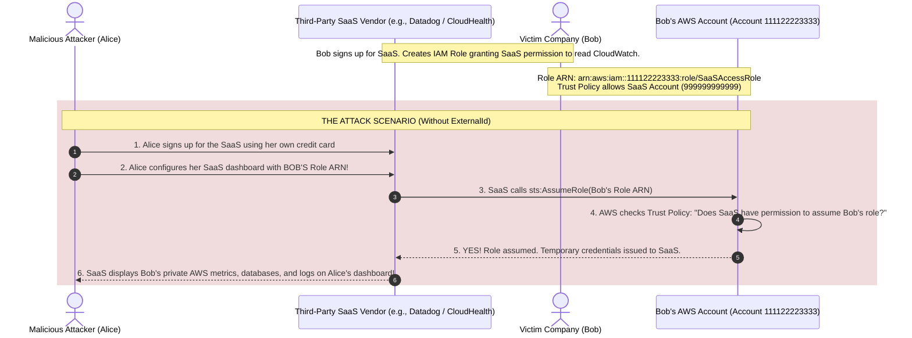
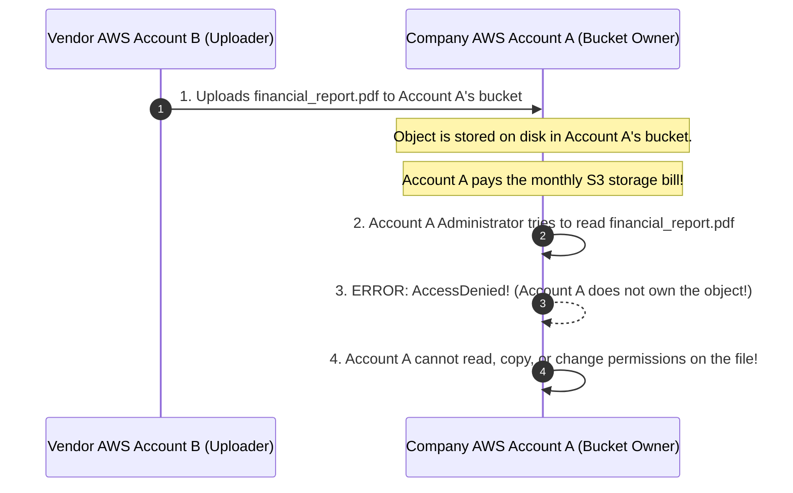
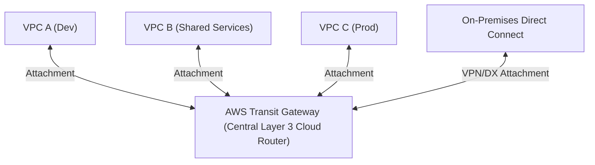

# Rabbit Hole 05: AWS IAM Edge Cases & The Confused Deputy Problem

In beginner tutorials, IAM is presented as simple JSON files with `Allow` and `Deny` statements.

In enterprise multi-account architectures, IAM involves cross-account role assumption, transitive trust boundaries, external SaaS integrations, and subtle evaluation precedence rules that trip up even experienced engineers.

Here are the critical security edge cases asked in Senior Cloud Security interviews.

---

## 1. The Confused Deputy Problem & `sts:ExternalId`

The **Confused Deputy** is a classic computer security vulnerability where an authorized entity (the "deputy") is coerced by an unauthorized malicious party into using its privileges to perform an action on the victim's resources.



### The Solution: The `sts:ExternalId` Cryptographic Secret
To eliminate the Confused Deputy vulnerability, the SaaS vendor generates a unique, secret random string (the **External ID**) for Bob during registration.

Bob appends this secret into the Role's Trust Policy:

```json
{
  "Version": "2012-10-17",
  "Statement": [
    {
      "Effect": "Allow",
      "Principal": {
        "AWS": "arn:aws:iam::999999999999:root"
      },
      "Action": "sts:AssumeRole",
      "Condition": {
        "StringEquals": {
          "sts:ExternalId": "secret-unique-token-4a9b8c7d"
        }
      }
    }
  ]
}
```

When the SaaS vendor assumes the role on behalf of a customer, it is programmed to send that specific customer's External ID in the `AssumeRole` API request. If attacker Alice tries to input Bob's Role ARN into her account, the SaaS vendor sends *Alice's* External ID, the condition evaluation fails, and AWS terminates the request with `AccessDenied`!

---

## 2. The S3 Cross-Account Object Ownership Disaster

Before AWS introduced modern controls, cross-account S3 uploads suffered from a bizarre permissions quirk that caused millions of dollars in enterprise headaches:

> [!WARNING]
> In legacy S3 architectures:
> **The AWS account that uploads an object owns the object, NOT the account that owns the S3 bucket!**



### The Solution: `BucketOwnerEnforced`
AWS solved this by introducing the **S3 Object Ownership** setting:
```hcl
resource "aws_s3_bucket_ownership_controls" "enforce" {
  bucket = aws_s3_bucket.my_bucket.id

  rule {
    object_ownership = "BucketOwnerEnforced"
  }
}
```
- Disables legacy Access Control Lists (ACLs) entirely.
- Forces **100% of all uploaded objects to automatically become the exclusive property of the bucket owner account**, regardless of who uploaded them.

---

## 3. Transitive Routing Limitations in VPC Peering

In network engineering, a **transitive relationship** means:  
$$\text{If } A \longleftrightarrow B \text{ and } B \longleftrightarrow C, \text{ then } A \longleftrightarrow C.$$

AWS VPC Peering strictly violates this mathematical law:

```mermaid
flowchart LR
    VPC_A["VPC A (Dev: 10.1.0.0/16)"] <====="VPC Peering Connection 1"=====> VPC_B["VPC B (Shared Services: 10.2.0.0/16)"]
    VPC_B <====="VPC Peering Connection 2"=====> VPC_C["VPC C (Production: 10.3.0.0/16)"]

    VPC_A -.->|"CANNOT COMMUNICATE!<br>Transitive Peering Strictly FORBIDDEN by AWS"| VPC_C
```

- In AWS VPC Peering, packets entering a VPC over a peering connection **cannot exit that VPC over another peering connection**.
- If you have 10 VPCs and want full mesh connectivity using VPC Peering, you must manage:
  $$\text{Peering Connections} = \frac{N(N - 1)}{2} = \frac{10(9)}{2} = \mathbf{45\text{ Peering Connections!}}$$

### The Solution: AWS Transit Gateway (TGW)
AWS Transit Gateway acts as a **Regional Cloud Virtual Router (Hub-and-Spoke)**:



- Each VPC attaches to the Transit Gateway with a single attachment.
- The Transit Gateway maintains a routing table supporting full transitive routing between any attached VPCs and on-premises datacenters.

---

## 4. Complex IAM Conflict Resolution: The "Who Wins?" Matrix

In high-stakes technical interviews, examiners present multi-layered permission scenarios to test your understanding of IAM evaluation precedence:

| Scenario | Conditions Evaluated | Final AWS Decision | Technical Reason |
| :--- | :--- | :--- | :--- |
| **Scenario 1: Explicit Deny in User Group** | User `Alice` has an inline policy granting `s3:PutObject`. Alice belongs to `DevelopersGroup`, which has a policy with an explicit `Deny` on `s3:PutObject`. | **ACCESS DENIED** | **Rule of Thumb**: An Explicit Deny in *any* policy (Group, User, SCP, Boundary) instantly terminates evaluation and overrides all Allows. |
| **Scenario 2: Organization SCP allows, but Identity Policy lacks action** | The AWS Organization SCP has `Allow * on *`. The IAM User has zero policies attached. | **ACCESS DENIED** | **Rule of Thumb**: SCPs do not grant permissions; they only define the *maximum allowable ceiling*. The user still requires an explicit `Allow` in an Identity Policy. |
| **Scenario 3: Cross-Account Resource Policy allows, but Identity Policy missing** | Account B's S3 Bucket Policy explicitly allows `arn:aws:iam::AccountA:user/Bob` to `s3:GetObject`. Bob's IAM user in Account A has no attached policies. | **ACCESS DENIED** | **Rule of Thumb**: For cross-account access, permissions must be explicitly granted on **both sides** (Identity Policy in Account A AND Resource Policy in Account B). |
| **Scenario 4: Permission Boundary restricts action** | User `Charlie` has `AdministratorAccess` (`Allow * on *`). However, Charlie's IAM Permission Boundary only allows `ec2:*`. Charlie attempts to create an S3 bucket. | **ACCESS DENIED** | **Rule of Thumb**: Permission boundaries set the maximum allowable permissions an identity can exercise. Since `s3:CreateBucket` is not in the boundary, it is blocked. |
