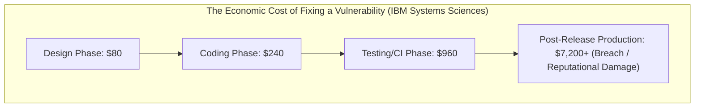
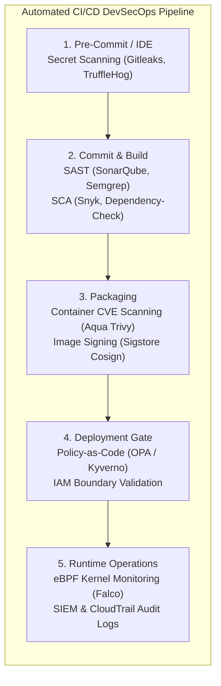
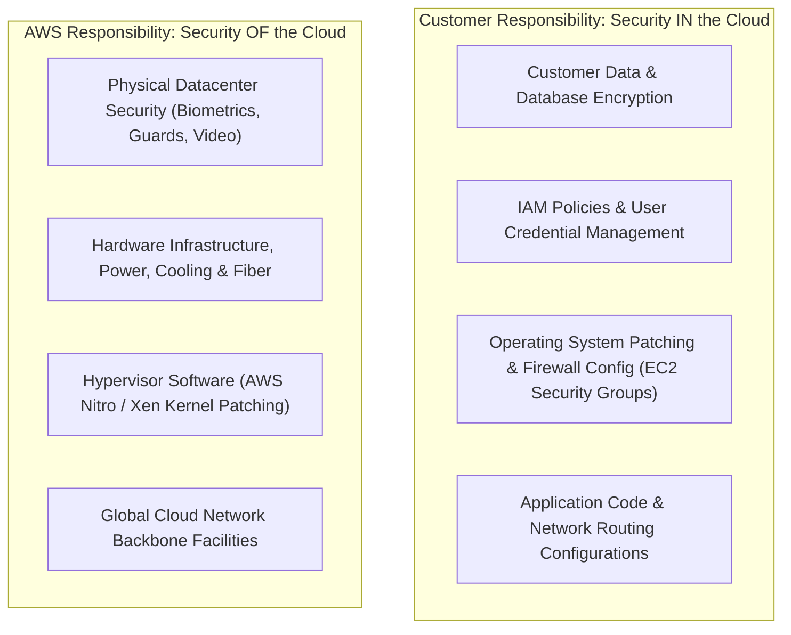
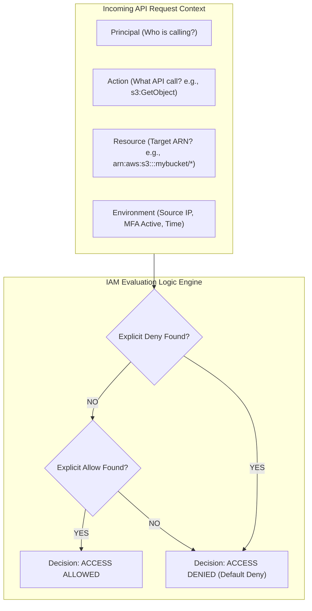
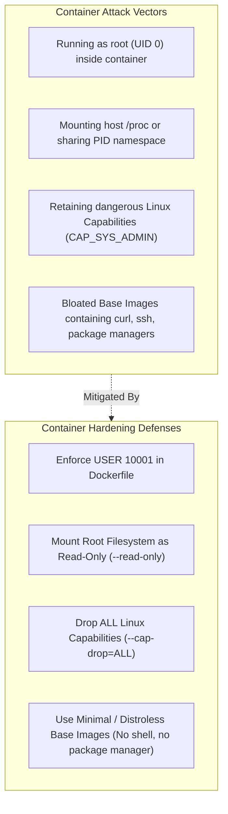
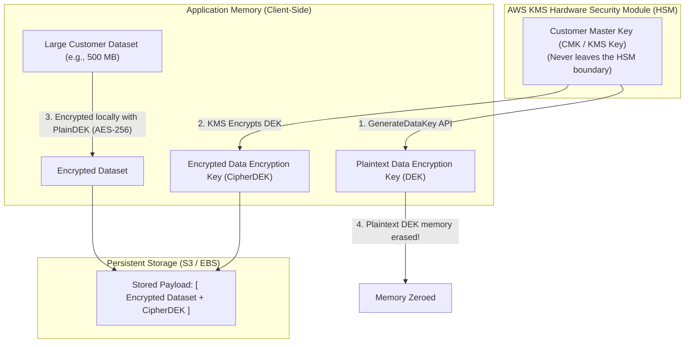

---
title: "Unit 5: DevSecOps, IAM and Cloud Security"
course: "INT378: Advancements in Cloud and DevOps"
category: "theory-unit"
unit_number: 5
portion: "Portion 2: Identity, Access & Cloud Governance"
hub: "[[INT378 Master Strategy & Curriculum Roadmap]]"
previous_unit: "[[Unit 4 - Monitoring, Metrics and Observability]]"
next_unit: "[[Unit 6 - Cloud-Native Development, Serverless & FinOps]]"
course_outcomes:
  - "CO1"
  - "CO3"
  - "CO5"
companion_labs:
  - "[[Lab 02 - AWS IAM, MFA, Custom Policies & RBAC]]"
  - "[[Lab 07 - DevSecOps Pipeline (SAST, Trivy & Secret Mgmt)]]"
code_templates:
  - "[[04 - CI-CD, Agile & DevSecOps Pipelines/code/lab06-07-jenkins-devsecops/Jenkinsfile.devsecops]]"
core_technologies:
  - "AWS IAM"
  - "AWS STS"
  - "Aqua Trivy"
  - "Gitleaks"
  - "Semgrep"
  - "AWS KMS"
  - "Kubernetes Security"
security_paradigms:
  - "Shift-Left"
  - "Zero-Trust"
  - "Least Privilege"
  - "Envelope Encryption"
exam_weightage: "High"
difficulty: "Advanced"
estimated_read_time: "25m"
status: "completed"
tags:
  - int378/unit-5
  - devsecops
  - iam
  - rbac
  - cloud-security
  - container-security
  - kms
last_updated: 2026-11-03
---

# Unit 5: DevSecOps, IAM and Cloud Security

---

## 1. Executive Summary & The DevSecOps Mindset

Historically, security was treated as an isolated audit at the end of the waterfall development lifecycle. Security teams acted as "gatekeepers," performing manual penetration testing days before a planned production release. In a modern DevOps environment deploying multiple times a day, this manual gate creates friction, deployment delays, and adversarial team dynamics.

**DevSecOps** is the cultural and technical integration of security into every phase of the software delivery lifecycle. Rather than treating security as a perimeter wall, DevSecOps treats **Security as Code**, shifting automated vulnerability detection to the earliest possible stages of development (**Shift-Left**).



---

## 2. The DevSecOps Security Tooling Taxonomy

A complete DevSecOps pipeline automates distinct categories of security scanners across the CI/CD pipeline:



### 2.1 Technical Analysis of Testing Paradigms

| Security Tooling Category | When It Runs | What It Inspects | Representative Tools | Strengths & Limitations |
| :--- | :--- | :--- | :--- | :--- |
| **Secret Scanning** | Pre-commit Git hooks, CI commit stage | Regex patterns and Shannon entropy of strings in Git diffs | Gitleaks, TruffleHog, GitGuardian | Prevents committing AWS access keys, private RSA keys, or database passwords to GitHub. |
| **SAST** (Static Application Security Testing) | Build phase | Abstract Syntax Trees (AST) and uncompiled source code (White-Box) | SonarQube, Semgrep, Checkmarx | Detects OWASP Top 10 flaws (SQL injection, hardcoded credentials, buffer overflows). Fast, but can have high false-positive rates. |
| **SCA** (Software Composition Analysis) | Build / Test phase | Manifests and lockfiles (`package-lock.json`, `requirements.txt`) | Snyk, OWASP Dependency-Check, Trivy | Discovers known vulnerabilities (CVEs) and outdated licensing in third-party open-source libraries. |
| **Container Scanning** | Packaging phase | Base OS packages (Alpine/Debian) and application artifacts in container layers | Aqua Trivy, Clair, Docker Scout | Scans immutable image layers before pushing to registries; blocks containers with CRITICAL CVEs. |
| **DAST** (Dynamic Application Security Testing) | Staging / Pre-prod phase | Running web application endpoints over HTTP (Black-Box) | OWASP ZAP, Burp Suite Enterprise | Simulates external attacker behaviors (cross-site scripting, header injection). Slow execution; cannot pinpoint source line. |
| **Runtime Security** | Production cluster | Linux kernel system calls (`syscalls`) via eBPF | Falco, Sysdig | Detects zero-day runtime attacks (e.g., unexpected shell spawned inside a container pod or unauthorized read of `/etc/shadow`). |

---

## 3. Cloud Security Architecture & AWS IAM Deep-Dive

### 3.1 The AWS Shared Responsibility Model



- **IaaS (Infrastructure as a Service - e.g., EC2)**: Customer is responsible for OS updates, security patches, firewall configuration, and application code.
- **PaaS (Platform as a Service - e.g., Elastic Beanstalk)**: Cloud provider manages OS patching; customer manages application code and configurations.
- **SaaS (Software as a Service - e.g., AWS WorkDocs)**: Cloud provider manages all underlying layers; customer manages user access and data.

### 3.2 AWS Identity and Access Management (IAM) Masterclass
IAM is the central authorization and authentication control plane of AWS.



#### The Complete 6-Step Evaluation Hierarchy
When an IAM principal requests an AWS API action, the evaluation follows an immutable sequence:
1. **Default Deny**: All access is denied by default.
2. **Explicit Deny Overrides All**: If an explicit `Deny` exists in **any** applicable policy, the evaluation terminates immediately with `AccessDenied`.
3. **Organizations Service Control Policies (SCPs)**: Evaluated next. If the SCP does not allow the action, it is blocked, even for the account's root administrator!
4. **Resource-Based Policies**: Evaluated (e.g., S3 Bucket Policies, KMS Key Policies).
5. **IAM Permissions Boundaries**: Evaluates maximum permission ceilings set on users/roles.
6. **Identity-Based Policies**: Evaluates policies directly attached to the User, Group, or Role. If an explicit `Allow` is found and no `Deny` occurred, access is granted.

### 3.3 Anatomy of an IAM Policy (JSON Grammar)
An IAM policy is an authorization document evaluated against incoming requests:

```json
{
  "Version": "2012-10-17",
  "Statement": [
    {
      "Sid": "EnforceMFAAndInternalIPForFinancialReports",
      "Effect": "Allow",
      "Action": [
        "s3:GetObject",
        "s3:ListBucket"
      ],
      "Resource": [
        "arn:aws:s3:::corporate-finance-ledger",
        "arn:aws:s3:::corporate-finance-ledger/*"
      ],
      "Condition": {
        "Bool": {
          "aws:MultiFactorAuthPresent": "true"
        },
        "IpAddress": {
          "aws:SourceIp": "198.51.100.0/24"
        }
      }
    }
  ]
}
```

### 3.4 IAM Roles, Instance Profiles & IMDSv2
- **The Access Key Anti-Pattern**: Generating long-term AWS Access Keys (`AKIA...`) and storing them in configuration files or hardcoding them into VM environments is the number-one cause of cloud security breaches.
- **The Secure Solution (IAM Roles + Instance Profiles)**:
  - Attach an IAM Role to an EC2 instance via an **Instance Profile**.
  - The application uses the AWS SDK without hardcoded keys.
  - The SDK queries the **Instance Metadata Service (IMDS)** at the non-routable link-local IP `http://169.254.169.254/latest/meta-data/iam/security-credentials/`.
  - The **AWS Security Token Service (STS)** injects temporary, self-rotating credentials (`AccessKeyId`, `SecretAccessKey`, `SessionToken`) valid for short windows (1–6 hours), automatically rotated by AWS.
- **IMDSv2 (Session-Oriented Security)**: Protects against Server-Side Request Forgery (SSRF) vulnerabilities by requiring a `PUT` request with a secret header token (`X-aws-ec2-metadata-token`) before allowing metadata access, preventing SSRF attacks from stealing instance credentials.

---

## 4. Container & Kubernetes Security

Containers share the host operating system's Linux kernel. A compromise in an unhardened container can allow attackers to execute a **container escape** and gain full root control over the physical host server.



### 4.1 Container Hardening Best Practices
1. **Never Run as Root**: Declare a dedicated unprivileged user in your Dockerfile:
   ```dockerfile
   RUN addgroup -S appgroup && adduser -S appuser -G appgroup -u 10001
   USER 10001
   ```
2. **Read-Only Root Filesystem**: Configure containers with a read-only root filesystem (`readOnlyRootFilesystem: true`). Malware cannot write malicious binaries into `/bin`, `/usr`, or `/tmp`.
3. **Drop Linux Capabilities**: By default, Docker grants containers a subset of Linux capabilities (e.g., `CAP_CHOWN`, `CAP_KILL`). In production, drop all capabilities and add back only what is strictly necessary:
   ```yaml
   securityContext:
     capabilities:
       drop: ["ALL"]
       add: ["NET_BIND_SERVICE"]
   ```
4. **Google Distroless Images**: Base your runtime on distroless images (`gcr.io/distroless/static-debian12`). These images contain **only** your application binary and minimal runtime libraries—zero package managers (`apt`, `apk`), zero compilers, and zero shells (`/bin/sh`, `/bin/bash`), rendering remote shell execution impossible for attackers.

### 4.2 Kubernetes Security & Pod Security Standards (PSS)
- **Kubernetes RBAC**: Fine-grained authorization using `Role` / `RoleBinding` (namespace-scoped) and `ClusterRole` / `ClusterRoleBinding` (cluster-scoped). Always restrict access to the Kubernetes API server following the principle of least privilege.
- **Pod Security Standards (PSS)**:
  - *Privileged*: Unrestricted; provides full access to host kernel capabilities (only for network plugins/CNI).
  - *Baseline*: Out-of-the-box security preventing known privilege escalations.
  - *Restricted*: Highly hardened; mandates non-root execution, drops all capabilities, and requires read-only filesystems.
- **Network Policies (Microsegmentation)**: By default, Kubernetes operates an open flat network where any pod can communicate with any other pod. Network Policies enforce **Default Deny** ingress/egress rules, allowing only authorized service paths (e.g., API Gateway $\to$ Payment Service $\to$ Database).

---

## 5. Secrets and Key Management: AWS KMS & Envelope Encryption

### 5.1 Secrets Management Anti-Patterns vs. Modern Solutions
- **The Environment Variable Flaw**: Passing database passwords via standard container environment variables (`ENV DB_PASS=secret`) is an anti-pattern. Any user with `docker inspect` access or any process dumping `/proc/1/environ` can read the secret in plaintext.
- **AWS Secrets Manager & HashiCorp Vault**:
  - Securely store encrypted secrets at rest using AES-256 GCM.
  - Provide dynamic, just-in-time credential generation.
  - Implement **automated secret rotation** without requiring application restarts or code deployments.

### 5.2 Envelope Encryption Deep-Dive
Encrypting large files directly with a centralized KMS key creates network bottlenecks and high API costs. **Envelope Encryption** solves this by using two tiers of cryptographic keys:



#### Why Envelope Encryption is Architecturally Superior
1. **Performance**: Only the tiny 256-bit Data Encryption Key (DEK) travels over the network to AWS KMS. The heavy payload (e.g., a 10 GB file) is encrypted locally in application memory using fast hardware CPU instructions (AES-NI).
2. **Scalability**: KMS API rate limits are not exhausted by encrypting gigabytes of data.
3. **Security**: Even if the encrypted dataset and the encrypted data key (`CipherDEK`) are stolen from an S3 bucket, they are mathematically useless without access to the root KMS key inside the tamper-resistant hardware security module.

---

## 6. Emerging Trends: Zero-Trust & Supply Chain Security

1. **Zero-Trust Network Architecture (ZTNA)**:
   - Built on the core principle: *"Never trust, always verify."*
   - Eliminates the outdated concept of an "internal trusted corporate network."
   - Every microservice communication hop is authenticated and encrypted using **Mutual TLS (mTLS)** and short-lived x509 certificates managed by a Service Mesh (Istio / Linkerd).
2. **Software Supply Chain Security (SLSA & Sigstore Cosign)**:
   - Attackers increasingly poison open-source dependencies (e.g., SolarWinds, Log4Shell, event-stream).
   - **Sigstore Cosign**: Cryptographically signs container images and publishes verifiable signatures to an immutable transparency log (Rekor). Kubernetes admission controllers verify the digital cryptographic signature before permitting pods to run.
   - **Software Bill of Materials (SBOM)**: Generates a complete, machine-readable inventory of every library, sub-dependency, and license compiled into a software artifact using standard formats (**CycloneDX, SPDX**).
3. **Policy-as-Code (Open Policy Agent - OPA)**:
   - Decouples authorization rules from application source code using the declarative `Rego` language. Evaluates policies across Terraform plans, Kubernetes admission requests, and API gateways.

---

## 7. Review, Exam & Viva Questions with Model Answers

### Question 1: Explain the AWS Shared Responsibility Model and differentiate customer responsibility for EC2 vs. AWS Lambda.
**Model Answer:**
The AWS Shared Responsibility Model divides security into **Security OF the Cloud** (AWS's duty to manage physical data centers, host hardware, hypervisors, and global network facilities) and **Security IN the Cloud** (the customer's duty to manage data encryption, IAM access controls, OS patching, and network configurations).
- *For EC2 (IaaS)*: The customer is fully responsible for guest OS security patches, updating software packages, configuring host-based firewalls (Security Groups), and managing user login credentials.
- *For AWS Lambda (Serverless PaaS)*: AWS manages the underlying physical hardware, virtualization layer, operating system patching, and runtime environment. The customer is solely responsible for writing secure application code, managing IAM execution role permissions, and securing data inputs/outputs.

### Question 2: Describe the complete evaluation logic executed by the AWS IAM engine when resolving conflicting permissions.
**Model Answer:**
1. **Default Deny**: All requests start in an implicit deny state.
2. **Explicit Deny Check**: The engine inspects all applicable policies (SCPs, resource policies, permission boundaries, identity policies). If an explicit `Deny` is found in *any* policy, the request is immediately denied, regardless of any `Allow`.
3. **Organization SCP Check**: If managed under AWS Organizations, the Service Control Policy must permit the action.
4. **Permissions Boundary & Session Policies**: The action must fall within the maximum allowable permissions boundary.
5. **Explicit Allow Check**: If an explicit `Allow` exists in an identity-based or resource-based policy and no explicit `Deny` was encountered, the request is granted. If no explicit `Allow` exists, the default deny holds.

### Question 3: What is Envelope Encryption in AWS KMS, and why is it preferred over encrypting large data directly via KMS?
**Model Answer:**
Envelope encryption is the practice of encrypting plaintext data with a unique, local Data Encryption Key (DEK), and subsequently encrypting that DEK with a root Key Management Key (CMK) inside the AWS KMS Hardware Security Module. It is preferred because:
1. *Performance and Bandwidth*: Directly streaming large payloads (e.g., gigabyte-sized files) over the network to KMS would introduce severe network latency and choke bandwidth. With envelope encryption, only the 256-bit key traverses the network.
2. *API Quotas*: It avoids exhausting AWS KMS API rate limits since data encryption occurs locally in application memory using fast AES-NI CPU instructions.

### Question 4: Identify three security risks of running Docker containers as `root` (UID 0), and describe how to harden them.
**Model Answer:**
- *Risks*:
  1. *Host Compromise via Container Escape*: Because containers share the host Linux kernel, an exploit allowing container escape immediately grants the attacker root privileges on the underlying physical server host.
  2. *Filesystem Tampering*: A root process can modify mounted host volumes and overwrite critical system configurations.
  3. *Unintended Kernel Capabilities*: Running as root retains default Linux capabilities (e.g., `CAP_SYS_RAWIO`), increasing vulnerability to kernel exploits.
- *Hardening Measures*:
  1. Declare an explicit unprivileged user (`USER 10001`) in the Dockerfile.
  2. Enforce a read-only root filesystem (`--read-only`) to prevent writing malicious binaries.
  3. Explicitly drop all Linux capabilities (`--cap-drop=ALL`) and use minimal Distroless base images containing no shells or package managers.
