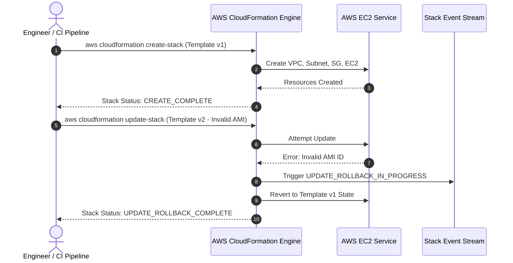
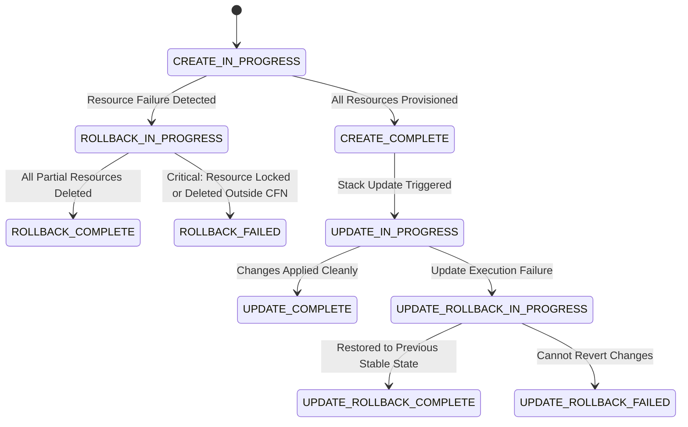

---
title: "Lab 03: AWS CloudFormation Templates, Stacks & Rollbacks"
course: "INT378: Advancements in Cloud and DevOps"
category: "practical-lab"
lab_number: 3
portion: "Portion 3: Infrastructure as Code (IaC)"
hub: "[[INT378 Master Strategy & Curriculum Roadmap]]"
previous_lab: "[[Lab 02 - AWS IAM, MFA, Custom Policies & RBAC]]"
next_lab: "[[Lab 04 - Docker Architecture, Containerization & Hub]]"
companion_theory:
  - "[[Unit 2 - Infrastructure as Code (IaC)]]"
course_outcomes:
  - "CO2"
  - "CO4"
code_template: "[[03 - Infrastructure as Code (Terraform & CloudFormation)/code/lab03-cloudformation/vpc-ec2-web-stack.yaml]]"
target_environment: "AWS Free Tier / AWS Academy"
cost_profile: "$0.00 (Free Tier t2.micro / t3.micro)"
estimated_duration: "45m"
tools_used:
  - "AWS CLI"
  - "AWS CloudFormation"
  - "YAML Templates"
  - "Change Sets"
teardown_required: true
verification_status: "ready"
tags:
  - int378/lab-03
  - aws
  - cloudformation
  - iac
  - rollback
  - change-sets
last_updated: 2026-11-03
---

# Lab 03: AWS CloudFormation Templates, Stacks & Rollbacks

**Course Outcome Alignment:** CO2, CO4  
**Target Environment:** AWS Free Tier / AWS Academy Learner Lab  
**Estimated Run Time:** 45 minutes  
**Template Location:** `03 - Infrastructure as Code (Terraform & CloudFormation)/code/lab03-cloudformation/vpc-ec2-web-stack.yaml`

---

## 1. Architectural Blueprint

In this experiment, you will codify cloud infrastructure using AWS CloudFormation. You will deploy a stack containing a VPC, Subnet, Security Group, and EC2 instance, execute stack updates, simulate an erroneous update to trigger automated rollback, and analyze the CloudFormation event stream.



---

## 2. Concept & Theoretical Foundations

1. **Stack**: A single operational unit managing a collection of related AWS resources. Creating, updating, or deleting a stack creates, updates, or deletes all constituent resources.
2. **Parameters & Pseudo Parameters**: Allow passing runtime arguments (e.g., Environment name, Instance Type) and referencing built-in AWS values (`AWS::Region`, `AWS::StackName`).
3. **Automated Rollback**: If an error occurs during stack creation or modification, CloudFormation rolls back the entire transaction to protect system integrity, preventing half-configured orphan infrastructure.
4. **Change Sets**: Generates an execution diff before applying changes, allowing engineers to review whether a change causes resource interruption or full replacement (crucial for databases and persistent storage).

---

## 3. Step-by-Step Implementation Guide

### Step 1: Inspect the CloudFormation Template
The template is provided at `03 - Infrastructure as Code (Terraform & CloudFormation)/code/lab03-cloudformation/vpc-ec2-web-stack.yaml`. It contains:
- `Parameters`: `InstanceType` (default `t2.micro`), `KeyName`.
- `Resources`:
  - `LabVPC` (`AWS::EC2::VPC`)
  - `LabSubnet` (`AWS::EC2::Subnet`)
  - `LabInternetGateway` & `LabVPCGatewayAttachment`
  - `LabRouteTable` & `LabDefaultRoute`
  - `LabSecurityGroup` (Allow port 80 & 22)
  - `WebServerInstance` (`AWS::EC2::Instance` with UserData script installing Apache)
- `Outputs`: `WebServerPublicIP`, `WebsiteURL`.

### Step 2: Validate the Template Syntax
Before deploying, validate the template offline:
```bash
aws cloudformation validate-template \
    --template-body file://"Cloud and DevOps/03 - Infrastructure as Code (Terraform & CloudFormation)/code/lab03-cloudformation/vpc-ec2-web-stack.yaml"
```
*Expected Output*: Returns parameters and description without errors.

### Step 3: Create the CloudFormation Stack
```bash
aws cloudformation create-stack \
    --stack-name int378-cfn-webstack \
    --template-body file://"Cloud and DevOps/03 - Infrastructure as Code (Terraform & CloudFormation)/code/lab03-cloudformation/vpc-ec2-web-stack.yaml" \
    --parameters ParameterKey=InstanceType,ParameterValue=t2.micro
```

Monitor stack creation progress:
```bash
aws cloudformation describe-stack-events \
    --stack-name int378-cfn-webstack \
    --query "StackEvents[*].[LogicalResourceId,ResourceType,ResourceStatus,ResourceStatusReason]" \
    --output table
```

Wait until the stack completes:
```bash
aws cloudformation wait stack-create-complete --stack-name int378-cfn-webstack
echo "Stack successfully created!"
```

Query the generated outputs (Website URL and Public IP):
```bash
aws cloudformation describe-stacks \
    --stack-name int378-cfn-webstack \
    --query "Stacks[0].Outputs" --output table
```

### Step 4: Test Stack Update with a Change Set
Create a change set to preview modifications:
```bash
aws cloudformation create-change-set \
    --stack-name int378-cfn-webstack \
    --change-set-name AddTagChangeSet \
    --template-body file://"Cloud and DevOps/03 - Infrastructure as Code (Terraform & CloudFormation)/code/lab03-cloudformation/vpc-ec2-web-stack.yaml" \
    --parameters ParameterKey=InstanceType,ParameterValue=t2.micro

# Inspect the change set
aws cloudformation describe-change-set \
    --stack-name int378-cfn-webstack \
    --change-set-name AddTagChangeSet \
    --query "Changes[*].[ResourceChange.Action,ResourceChange.LogicalResourceId,ResourceChange.Replacement]" --output table
```

### Step 5: Trigger and Observe Stack Rollback
To see automated rollback in action, attempt an update with an invalid/non-existent AMI ID:
```bash
# Attempt stack update with a bogus AMI ID
aws cloudformation update-stack \
    --stack-name int378-cfn-webstack \
    --template-body file://"Cloud and DevOps/03 - Infrastructure as Code (Terraform & CloudFormation)/code/lab03-cloudformation/vpc-ec2-web-stack.yaml" \
    --parameters ParameterKey=AmiId,ParameterValue=ami-99999999bogusami 2>&1 || true

# Watch the automated rollback events
aws cloudformation describe-stack-events \
    --stack-name int378-cfn-webstack \
    --query "StackEvents[?ResourceStatus=='UPDATE_ROLLBACK_IN_PROGRESS' || ResourceStatus=='UPDATE_ROLLBACK_COMPLETE']" --output table
```

#### CloudFormation Stack Lifecycle & Rollback State Machine



> [!NOTE]
> **Why `ROLLBACK_FAILED` happens**: If a resource (such as an S3 bucket with files or an active ENI) cannot be deleted during a rollback, CloudFormation halts in `ROLLBACK_FAILED`. To recover, the engineer must either manually empty the bucket or use the AWS Console to skip the problematic resource during rollback.

---

## 4. CloudFormation vs. Terraform Comparison in Practice

| Dimension | CloudFormation Lab Observation | Terraform Equivalent |
| :--- | :--- | :--- |
| **Validation** | `aws cloudformation validate-template` | `terraform validate` |
| **Previewing Changes**| CloudFormation Change Sets | `terraform plan` |
| **Execution** | AWS manages execution queue asynchronously in the cloud. | Terraform executes locally via provider API calls in terminal. |
| **Rollback Handling** | Automatic server-side rollback to previous stable stack. | State-driven; requires manual re-application of previous code commit. |
| **State Storage** | Implicitly held within the AWS CloudFormation control plane. | Explicit `terraform.tfstate` file requiring S3 backend and locking. |

---

## 5. Teardown & Cleanup Checklist

Deleting a CloudFormation stack automatically de-provisions all resources created by that stack in reverse dependency order:

```bash
# Delete the stack
aws cloudformation delete-stack --stack-name int378-cfn-webstack

# Wait for complete deletion
aws cloudformation wait stack-delete-complete --stack-name int378-cfn-webstack
echo "Stack and all associated resources completely eliminated."
```

---

## 6. Viva Voce & Interview Questions

1. **What is a CloudFormation Change Set and why should you use it in production?**
   - *Answer*: A Change Set lets you preview proposed modifications to your infrastructure before applying them, highlighting whether resources will be modified in-place or deleted and replaced.
2. **What causes a CloudFormation stack to enter the `UPDATE_ROLLBACK_FAILED` state, and how do you resolve it?**
   - *Answer*: It occurs when CloudFormation cannot restore a resource to its previous state during rollback (e.g., if a security group or subnet is locked by an external dependent resource). Resolution requires `continue-update-rollback` with resource skips.
3. **How does CloudFormation handle dependencies between resources?**
   - *Answer*: CloudFormation automatically calculates dependencies via intrinsic functions like `!Ref` and `!GetAtt`. For explicit ordering where no reference exists, the `DependsOn` attribute is used.
