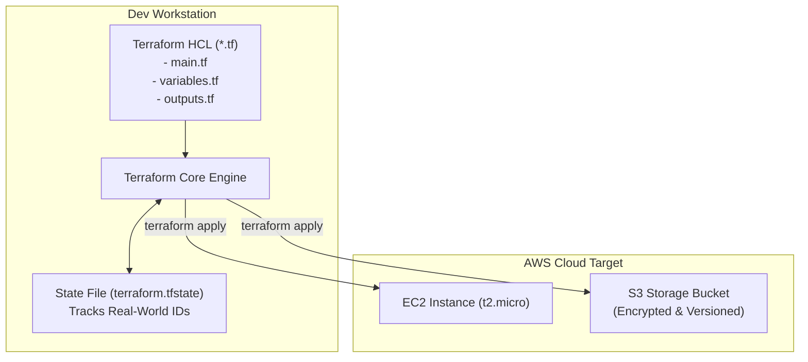
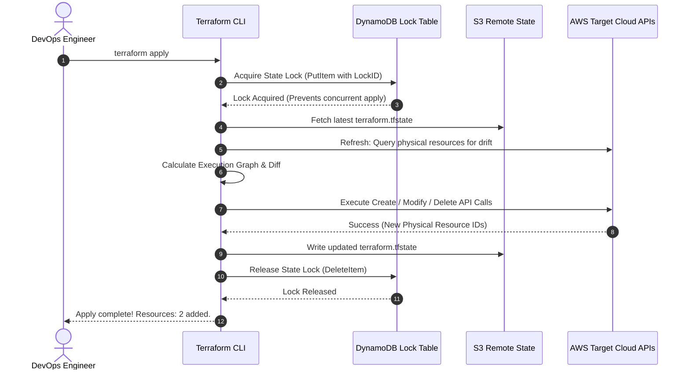

---
title: "Lab 05: Terraform IaC (EC2, S3 & State Management)"
course: "INT378: Advancements in Cloud and DevOps"
category: "practical-lab"
lab_number: 5
portion: "Portion 3: Infrastructure as Code (IaC)"
hub: "[[INT378 Master Strategy & Curriculum Roadmap]]"
previous_lab: "[[Lab 04 - Docker Architecture, Containerization & Hub]]"
next_lab: "[[Lab 06 - Automated CI-CD with Jenkins & GitHub Webhooks]]"
companion_theory:
  - "[[Unit 2 - Infrastructure as Code (IaC)]]"
course_outcomes:
  - "CO2"
  - "CO4"
code_directory: "03 - Infrastructure as Code (Terraform & CloudFormation)/code/lab05-terraform"
target_environment: "Local CLI with AWS Free Tier Credentials"
cost_profile: "$0.00 (t2.micro + S3 bucket within free tier limits)"
estimated_duration: "45m"
tools_used:
  - "HashiCorp Terraform / OpenTofu"
  - "AWS Provider"
  - "HCL"
  - "State Management"
teardown_required: true
verification_status: "ready"
tags:
  - int378/lab-05
  - terraform
  - opentofu
  - iac
  - aws
  - s3
  - ec2
last_updated: 2026-11-03
---

# Lab 05: Terraform IaC (EC2, S3 & State Management)

**Course Outcome Alignment:** CO2, CO4  
**Target Environment:** Local Workstation with AWS CLI / AWS Free Tier or Learner Lab  
**Estimated Run Time:** 45 minutes  
**Cost Warning:** Free-tier eligible (`t2.micro` + S3). Always run `terraform destroy` when finished!  
**Code Location:** `03 - Infrastructure as Code (Terraform & CloudFormation)/code/lab05-terraform/`

---

## 1. Architectural Blueprint

In this experiment, you will codify infrastructure using HashiCorp Terraform (or OpenTofu). You will declare an AWS S3 bucket with versioning and server-side encryption, an EC2 instance within an existing default VPC, parameterize values using input variables, inspect the state graph, perform infrastructure mutations, and tear down everything cleanly using `terraform destroy`.



---

## 2. Concept & Theoretical Foundations

1. **HashiCorp Configuration Language (HCL)**: Declarative syntax designed to be human-readable and machine-friendly.
2. **The 5-Step Lifecycle**:
   - `terraform init`: Initializes working directory, downloads AWS provider plugins, and configures state backend.
   - `terraform validate`: Verifies syntax and configuration correctness without calling cloud APIs.
   - `terraform plan`: Calculates delta between actual state and desired code configuration.
   - `terraform apply`: Applies the changes via cloud provider APIs and updates `terraform.tfstate`.
   - `terraform destroy`: Reads the state file and terminates all provisioned resources.
3. **State File (`terraform.tfstate`)**: A sensitive JSON file that maps declared code resources to physical cloud identifiers (e.g., `aws_instance.web` $\to$ `i-0a1b2c3d4e5f`). Losing the state file causes Terraform to lose track of managed infrastructure.

### Enterprise State Locking Architecture



> [!IMPORTANT]
> Without state locking, if two engineers or CI pipelines run `terraform apply` concurrently, both would read the same state simultaneously and attempt conflicting mutations, corrupting the state file and producing duplicate resources.

---

## 3. Step-by-Step Implementation Guide

### Step 1: Install Terraform or OpenTofu
- **Windows (Chocolatey / Winget)**:
  ```powershell
  winget install Hashicorp.Terraform
  # OR OpenTofu:
  # winget install OpenTofu.tofu
  ```
- Verify installation:
  ```bash
  terraform -version
  ```

### Step 2: Review Terraform Code Structure
Navigate to `03 - Infrastructure as Code (Terraform & CloudFormation)/code/lab05-terraform/`:
- `main.tf`: Provider definition, S3 bucket with AES-256 encryption, and EC2 instance.
- `variables.tf`: Type-safe variable declarations with descriptions and default values.
- `outputs.tf`: Exports the provisioned instance public IP and S3 bucket ARN.
- `terraform.tfvars.example`: Example variable overrides.

### Step 3: Initialize Terraform Working Directory
```bash
cd "03 - Infrastructure as Code (Terraform & CloudFormation)/code/lab05-terraform"

# Initialize provider plugins
terraform init
```
*Expected Output*: `Terraform has been successfully initialized!` creates `.terraform/` and `.terraform.lock.hcl`.

### Step 4: Validate and Plan
```bash
# Validate syntax
terraform validate

# Generate execution plan
terraform plan -out=tfplan
```
*Analyze the output*: Notice the `+ create` symbols indicating planned resource additions.

### Step 5: Apply Infrastructure
```bash
terraform apply tfplan
```
*Expected Output*: `Apply complete! Resources: 2 added, 0 changed, 0 destroyed.` Outputs will print the generated S3 bucket name and EC2 public IP.

### Step 6: Inspect State File & Graph
```bash
# List all resources tracked in the state file
terraform state list

# Show detailed attributes of the EC2 instance from state
terraform state show aws_instance.int378_vm

# View outputs stored in state
terraform output
```

### Step 7: Modify Infrastructure (In-Place Mutation)
Open `variables.tf` or provide an inline variable to change the EC2 instance tag:
```bash
terraform apply -var="environment=production" -auto-approve
```
*Observe*: Terraform performs an **in-place update (`~`)** on the instance tags without terminating or recreating the virtual machine!

---

## 4. State Drift Simulation

To see how Terraform handles external drift:
1. Go to AWS Console or use CLI to manually change the tag of the EC2 instance:
   ```bash
   aws ec2 create-tags --resources <INSTANCE_ID> --tags Key=ManualDrift,Value=DiscoveredByConsole
   ```
2. Run `terraform plan`:
   ```bash
   terraform plan
   ```
   *Notice*: Terraform queries AWS, detects that the cloud state drifted from the code, and plans to revert the unauthorized manual change to restore the code state.

---

## 5. Teardown & Cleanup Checklist

> [!CAUTION]
> Failure to destroy Terraform resources will lead to continuous AWS usage charges.

```bash
# Destroy all infrastructure provisioned by this configuration
terraform destroy -auto-approve

# Verify all resources are eliminated
terraform state list
# Should return nothing!

# Clean up local sensitive plan files
rm -f tfplan terraform.tfstate terraform.tfstate.backup
```

---

## 6. Viva Voce & Interview Questions

1. **Why is it dangerous to commit `terraform.tfstate` to a public Git repository?**
   - *Answer*: The state file stores sensitive metadata in plaintext, including database passwords, initial SSH keys, and resource IDs. State files should always be stored in an encrypted remote backend (such as an S3 bucket with restricted IAM permissions).
2. **What is state locking and why is it needed?**
   - *Answer*: When multiple engineers or automated CI pipelines execute `terraform apply` concurrently, state locking (via DynamoDB) prevents race conditions and corrupted state files by ensuring only one apply runs at a time.
3. **What is the difference between `terraform plan` and `terraform apply`?**
   - *Answer*: `plan` calculates and previews the execution graph without making any changes to cloud resources. `apply` actually executes the API calls to build or modify the infrastructure and updates the state file.
