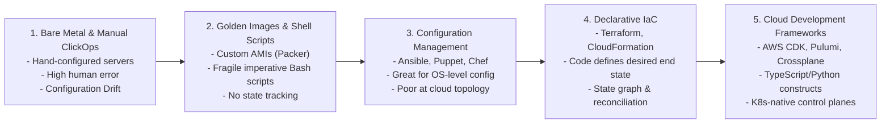
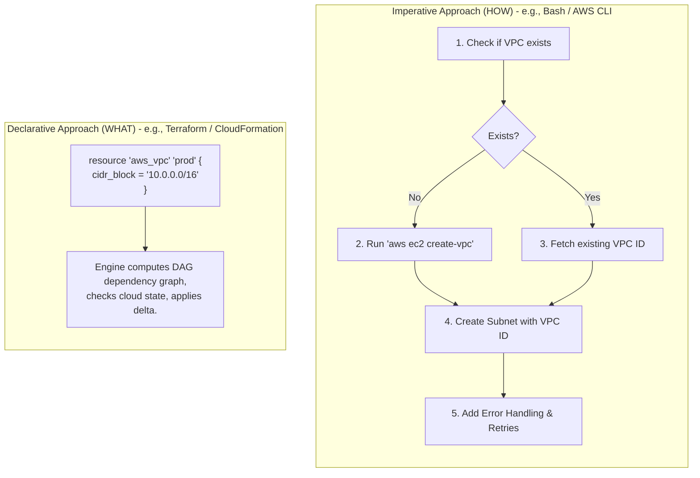
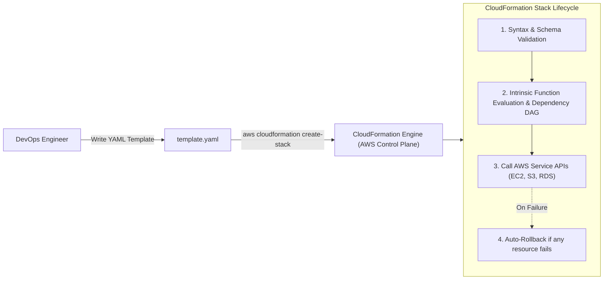
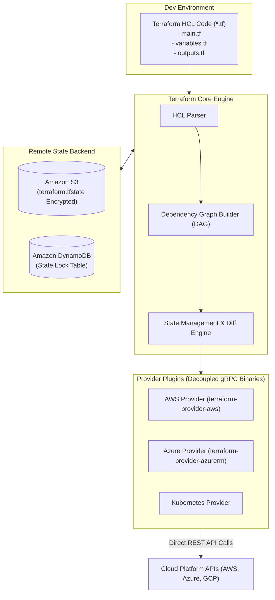
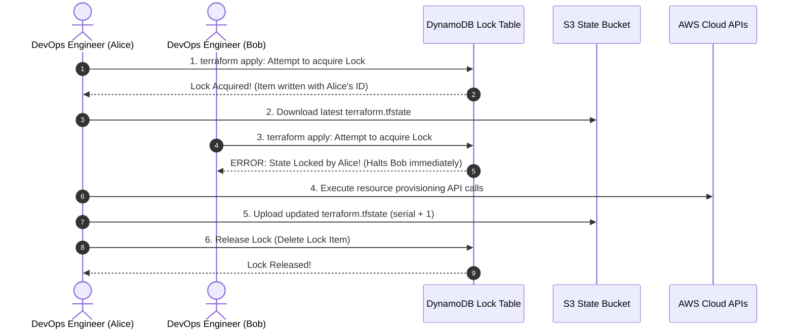

---
title: "Unit 2: Infrastructure as Code (IaC)"
course: "INT378: Advancements in Cloud and DevOps"
category: "theory-unit"
unit_number: 2
portion: "Portion 3: Infrastructure as Code (IaC)"
hub: "[[INT378 Master Strategy & Curriculum Roadmap]]"
previous_unit: "[[Unit 1 - Advanced Cloud Infrastructure & Services]]"
next_unit: "[[Unit 3 - Agile and CI-CD Practices for Scalable Systems]]"
course_outcomes:
  - "CO2"
  - "CO4"
companion_labs:
  - "[[Lab 03 - AWS CloudFormation Templates, Stacks & Rollbacks]]"
  - "[[Lab 05 - Terraform IaC (EC2, S3 & State Management)]]"
code_templates:
  - "[[03 - Infrastructure as Code (Terraform & CloudFormation)/code/lab03-cloudformation/vpc-ec2-web-stack.yaml]]"
  - "[[03 - Infrastructure as Code (Terraform & CloudFormation)/code/lab05-terraform/main.tf]]"
core_technologies:
  - "HashiCorp Terraform"
  - "OpenTofu"
  - "AWS CloudFormation"
  - "AWS CDK"
  - "Pulumi"
  - "Crossplane"
exam_weightage: "High"
difficulty: "Intermediate"
estimated_read_time: "25m"
status: "completed"
tags:
  - int378/unit-2
  - iac
  - terraform
  - cloudformation
  - state-management
  - automation
last_updated: 2026-11-03
---

# Unit 2: Infrastructure as Code (IaC)

---

## 1. Executive Summary & The Evolution of Infrastructure

In the early days of IT, provisioning an environment required manually raising procurement tickets, racking physical hardware servers in a datacenter, plugging in Ethernet cables, and hand-typing Linux commands across terminal sessions. This manual approach resulted in **snowflake servers**—unique, undocumented, and impossible to reproduce accurately.

### The Evolution of Cloud Provisioning


### Why IaC is the Backbone of DevOps
1. **Single Source of Truth (SSOT)**: Every subnet, firewall rule, database replica, and cache node is codified in version control (Git). Infrastructure history is auditable via Git commits.
2. **Elimination of Configuration Drift**: Human modifications made in cloud consoles ("clickOps") break environment parity. IaC detects this divergence and forces reconciliation back to the declared codebase.
3. **Idempotency**: An operation is **idempotent** if running it once produces the desired state, and running it 100 times subsequently produces the exact same state with zero side effects or duplicate resource launches.
4. **Disaster Recovery (RTO & RPO)**: If an entire AWS geographic region collapses, an engineer can execute `terraform apply` against an alternate region and reconstruct a multi-million-dollar production enterprise environment from scratch in minutes.

---

## 2. Declarative vs. Imperative Paradigms



| Dimension | Declarative (Terraform, CloudFormation) | Imperative (Bash, Python Boto3, AWS CLI) |
| :--- | :--- | :--- |
| **Philosophical Goal** | *"Here is what I want the world to look like. You figure out how to get there."* | *"Follow these exact sequential instructions step-by-step."* |
| **State Reconciliation** | Built-in. Compares declared code with actual cloud state and executes only the delta ($\Delta$). | Manual. The developer must write custom conditional logic to inspect whether resources already exist. |
| **Handling Interrupted Runs** | Self-healing. Re-running the tool detects what was already provisioned and resumes. | Danger of partial failures: duplicate resources created, orphaned billing resources, or fatal script crashes. |
| **Dependency Management** | Constructs an internal **Directed Acyclic Graph (DAG)** to provision unblocked resources in parallel automatically. | Must be manually sequenced by the script author. |

---

## 3. Deep-Dive: AWS CloudFormation

AWS CloudFormation is Amazon's fully managed, native Infrastructure as Code service. It uses JSON or YAML templates to manage the entire lifecycle of AWS resources as a single unit called a **Stack**.



### 3.1 Complete Template Anatomy Breakdown
A CloudFormation template comprises 8 primary top-level sections:

```yaml
AWSTemplateFormatVersion: '2010-09-09' # Identifies template capability version
Description: 'Production Web Application Infrastructure'

Metadata: # Arbitrary JSON/YAML objects providing contextual information
  AWS::CloudFormation::Interface:
    ParameterGroups:
      - Label: { default: "Network Configuration" }
        Parameters: [ VpcCidr, SubnetCidr ]

Parameters: # Dynamic inputs passed to template at stack launch
  InstanceType:
    Type: String
    Default: t2.micro
    AllowedValues: [t2.micro, t3.micro]
    Description: EC2 compute size

Mappings: # Static lookup tables (e.g., matching Regions to AMI IDs)
  RegionMap:
    us-east-1:
      AMI: ami-0c55b159cbfafe1f0
    eu-west-1:
      AMI: ami-01f14919ba412de34

Conditions: # Boolean flags controlling conditional resource provisioning
  IsProduction: !Equals [ !Ref EnvironmentType, "production" ]

Transform: # Macro used for AWS Serverless Application Model (AWS SAM)
  - 'AWS::Serverless-2016-10-31'

Resources: # MANDATORY: Declares the actual cloud components to provision
  ProductionVPC:
    Type: AWS::EC2::VPC
    Properties:
      CidrBlock: !Ref VpcCidr
      EnableDnsHostnames: true
      Tags:
        - Key: Name
          Value: !Sub "${AWS::StackName}-VPC"

Outputs: # Exports values for use by other stacks or CLI scripts
  VpcIdExport:
    Description: The ID of the created VPC
    Value: !Ref ProductionVPC
    Export:
      Name: !Sub "${AWS::StackName}-VPC-ID"
```

### 3.2 CloudFormation Intrinsic Functions Explained
CloudFormation provides built-in intrinsic functions to assign values to properties that are not available until runtime:

1. **`!Ref`**: References the physical ID of a resource or the value of a parameter.
   ```yaml
   VpcId: !Ref ProductionVPC
   ```
2. **`!GetAtt`**: Retrieves a specific named attribute from a resource.
   ```yaml
   SubnetId: !GetAtt MySubnet.SubnetId
   PublicIP: !GetAtt WebInstance.PublicIp
   ```
3. **`!Sub`**: Substitutes variables into a string template. Pseudo-parameters like `${AWS::Region}` and `${AWS::AccountId}` are automatically interpolated.
   ```yaml
   Name: !Sub "${AWS::StackName}-app-${AWS::Region}"
   ```
4. **`!FindInMap`**: Looks up a value in the `Mappings` block based on keys.
   ```yaml
   ImageId: !FindInMap [ RegionMap, !Ref "AWS::Region", AMI ]
   ```
5. **`!Join`**: Concatenates a list of strings with a specified delimiter.
   ```yaml
   FullDomain: !Join [ ".", [ "api", "internal", "example", "com" ] ]
   ```

### 3.3 Stack Lifecycle, Change Sets & Rollback Recovery
- **Change Sets**: Before modifying a live production stack, you generate a Change Set. CloudFormation calculates the delta and reports whether an existing resource will undergo:
  - *No Interruption*: Modified in place (e.g., adding a tag).
  - *Some Interruption*: Service restarted (e.g., changing some security group rules).
  - *Replacement*: **Destructive!** The resource is terminated and recreated with a new physical ID (e.g., changing an RDS database subnet group or EC2 AMI).
- **Automated Rollback Engine**: If CloudFormation encounters an error while deploying a stack (e.g., invalid AMI ID or subnet IP exhaustion), it enters `UPDATE_ROLLBACK_IN_PROGRESS`. It tears down newly created resources and restores previously functioning resources back to the last known stable state.
- **`UPDATE_ROLLBACK_FAILED` Troubleshooting**: Occurs when a dependency outside CloudFormation locks a resource during a rollback. To fix, you run:
  ```bash
  aws cloudformation continue-update-rollback \
      --stack-name my-stack \
      --resources-to-skip ProblematicResourceLogicalId
  ```

---

## 4. Deep-Dive: HashiCorp Terraform & OpenTofu

Terraform is an open-source, multi-cloud Infrastructure as Code engine. In 2023, HashiCorp altered Terraform's license from MPL-2.0 to the Business Source License (BSL). In response, the open-source community, backed by the Linux Foundation, created **OpenTofu**, an open-source, drop-in replacement fork.



### 4.1 The Core vs. Provider Decoupled Architecture
Terraform is fundamentally split into two distinct layers communicating via **gRPC sockets**:
1. **Terraform Core**:
   - Compiles and evaluates HCL code.
   - Builds the resource dependency graph (DAG) to determine which resources can be safely created in parallel.
   - Compares the state file against real-world cloud infrastructure.
2. **Terraform Providers**:
   - Decoupled binary executables downloaded during `terraform init`.
   - Each provider translates Terraform Core resource instructions into real REST API calls to the target platform (AWS, Azure, GCP, GitHub, Datadog, Cloudflare).

### 4.2 The Terraform State File (`terraform.tfstate`) Internals
Terraform does not query cloud APIs for every single piece of information from scratch; it maintains a mapping between your HCL resource declarations and the physical cloud objects in a JSON document called **state**.

```json
{
  "version": 4,
  "terraform_version": "1.7.0",
  "serial": 12,
  "lineage": "e7b1a2c3-4d5e-6f7a-8b9c-0d1e2f3a4b5c",
  "resources": [
    {
      "mode": "managed",
      "type": "aws_instance",
      "name": "web_server",
      "provider": "provider[\"registry.terraform.io/hashicorp/aws\"]",
      "instances": [
        {
          "schema_version": 1,
          "attributes": {
            "id": "i-0a1b2c3d4e5f67890",
            "ami": "ami-0c55b159cbfafe1f0",
            "instance_type": "t2.micro",
            "public_ip": "54.210.12.34"
          }
        }
      ]
    }
  ]
}
```

> [!WARNING]
> **Why Local State is an Anti-Pattern**:
> Storing `terraform.tfstate` on a developer's local machine causes immediate merge conflicts when multiple engineers work on the same infrastructure. If two engineers run `terraform apply` simultaneously, state files desynchronize, duplicate resources are created, and cloud infrastructure becomes orphaned.

### 4.3 Enterprise Remote Backend with Distributed State Locking
The industry-standard solution on AWS combines **Amazon S3** (for encrypted remote state storage) with **Amazon DynamoDB** (for distributed concurrency locking).



#### Remote Backend Configuration in HCL:
```hcl
terraform {
  backend "s3" {
    bucket         = "int378-enterprise-tfstate"
    key            = "production/infrastructure.tfstate"
    region         = "us-east-1"
    encrypt        = true
    dynamodb_table = "terraform-state-lock-table"
  }
}
```

### 4.4 The 5 Core CLI Lifecycle Commands
1. **`terraform init`**: Scans `*.tf` files, downloads required provider plugins into `.terraform/`, and establishes the remote backend connection.
2. **`terraform validate`**: Verifies HCL syntax, provider resource types, and variable types without making any external cloud network calls.
3. **`terraform plan`**: Reconciles the state file against actual cloud infrastructure (via API reads), identifies configuration drift, and generates an execution plan highlighting what will be added (`+`), updated in place (`~`), or destroyed (`-`).
4. **`terraform apply`**: Executes the approved execution plan against cloud APIs in parallel dependency order, writing the final state back to the backend.
5. **`terraform destroy`**: Reads the state file and terminates all provisioned resources in exact reverse dependency order.

---

## 5. Comprehensive Head-to-Head Comparison: Terraform vs. AWS CloudFormation

| Evaluation Parameter | HashiCorp Terraform / OpenTofu | AWS CloudFormation |
| :--- | :--- | :--- |
| **Ecosystem & Scope** | Multi-Cloud & Multi-Platform (AWS, Azure, GCP, Kubernetes, GitHub, Cloudflare). | AWS-centric (manages AWS resources natively). |
| **Language & Readability**| **HCL (HashiCorp Configuration Language)**: Concise, expressive, human-readable, supports native comments. | **JSON or YAML**: Verbose, strict indentation rules, complex multi-line strings. |
| **State Management** | **Explicit**: Stored in a state file (`terraform.tfstate`) managed by user (requires S3 + DynamoDB setup). | **Implicit**: Fully managed server-side by AWS control plane. No state files to lose or configure. |
| **Speed & Feedback Loop**| **High**: Dependency graph computed locally on workstation; parallel API calls fire immediately. | **Moderate**: Templates are queued server-side in AWS; event polling introduces feedback latency. |
| **Resource Rollback** | Relies on Git version control. Failed applies remain in current state; re-applying fixed code reconciles. | Automated rollback engine returns stack to last stable state upon update failure. |
| **Community Registry** | Massive open-source Terraform Registry with thousands of pre-tested community modules. | AWS Quick Starts and CloudFormation Registry. |
| **Licensing** | OpenTofu (MPL 2.0 open-source) / Terraform (BSL). | Proprietary AWS Cloud Managed Service. |

---

## 6. Emerging Trends & The Future of IaC

1. **AWS Cloud Development Kit (CDK)**:
   - Eliminates raw YAML/JSON. Enables developers to declare cloud architecture using standard imperative programming languages (**TypeScript, Python, Go, Java, C#**).
   - Under the hood, the CDK synthesizes standard declarative AWS CloudFormation templates via `cdk synth`.
2. **Pulumi**:
   - Like CDK, Pulumi uses general-purpose programming languages, but applies changes directly to cloud APIs (multi-cloud) like Terraform, bypassing CloudFormation templates.
3. **Crossplane**:
   - A CNCF project that extends the **Kubernetes API** to manage external cloud infrastructure using Custom Resource Definitions (CRDs). Enables managing databases, S3 buckets, and VPCs using `kubectl`.
4. **AI-Driven Infrastructure as Code**:
   - Generative AI tools (Amazon Q Developer, GitHub Copilot) synthesizing HCL and CloudFormation templates directly from natural-language architecture prompts, combined with automated security static analysis (Checkov, tfsec).

---

## 7. Review, Exam & Viva Questions with Model Answers

### Question 1: What is idempotency in Infrastructure as Code, and why is it essential for CI/CD automation?
**Model Answer:**
Idempotency is the mathematical and operational property wherein executing an operation multiple times produces the exact same result as executing it once, without unintended side effects. In CI/CD automation, pipelines execute IaC scripts automatically on every code merge. If an IaC tool were not idempotent, re-running a pipeline would attempt to create duplicate subnets, throw "ResourceAlreadyExists" errors, or overwrite active database instances. Idempotency guarantees that only the delta ($\Delta$) between the code and cloud state is applied.

### Question 2: Explain how Amazon S3 and DynamoDB work together to manage Terraform state in team environments.
**Model Answer:**
In collaborative engineering teams, the local state file is moved to a remote backend. Amazon S3 acts as the **central encrypted storage layer**, storing the immutable `terraform.tfstate` document with versioning enabled to recover from accidental state corruptions. Amazon DynamoDB provides **distributed state locking**. When a developer or CI runner executes `terraform apply`, Terraform writes an item containing a unique Lock ID to DynamoDB. Concurrent executions are blocked until the lock is released upon completion, preventing race conditions and corrupted state.

### Question 3: What is a CloudFormation Change Set, and how does it prevent production outages?
**Model Answer:**
A CloudFormation Change Set is a dry-run preview of proposed modifications to an active stack. It analyzes the differences between the current template and the new template, detailing whether resources will be created, updated without interruption, or replaced. This prevents catastrophic outages by alerting engineers beforehand if a critical production resource (such as an RDS database or persistent EBS volume) would be accidentally deleted and recreated due to an immutable property change.

### Question 4: Compare Terraform Modules with CloudFormation Nested Stacks.
**Model Answer:**
- **Terraform Modules**: Reusable, parameterized packages of HCL code stored locally or in a Git/Terraform registry. Modules are compiled locally into a single cohesive dependency graph during `terraform plan`.
- **CloudFormation Nested Stacks**: Stacks created as components of other parent stacks using the `AWS::CloudFormation::Stack` resource. They are stored as separate templates in an S3 bucket and managed as individual child stacks in the AWS CloudFormation console.
