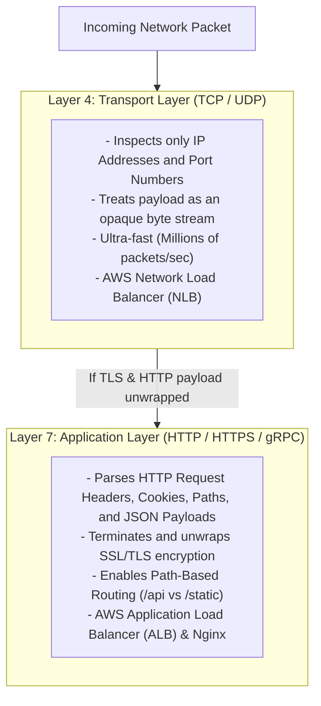
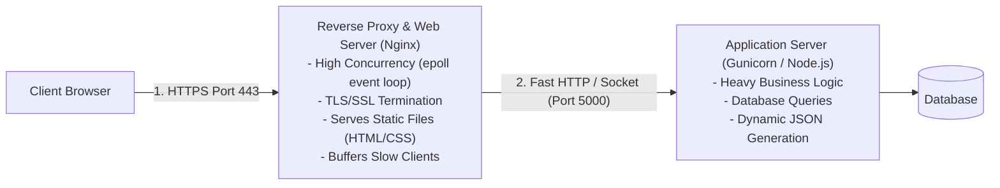
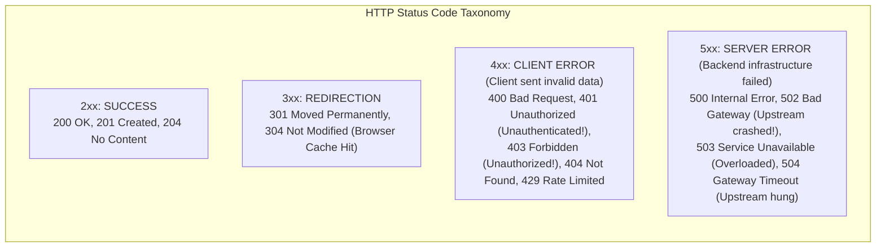
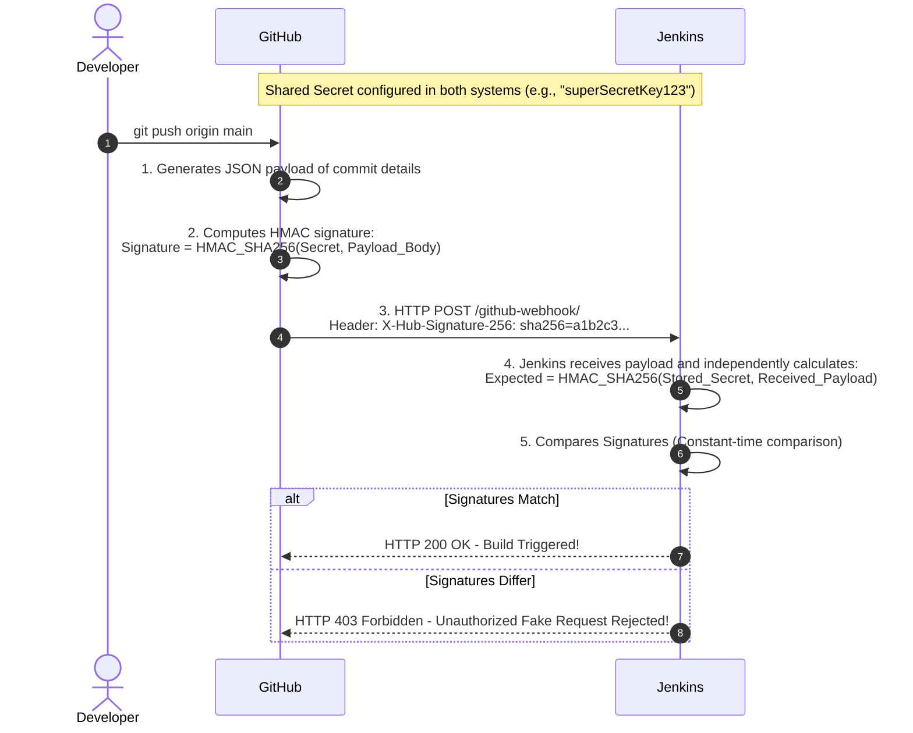
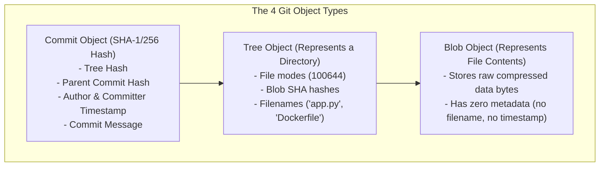

# Aux 06: Web Servers, Reverse Proxies & Application Protocols

In modern CI/CD and cloud deployments, you are constantly deploying web servers (Nginx/Apache), configuring GitHub Webhooks, and debugging HTTP 502/504 errors. Here is how web protocols, proxies, and version control graphs operate under the hood.

---

## 1. OSI Layer 4 (Transport) vs. Layer 7 (Application)

The Open Systems Interconnection (OSI) model standardizes network communication functions. In cloud infrastructure, architectural decisions center on **Layer 4** vs. **Layer 7**.



---

## 2. Web Server vs. Application Server vs. Reverse Proxy

Developers frequently confuse the roles of Nginx, Apache HTTPD, Node.js, and Python Flask/Gunicorn.



### 2.1 The Architectural Taxonomy
1. **Web Server (Nginx / Apache HTTPD)**:
   - Written in C. Uses an asynchronous, non-blocking **event loop (`epoll` on Linux)**.
   - Capable of holding **tens of thousands of concurrent idle connections** with minimal RAM overhead (~2MB).
   - Designed to serve static media directly from disk and handle network security.
2. **Application Server (Node.js, Python Gunicorn, Java Tomcat)**:
   - Executes application code, compiles templates, connects to databases, and computes business algorithms.
   - Multi-threaded or process-based; each worker consumes substantial memory (50MB–500MB). Exposing an application server directly to the public internet is dangerous and inefficient.
3. **Reverse Proxy**:
   - A server that sits in front of one or more backend web servers, intercepting requests from clients and forwarding them to internal application servers.

### 2.2 Why Put Nginx in Front of Your Application?
- **Slow Client Buffering**: Mobile devices on slow 3G networks upload request payloads over seconds. If exposed directly, your application workers (e.g., Gunicorn processes) will be blocked waiting for bytes to arrive. Nginx buffers the entire request in its fast memory and hands it to the application server in microseconds.
- **SSL/TLS Offloading**: Nginx terminates the CPU-intensive cryptographic TLS handshake, allowing internal backend services to communicate via lightweight HTTP on private network interfaces.
- **Path-Based Microservice Routing**: Nginx routes `/api/v1/auth` to your Auth service and `/api/v1/billing` to your Billing container.

---

## 3. HTTP Protocol Mechanics & Status Code Taxonomy

An HTTP transaction is a text/binary protocol exchange over an established TCP connection.

### 3.1 HTTP Status Code Classes
SREs and DevOps engineers must memorize the meaning of status code classes:



### 3.2 The Common DevOps Failures: 502 vs. 504
- **HTTP 502 Bad Gateway**:
  - The proxy (Nginx or AWS ALB) attempted to forward a request to the backend application (e.g., Python Flask on port 5000), but **the backend refused the connection or crashed** (e.g., Python process died of an Out-Of-Memory error).
  - *Fix*: Check backend application status (`systemctl status myapp` or `docker ps`).
- **HTTP 504 Gateway Timeout**:
  - The proxy connected to the backend application, but **the backend took longer to return a response than the proxy's timeout limit** (e.g., an unindexed SQL query hung for 60 seconds).
  - *Fix*: Optimize backend query or increase proxy timeout headers.

---

## 4. Webhooks Under the Hood: Event-Driven Push vs. Polling

In CI/CD, how does Jenkins know when a developer executes `git push` on GitHub?

```mermaid
flowchart TD
    subgraph Polling["Option A: Polling SCM (Inefficient Pull)"]
        direction TB
        J1["Jenkins"] -->|"Every 60s: 'Any new commits?'"| G1["GitHub API"]
        G1 -->>|"No"| J1
        J1 -->|"Every 60s: 'Any new commits?'"| G1
        G1 -->>|"No"| J1
        Note1["Wastes API Rate Limits & Adds 60s Delay"]
    end

    subgraph Webhook["Option B: GitHub Webhook (Instant Event Push)"]
        direction TB
        Dev["Developer Git Push"] --> GitServer["GitHub Server"]
        GitServer -->|"Instant HTTP POST /github-webhook/ (JSON Payload)"| JenkinsHook["Jenkins Controller"]
        JenkinsHook -->|"Build Started in 50ms!"| Runner["Build Job"]
    end
```

### 4.1 Cryptographic Webhook Security (HMAC SHA-256)
If Jenkins exposes an endpoint at `http://jenkins.example.com/github-webhook/`, what stops an unauthorized party from sending fake POST requests to trigger thousands of expensive builds?

GitHub and Jenkins use **Hash-based Message Authentication Codes (HMAC SHA-256)**:



---

## 5. Git Internals: The Immutable DAG (Directed Acyclic Graph)

Git is not a system that tracks file diffs. Internally, Git is a **content-addressable object store** organized as a **Directed Acyclic Graph (DAG)** stored inside the hidden `.git/objects/` directory.



### What is a Branch in Git?
A branch is not an expensive copy of your project files. A branch is simply a **lightweight 41-byte text file** inside `.git/refs/heads/` containing the 40-character SHA hash of the commit it points to!
- Creating a branch (`git branch feature-x`) writes 41 bytes to disk.
- Committing a change calculates the SHA hash of the new commit object and updates the text file pointer.
- This architectural design allows Git to branch, merge, and traverse millions of historical commits in milliseconds.
