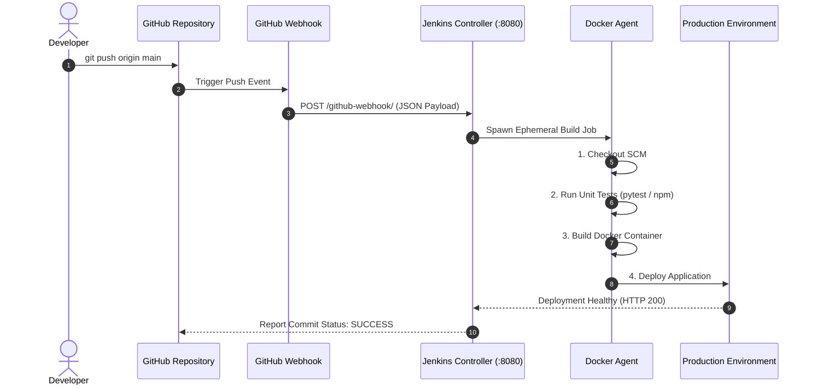

---
title: "Lab 06: Automated CI/CD Pipeline with Jenkins & GitHub Webhooks"
course: "INT378: Advancements in Cloud and DevOps"
category: "practical-lab"
lab_number: 6
portion: "Portion 4: Agile, CI/CD & DevSecOps Automation"
hub: "[[INT378 Master Strategy & Curriculum Roadmap]]"
previous_lab: "[[Lab 05 - Terraform IaC (EC2, S3 & State Management)]]"
next_lab: "[[Lab 07 - DevSecOps Pipeline (SAST, Trivy & Secret Mgmt)]]"
companion_theory:
  - "[[Unit 3 - Agile and CI-CD Practices for Scalable Systems]]"
course_outcomes:
  - "CO2"
  - "CO5"
code_directory: "04 - CI-CD, Agile & DevSecOps Pipelines/code/lab06-07-jenkins-devsecops"
target_environment: "Local Docker Compose / Cloud VM"
cost_profile: "$0.00 (Local open-source containers)"
estimated_duration: "50m"
tools_used:
  - "Jenkins LTS"
  - "GitHub Webhooks"
  - "Docker"
  - "Declarative Pipeline"
teardown_required: false
verification_status: "ready"
tags:
  - int378/lab-06
  - jenkins
  - ci-cd
  - github
  - webhooks
  - automation
last_updated: 2026-11-03
---

# Lab 06: Automated CI/CD Pipeline with Jenkins & GitHub Webhooks

**Course Outcome Alignment:** CO2, CO5  
**Target Environment:** Local Docker Compose OR AWS EC2 Instance (`t3.small` / `t2.medium`)  
**Estimated Run Time:** 50 minutes  
**Cost:** \$0.00 if run locally on Docker; minimal if run on EC2  
**Code Location:** `04 - CI-CD, Agile & DevSecOps Pipelines/code/lab06-07-jenkins-devsecops/`

---

## 1. Architectural Blueprint

In this experiment, you will deploy Jenkins, configure an ngrok / public reverse proxy (or EC2 public IP) for GitHub Webhooks, build a declarative CI/CD pipeline triggered by Git commits, and automate testing and deployment.



---

## 2. Concept & Theoretical Foundations

1. **Pipeline-as-Code**: Storing build, test, and release logic in a version-controlled `Jenkinsfile` directly in the project repository alongside application code.
2. **Webhooks vs. Polling**:
   - *Polling SCM*: Jenkins repeatedly queries GitHub (e.g., every 5 minutes). Inefficient, wastes API rate limits, and introduces release delays.
   - *Webhooks (Push Model)*: GitHub sends an instantaneous HTTP POST request to Jenkins the exact second a developer pushes code. Zero delay, zero wasted polls.
3. **Continuous Deployment Gate**: The pipeline halts immediately and sends alerts if any unit test or build step fails, preventing broken code from reaching staging or production.

---

## 3. Step-by-Step Implementation Guide

### Step 1: Deploy Jenkins Locally via Docker (Zero-Cost Setup)
Run Jenkins with Docker socket mounting (enabling Jenkins to build Docker images):
```bash
docker run -d \
    --name int378-jenkins \
    -p 8080:8080 -p 50000:50000 \
    -v jenkins_home:/var/jenkins_home \
    -v /var/run/docker.sock:/var/run/docker.sock \
    jenkins/jenkins:lts-jdk17
```

Retrieve the initial administrator password:
```bash
docker exec int378-jenkins cat /var/jenkins_home/secrets/initialAdminPassword
```
- Open `http://localhost:8080` in your browser.
- Paste the admin password, select **Install Suggested Plugins**, and create an admin user.

### Step 2: Set Up GitHub Webhook Tunneling (For Local Testing)
GitHub cannot reach `localhost:8080` directly. If running locally, expose Jenkins using `ngrok` or `localtunnel`:
```bash
# In a separate terminal
npx localtunnel --port 8080
# Output: your-subdomain.loca.lt
```

### Step 3: Configure GitHub Repository Webhook
1. Go to your GitHub repository $\to$ **Settings** $\to$ **Webhooks** $\to$ **Add webhook**.
2. **Payload URL**: `https://<YOUR_TUNNEL_URL>/github-webhook/`
3. **Content type**: `application/json`
4. **Which events to trigger**: Select **Just the push event**.
5. Click **Add webhook**. Ensure a green checkmark appears.

### Step 4: Create Pipeline Job in Jenkins
1. On Jenkins Dashboard, click **New Item**.
2. Enter item name: `int378-automated-pipeline`.
3. Select **Pipeline** $\to$ Click **OK**.
4. Under **Build Triggers**, check **GitHub hook trigger for GITScm polling**.
5. Under **Pipeline Definition**, select **Pipeline script from SCM**:
   - SCM: **Git**
   - Repository URL: Your GitHub repo URL.
   - Script Path: `Jenkinsfile.basic` (or paste contents of `Jenkinsfile.basic`).
6. Click **Save**.

### Step 5: Test Webhook Automation
1. Make a small code change in your local Git repository:
   ```bash
   echo "<!-- Updated via Webhook Trigger -->" >> index.html
   git commit -am "chore: test automated webhook trigger"
   git push origin main
   ```
2. Switch to Jenkins Dashboard:
   - Notice that Build #1 is automatically queued within seconds!
   - View console output: stages **Checkout**, **Unit Test**, **Docker Build**, and **Deploy** execute sequentially.

---

## 4. Verification Checklist

- [ ] Webhook delivery returns HTTP 200 in GitHub repository settings.
- [ ] Jenkins pipeline stage view shows all green checkmarks across stages.
- [ ] Container deployed on port 8080 responds to curl health probes.
- [ ] Introducing a failing test (`exit 1`) stops the pipeline before deployment.

---

## 5. Teardown & Cleanup Checklist

```bash
# Stop and remove local Jenkins container and volume
docker stop int378-jenkins
docker rm int378-jenkins
docker volume rm jenkins_home

# Close the webhook tunnel (Ctrl+C in localtunnel terminal)
```

---

## 6. Viva Voce & Interview Questions

1. **What is the difference between Scripted Pipeline and Declarative Pipeline in Jenkins?**
   - *Answer*: Scripted Pipeline uses standard Groovy syntax and procedural logic; Declarative Pipeline provides a more structured, readable, and opinionated syntax (`pipeline { stage { steps } }`) that catches syntax errors early.
2. **How does Jenkins Controller manage distributed builds across multiple Agents?**
   - *Answer*: The Controller schedules builds, manages credentials, and parses pipeline definitions, while delegating the heavy execution of build/test tasks to ephemeral worker agent nodes over SSH or JNLP.
3. **What is the role of `post` actions in a Jenkinsfile?**
   - *Answer*: `post` actions run conditionally after pipeline execution (`always`, `success`, `failure`), ideal for cleaning up workspaces, archiving test reports, or sending failure notifications to Slack/Teams.
