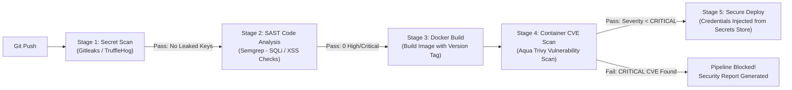
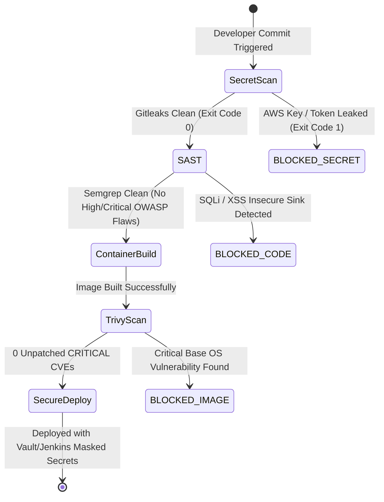

---
title: "Lab 07: DevSecOps Pipeline (SAST, Trivy Image Scanning & Secrets Management)"
course: "INT378: Advancements in Cloud and DevOps"
category: "practical-lab"
lab_number: 7
portion: "Portion 4: Agile, CI/CD & DevSecOps Automation"
hub: "[[INT378 Master Strategy & Curriculum Roadmap]]"
previous_lab: "[[Lab 06 - Automated CI-CD with Jenkins & GitHub Webhooks]]"
next_lab: "[[Lab 08 - Prometheus & Node Exporter Metrics & Alerting]]"
companion_theory:
  - "[[Unit 5 - DevSecOps, IAM and Cloud Security]]"
course_outcomes:
  - "CO3"
  - "CO5"
code_directory: "04 - CI-CD, Agile & DevSecOps Pipelines/code/lab06-07-jenkins-devsecops"
target_environment: "Jenkins with Docker Engine"
cost_profile: "$0.00 (Open-source scanning tools)"
estimated_duration: "50m"
tools_used:
  - "Jenkins"
  - "Aqua Trivy"
  - "Gitleaks"
  - "Semgrep"
  - "Credentials Store"
teardown_required: false
verification_status: "ready"
tags:
  - int378/lab-07
  - devsecops
  - sast
  - trivy
  - gitleaks
  - cve-scan
last_updated: 2026-11-03
---

# Lab 07: DevSecOps Pipeline (SAST, Trivy Image Scanning & Secrets Management)

**Course Outcome Alignment:** CO3, CO5  
**Target Environment:** Jenkins with Docker Engine / Linux CLI  
**Estimated Run Time:** 50 minutes  
**Cost:** \$0.00 (All open-source tools: Trivy, Gitleaks, Semgrep)  
**Code Location:** `04 - CI-CD, Agile & DevSecOps Pipelines/code/lab06-07-jenkins-devsecops/`

---

## 1. Architectural Blueprint

In this experiment, you will transform a standard CI/CD pipeline into an enterprise-grade **DevSecOps pipeline**. You will integrate automated secret detection (Gitleaks), Static Application Security Testing (Semgrep / SonarQube), Docker image Common Vulnerabilities and Exposures (CVE) scanning (Aqua Trivy), secure credential masking using Jenkins Credentials Store, and automated security assessment report generation.



---

## 2. Concept & Theoretical Foundations

1. **Shift-Left Security**: Catching vulnerabilities at the commit and build phases where remediation costs $10\times$ to $100\times$ less than post-production incident response.
2. **Secrets Detection (Gitleaks)**: Scans Git history and uncommitted diffs for high-entropy strings and known regex patterns matching AWS access keys, GitHub personal access tokens, and private RSA keys.
3. **Static Application Security Testing (SAST)**: Analyzes source code without executing it, tracing data flows from untrusted inputs to dangerous sinks (OWASP Top 10 vulnerabilities).
4. **Container Image Scanning (Trivy)**: Scans base OS packages (Debian/Alpine) and application dependencies (npm, pip, maven) against national CVE vulnerability databases, reporting severity (LOW, MEDIUM, HIGH, CRITICAL).

---

## 3. Step-by-Step Implementation Guide

### Step 1: Install Security Scanners (Trivy & Gitleaks)
If running on Jenkins Agent or local machine:
```bash
# Install Trivy (Linux / macOS / Windows Winget)
# Windows: winget install AquaSecurity.Trivy
# Linux:
curl -sfL https://raw.githubusercontent.com/aquasecurity/trivy/main/contrib/install.sh | sh -s -- -b /usr/local/bin

# Verify Trivy
trivy --version
```

### Step 2: Configure Jenkins Credentials Store (Secrets Management)
1. In Jenkins Dashboard, navigate to **Manage Jenkins** $\to$ **Credentials** $\to$ **System** $\to$ **Global credentials**.
2. Click **Add Credentials**:
   - **Kind**: Secret text
   - **Scope**: Global
   - **Secret**: `super-secret-production-db-token-2026`
   - **ID**: `PROD_DB_TOKEN`
   - **Description**: Production Database Auth Token
3. Click **Create**.
*Security Guarantee: Jenkins encrypts this token on disk using AES-128 and automatically masks it (`****`) from console build logs.*

### Step 3: Run Standalone Security Tests

#### 1. Test Secret Scanning (Gitleaks)
```bash
# Run Gitleaks scanner on repository
docker run -v $(pwd):/path zricethezav/gitleaks:latest detect --source="/path" -v
```

#### 2. Test Container Image Vulnerability Scanning (Trivy)
```bash
# Scan a vulnerable image to see Trivy detect CVEs:
trivy image --severity HIGH,CRITICAL python:3.9-slim

# Scan an optimized image and generate a JUnit/JSON report:
trivy image --exit-code 1 --severity CRITICAL --format json -o trivy-report.json int378-webapp:1.0
```
*Note: `--exit-code 1` causes Trivy to fail the CI/CD pipeline build if any CRITICAL vulnerability is discovered.*

### Step 4: Execute the Complete DevSecOps Declarative Pipeline
Configure a Jenkins pipeline job pointing to `04 - CI-CD, Agile & DevSecOps Pipelines/code/lab06-07-jenkins-devsecops/Jenkinsfile.devsecops`.

#### DevSecOps Multi-Stage Quality Gates



Key stages executed by the pipeline:
1. **Secret Detection**: Runs Gitleaks to verify no private keys or tokens were accidentally committed.
2. **SAST Analysis**: Runs Semgrep to inspect Python/Node code against OWASP Top 10 security rules.
3. **Container Build**: Builds the container image.
4. **Container CVE Scan**: Runs Trivy. If critical unpatched vulnerabilities are found, the build fails immediately.
5. **Report Archival**: Archives `trivy-report.html` and `semgrep-report.json` as downloadable build artifacts in Jenkins.
6. **Secure Deployment**: Injects `PROD_DB_TOKEN` dynamically via Jenkins credential binding.

---

## 4. Verification Checklist

- [ ] Deliberately adding an AWS key (`AKIAEXAMPLEKEY123456`) fails Stage 1 (Gitleaks).
- [ ] Deliberately introducing an unescaped SQL query (`"SELECT * FROM users WHERE id = " + id`) fails Stage 2 (SAST).
- [ ] Using an ancient vulnerable Docker base image (`node:10`) fails Stage 4 (Trivy).
- [ ] Passing pipeline generates and archives security reports accessible from the Jenkins UI build page.
- [ ] Secrets bound in `Jenkinsfile` appear masked as `****` in the build console log.

---

## 5. Teardown & Cleanup Checklist

```bash
# Clean up temporary test scan reports
rm -f trivy-report.json semgrep-report.json

# Remove test images
docker rmi -f python:3.9-slim
```

---

## 6. Viva Voce & Interview Questions

1. **Why is SAST alone not enough to guarantee application security in modern cloud deployments?**
   - *Answer*: SAST only scans proprietary custom code. Over $80\%$ of modern software comprises third-party open-source libraries and container OS dependencies, which require Software Composition Analysis (SCA) and container vulnerability scanning (Trivy/Snyk).
2. **What is the difference between a Vulnerability (CVE) and an Exploit?**
   - *Answer*: A CVE (Common Vulnerabilities and Exposures) is a documented flaw in software or firmware that can be potentially abused. An exploit is a working piece of code or technique that actively takes advantage of that vulnerability to execute an attack.
3. **How does the Jenkins Credentials plugin prevent secret leakage in build logs?**
   - *Answer*: It intercepts console output streams and replaces any string matching stored credentials with asterisks (`****`) through dynamic regular expression masking.
