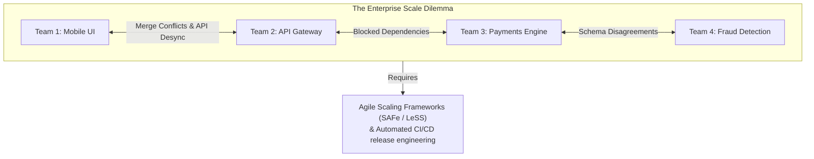
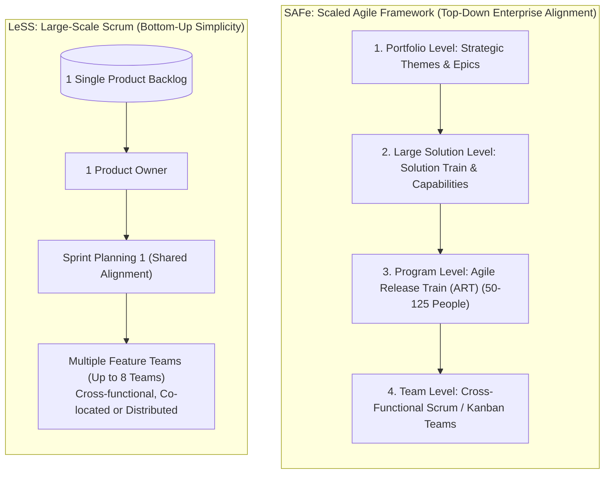
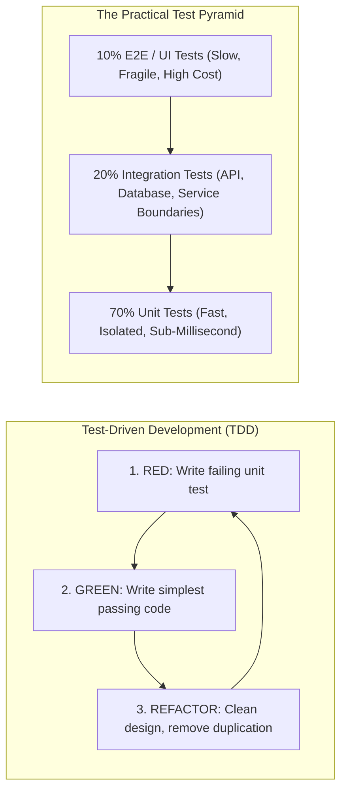
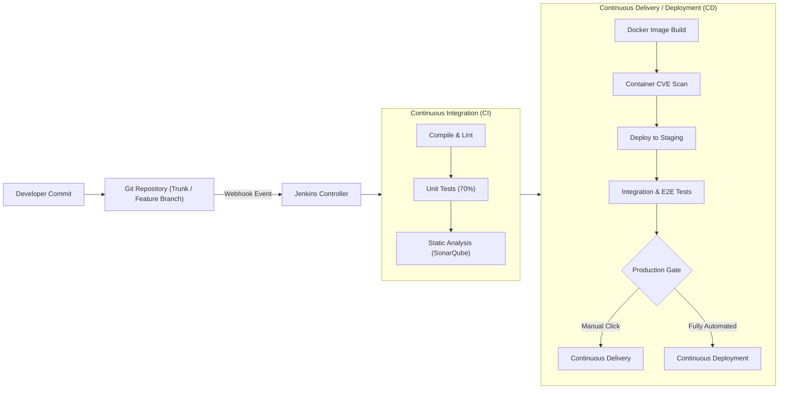
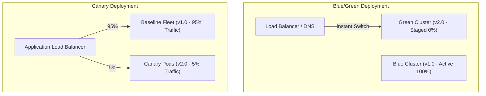
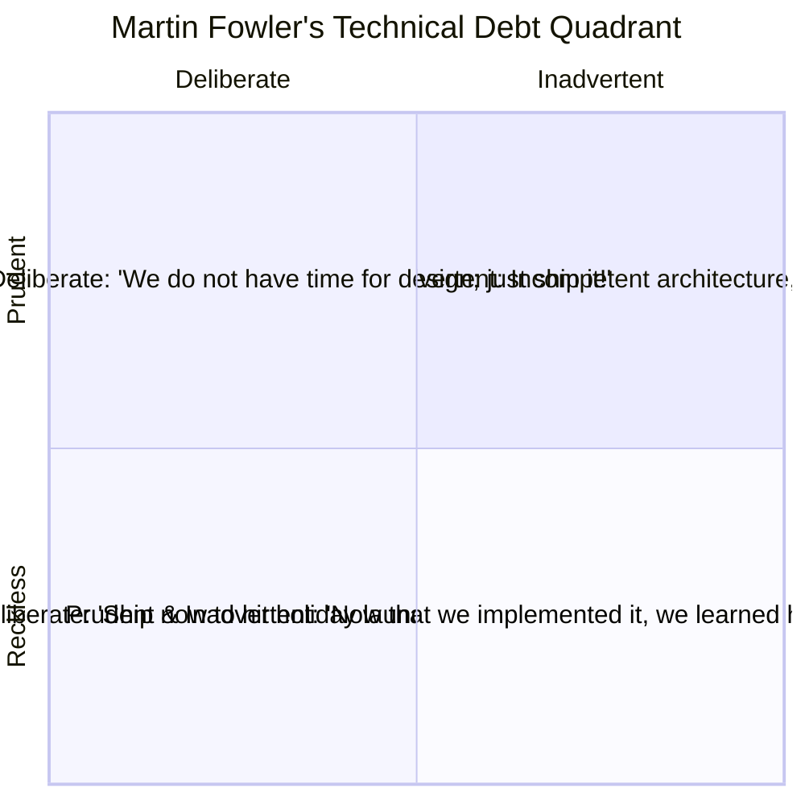
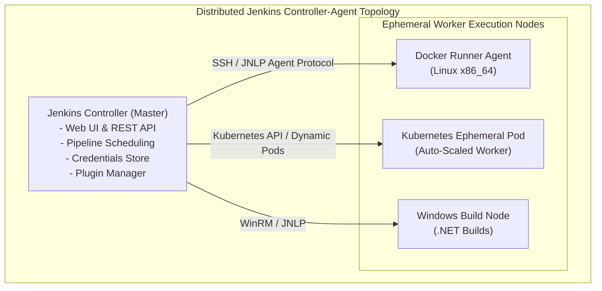

---
title: "Unit 3: Agile and CI/CD Practices for Scalable Product Development"
course: "INT378: Advancements in Cloud and DevOps"
category: "theory-unit"
unit_number: 3
portion: "Portion 4: Agile, CI/CD & DevSecOps Automation"
hub: "[[INT378 Master Strategy & Curriculum Roadmap]]"
previous_unit: "[[Unit 2 - Infrastructure as Code (IaC)]]"
next_unit: "[[Unit 4 - Monitoring, Metrics and Observability]]"
course_outcomes:
  - "CO2"
  - "CO5"
companion_labs:
  - "[[Lab 06 - Automated CI-CD with Jenkins & GitHub Webhooks]]"
code_templates:
  - "[[04 - CI-CD, Agile & DevSecOps Pipelines/code/lab06-07-jenkins-devsecops/Jenkinsfile.basic]]"
core_technologies:
  - "SAFe"
  - "LeSS"
  - "TDD"
  - "BDD"
  - "Jenkins"
  - "GitHub Webhooks"
deployment_strategies:
  - "Blue/Green"
  - "Canary"
  - "Rolling Updates"
  - "Feature Flags"
exam_weightage: "High"
difficulty: "Intermediate"
estimated_read_time: "25m"
status: "completed"
tags:
  - int378/unit-3
  - agile
  - safe
  - less
  - ci-cd
  - jenkins
  - tdd
  - bdd
last_updated: 2026-11-03
---

# Unit 3: Agile and CI/CD Practices for Scalable Product Development

---

## 1. Executive Summary & The Scaling Challenge

Standard Agile frameworks (like single-team Scrum) are optimized for a single cross-functional team of 5–9 engineers working from a single product backlog. When an enterprise grows to hundreds of developers building complex, interdependent systems (e.g., banking cores, aerospace telemetry, e-commerce marketplaces), basic Scrum breaks down due to the **combinatorial explosion of communication channels**:

$$\text{Communication Channels} = \frac{N(N - 1)}{2}$$

For a team of 7 engineers, there are 21 communication paths. For 100 engineers working without a scaling framework, there are **4,950 potential communication paths**, resulting in cross-team dependencies, blocked release trains, and integration gridlock.



---

## 2. Scaling Agile for Enterprise: SAFe vs. LeSS

To solve large-scale alignment, enterprises adopt either structured top-down frameworks (**SAFe**) or decentralized minimalist frameworks (**LeSS**).



### 2.1 Scaled Agile Framework (SAFe) Deep-Dive
- **Philosophy**: Highly prescriptive, enterprise-grade framework designed to coordinate large organizations with strict regulatory, financial, and compliance requirements.
- **The 4 Configurations**:
  1. *Essential SAFe*: Baseline building block; aligns teams on a single Agile Release Train (ART).
  2. *Large Solution SAFe*: For complex systems built without a full portfolio (e.g., aircraft, medical systems).
  3. *Portfolio SAFe*: Connects enterprise strategy and investment funding directly to Agile execution.
  4. *Full SAFe*: The complete multi-tiered enterprise model.

#### The Agile Release Train (ART) & Program Increment (PI) Planning
- **Agile Release Train (ART)**: A long-lived, cross-functional team of Agile teams (typically 50–125 people) that plans, commits, develops, and delivers software together on a synchronized 8–12 week cadence.
- **Program Increment (PI) Planning**: The heartbeat of SAFe. A mandatory 2-day collaborative planning session where all engineers, architects, and business leaders gather to plan the upcoming 10-week cycle:
  - *Day 1*: Business context presentation, vision review, team breakouts to estimate story points, and draft plan review.
  - *Day 2*: Management review and problem-solving, team plan revisions, identification of cross-team dependencies mapped on a physical/virtual **Program Board**, risk roping (ROAMing: Resolved, Owned, Accepted, Mitigated), and a final **Confidence Vote (Fist of Five)**.

#### WSJF (Weighted Shortest Job First) Prioritization Formula
SAFe prioritizes features using economic calculations rather than emotional debates:

$$\text{WSJF} = \frac{\text{Cost of Delay (CoD)}}{\text{Job Duration / Size}}$$

Where:
$$\text{Cost of Delay} = \text{User-Business Value} + \text{Time Criticality} + \text{Risk Reduction / Opportunity Enablement}$$

*Jobs with the highest WSJF score are scheduled first because they yield the greatest economic return per unit of engineering time.*

### 2.2 Large-Scale Scrum (LeSS) Deep-Dive
- **Philosophy**: "More with LeSS." Craig Larman and Bas Vodde designed LeSS based on the insight that organizations should **descale organizational complexity** rather than adding layers of managers.
- **Key Tenets**:
  - **Single Product Backlog**: One unified backlog for the entire product, regardless of how many feature teams exist.
  - **Single Product Owner**: One PO prioritizes the single backlog; teams collaborate directly with real business users to clarify details.
  - **Feature Teams over Component Teams**: Component teams (e.g., "DB Team", "UI Team") create massive handoff waste. LeSS mandates cross-functional **Feature Teams** capable of building customer-facing value across the entire full-stack slice.

---

## 3. Engineering Quality: TDD and BDD

High-speed automated continuous delivery is impossible without rigorous automated testing. Code without tests cannot be deployed continuously.



### 3.1 Test-Driven Development (TDD)
- **Developer-Centric**: Focuses on fine-grained software design, boundary conditions, and code correctness.
- **The Red-Green-Refactor Rhythm**:
  1. *Red*: Write a targeted unit test asserting expected behavior before writing the production code. The test must fail (proving it detects the missing capability).
  2. *Green*: Implement the bare minimum code necessary to make the test pass. Premature optimization is avoided.
  3. *Refactor*: Improve code design, eliminate duplication, and adhere to SOLID principles while ensuring the test suite remains green throughout.

### 3.2 Behavior-Driven Development (BDD)
- **Collaboration-Centric**: Eliminates misunderstandings between Business Product Owners, Developers, and QA engineers by expressing acceptance criteria in executable, human-readable language.
- **Gherkin Syntax (`Given-When-Then`)**:
  ```gherkin
  Feature: Zero-Downtime Payment Processing
    Scenario Outline: User completes transaction with credit card
      Given a user has an active cart totaling <amount>
      And the user enters a valid card ending in "<last4>"
      When the user clicks "Authorize Payment"
      Then the payment gateway returns status "<status>"
      And a receipt notification is dispatched to "<email>"

      Examples:
        | amount | last4 | status  | email            |
        | $45.00 | 4242  | SUCCESS | user@domain.com  |
        | $99.99 | 0002  | DECLINED| user@domain.com  |
  ```
- **Execution Engine**: Tools like **Cucumber** or **Behave** bind these Gherkin steps to automated underlying test code (`step definitions`), turning documentation into executable tests.

---

## 4. CI/CD Architecture & Release Engineering



### 4.1 CI vs. Continuous Delivery vs. Continuous Deployment
1. **Continuous Integration (CI)**: Developers integrate code into a shared repository multiple times a day. Every commit triggers an automated build and test runner to detect merge regressions immediately.
2. **Continuous Delivery (CD)**: The build is automatically tested, packaged, and staged in a production-like environment. The actual production release requires **manual business approval**.
3. **Continuous Deployment (CD)**: Every commit that passes the automated CI test pipeline flows **directly to production with zero human intervention**.

### 4.2 Branching Strategies: Trunk-Based Development vs. GitFlow
- **GitFlow (Heavyweight)**: Uses long-lived branches (`master`, `develop`, `release/*`, `feature/*`, `hotfix/*`). Features take weeks to merge back into `develop`, causing severe merge conflicts ("merge hell").
- **Trunk-Based Development (Modern DevOps Standard)**: All developers commit small, frequent updates directly into a single shared branch (`main` or `trunk`). Branches live for less than 1–2 days. Unfinished features are safely hidden behind **Feature Flags** in production code.

### 4.3 Zero-Downtime Deployment Strategies Compared



| Deployment Strategy | How It Operates | Blast Radius | Rollback Speed | Infrastructure Cost |
| :--- | :--- | :--- | :--- | :--- |
| **Blue/Green Deployment** | Two identical production environments. Live users hit Blue (v1). Deploy v2 to Green. Run smoke tests on Green. Flip the load balancer target to Green. | High (all users transition simultaneously upon switch). | **Instantaneous**: Flip load balancer back to Blue. | **High**: Requires double infrastructure capacity during deployment. |
| **Canary Deployment** | Direct a tiny fraction of live user traffic (e.g., $2\% - 5\%$) to new version (v2). Monitor latency, 5xx errors, and crash metrics. Incrementally shift traffic to $100\%$. | **Extremely Low**: If a bug exists, only $5\%$ of users experience it. | Fast: Re-route $100\%$ of traffic back to baseline pods. | **Low**: Only adds a few canary instances. |
| **Rolling Update** | Sequentially replaces instances running v1 with v2 instances one-by-one or in batches behind the load balancer. | Moderate (users hit mixed versions during deployment window). | Slow: Must sequentially re-roll backward. | **Minimal**: Operates within existing compute cluster. |

---

## 5. Product Strategy, Distributed Teams & Technical Debt

### 5.1 A/B Testing & Data-Driven Product Strategy
- **Mechanism**: Splitting production users into randomized cohorts:
  - **Control Group (A)**: Experiences the existing baseline system.
  - **Variant Group (B)**: Experiences the modified feature or algorithmic change.
- **Statistical Rigor**: Telemetry measures target business metrics (e.g., cart conversion, click-through rate). Changes are only promoted to $100\%$ if the measured lift is statistically significant ($p\text{-value} < 0.05$), proving the improvement was not random noise.

### 5.2 Technical Debt Management & The Debt Quadrant
Coined by Ward Cunningham, **Technical Debt** describes the implied cost of additional future rework caused by choosing an easy, fast solution now instead of using a better, well-designed approach that would take longer.



#### Technical Debt Mitigation in Practice
- Allocate **$20\%$ of every sprint capacity** strictly to architectural refactoring, dependency upgrades, and technical debt elimination.
- Track **Code Churn** and cyclomatic complexity via SonarQube quality gates that automatically block pull requests introducing technical debt.

---

## 6. Jenkins Automation Engine & Pipeline-as-Code

Jenkins is an open-source automation server supporting distributed, scalable continuous delivery.



### 6.1 Controller-Agent Distributed Topology
- **Jenkins Controller (Master)**: Responsible for managing configurations, authentication, hosting the web GUI, storing build history, and scheduling pipeline executions. It should **never execute heavy compilation or container builds** directly on the controller node (doing so introduces security vulnerabilities and crashes the web server).
- **Jenkins Agents (Workers)**: Lightweight client daemons that receive execution instructions from the controller, execute shell scripts in isolated environments, and stream console output back to the controller.

### 6.2 Declarative Pipeline Syntax Directives
A production `Jenkinsfile` uses structured Declarative Pipeline syntax:

```groovy
pipeline {
    agent {
        docker {
            image 'python:3.11-alpine'
            args '-u root'
        }
    }

    options {
        timeout(time: 1, unit: 'HOURS')
        disableConcurrentBuilds()
    }

    environment {
        APP_NAME = 'int378-portal'
        AWS_REGION = 'us-east-1'
    }

    stages {
        stage('Unit Testing') {
            steps {
                sh 'python -m unittest discover'
            }
        }
        stage('Deploy to Staging') {
            when {
                branch 'develop'
            }
            steps {
                echo "Deploying to Staging Environment..."
            }
        }
        stage('Deploy to Production') {
            when {
                branch 'main'
            }
            steps {
                echo "Deploying to Production Cluster..."
            }
        }
    }

    post {
        success {
            echo "Pipeline passed successfully!"
        }
        failure {
            echo "ALERT: Pipeline failed! Dispatched incident notification."
        }
        always {
            cleanWs()
        }
    }
}
```

---

## 7. Review, Exam & Viva Questions with Model Answers

### Question 1: Explain the Agile Release Train (ART) and Program Increment (PI) Planning in the SAFe framework.
**Model Answer:**
In SAFe, the Agile Release Train (ART) is a long-lived, self-organizing team of Agile teams (typically 50 to 125 people) along with stakeholders that plans, commits, and delivers software together on a synchronized 8 to 12-week cadence. The Program Increment (PI) Planning is the foundational 2-day cadence event where all members of the ART gather to review business strategy, break down features into team iterations, identify cross-team dependencies on a shared Program Board, mitigate architectural risks using the ROAM matrix, and commit to PI objectives via a confidence vote.

### Question 2: Differentiate between Canary Deployment and Blue/Green Deployment based on rollback time, cost, and risk.
**Model Answer:**
- *Rollback Time*: Blue/Green provides near-instantaneous rollback simply by switching the load balancer back to the idle Blue environment. Canary rollback is fast (routing traffic away from canary pods), but takes slightly longer to completely drain in-flight connections.
- *Infrastructure Cost*: Blue/Green requires double infrastructure capacity ($200\%$) during the release window to maintain both identical clusters. Canary runs with minimal overhead ($105\%$) by adding only a few canary instances.
- *Risk & Blast Radius*: Canary deployment provides the lowest risk because only a tiny percentage ($2\%-5\%$) of live users are exposed to the new code initially. In Blue/Green, $100\%$ of user traffic switches immediately upon load balancer cutover.

### Question 3: How does Behavior-Driven Development (BDD) bridge the communication gap between business analysts and engineering teams?
**Model Answer:**
BDD utilizes a formal, human-readable domain language called Gherkin, structured around `Given` (preconditions), `When` (actions), and `Then` (expected outcomes). Because Gherkin is written in plain English, business analysts, product owners, and QA engineers can author and review acceptance tests without understanding code. Developers and automated frameworks (such as Cucumber) then bind these plain-language steps directly to automated unit and integration tests, turning user stories into living, executable specifications.

### Question 4: Why should heavy build jobs never be executed on the Jenkins Controller (Master) node?
**Model Answer:**
Running builds on the Jenkins Controller node presents severe stability and security hazards. A resource-intensive compilation or runaway container build can exhaust the controller's CPU, disk, or memory, crashing the web UI, interrupting active pipelines, and corrupting the build database. Furthermore, giving arbitrary build scripts access to the controller filesystem exposes Jenkins credentials, SSH keys, and system configuration to malicious or accidental tampering. Builds must always be executed on isolated, ephemeral worker agents.
