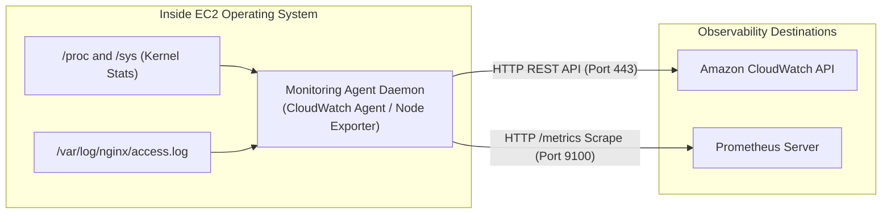
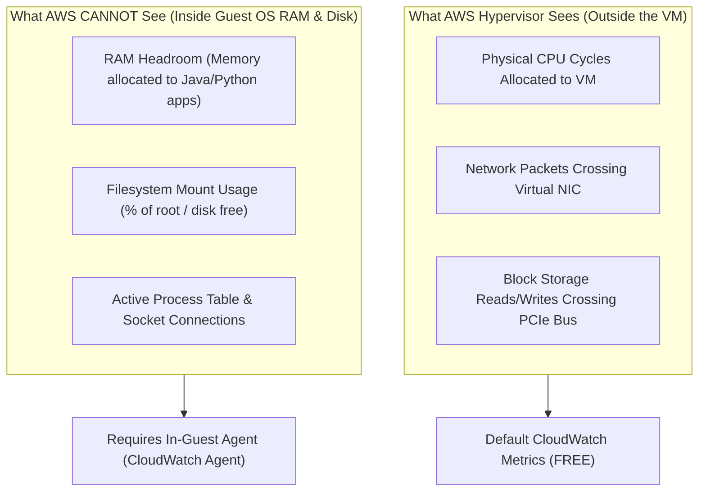
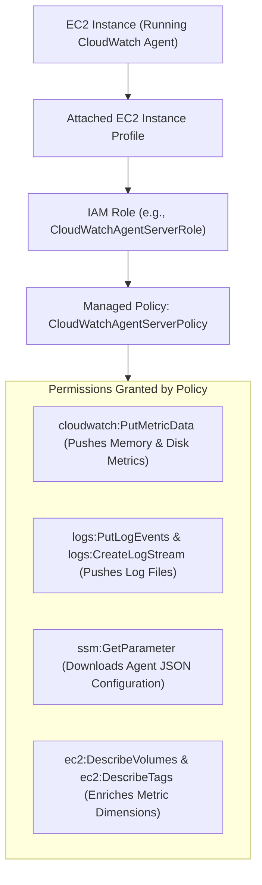
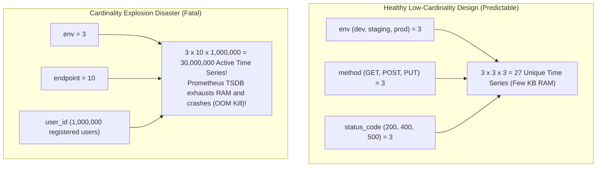
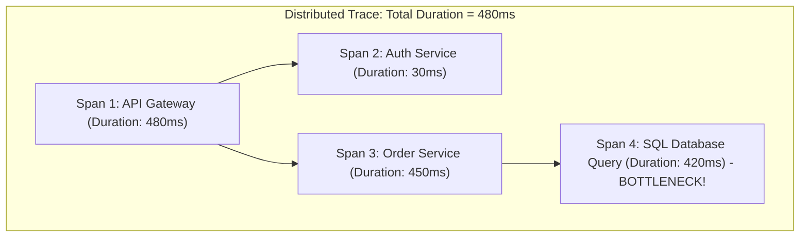

# Aux 05: Monitoring Agents, Telemetry & Time-Series Data

Telemetry does not magically appear in cloud dashboards. Monitoring tools rely on background daemons, operating system filesystems, specific IAM permissions, and specialized time-series storage engines.

---

## 1. What is an "Agent" on a Cloud Instance?

In cloud and DevOps, an **Agent** is a background daemon process (a `systemd` service on Linux or a Windows Service) that runs inside an operating system to collect logs, system metrics, or security events and push them to a centralized observability backend.



### 1.1 Hypervisor Metrics vs. In-Guest OS Metrics (The "RAM" Mystery)
When you launch an EC2 instance, AWS automatically provides free, basic CloudWatch metrics (CPU Utilization, Network In/Out, Disk Read/Write Ops) without installing any software. 

**Why does AWS not provide Memory (RAM) utilization or Disk Space percentage out of the box?**



- **Security & Privacy Boundary**: The cloud hypervisor allocates virtual memory pages to your instance, but it **cannot inspect what data is inside those memory pages** without violating your privacy.
- To the hypervisor, allocated RAM is just an opaque block of bytes. The hypervisor has no idea whether your Linux OS is using that RAM for critical database cache or if it is completely free.
- **The Rule**: To measure **Memory (RAM) Utilization** or **Filesystem Disk Space Used (%)**, you **must install an in-guest agent** (such as the unified CloudWatch Agent or Prometheus Node Exporter).

---

## 2. AWS CloudWatch Agent Architecture & Required IAM Policies

To deploy the AWS CloudWatch Agent on an EC2 instance, the virtual machine must be granted specific IAM permissions to publish metric data and write log events to the AWS CloudWatch control plane.



### 2.1 The Core CloudWatch IAM Policies

| IAM Policy Name | Type | Intended Principal / Entity | Permissions Granted |
| :--- | :--- | :--- | :--- |
| **`CloudWatchAgentServerPolicy`** | AWS-Managed | **EC2 Instances** (Attached via IAM Role & Instance Profile). | Allows the EC2 instance to push custom metric data (`cloudwatch:PutMetricData`), create log streams and publish logs (`logs:PutLogEvents`), and read configuration files from AWS Systems Manager Parameter Store (`ssm:GetParameter`). |
| **`CloudWatchAgentAdminPolicy`** | AWS-Managed | **DevOps Engineers / Administrators** configuring the agent. | Grants permissions to create, edit, and save CloudWatch Agent configuration files into AWS Systems Manager (SSM) Parameter Store. |
| **`CloudWatchReadOnlyAccess`** | AWS-Managed | **Developers / Junior SREs**. | Allows reading and viewing all CloudWatch dashboards, metrics, and alarms, but blocks creating or modifying alarms and deleting log groups. |
| **`CloudWatchFullAccess`** | AWS-Managed | **Senior DevOps Engineers**. | Full administrative access to create, update, and delete alarms, dashboards, anomaly detectors, and metric filters. |

---

## 3. Time-Series Databases (TSDB) & Gorilla Compression

Why can't we just store telemetry metrics in standard relational databases like PostgreSQL or MySQL?

### 3.1 Relational Databases vs. TSDBs
- **Relational Databases (PostgreSQL/MySQL)**:
  - Optimized for **row-based point reads and complex ACID joins** across tables.
  - As write throughput scales to thousands of metric samples per second, relational **B-Tree indexes become fragmented**, leading to disk write amplification, lock contention, and catastrophic query degradation.
- **Time-Series Databases (Prometheus, InfluxDB, TimescaleDB)**:
  - Optimized for **high-frequency sequential append-only writes** and **range-based mathematical queries over time windows**.
  - Uses columnar chunking and specialized compression.

### 3.2 The Structure of a Time-Series Sample
Every metric sample in Prometheus or CloudWatch consists of:

$$\text{Metric Sample} = \underbrace{\text{Metric Name} + \{\text{Label Key}=\text{Value}, \dots\}}_{\text{Time Series Identifier}} + \underbrace{\text{Timestamp (int64)} + \text{Value (float64)}}_{\text{Sample Data Point}}$$

```text
http_requests_total{method="POST", handler="/checkout", status="500"}  1732064400  42
```

### 3.3 Gorilla Compression (How Prometheus Compresses Samples to 1.37 Bytes)
Prometheus utilizes Facebook's **Gorilla compression algorithm**:
1. **Timestamps (Delta-of-Delta Encoding)**:
   - Instead of storing 64-bit absolute timestamps (`1732064400`, `1732064415`, `1732064430`), Prometheus calculates the difference between consecutive timestamps ($\Delta_1 = 15\text{s}$, $\Delta_2 = 15\text{s}$).
   - It then calculates the *difference of the differences* ($D = \Delta_2 - \Delta_1 = 0$).
   - A delta of zero is encoded with **a single bit (`0`)**!
2. **Values (XOR Floating-Point Compression)**:
   - Consecutive floating-point metrics often share identical leading and trailing binary bits. Prometheus calculates the bitwise XOR between consecutive float64 values and stores only the non-zero delta bits.
   - *Result*: A standard 16-byte raw data point ($8\text{ bytes timestamp} + 8\text{ bytes float}$) is compressed down to an average of **only 1.37 bytes** on disk.

---

## 4. The Cardinality Explosion Disaster (What SREs Fear)

In time-series monitoring, **Cardinality** refers to the number of unique time-series generated by the permutations of label values.

$$\text{Total Active Series} = \prod (\text{Count of Unique Values for Each Label})$$



> [!CAUTION]
> **The Golden Rule of Prometheus Labels**:
> **NEVER** place high-cardinality, unbounded data into metric labels!
> - *Safe Labels*: `method`, `status_code`, `environment`, `region`, `service_name`.
> - *Dangerous Labels*: `user_id`, `email`, `session_token`, `ip_address`, `request_id`.
> If you need to trace individual user requests or transaction IDs, that is the job of **Distributed Tracing and Logs**, NOT Metrics!

---

## 5. Distributed Tracing Foundations & The W3C Trace Context

While metrics tell you *that* latency spiked, **Distributed Tracing** tells you *which microservice* caused the delay.



### Context Propagation Across Microservices (W3C `traceparent`)
How do independent microservices (written in Go, Python, Java) know they are processing the same end-user request?

They pass standard HTTP headers defined by the **W3C Trace Context specification**:

```text
traceparent: 00-4bf92f3577b34da6a3ce929d0e0e4736-00f067aa0ba902b7-01
              │  └───────────────┬──────────────┘ └───────┬──────┘ └─┬┘
              │                  │                        │          │
           Version            TraceID                   SpanID     Flags
          (2 hex)            (32 hex)                  (16 hex)   (2 hex)
```

1. **TraceID**: A globally unique 128-bit identifier generated by the first receiving service (e.g., API Gateway). It remains identical across all microservice hops.
2. **SpanID**: An 8-byte identifier representing the current sub-operation. When Service A calls Service B, Service B generates a new `SpanID` and records Service A's span as its `ParentSpanID`.
3. OpenTelemetry and tracing platforms (Jaeger, AWS X-Ray, Grafana Tempo) read these parent-child relationships to construct complete waterfall visualization graphs of distributed requests.
