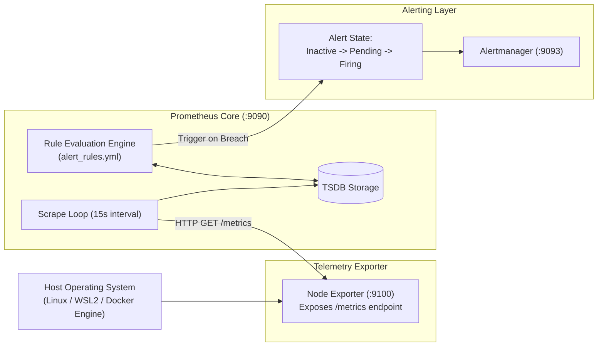
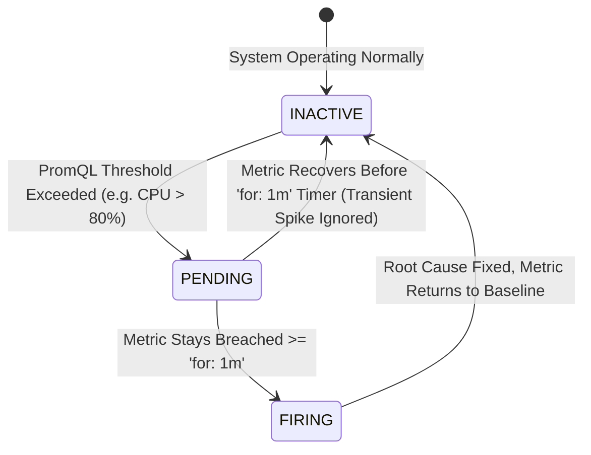

---
title: "Lab 08: Prometheus & Node Exporter Infrastructure Monitoring & Alerting"
course: "INT378: Advancements in Cloud and DevOps"
category: "practical-lab"
lab_number: 8
portion: "Portion 5: Observability, Serverless & FinOps"
hub: "[[INT378 Master Strategy & Curriculum Roadmap]]"
previous_lab: "[[Lab 07 - DevSecOps Pipeline (SAST, Trivy & Secret Mgmt)]]"
next_lab: "[[Lab 09 - Grafana Dashboards & Prometheus Data Source]]"
companion_theory:
  - "[[Unit 4 - Monitoring, Metrics and Observability]]"
course_outcomes:
  - "CO2"
  - "CO4"
code_directory: "05 - Observability, Telemetry & SRE/code/lab08-09-monitoring"
target_environment: "Local Docker Compose Stack"
cost_profile: "$0.00 (Local open-source containers)"
estimated_duration: "45m"
tools_used:
  - "Prometheus"
  - "Node Exporter"
  - "PromQL"
  - "Alertmanager"
teardown_required: false
verification_status: "ready"
tags:
  - int378/lab-08
  - prometheus
  - node-exporter
  - metrics
  - promql
  - alerting
last_updated: 2026-11-03
---

# Lab 08: Prometheus & Node Exporter Infrastructure Monitoring & Alerting

**Course Outcome Alignment:** CO2, CO4  
**Target Environment:** Local Machine (Docker Compose) OR Linux VM  
**Estimated Run Time:** 45 minutes  
**Cost:** \$0.00 (Local open-source execution)  
**Configuration Location:** `05 - Observability, Telemetry & SRE/code/lab08-09-monitoring/`

---

## 1. Architectural Blueprint

In this experiment, you will deploy an infrastructure monitoring and alerting stack using Prometheus and Node Exporter. Node Exporter gathers host metrics (CPU, memory, disk, network), Prometheus periodically pulls (scrapes) these metrics into its time-series database (TSDB), evaluates threshold-based alerting rules, and fires alerts when limits are breached.



---

## 2. Concept & Theoretical Foundations

1. **Node Exporter**: A lightweight daemon written in Go by the Prometheus team. It queries Linux kernel subsystems (`/proc`, `/sys`) and formats hardware/OS metrics into standard Prometheus exposition format.
2. **PromQL Vector Types**:
   - *Instant Vector*: Current value at evaluation instant. Example: `node_memory_MemAvailable_bytes`.
   - *Range Vector*: Buffer of historical values over a time duration. Example: `node_cpu_seconds_total[5m]`.
3. **The Alerting Rule Lifecycle**:
   - `for: 1m` prevents alert spam by requiring the threshold breach to remain continuously active for 1 full minute before moving from `PENDING` to `FIRING`.



> [!TIP]
> The `PENDING` state eliminates false-positive alert flapping caused by brief CPU micro-spikes (such as a 3-second cron job execution).

---

## 3. Step-by-Step Implementation Guide

### Step 1: Inspect Configuration Files
Navigate to `05 - Observability, Telemetry & SRE/code/lab08-09-monitoring/`:
- `docker-compose.yml`: Spins up Prometheus, Node Exporter, and Grafana.
- `prometheus.yml`: Scrape targets (`node-exporter:9100`) and evaluation interval (15s).
- `alert_rules.yml`: Contains rules for high CPU load, low free memory, and host downtime.

### Step 2: Launch the Monitoring Stack
```bash
cd "05 - Observability, Telemetry & SRE/code/lab08-09-monitoring"

# Launch Prometheus, Node Exporter, and Grafana
docker compose up -d

# Verify containers are running
docker compose ps
```

Verify service endpoints:
- Prometheus UI: `http://localhost:9090`
- Node Exporter Raw Metrics: `http://localhost:9100/metrics`

### Step 3: Execute PromQL Queries in Prometheus UI
Open `http://localhost:9090/graph` and execute these queries:

#### 1. Instantaneous Memory Utilization (%)
```promql
(1 - (node_memory_MemAvailable_bytes / node_memory_MemTotal_bytes)) * 100
```

#### 2. Per-Core CPU Usage Rate (%)
```promql
100 - (avg by (instance) (rate(node_cpu_seconds_total{mode="idle"}[1m])) * 100)
```

#### 3. Disk Space Utilization (%)
```promql
(1 - (node_filesystem_avail_bytes{mountpoint="/"} / node_filesystem_size_bytes{mountpoint="/"})) * 100
```

#### 4. Network Inbound Bandwidth (Bytes/sec)
```promql
rate(node_network_receive_bytes_total[1m])
```

### Step 4: Validate Alert Generation
1. In the Prometheus UI top bar, click **Alerts**.
2. Notice the pre-configured alerts from `alert_rules.yml`:
   - `HostHighCpuLoad`
   - `HostLowMemory`
   - `ServiceDown`
3. All alerts will display with a green **INACTIVE** state.

#### Triggering an Artificial Alert
We will simulate a service failure to trigger the `ServiceDown` alert:
```bash
# Stop Node Exporter container
docker compose stop node-exporter
```
- Wait 15 seconds: Refresh the Prometheus Alerts page.
- The `ServiceDown` alert transitions to yellow **PENDING**.
- Wait 1 minute (defined by `for: 1m`):
- The alert transitions to red **FIRING**!

#### Resolving the Alert
```bash
# Restart Node Exporter
docker compose start node-exporter
```
- Within 15 seconds, Prometheus scrapes the endpoint successfully (`up == 1`).
- The alert transitions back to green **INACTIVE** automatically.

---

## 4. Verification Checklist

- [ ] Node Exporter `/metrics` returns metric families with `# HELP` and `# TYPE`.
- [ ] PromQL query executes and displays live graphical time-series charts.
- [ ] Stopping Node Exporter successfully transitions the alert state: `INACTIVE` $\to$ `PENDING` $\to$ `FIRING`.
- [ ] Restarting Node Exporter clears the alert back to `INACTIVE`.

---

## 5. Teardown & Cleanup Checklist

```bash
# If you are not continuing immediately to Lab 09:
docker compose down -v
```

---

## 6. Viva Voce & Interview Questions

1. **Why does Prometheus recommend scraping metrics rather than pushing them?**
   - *Answer*: Scraping allows Prometheus to control network load and metric ingestion rates, reliably detect service crashes when scrapes fail (`up == 0`), and avoids managing push authentication keys on target nodes.
2. **What does the `rate()` function in PromQL do? Why should it only be used with Counters?**
   - *Answer*: `rate()` calculates the per-second average rate of increase of a time series over a given time window. It is designed specifically for counters because it automatically accounts for counter resets (such as server reboots).
3. **What is the difference between an alert in `PENDING` state and `FIRING` state?**
   - *Answer*: In `PENDING`, the alert condition evaluates to true, but the duration specified in the `for` clause has not yet elapsed. Once the condition remains continuously true for the entire `for` duration, it transitions to `FIRING` and dispatches notifications.
