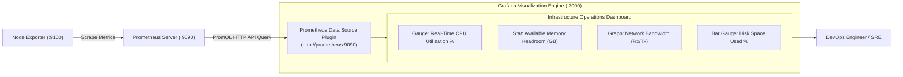
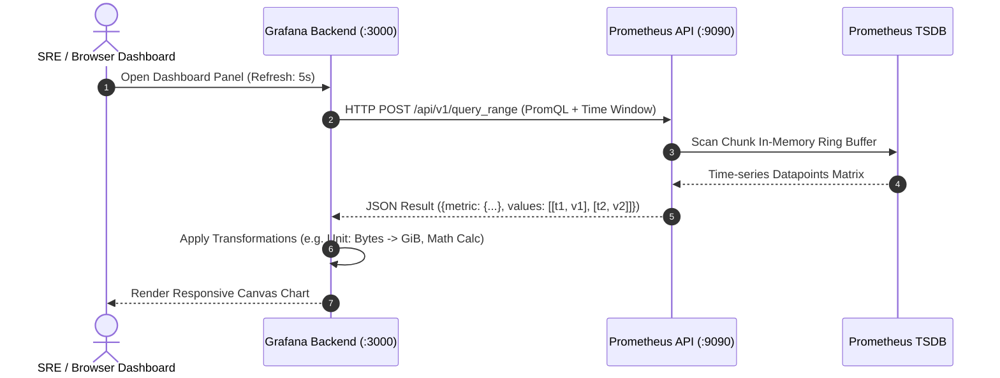

---
title: "Lab 09: Grafana Dashboards & Prometheus Data Source Integration"
course: "INT378: Advancements in Cloud and DevOps"
category: "practical-lab"
lab_number: 9
portion: "Portion 5: Observability, Serverless & FinOps"
hub: "[[INT378 Master Strategy & Curriculum Roadmap]]"
previous_lab: "[[Lab 08 - Prometheus & Node Exporter Metrics & Alerting]]"
next_lab: "[[Lab 10 - Serverless Microservice (Lambda, API GW, CloudWatch)]]"
companion_theory:
  - "[[Unit 4 - Monitoring, Metrics and Observability]]"
course_outcomes:
  - "CO2"
  - "CO4"
code_directory: "05 - Observability, Telemetry & SRE/code/lab08-09-monitoring"
target_environment: "Local Docker Compose Stack"
cost_profile: "$0.00 (Local open-source containers)"
estimated_duration: "45m"
tools_used:
  - "Grafana"
  - "Prometheus Data Source"
  - "PromQL"
  - "Dashboards"
teardown_required: false
verification_status: "ready"
tags:
  - int378/lab-09
  - grafana
  - prometheus
  - dashboards
  - visualization
  - sre
last_updated: 2026-11-03
---

# Lab 09: Grafana Dashboards & Prometheus Data Source Integration

**Course Outcome Alignment:** CO2, CO4  
**Target Environment:** Local Docker Compose OR Cloud VM  
**Estimated Run Time:** 45 minutes  
**Cost:** \$0.00 (Local open-source execution)  
**Configuration Location:** `05 - Observability, Telemetry & SRE/code/lab08-09-monitoring/`

---

## 1. Architectural Blueprint

In this experiment, you will deploy Grafana, integrate it with the running Prometheus time-series database as an upstream data source, design an enterprise infrastructure monitoring dashboard, configure custom visual panels (Gauges, Time Series graphs, Stat cards), and analyze system performance trends.



---

## 2. Concept & Theoretical Foundations

1. **Decoupled Telemetry Architecture**: Grafana does not store metrics. It is a pure visualization, querying, and dashboarding engine that delegates storage to specialized backends (Prometheus for metrics, Loki for logs, Jaeger for traces).
2. **Dashboard Variables (Templating)**: Allows building dynamic dashboards where dropdown filters (e.g., `$instance`, `$cluster`) parameterize PromQL queries dynamically:
   ```promql
   rate(node_cpu_seconds_total{instance="$instance"}[5m])
   ```
3. **Thresholds & Color Coding**: Visual alerts that shift colors from Green ($< 60\%$) to Amber ($60\% - 85\%$) to Red ($> 85\%$) based on real-time operational health.

### Grafana Query Execution & Rendering Pipeline



---

## 3. Step-by-Step Implementation Guide

### Step 1: Start the Monitoring Stack
If not already running from Lab 08:
```bash
cd "05 - Observability, Telemetry & SRE/code/lab08-09-monitoring"
docker compose up -d
```

Access Grafana in your web browser:
- **URL**: `http://localhost:3000`
- **Default Credentials**: Username `admin`, Password `admin` (change upon first login or skip).

### Step 2: Configure Prometheus as a Data Source
1. In the Grafana left-hand navigation sidebar, click **Connections** (or gear icon $\to$ **Data Sources**).
2. Click **Add data source**.
3. Select **Prometheus**.
4. In the **Prometheus server URL** field, enter:
   ```text
   http://prometheus:9090
   ```
   *(Since both containers share the same Docker network, use the service name `prometheus`)*.
5. Scroll to the bottom and click **Save & test**.
6. Verify the green banner: *"Successfully queried the Prometheus API."*

### Step 3: Design a Custom Infrastructure Dashboard
1. Click **Dashboards** $\to$ **New** $\to$ **New Dashboard**.
2. Click **+ Add visualization**. Select **Prometheus** as data source.

#### Panel 1: Real-Time CPU Usage (Gauge Panel)
- **PromQL Query**:
  ```promql
  100 - (avg by (instance) (rate(node_cpu_seconds_total{mode="idle"}[1m])) * 100)
  ```
- **Panel Type**: On the right sidebar, change visualization from *Time series* to **Gauge**.
- **Panel Title**: `Host CPU Utilization`
- **Standard Options**: Unit $\to$ `Misc / Percent (0-100)`. Max $\to$ `100`.
- **Thresholds**: Green at `0`, Orange at `70`, Red at `85`.
- Click **Apply**.

#### Panel 2: Memory Headroom (Stat Panel)
- Click **+ Add visualization** $\to$ Select **Prometheus**.
- **PromQL Query**:
  ```promql
  node_memory_MemAvailable_bytes
  ```
- **Panel Type**: **Stat**.
- **Panel Title**: `Available RAM`.
- **Standard Options**: Unit $\to$ `Data (IEC) / bytes`.
- Click **Apply**.

#### Panel 3: Inbound vs Outbound Network Traffic (Time Series Graph)
- Click **+ Add visualization** $\to$ Select **Prometheus**.
- **Query A (Inbound)**:
  ```promql
  rate(node_network_receive_bytes_total{device="eth0"}[1m])
  ```
  - Legend: `Rx (Inbound)`
- Click **+ Add query** $\to$ **Query B (Outbound)**:
  ```promql
  rate(node_network_transmit_bytes_total{device="eth0"}[1m])
  ```
  - Legend: `Tx (Outbound)`
- **Panel Title**: `Network Throughput (eth0)`
- **Standard Options**: Unit $\to$ `Data Rate / bytes/sec`.
- Click **Apply**.

#### Panel 4: Disk Utilization (Bar Gauge)
- Click **+ Add visualization** $\to$ Select **Prometheus**.
- **PromQL Query**:
  ```promql
  100 - ((node_filesystem_avail_bytes{mountpoint="/"} / node_filesystem_size_bytes{mountpoint="/"}) * 100)
  ```
- **Panel Type**: **Bar gauge**.
- **Panel Title**: `Root Disk Usage %`.
- **Standard Options**: Unit $\to$ `Misc / Percent (0-100)`. Max $\to$ `100`.
- Click **Apply**.

### Step 4: Import Industry Standard Community Dashboard
Grafana allows importing production-ready community dashboards instantly:
1. In Grafana, click **Dashboards** $\to$ **New** $\to$ **Import**.
2. Enter Dashboard ID: `1860` (Node Exporter Full - the most popular community dashboard).
3. Click **Load**.
4. Select `Prometheus` as the data source dropdown.
5. Click **Import**.
6. *Observe*: A full enterprise dashboard with 30+ panels displays instant deep metrics for CPU cores, RAM swap, I/O wait, context switches, and network packets!

---

## 4. Verification & Performance Trend Analysis

- [ ] Custom dashboard displays 4 live updating panels.
- [ ] Gauge shifts color when generating load on host.
- [ ] Time range controls (top right: `Last 5 minutes`, `Last 1 hour`, `Auto-refresh 5s`) respond dynamically.
- [ ] Node Exporter Full (ID 1860) renders detailed hardware trends without query errors.

---

## 5. Teardown & Cleanup Checklist

```bash
# Tear down monitoring stack and delete volumes
docker compose down -v
```

---

## 6. Viva Voce & Interview Questions

1. **How does Grafana query data from Prometheus without storing copies of time-series data locally?**
   - *Answer*: Grafana acts as a proxy client. When a dashboard refreshes, Grafana converts the panel's PromQL expressions and time window into HTTP REST requests to the Prometheus API (`/api/v1/query_range`), parses the returned JSON, and renders the graphics in the client browser canvas.
2. **What are Dashboard Variables in Grafana and how do they benefit large-scale cloud operations?**
   - *Answer*: Variables parameterize dashboards, allowing operators to dynamically switch metrics between different instances, regions, or environments using a single dropdown instead of building separate dashboards for each server.
3. **What is the difference between a Stat panel and a Time Series panel?**
   - *Answer*: A Stat panel aggregates a time series into a single summary scalar number (e.g., current value, average, max), whereas a Time Series panel visualizes historical evolution of the metric over an entire timeline.
