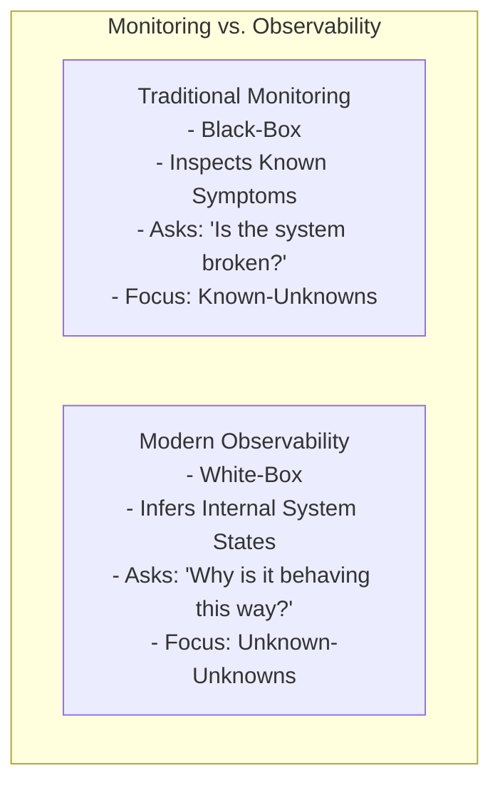
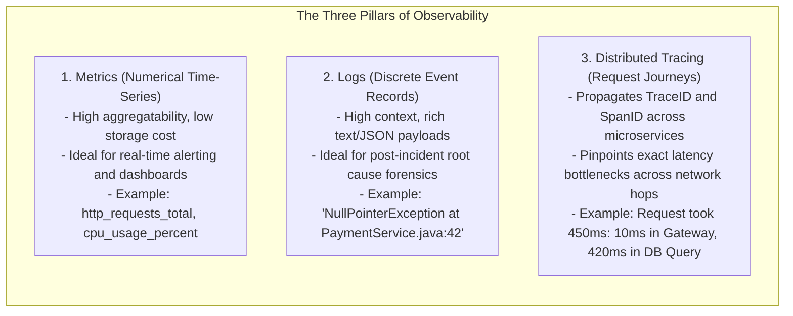
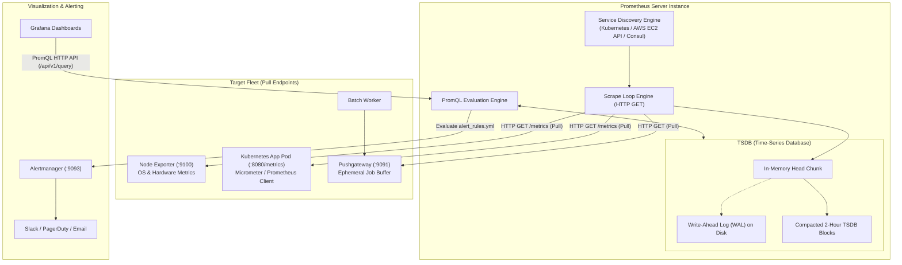
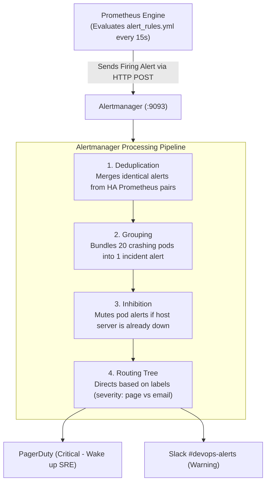
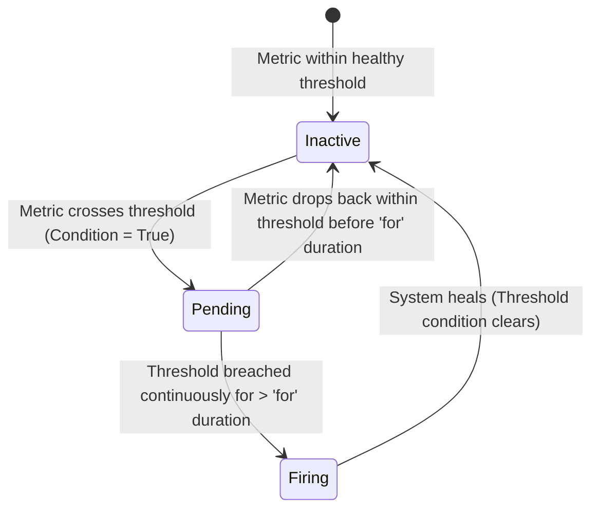
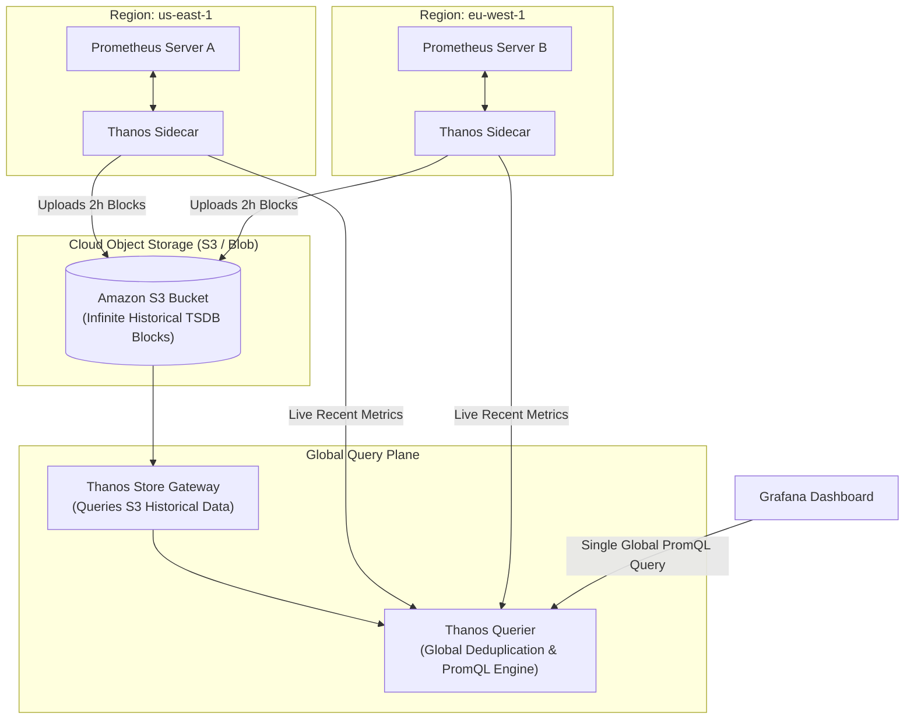

---
title: "Unit 4: Monitoring, Metrics and Observability"
course: "INT378: Advancements in Cloud and DevOps"
category: "theory-unit"
unit_number: 4
portion: "Portion 5: Observability, Serverless & FinOps"
hub: "[[INT378 Master Strategy & Curriculum Roadmap]]"
previous_unit: "[[Unit 3 - Agile and CI-CD Practices for Scalable Systems]]"
next_unit: "[[Unit 5 - DevSecOps, IAM and Cloud Security]]"
course_outcomes:
  - "CO2"
  - "CO4"
companion_labs:
  - "[[Lab 08 - Prometheus & Node Exporter Metrics & Alerting]]"
  - "[[Lab 09 - Grafana Dashboards & Prometheus Data Source]]"
code_templates:
  - "[[05 - Observability, Telemetry & SRE/code/lab08-09-monitoring/docker-compose.yml]]"
  - "[[05 - Observability, Telemetry & SRE/code/lab08-09-monitoring/prometheus.yml]]"
core_technologies:
  - "Prometheus"
  - "Node Exporter"
  - "Grafana"
  - "Alertmanager"
  - "Thanos"
  - "OpenTelemetry"
telemetry_pillars:
  - "Metrics"
  - "Logs"
  - "Distributed Traces"
exam_weightage: "High"
difficulty: "Advanced"
estimated_read_time: "25m"
status: "completed"
tags:
  - int378/unit-4
  - observability
  - monitoring
  - prometheus
  - promql
  - grafana
  - sre
last_updated: 2026-11-03
---

# Unit 4: Monitoring, Metrics and Observability

---

## 1. Executive Summary & The Paradigm Shift

In traditional monolithic datacenter environments, a system lived on a static set of physical servers. A simple black-box ping check or Nagios alert (*"Is port 80 open?"* or *"Is disk $> 90\%$?"*) was sufficient.

In modern cloud-native architectures, applications consist of hundreds of ephemeral microservices and serverless functions distributed across multiple Availability Zones, auto-scaling up and down every few minutes. In such architectures, **systems fail in novel, non-deterministic ways**. Components can appear "up" while returning degraded payloads or causing cascading timeouts across downstream services. This reality necessitates the transition from **passive monitoring** to **active observability**.



---

## 2. The Three Pillars of Observability & SRE Telemetry Frameworks

Observability is enabled by collecting and correlating three fundamental telemetry data types:



### 2.1 The Industry SRE Telemetry Frameworks

#### 1. The Google SRE 4 Golden Signals
1. **Latency**: The time it takes to service a request. Crucially, SREs track the latency of successful requests separately from the latency of failed requests (e.g., an instant HTTP 500 error takes 2ms, artificially depressing average latency).
2. **Traffic**: A measure of how much demand is placed on the system (e.g., HTTP requests per second, active database transactions).
3. **Errors**: The rate of requests that fail, either explicitly (HTTP 5xx), implicitly (HTTP 200 with wrong JSON payload), or by policy (e.g., response took $> 1\text{ second}$).
4. **Saturation**: How "full" a service or resource is, emphasizing the most constrained subsystem (e.g., memory headroom, database thread pool exhaustion, socket buffer queue).

#### 2. The RED Method (Microservices & Web APIs)
- **Rate**: Requests served per second.
- **Errors**: Number of failing requests per second.
- **Duration**: The latency distribution of requests.

#### 3. The USE Method (Underlying Infrastructure & Hardware)
- **Utilization**: The average time a resource was busy servicing work (e.g., CPU busy percentage).
- **Saturation**: The degree to which extra work is queued waiting for the resource (e.g., Linux run-queue length, disk I/O queue depth).
- **Errors**: The count of hardware/device error events (e.g., dropped network packets, memory parity faults).

---

## 3. Prometheus Architecture & Time-Series Database (TSDB) Internals

Prometheus is an open-source, CNCF-graduated systems monitoring and alerting toolkit built specifically for cloud-native infrastructure.



### 3.1 The Pull vs. Push Architectural Debate
- **Why Prometheus Favors Pull**:
  - **Overload Protection**: Prometheus controls the frequency and volume of scrapes, preventing monitoring servers from being overwhelmed during network storms.
  - **Built-in Liveness Detection**: If Prometheus fails to scrape an endpoint, that target is immediately flagged as `DOWN` (`up == 0`). In push systems, if a server dies silently, you cannot easily tell whether it crashed or simply had no traffic to report.
  - **Zero Target Configuration**: Targets do not need to be configured with monitoring server IP addresses, credentials, or TLS certificates.
- **When Push is Required (The Pushgateway)**:
  - Ephemeral, short-lived batch jobs (e.g., a 5-second data processing job) may spin up, execute, and terminate in between Prometheus scrape intervals. These jobs push their metrics to an intermediate buffer called the **Prometheus Pushgateway**, which Prometheus then scrapes normally.

### 3.2 TSDB Storage Internals & The Gorilla Compression Algorithm
Prometheus stores data as time-series: streams of timestamped values belonging to the same metric name and set of labeled dimensions.
- **In-Memory Head Chunk**: Active samples are appended directly into RAM.
- **Write-Ahead Log (WAL)**: To survive unexpected server power loss or crashes, every incoming sample is sequentially appended to an on-disk WAL before being acknowledged. On restart, the WAL replays unwritten samples to recover state in memory.
- **2-Hour Compacted Blocks**: Every 2 hours, the TSDB cuts an immutable block to disk containing chunk data, metadata, and an inverted index.
- **Gorilla Compression**: Timestamps are compressed using **Delta-of-Delta** encoding (storing only the change in the time difference between consecutive samples, often compressing timestamps down to 1–2 bits). Float64 values are compressed using **XOR floating-point encoding**. This reduces storage overhead to an average of **only 1.37 bytes per sample**!

### 3.3 The 4 Core Metric Types Explained
1. **Counter**:
   - A cumulative metric that can **only increase** or reset to zero upon application restart.
   - *Example*: `http_requests_total`, `packet_drop_count`.
   - *Golden Rule*: Never graph a raw Counter directly (a monotonic line going up into infinity is useless). Always wrap Counters in `rate()` or `increase()`.
2. **Gauge**:
   - A single numerical value that can arbitrarily **fluctuate up and down**.
   - *Example*: `node_memory_MemAvailable_bytes`, `temperature_celsius`, `concurrent_active_sessions`.
3. **Histogram**:
   - Samples observations (usually response times or payload sizes) and buckets them into configurable intervals.
   - Automatically exposes three time-series:
     - `<basename>_bucket{le="<upper_inclusive_bound>"}`
     - `<basename>_sum` (total sum of all observed values)
     - `<basename>_count` (total count of events)
   - *Example*: Calculating p95 latency via `histogram_quantile()`.
4. **Summary**:
   - Similar to a histogram, but calculates configurable $\phi$-quantiles (e.g., 0.5, 0.9, 0.99) **client-side** in the application process.
   - *Limitation*: Summaries cannot be aggregated across multiple server instances (you cannot mathematically average pre-calculated medians).

---

## 4. PromQL (Prometheus Query Language) Masterclass

PromQL is a functional query language that evaluates vector expressions in real time.

### 4.1 Vector Types
- **Instant Vector**: A set of time-series containing a single sample for each time-series, all evaluated at the exact same timestamp.
  ```promql
  node_cpu_seconds_total{mode="idle"}
  ```
- **Range Vector**: A set of time-series containing a buffer of historical samples over a time window.
  ```promql
  node_cpu_seconds_total{mode="idle"}[5m]
  ```
- **Scalar**: A simple raw numeric floating-point value (e.g., `100`, `0.75`).

### 4.2 High-Yield Production PromQL Expressions

#### 1. Per-Instance Real-Time CPU Utilization (%)
```promql
100 - (avg by (instance) (rate(node_cpu_seconds_total{mode="idle"}[5m])) * 100)
```
*Logic*: Calculate the per-second idle CPU rate over a 5-minute window, take the average grouped by instance, multiply by 100, and subtract from 100 to get busy percentage.

#### 2. HTTP Error Rate Percentage (5xx Errors vs Total Requests)
```promql
(sum(rate(http_requests_total{status=~"5.."}[5m])) 
 / 
 sum(rate(http_requests_total[5m]))) * 100
```

#### 3. 99th Percentile API Response Latency (p99)
```promql
histogram_quantile(0.99, sum by (le) (rate(http_request_duration_seconds_bucket[5m])))
```
*Logic*: Takes the rate of bucket sample increases over 5 minutes and interpolates the 99th percentile request duration.

#### 4. `rate()` vs. `irate()` Distinction
- `rate(v[5m])`: Calculates the average per-second rate of increase over the entire 5-minute window. It smooths out short-lived spikes and is ideal for **alerting rules and long-term trend analysis**.
- `irate(v[5m])`: Instantaneous rate. Looks strictly at the **last two data points** within the 5-minute range vector. It captures ultra-fast, volatile spikes, making it ideal for **real-time high-resolution debugging dashboards**.

---

## 5. Alerting Engine & Alertmanager Architecture

Prometheus separates alert detection from alert delivery. Prometheus evaluates rules; **Alertmanager** handles deduplication, grouping, silencing, and notification routing.



### 5.1 Alert Rule State Machine


1. **`INACTIVE`**: The alert condition evaluates to false. Everything is normal.
2. **`PENDING`**: The condition evaluated to true, but the `for: 5m` timer has not yet expired. This prevents alerting on temporary 10-second CPU spikes.
3. **`FIRING`**: The condition remained true continuously for the entire `for` duration. An HTTP POST alert payload is dispatched to Alertmanager.

---

## 6. Grafana: Visualizations & Enterprise Dashboards

Grafana is an open-source analytics and visualization web application that decouples visualization from underlying storage.

### 6.1 Multi-Datasource Architectural Value
Grafana does not store time-series data. It connects to multiple heterogeneous backends simultaneously:
- Query metrics from **Prometheus**.
- Query application logs from **Grafana Loki**.
- Query distributed traces from **Grafana Tempo / Jaeger**.
- Query billing and infrastructure status from **AWS CloudWatch**.

All four sources can be displayed inside a single unified troubleshooting dashboard.

### 6.2 The SRE Dashboard Hierarchy (Drill-Down Design)
1. **Level 1: Executive / Fleet Dashboard**: High-level overview displaying the RED metrics and Google 4 Golden Signals for the entire product portfolio. Uses Gauges and single-stat cards with Green/Orange/Red thresholds.
2. **Level 2: Service-Level Dashboard**: Displays performance of a specific microservice (e.g., Payment Gateway), showing request rate, p50/p95/p99 latencies, and error rates broken down by API routes.
3. **Level 3: Host / Node-Level Dashboard**: Deep hardware resource utilization (CPU core breakdown, memory slab allocation, network interface drops, disk I/O queues).
4. **Level 4: Correlated Logs & Traces**: Integrated panel using Grafana Explore to inspect the exact stack trace of requests matching a latency spike seen on the Level 2 panel.

---

## 7. Scaling Observability: Thanos & OpenTelemetry

### 7.1 The Limits of Standalone Prometheus
A standalone Prometheus server is a single point of failure:
- Storing months or years of metric data requires massive, expensive local disks.
- Does not natively provide a single global view across multiple multi-region Kubernetes clusters.
- High-availability pairs run independently and do not synchronize state.

### 7.2 Thanos Architecture for Planet-Scale Prometheus
Thanos seamlessly transforms standalone Prometheus deployments into a distributed, highly available monitoring system with infinite retention.



- **Thanos Sidecar**: Runs alongside Prometheus, backing up 2-hour TSDB blocks to Amazon S3 and answering live real-time queries.
- **Thanos Store Gateway**: Acts as an index proxy querying historical blocks directly from S3 without downloading entire files.
- **Thanos Querier**: Evaluates PromQL queries across all clusters, merges identical samples from redundant Prometheus instances, and exposes a standard Prometheus-compatible API to Grafana.

### 7.3 OpenTelemetry (OTel): The Industry Standard
Governed by the CNCF, **OpenTelemetry (OTel)** provides vendor-neutral APIs, SDKs, and a centralized **OTel Collector**. Instead of importing custom Datadog, New Relic, or Prometheus libraries, developers instrument code once using the open OTel standard. The OTel Collector receives the telemetry and routes it to any chosen backend without code refactoring.

---

## 8. Review, Exam & Viva Questions with Model Answers

### Question 1: Explain Google's Four Golden Signals of monitoring and explain how to measure each in a web service.
**Model Answer:**
1. *Latency*: The time taken to service a request. Measured by calculating the duration distribution (e.g., p95, p99) of successful requests versus errors using a Prometheus histogram (`http_request_duration_seconds_bucket`).
2. *Traffic*: The demand placed on the service. Measured as the rate of incoming HTTP requests per second using `rate(http_requests_total[5m])`.
3. *Errors*: The rate of requests that fail. Measured by querying the rate of HTTP 5xx status codes relative to total requests.
4. *Saturation*: How full the system's most constrained resource is. Measured by tracking memory utilization percentages, thread pool queue depth, or open file descriptor limits.

### Question 2: Why should a Prometheus Counter never be visualized directly on a graph without a rate function?
**Model Answer:**
A Counter is a cumulative metric that strictly increases monotonically over time or resets to zero when an application restarts. Plotting a raw counter displays an ever-rising line whose slope changes subtly with traffic variations, making it impossible to detect sudden traffic spikes, dips, or instantaneous error surges. Applying `rate()` calculates the per-second rate of change over a specific time window, transforming the raw cumulative count into an actionable, informative time-series of requests or errors per second while automatically handling counter resets.

### Question 3: How does Thanos achieve infinite long-term metric retention while maintaining low storage costs?
**Model Answer:**
Thanos decouples storage from compute. The Thanos Sidecar intercepts 2-hour compacted TSDB blocks written by Prometheus and ships them to low-cost cloud object storage (such as Amazon S3). The Thanos Store Gateway queries these cold historical blocks directly from S3 using byte-range requests and cached index headers. Furthermore, the Thanos Compactor periodically downsamples older data (aggregating raw samples into 5-minute and 1-hour downsampled resolutions), reducing data storage requirements by orders of magnitude while preserving long-term multi-year trend analysis.

### Question 4: Differentiate between `rate()` and `irate()` in PromQL. When is it appropriate to use each?
**Model Answer:**
- `rate()` calculates the average per-second rate of increase across all samples within a specified range vector (e.g., `[5m]`). It smooths out brief, transient spikes, making it resilient to noise and the standard function for **alerting rules and baseline capacity planning**.
- `irate()` calculates the instantaneous rate of change looking strictly at the **last two data points** in the range vector. It captures volatile, high-frequency spikes and fast micro-bursts, making it suitable for **high-resolution real-time diagnostic dashboards**.
