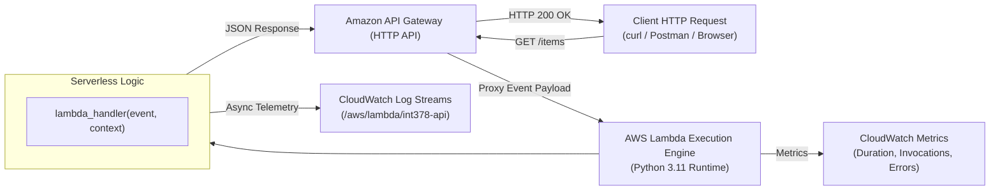
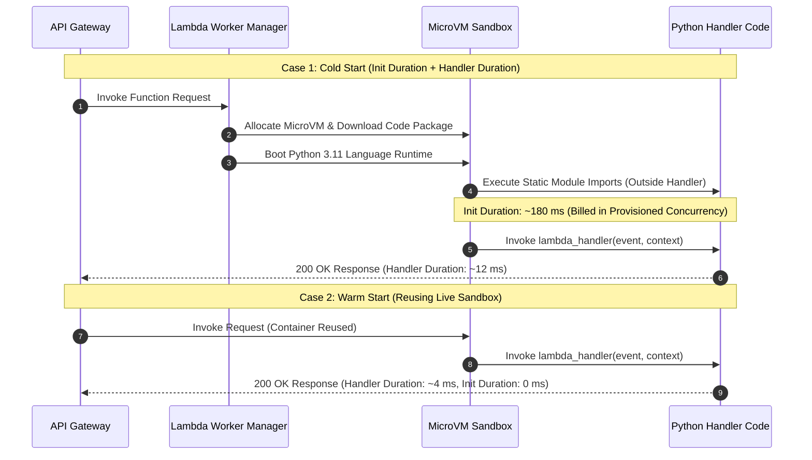

---
title: "Lab 10: Serverless Microservice (AWS Lambda, API Gateway & CloudWatch)"
course: "INT378: Advancements in Cloud and DevOps"
category: "practical-lab"
lab_number: 10
portion: "Portion 5: Observability, Serverless & FinOps"
hub: "[[INT378 Master Strategy & Curriculum Roadmap]]"
previous_lab: "[[Lab 09 - Grafana Dashboards & Prometheus Data Source]]"
next_lab: "[[Lab 11 - AWS Cost Explorer, Budgets & FinOps Optimization]]"
companion_theory:
  - "[[Unit 6 - Cloud-Native Development, Serverless & FinOps]]"
course_outcomes:
  - "CO4"
  - "CO6"
code_directory: "06 - Cloud-Native, Serverless & FinOps/code/lab10-serverless"
target_environment: "AWS Free Tier / AWS Academy / LocalStack"
cost_profile: "$0.00 (1M Lambda requests & 5GB CloudWatch logs free)"
estimated_duration: "45m"
tools_used:
  - "AWS Lambda"
  - "Amazon API Gateway"
  - "Amazon CloudWatch Logs"
  - "Python 3.11"
teardown_required: true
verification_status: "ready"
tags:
  - int378/lab-10
  - aws
  - lambda
  - serverless
  - api-gateway
  - cloudwatch
last_updated: 2026-11-03
---

# Lab 10: Serverless Microservice (AWS Lambda, API Gateway & CloudWatch)

**Course Outcome Alignment:** CO4, CO6  
**Target Environment:** AWS Free Tier / AWS Academy Learner Lab / LocalStack  
**Estimated Run Time:** 45 minutes  
**Cost:** \$0.00 (AWS Lambda includes 1,000,000 free requests/month; CloudWatch includes 5GB free logs)  
**Code Location:** `06 - Cloud-Native, Serverless & FinOps/code/lab10-serverless/`

---

## 1. Architectural Blueprint

In this experiment, you will build and deploy a serverless REST API microservice. An HTTP request sent to Amazon API Gateway triggers an AWS Lambda function running Python 3.11. The Lambda function processes the event, returns a structured JSON response, automatically writes execution logs to Amazon CloudWatch Logs, and surfaces telemetry metrics (Invocations, Duration, Cold Start Latency, Error Count).



---

## 2. Concept & Theoretical Foundations

1. **Function-as-a-Service (FaaS)**: Abstracting the entire server operating system. You provide code; the cloud platform provisions the runtime container on demand, executes the code, and de-provisions resources when idle.
2. **Cold Start vs. Warm Start**:
   - *Cold Start*: The first invocation creates an execution environment, downloads code, and initializes runtime dependencies.
   - *Warm Start*: Subsequent requests reuse the running execution sandbox.



> [!TIP]
> **Static Initialization Best Practice**: Initialize database connections, AWS SDK clients (`boto3.client`), and cache objects outside `lambda_handler()`. This allows warm invocations to reuse established connection pools, reducing database latency from 80ms to under 5ms.
3. **API Gateway Payload Format v2 (HTTP API)**: A lightweight, low-latency REST interface mapping HTTP methods, path parameters, query parameters, and headers directly into the Lambda `event` object.
4. **CloudWatch Telemetry Breakdown**:
   - `REPORT RequestId: ... Duration: 12.45 ms Billed Duration: 13 ms Memory Size: 128 MB Max Memory Used: 48 MB Init Duration: 180.20 ms`
   - *Notice*: `Init Duration` represents the cold start overhead.

---

## 3. Step-by-Step Implementation Guide

### Step 1: Inspect the Lambda Function Code
The function code is at `06 - Cloud-Native, Serverless & FinOps/code/lab10-serverless/lambda_function.py`.

Key components:
- `lambda_handler(event, context)`: Entry point.
- Extracts HTTP method and query string parameters from `event`.
- Handles routing: `GET /items`, `POST /items`, and `GET /health`.
- Emits structured JSON logs containing `requestId` and timestamps.

### Step 2: Create Execution Role for Lambda
Create `lambda-trust.json`:
```json
{
  "Version": "2012-10-17",
  "Statement": [
    {
      "Effect": "Allow",
      "Principal": {
        "Service": "lambda.amazonaws.com"
      },
      "Action": "sts:AssumeRole"
    }
  ]
}
```

Deploy the role:
```bash
# Create role
ROLE_ARN=$(aws iam create-role \
    --role-name int378-lambda-basic-role \
    --assume-role-policy-document file://lambda-trust.json \
    --query "Role.Arn" --output text)

# Attach AWS managed policy for CloudWatch Logs permissions
aws iam attach-role-policy \
    --role-name int378-lambda-basic-role \
    --policy-arn arn:aws:iam::aws:policy/service-role/AWSLambdaBasicExecutionRole

# Wait 5 seconds for IAM role propagation
sleep 5
```
*(If on AWS Academy Learner Lab, select the pre-existing `LabRole` from the dropdown/CLI instead of creating a new role).*

### Step 3: Package and Deploy Lambda Function
```bash
cd "06 - Cloud-Native, Serverless & FinOps/code/lab10-serverless"

# Zip the Python source file
zip function.zip lambda_function.py

# Create Lambda Function
aws lambda create-function \
    --function-name int378-serverless-api \
    --runtime python3.11 \
    --role $ROLE_ARN \
    --handler lambda_function.lambda_handler \
    --zip-file fileb://function.zip \
    --timeout 10 \
    --memory-size 128

echo "Lambda function deployed."
```

### Step 4: Test Function Execution Directly (CLI)
Invoke the function with a test event payload:
```bash
# Invoke Lambda synchronously
aws lambda invoke \
    --function-name int378-serverless-api \
    --payload '{"rawPath": "/items", "requestContext": {"http": {"method": "GET"}}}' \
    --cli-binary-format raw-in-base64-out \
    response.json

# Read response
cat response.json
```
*Expected Output*: Returns `statusCode: 200` with mock items list.

### Step 5: Integrate with Amazon API Gateway (HTTP API)
```bash
# 1. Create HTTP API Gateway
API_ID=$(aws apigatewayv2 create-api \
    --name int378-http-api \
    --protocol-type HTTP \
    --target $(aws lambda get-function --function-name int378-serverless-api --query "Configuration.FunctionArn" --output text) \
    --query "ApiId" --output text)

# 2. Grant API Gateway permission to invoke Lambda
ACCOUNT_ID=$(aws sts get-caller-identity --query Account --output text)
aws lambda add-permission \
    --function-name int378-serverless-api \
    --statement-id apigateway-invoke-perm \
    --action lambda:InvokeFunction \
    --principal apigateway.amazonaws.com \
    --source-arn "arn:aws:execute-api:us-east-1:${ACCOUNT_ID}:${API_ID}/*"

# 3. Get the API Gateway Endpoint URL
API_ENDPOINT=$(aws apigatewayv2 get-api --api-id $API_ID --query "ApiEndpoint" --output text)
echo "Public API Gateway URL: $API_ENDPOINT"
```

### Step 6: Test HTTP Endpoints via Curl / Browser
```bash
# Test GET /items
curl "$API_ENDPOINT/items"

# Test POST /items
curl -X POST "$API_ENDPOINT/items" \
    -H "Content-Type: application/json" \
    -d '{"name": "DevOps Handbook", "category": "Books"}'

# Test health check
curl "$API_ENDPOINT/health"
```

### Step 7: Analyze CloudWatch Logs & Metrics
1. Query CloudWatch Log Group:
   ```bash
   aws logs describe-log-streams \
       --log-group-name "/aws/lambda/int378-serverless-api" \
       --order-by LastEventTime --descending --limit 1
   ```
2. Retrieve the latest log events:
   ```bash
   STREAM_NAME=$(aws logs describe-log-streams --log-group-name "/aws/lambda/int378-serverless-api" --order-by LastEventTime --descending --query "logStreams[0].logStreamName" --output text)

   aws logs get-log-events \
       --log-group-name "/aws/lambda/int378-serverless-api" \
       --log-stream-name "$STREAM_NAME" \
       --query "events[*].message" --output text
   ```
3. Inspect CloudWatch Metrics in AWS Console:
   - Go to **CloudWatch** $\to$ **Metrics** $\to$ **Lambda** $\to$ **By Function Name**.
   - Review **Invocations**, **Duration**, and **Errors** graphs.

---

## 4. Verification Checklist

- [ ] Direct invocation via AWS CLI returns valid JSON response.
- [ ] Public curl requests to the API Gateway URL return HTTP 200.
- [ ] CloudWatch Log Stream shows `START`, custom application `INFO` logs, and `REPORT` lines.
- [ ] `Init Duration` observable on the first invocation (cold start), absent on subsequent rapid calls (warm start).

---

## 5. Teardown & Cleanup Checklist

```bash
# Delete API Gateway
aws apigatewayv2 delete-api --api-id $API_ID

# Delete Lambda Function
aws lambda delete-function --function-name int378-serverless-api

# Delete CloudWatch Log Group
aws logs delete-log-group --log-group-name "/aws/lambda/int378-serverless-api"

# Detach policy and delete IAM Role
aws iam detach-role-policy --role-name int378-lambda-basic-role --policy-arn arn:aws:iam::aws:policy/service-role/AWSLambdaBasicExecutionRole
aws iam delete-role --role-name int378-lambda-basic-role

# Remove local files
rm -f function.zip response.json lambda-trust.json
```

---

## 6. Viva Voce & Interview Questions

1. **How is AWS Lambda billed?**
   - *Answer*: Lambda billing is based on the number of requests ($0.20 per 1M requests after the free tier) and compute duration measured in milliseconds, multiplied by the allocated memory size ($GB\text{-seconds}$).
2. **What is a Cold Start in AWS Lambda, and how does Provisioned Concurrency solve it?**
   - *Answer*: A cold start is the initialization latency that occurs when AWS spins up a new microVM execution environment for an uninitialized function. Provisioned Concurrency keeps a pre-warmed pool of execution environments ready to respond instantly.
3. **What is the difference between Amazon API Gateway REST API and HTTP API?**
   - *Answer*: HTTP APIs are newer, lightweight, optimized for serverless workloads, offer up to $70\%$ lower latency, and cost up to $71\%$ less than REST APIs, though they lack advanced features like API caching and request transformations.
