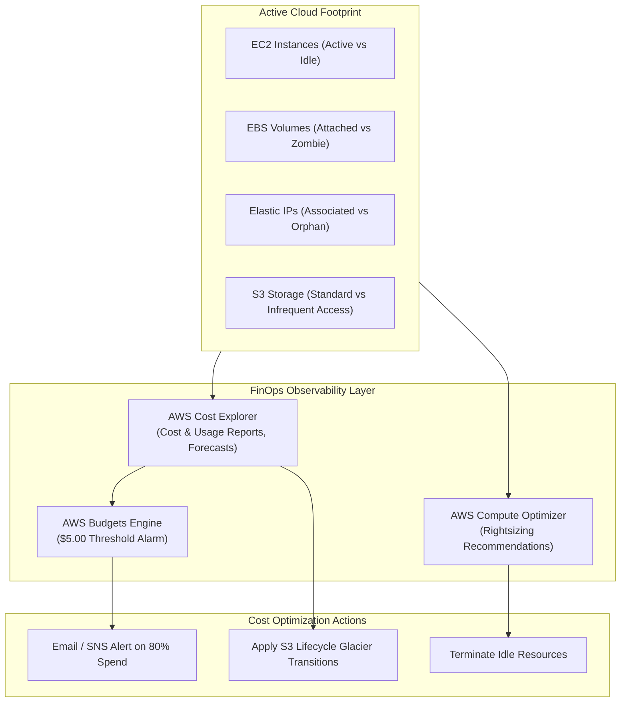
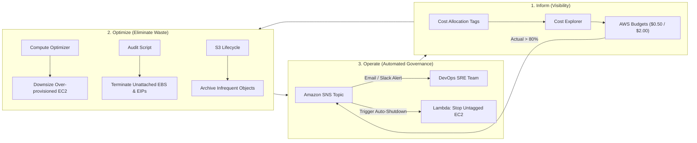

# Lab 11: AWS Cost Explorer, Budgets & FinOps Cloud Optimization

**Course Outcome Alignment:** CO4, CO6  
**Target Environment:** AWS Management Console & AWS CLI  
**Estimated Run Time:** 40 minutes  
**Cost:** \$0.00 (AWS Cost Explorer, Budgets within free tier limits)

---

## 1. Architectural Blueprint

In this experiment, you will take on the role of a Cloud Financial Operations (FinOps) Engineer. You will analyze historical spending trends using AWS Cost Explorer, configure automated multi-tier financial thresholds using AWS Budgets, perform an inventory audit of idle/underutilized resources (unattached EBS volumes, zombie Elastic IPs, over-provisioned EC2 instances), and build a cost optimization roadmap.



---

## 2. Concept & Theoretical Foundations

1. **FinOps (Cloud Financial Operations)**: An evolving cloud operational discipline and cultural practice that enables organizations to maximize business value by helping engineering, finance, and technology teams collaborate on data-driven spending decisions.
2. **Cost Allocation Tags**: Key-value pairs attached to AWS resources (`Environment=Production`, `Project=INT378`, `Owner=TeamDevOps`). Cost Explorer groups and filters spend by these tags, enabling departmental chargebacks.
3. **AWS Budgets**: Allows setting custom cost and usage limits. Evaluates daily or monthly and triggers alerts when forecasted or actual costs exceed defined percentages (e.g., $50\%$, $80\%$, $100\%$).
4. **AWS Compute Optimizer**: Analyzes Amazon CloudWatch metric history (CPU utilization, memory usage, network I/O, disk throughput) to identify over-provisioned (wasteful) or under-provisioned (bottlenecked) compute instances.

### The FinOps Feedback Loop & Automated Remediation



---

## 3. Step-by-Step Implementation Guide

### Step 1: Enable and Explore AWS Cost Explorer
1. In the AWS Management Console, search for **Billing and Cost Management**.
2. Click **Cost Explorer** in the left sidebar. *(If opening for the first time, click "Enable Cost Explorer". Note that AWS takes ~24 hours to populate historical data)*.
3. In the Cost Explorer interactive dashboard:
   - **Granularity**: Switch between *Monthly* and *Daily*.
   - **Dimension**: Group by **Service** to see which services (EC2, S3, RDS) drive expenses.
   - **Filter**: Filter by **Usage Type** or **Region** to identify geographic spending variations.
   - **Forecast**: Enable the forecasting toggle to project spending for the next 30 days based on current burn rate.

### Step 2: Configure a Multi-Tier AWS Budget with Email Alerts

We will configure an automated \$5.00 monthly safety budget with warnings at 50% (\$2.50) and 80% (\$4.00), and a critical alert at 100% (\$5.00).

```bash
# Get current account ID
ACCOUNT_ID=$(aws sts get-caller-identity --query Account --output text)

# Create budget definition file
cat << 'EOF' > budget.json
{
  "BudgetName": "INT378-Monthly-Student-Safety-Budget",
  "BudgetLimit": {
    "Amount": "5.00",
    "Unit": "USD"
  },
  "CostFilters": {},
  "CostTypes": {
    "IncludeTax": true,
    "IncludeSubscription": true,
    "UseBlended": false,
    "IncludeRefund": false,
    "IncludeCredit": false,
    "IncludeUpfront": true,
    "IncludeRecurring": true,
    "IncludeOtherSubscription": true,
    "IncludeSupport": true,
    "IncludeDiscount": true,
    "UseAmortized": false
  },
  "TimeUnit": "MONTHLY",
  "BudgetType": "COST"
}
EOF

# Create notification subscribers configuration
cat << 'EOF' > notifications.json
[
  {
    "Notification": {
      "NotificationType": "ACTUAL",
      "ComparisonOperator": "GREATER_THAN",
      "Threshold": 50.0,
      "ThresholdType": "PERCENTAGE"
    },
    "Subscribers": [
      {
        "SubscriptionType": "EMAIL",
        "Address": "student-devops@university.edu"
      }
    ]
  },
  {
    "Notification": {
      "NotificationType": "FORECASTED",
      "ComparisonOperator": "GREATER_THAN",
      "Threshold": 80.0,
      "ThresholdType": "PERCENTAGE"
    },
    "Subscribers": [
      {
        "SubscriptionType": "EMAIL",
        "Address": "student-devops@university.edu"
      }
    ]
  }
]
EOF

# Deploy the budget via AWS CLI
aws budgets create-budget \
    --account-id $ACCOUNT_ID \
    --budget file://budget.json \
    --notifications-with-subscribers file://notifications.json

echo "Budget successfully deployed."
```

### Step 3: Run the Underutilized & Zombie Resource Audit Script
Save and run this audit script to scan your AWS region for idle resources that accumulate hidden fees:

```bash
cat << 'EOF' > finops-audit.sh
#!/bin/bash
REGION="us-east-1"
echo "=================================================="
echo "    AWS FINOPS RESOURCE INVENTORY AUDIT"
echo "=================================================="

echo -e "\n[1] Auditing Unattached (Zombie) EBS Volumes..."
UNATTACHED_EBS=$(aws ec2 describe-volumes --region $REGION \
    --filters "Name=status,Values=available" \
    --query "Volumes[*].[VolumeId,Size,CreateTime]" --output text)

if [ -z "$UNATTACHED_EBS" ]; then
    echo "CLEAN: No unattached EBS volumes found."
else
    echo "WARNING: Found unattached volumes accumulating storage costs:"
    echo "$UNATTACHED_EBS"
fi

echo -e "\n[2] Auditing Unassociated Elastic IPs (EIPs)..."
UNASSOCIATED_EIP=$(aws ec2 describe-addresses --region $REGION \
    --query "Addresses[?AssociationId==null].[PublicIp,AllocationId]" --output text)

if [ -z "$UNASSOCIATED_EIP" ]; then
    echo "CLEAN: No unassociated Elastic IPs found."
else
    echo "WARNING: Found unattached Elastic IPs accumulating hourly charges:"
    echo "$UNASSOCIATED_EIP"
fi

echo -e "\n[3] Auditing Running EC2 Instances for Rightsizing..."
RUNNING_VMS=$(aws ec2 describe-instances --region $REGION \
    --filters "Name=instance-state-name,Values=running" \
    --query "Reservations[*].Instances[*].[InstanceId,InstanceType,LaunchTime]" --output text)

if [ -z "$RUNNING_VMS" ]; then
    echo "INFO: No instances currently running."
else
    echo "Active Instances to verify against CloudWatch CPU utilization:"
    echo "$RUNNING_VMS"
fi
echo "=================================================="
EOF

chmod +x finops-audit.sh
./finops-audit.sh
```

### Step 4: Implement S3 Storage Class Cost Optimization
Apply an automated S3 Lifecycle Rule to move old objects from standard storage to Glacier archive, reducing storage costs by over 80%:

```bash
cat << 'EOF' > s3-lifecycle.json
{
  "Rules": [
    {
      "ID": "MoveLogsToGlacierAndExpire",
      "Status": "Enabled",
      "Filter": {
        "Prefix": "logs/"
      },
      "Transitions": [
        {
          "Days": 30,
          "StorageClass": "STANDARD_IA"
        },
        {
          "Days": 90,
          "StorageClass": "GLACIER"
        }
      ],
      "Expiration": {
        "Days": 365
      }
    }
  ]
}
EOF
```

---

## 4. Verification Checklist

- [ ] AWS Cost Explorer is enabled and historical or forecast graphs render.
- [ ] AWS Budget `INT378-Monthly-Student-Safety-Budget` visible in the Budgets console.
- [ ] Confirmation verification email received in your inbox.
- [ ] `finops-audit.sh` completes clean scan with zero orphaned EBS volumes or Elastic IPs.

---

## 5. Teardown & Cleanup Checklist

```bash
# Delete the test budget if no longer required
aws budgets delete-budget \
    --account-id $ACCOUNT_ID \
    --budget-name "INT378-Monthly-Student-Safety-Budget"

# Clean up local JSON configuration files
rm -f budget.json notifications.json finops-audit.sh s3-lifecycle.json
```

---

## 6. Viva Voce & Interview Questions

1. **What is the difference between AWS Cost Explorer and AWS Budgets?**
   - *Answer*: Cost Explorer is a retrospective and analytical tool that visualizes historical spending and projects future spending. AWS Budgets is a proactive threshold monitoring tool that triggers alarms and automated actions when current or forecasted spend crosses defined limits.
2. **Why does AWS charge for an Elastic IP address when it is detached from an EC2 instance?**
   - *Answer*: Public IPv4 addresses are a globally scarce resource. AWS charges an hourly penalty fee for unattached Elastic IPs to discourage customers from reserving public IP addresses without using them.
3. **What is the difference between an EC2 Instance Savings Plan and a Compute Savings Plan?**
   - *Answer*: Compute Savings Plans offer up to $66\%$ savings and apply flexibly across instance families, operating systems, regions, and services (EC2, Fargate, Lambda). EC2 Instance Savings Plans offer higher discounts (up to $72\%$) but require committing to a specific instance family in a specific region.
