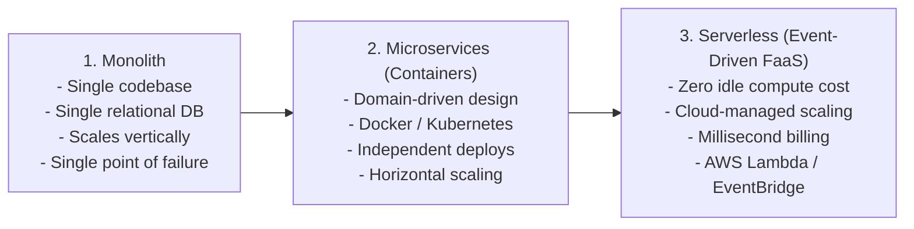
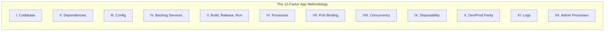
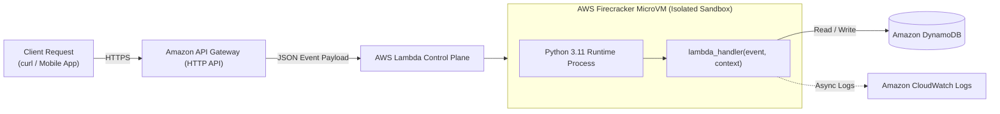
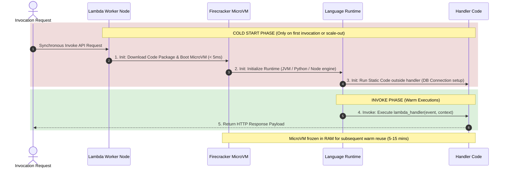
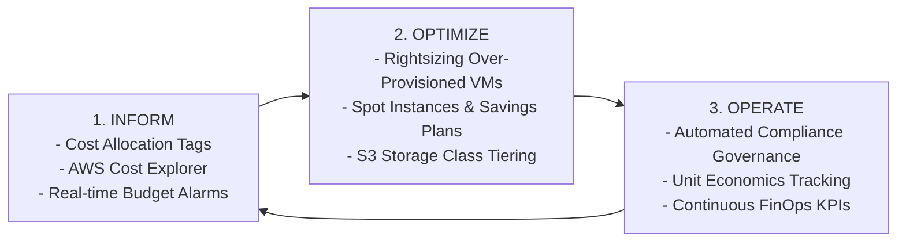
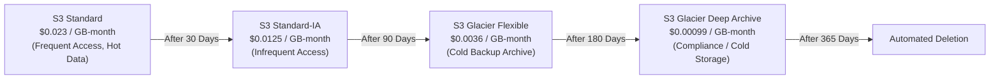
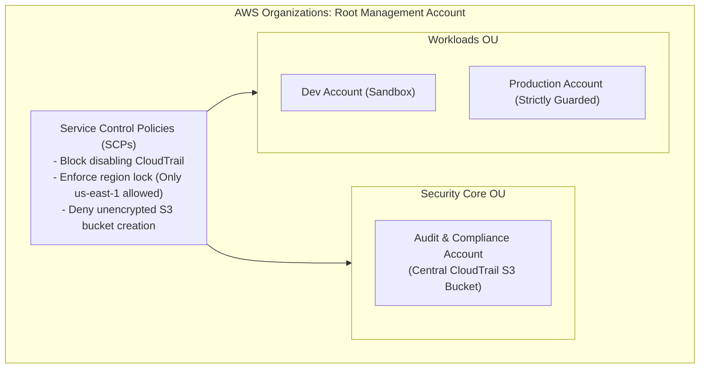

---
title: "Unit 6: Cloud-Native Development, Serverless & FinOps"
course: "INT378: Advancements in Cloud and DevOps"
category: "theory-unit"
unit_number: 6
portion: "Portion 5: Observability, Serverless & FinOps"
hub: "[[INT378 Master Strategy & Curriculum Roadmap]]"
previous_unit: "[[Unit 5 - DevSecOps, IAM and Cloud Security]]"
next_unit: null
course_outcomes:
  - "CO4"
  - "CO6"
companion_labs:
  - "[[Lab 10 - Serverless Microservice (Lambda, API GW, CloudWatch)]]"
  - "[[Lab 11 - AWS Cost Explorer, Budgets & FinOps Optimization]]"
code_templates:
  - "[[06 - Cloud-Native, Serverless & FinOps/code/lab10-serverless/lambda_function.py]]"
core_technologies:
  - "12-Factor App"
  - "AWS Lambda"
  - "AWS Firecracker"
  - "Amazon API Gateway"
  - "FinOps Foundation"
  - "AWS Cost Explorer"
  - "AWS Budgets"
  - "AWS CloudTrail"
  - "AWS Config"
exam_weightage: "High"
difficulty: "Intermediate"
estimated_read_time: "25m"
status: "completed"
tags:
  - int378/unit-6
  - cloud-native
  - 12-factor-app
  - serverless
  - lambda
  - finops
  - governance
last_updated: 2026-11-03
---

# Unit 6: Cloud-Native Development, Serverless & FinOps

---

## 1. Executive Summary & The Cloud-Native Paradigm

The Cloud Native Computing Foundation (CNCF) defines **cloud-native** technologies as those that empower organizations to build and run scalable applications in modern, dynamic environments such as public, private, and hybrid clouds. Containers, service meshes, microservices, immutable infrastructure, and declarative APIs exemplify this approach.

### The Architectural Evolution Continuum

---

## 2. The Twelve-Factor App Methodology in Extreme Detail

Created by Heroku co-founder Adam Wiggins, the **Twelve-Factor App** methodology establishes foundational architectural principles for building software designed to thrive in modern cloud platforms.

### Complete Technical Breakdown of All 12 Factors

| Factor | Name | Core Architectural Rule | Cloud / Kubernetes Implementation Pattern | Anti-Pattern to Avoid |
| :--- | :--- | :--- | :--- | :--- |
| **I** | **Codebase** | One codebase tracked in revision control, many deploys. | Single Git repository per microservice. Deployments (Dev, Staging, Prod) represent different running environments of that same codebase. | Multiple microservices sharing a single coupled Git repo with intertwined build steps. |
| **II** | **Dependencies** | Explicitly declare and isolate dependencies. | Use deterministic lockfiles (`package-lock.json`, `Pipfile.lock`, `go.sum`). Package into container images with isolated libraries. | Relying on system-wide pre-installed packages on the host operating system. |
| **III** | **Config** | Store configuration in the environment. | Inject database credentials, API endpoints, and flags via OS **environment variables** or AWS Systems Manager Parameter Store. | Committing `config.json` containing production credentials directly into Git. |
| **IV** | **Backing Services** | Treat backing services as attached resources. | Databases, caches (Redis), and message queues (SQS) are referenced via external connection URLs. Swapping from local Redis to AWS ElastiCache requires only a config URL change, zero code alterations. | Hardcoding localhost database sockets or bundling the database inside the application container. |
| **V** | **Build, Release, Run** | Strictly separate build, release, and run stages. | **Build**: Compiles code into an immutable Docker image. **Release**: Combines image with environment config. **Run**: Launches container pods in the cluster. | Hot-patching live code or editing files directly on running production servers. |
| **VI** | **Processes** | Execute the app as one or more stateless processes. | Applications share nothing. Any state (user sessions, uploaded files) is persisted to backing stores (Amazon DynamoDB, S3, ElastiCache). | Storing user login sessions in local server memory; servers crash, logging out users. |
| **VII** | **Port Binding** | Export services via port binding. | The web application is self-contained, bundling its own HTTP server (e.g., Python Gunicorn, Node.js HTTP) listening on an injected port (e.g., `PORT=8080`). | Relying on an external Apache/Tomcat container to host injected application WAR files. |
| **VIII** | **Concurrency** | Scale out via the process model. | Scale horizontally by adding more process instances or container replicas behind a load balancer, rather than adding complex multi-threading inside a single giant process. | Running a massive monolithic process relying on JVM thread pooling that exhausts host memory. |
| **IX** | **Disposability** | Maximize robustness with fast startup and graceful shutdown. | Containers start in sub-seconds. Upon receiving `SIGTERM`, processes stop accepting new HTTP requests, drain in-flight connections, and exit cleanly within seconds. | Processes that take 5 minutes to boot or crash corrupting database transactions on shutdown. |
| **X** | **Dev/Prod Parity** | Keep development, staging, and production as similar as possible. | Use the same backing services (e.g., run real PostgreSQL in local Docker for dev rather than SQLite when production runs PostgreSQL). | Developing against SQLite locally and debugging PostgreSQL dialect bugs in production. |
| **XI** | **Logs** | Treat logs as event streams. | Applications write raw structured JSON events unbuffered to `stdout` / `stderr`. The cloud execution environment (FluentBit, CloudWatch agent) captures and aggregates streams. | Writing logs directly to local rotated files on disk (`/var/log/app.log`) inside containers. |
| **XII** | **Admin Processes** | Run admin/management tasks as one-off processes. | Database migrations (`rails db:migrate`, `alembic upgrade head`) execute as isolated one-off jobs (e.g., Kubernetes `Job` or AWS ECS Task) using identical environment configs. | Manually logging into a production server via SSH to run raw SQL schema alterations. |

---

## 3. Serverless Architectures & AWS Lambda Deep-Dive

Serverless does not mean "no servers"; it means developers write business logic while the cloud provider manages server provisioning, OS patching, automatic scaling, and capacity planning.

### 3.1 Under the Hood: AWS Firecracker MicroVMs
AWS Lambda executes function code inside lightweight, hardware-isolated virtual machines called **microVMs**, powered by **Firecracker**—an open-source Virtual Machine Monitor written in Rust by AWS using the Linux Kernel-based Virtual Machine (KVM).

#### Why Firecracker Replaced Traditional Containers in Lambda
- **Security Boundary**: Standard containers share a single host OS kernel. A multi-tenant environment running untrusted customer code could allow container breakout attacks. Firecracker provides hardware virtualization isolation per function.
- **Ultra-Fast Boot Time**: While a standard VM takes minutes to boot, a Firecracker microVM boots in **less than $5\text{ ms}$**.
- **Minimal Footprint**: A running Firecracker microVM consumes **less than $5\text{ MB}$ of memory**, allowing AWS to pack thousands of isolated microVMs on a single bare-metal server.

### 3.2 The Lambda Execution Lifecycle & Cold Start Mechanics

#### Cold Start vs. Warm Start
- **Cold Start**: Occurs when a request arrives and no idle, pre-warmed execution environment exists. AWS must allocate a worker node, download the code artifact from S3, boot the Firecracker microVM, initialize the runtime, and execute static initialization code. This introduces latency overhead (typically 100ms–2s depending on language and bundle size).
- **Warm Start**: If a subsequent request arrives while the microVM is still active in memory, AWS routes the request directly to the existing sandbox. Latency drops to sub-10 milliseconds.

#### Cold Start Mitigation Strategies
1. **Provisioned Concurrency**: Allocates a pre-warmed pool of execution environments that remain continuously initialized, eliminating cold start latency for critical production APIs.
2. **Runtime Selection**: Compiled/interpreted runtimes with minimal initialization overhead (Go, Rust, Python, Node.js) suffer much smaller cold starts (100–300ms) than heavy JVM or .NET runtimes (1–3 seconds).
3. **Optimize Static Code**: Initialize database connection pools and AWS SDK clients **outside** the `lambda_handler` function block so they are reused across warm invocations.

---

## 4. Cloud Cost Optimization & FinOps

Cloud financial management (**FinOps**) bridges engineering, finance, and operations to maximize business value from cloud spending.

### 4.1 Cloud Billing Models & Commitment Strategies

| Pricing Model | How Billing Works | Potential Discount | Ideal Use Case | Risk / Limitation |
| :--- | :--- | :--- | :--- | :--- |
| **On-Demand** | Pay by the second with zero upfront commitment. | Baseline ($0\%$) | Unpredictable, short-term, or newly developed workloads. | Highest hourly cost; zero financial optimization. |
| **Compute Savings Plans** | Commit to a consistent hourly spend (e.g., \$10/hr) for 1 or 3 years. | **Up to $66\%$** | Workloads that vary across EC2, AWS Fargate (containers), and AWS Lambda. | Requires financial commitment; underutilization forfeits savings. |
| **EC2 Instance Savings Plans** | Commit to a specific instance family in a specific region (e.g., `c6i` in `us-east-1`). | **Up to $72\%$** | Steady-state compute fleets with predictable, known architecture. | Locked to that specific instance family and region. |
| **Spot Instances** | Bid on excess spare cloud compute capacity. | **Up to $90\%$** | Stateless, fault-tolerant batch workloads, big data rendering, CI/CD test runners. | **AWS can terminate with 2-minute notice** if capacity is needed by on-demand users. |

### 4.2 S3 Storage Class Lifecycle Cost Engineering
Data storage is a significant contributor to cloud waste. Organizations accumulate petabytes of historical logs and backups in expensive storage tiers.

#### Financial Impact Analysis
- Storing $100\text{ TB}$ in **S3 Standard**: $100{,}000 \times \$0.023 = \mathbf{\$2{,}300\text{ per month}}$.
- Transitioning to **Glacier Deep Archive**: $100{,}000 \times \$0.00099 = \mathbf{\$99\text{ per month}}$.
- *Result*: **Over $95\%$ reduction in persistent storage expenditure!**

### 4.3 Eliminating Zombie Cloud Resources
1. **Unattached EBS Volumes**: When an EC2 instance is terminated without the `DeleteOnTermination` flag, its network-attached EBS volume remains in the `available` state, silently accruing standard monthly storage fees (\$0.08/GB-month).
2. **Unassociated Elastic IPs**: AWS penalizes accounts holding allocated public IPv4 addresses that are not attached to a running instance (\$0.005/hour).
3. **Abandoned CloudWatch Logs**: Default log groups retain logs with **Never Expire** retention. Set an automated expiration policy (e.g., 30 or 90 days) on all log groups.

---

## 5. Cloud Governance, Compliance Auditing & Secure Architecture

Enterprise cloud adoption requires centralized guardrails to enforce organizational policy and prevent security breaches across dozens of business unit accounts.

### 5.1 The Auditing Duo: AWS CloudTrail vs. AWS Config
- **AWS CloudTrail (The Account Flight Recorder)**:
  - Answers: *"Who made what API call, from what IP address, at what exact millisecond?"*
  - Captures every management and data event across CLI, Console, and SDKs.
  - Generates immutable, signed JSON log streams delivered to an isolated, encrypted S3 bucket.
- **AWS Config (The Compliance & Drift Engine)**:
  - Answers: *"What does my infrastructure look like right now, how has it changed over time, and does it violate compliance policies?"*
  - Continuously records point-in-time configuration snapshots of resources.
  - Automatically evaluates configurations against compliance rules (e.g., `s3-bucket-public-read-prohibited`, `encrypted-volumes`).

### 5.2 The AWS Well-Architected Framework (6 Core Pillars)
1. **Operational Excellence**: Run and monitor systems to deliver business value, continually improving processes and procedures (Infrastructure as Code, small reversible changes, anticipating failure).
2. **Security**: Protect information, systems, and assets while delivering business value through risk assessments and mitigation strategies (Least privilege, defense in depth, automating security best practices).
3. **Reliability**: Ensure a workload performs its intended function correctly and consistently when expected (Multi-AZ failover, automatic recovery from failure, horizontal scaling to prevent saturation).
4. **Performance Efficiency**: Use compute resources efficiently to meet system requirements and maintain that efficiency as demand changes (Selecting optimal storage/compute types, democratizing advanced technologies).
5. **Cost Optimization**: Avoid unnecessary spending through financial awareness and architecture rightsizing (Adopting consumption models, analyzing spend via Cost Explorer, utilizing managed services).
6. **Sustainability**: Minimize the environmental impacts of running cloud workloads (Maximizing resource utilization, selecting energy-efficient Graviton ARM processors).

---

## 6. Review, Exam & Viva Questions with Model Answers

### Question 1: Explain the Twelve-Factor App methodology. Select any three factors and explain their technical realization in modern cloud architectures.
**Model Answer:**
The Twelve-Factor App methodology is a set of best practices for building scalable, maintainable, cloud-native software.
1. *Factor III: Config (Store config in the environment)*: Application code must strictly decouple configuration constants (database credentials, API endpoints) from the binary. Realized by injecting values via OS environment variables, Kubernetes ConfigMaps/Secrets, or AWS Systems Manager Parameter Store.
2. *Factor VI: Processes (Execute as stateless processes)*: Applications share nothing and persist zero state to the local filesystem or memory. Realized by offloading session data and uploads to managed backing stores like Amazon DynamoDB, ElastiCache Redis, and S3.
3. *Factor IX: Disposability (Fast startup and graceful shutdown)*: Applications must boot in seconds and respond cleanly to `SIGTERM` signals. Realized in container orchestration by draining active network connections and finishing database queries within the container termination grace period before shutting down.

### Question 2: What is the Cold Start phenomenon in AWS Lambda, and how does Provisioned Concurrency solve it?
**Model Answer:**
A cold start occurs when an invocation request arrives and no pre-warmed execution sandbox is available in memory. AWS must allocate compute resources, download the function zip package, initialize the Firecracker microVM, boot the language runtime (Node.js/Python), and execute static initialization code outside the handler. This introduces latency overhead (100ms to 2s). Provisioned Concurrency completely solves this by pre-allocating and keeping a designated number of execution sandboxes pre-warmed and initialized in memory, ready to service incoming invocations with sub-10ms latency.

### Question 3: Outline the three phases of the FinOps lifecycle (Inform, Optimize, Operate).
**Model Answer:**
1. *Inform*: Establishing visibility into cloud spending. Allocating costs accurately using standardized Cost Allocation Tags, setting up automated AWS Budgets with multi-tier threshold alerts, and visualizing usage via AWS Cost Explorer.
2. *Optimize*: Taking concrete technical and commercial actions to reduce waste. Rightsizing over-provisioned EC2 instances via Compute Optimizer, switching steady-state compute to Savings Plans, leveraging Spot Instances, and configuring automated S3 Lifecycle rules.
3. *Operate*: Embedding continuous governance into operations. Tracking unit economic KPIs (e.g., cost per customer transaction) and automating continuous policy enforcement to ensure teams remain financially accountable.

### Question 4: Compare AWS CloudTrail and AWS Config in terms of scope, function, and compliance role.
**Model Answer:**
- **AWS CloudTrail**: An event logging audit service that records API activity across the account. It captures chronological metadata (caller identity, timestamp, source IP, API action, request parameters) detailing **who did what**.
- **AWS Config**: A configuration management and compliance auditing service that continuously tracks the state and relationships of cloud resources. It evaluates whether configurations adhere to organizational guardrails (e.g., verifying all EBS volumes are encrypted) and reports **how resource configurations changed over time**.
- *Together*: CloudTrail provides the audit trail of who made the change, while Config details the compliance state before and after the modification.
