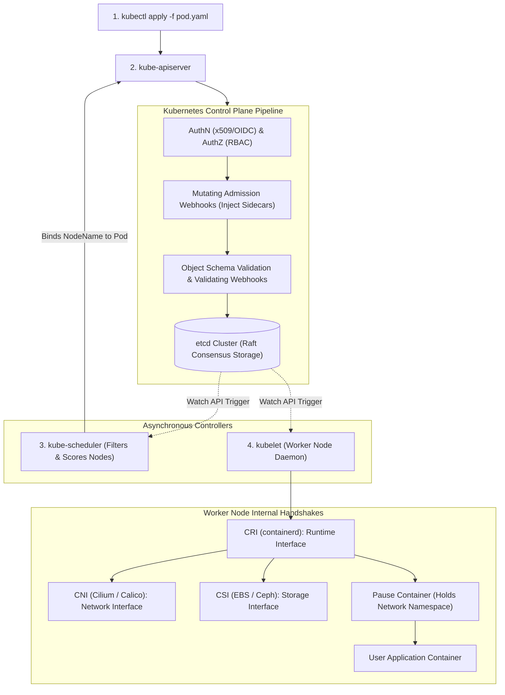
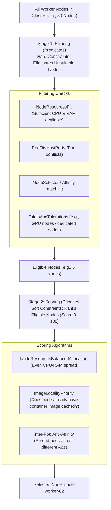
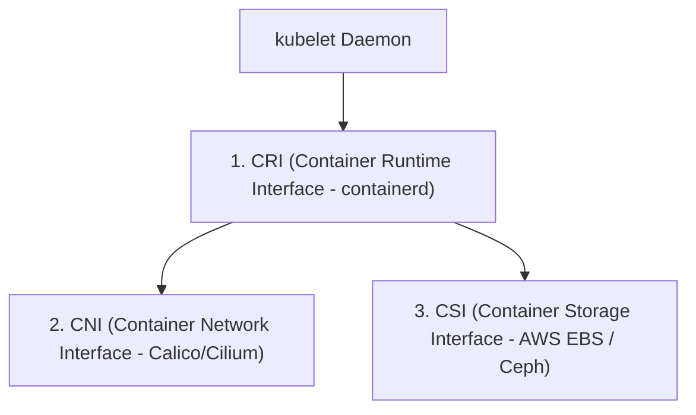
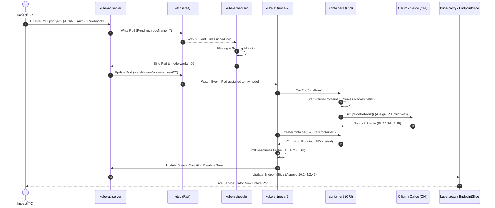

# Rabbit Hole 03: Kubernetes Under the Hood (The Life of a Pod)

Every DevOps engineer knows how to write a YAML manifest and execute `kubectl apply -f pod.yaml`.

In Staff SRE and Principal DevOps interviews, examiners ask:  
*"Walk me through the exact microsecond-by-microsecond lifecycle of that request across the API server, etcd consensus, the scheduler, admission webhooks, kubelet, CRI, CNI, and CSI until bytes hit the application."*

Here is the complete journey.

---

## 1. The Global Lifecycle Architecture

---

## 2. Phase 1: The `kube-apiserver` Processing Pipeline

`kube-apiserver` is the sole gateway to the cluster. No component (not even the scheduler or kubelet) ever talks directly to `etcd`; everyone talks to the API server.

1. **Client-Side Validation & Serialization**: `kubectl` validates the YAML against its local OpenAPI schema, converts it into JSON, and sends an `HTTP POST` over mutual TLS (mTLS) to the API server.
2. **Authentication (AuthN)**: Inspects client x509 certificates, bearer tokens, or OpenID Connect (OIDC) JWTs to extract the username, UID, and group memberships.
3. **Authorization (AuthZ)**: Evaluates **Role-Based Access Control (RBAC)** rules. Can user `alice` perform the verb `create` on the resource `pods` in the namespace `production`?
4. **Mutating Admission Webhooks**: External webhooks modify the pod before storage. This is how service meshes (Istio/Linkerd) automatically inject their **Envoy sidecar proxy** containers into your pod manifest!
5. **Schema Validation**: Validates fields, types, and required parameters.
6. **Validating Admission Webhooks**: Security policy engines (**OPA Gatekeeper / Kyverno**) verify compliance. If the pod requests `privileged: true` or runs as `root`, the webhook rejects the request and returns an HTTP 403 error.
7. **Writing to `etcd`**: Once validated, the API server writes the pod object to `etcd`.

---

## 3. Phase 2: `etcd` Internals, Raft Consensus & Quorum Math

`etcd` is a distributed, consistent key-value store using the **Raft consensus algorithm**.

### 3.1 MVCC (Multi-Version Concurrency Control)
`etcd` does not overwrite keys in place. Every change increments a global 64-bit integer called a **Revision**.
- It provides **optimistic locking via `resourceVersion`**. If two controllers attempt to update the same pod simultaneously, the second write is rejected with a conflict error, forcing the controller to refresh and re-evaluate.

### 3.2 Why etcd Clusters Must ALWAYS Have an Odd Number of Nodes
Engineers often ask: *"Why run 3 or 5 etcd nodes? Why not 4 or 6?"*

The mathematical quorum required to commit a write is:

$$\text{Quorum} = \left\lfloor \frac{N}{2} \right\rfloor + 1$$

| Cluster Size ($N$) | Quorum Needed | Fault Tolerance (Nodes that can fail) | Why Even Numbers Are an Anti-Pattern |
| :--- | :--- | :--- | :--- |
| **1 Node** | 1 | **0 Nodes** (Single point of failure) | Unacceptable for production. |
| **3 Nodes** | 2 | **1 Node** | Standard production baseline. |
| **4 Nodes** | 3 | **1 Node** | **Bad Engineering**: Adding the 4th node does *not* increase fault tolerance (it still only survives 1 failure), but introduces an extra node capable of network partitioning! |
| **5 Nodes** | 3 | **2 Nodes** | High-availability enterprise standard. |

---

## 4. Phase 3: The `kube-scheduler` (Two-Stage Selection)

At this moment, the pod exists in `etcd` in the `Pending` state with an empty node assignment (`spec.nodeName: ""`).

The `kube-scheduler` runs an infinite reconciliation loop watching for unassigned pods. When it sees our pod, it executes a two-phase selection algorithm:

The scheduler creates a **Binding object** sending a `POST /api/v1/namespaces/default/pods/my-pod/binding` to the API server, setting `spec.nodeName: "node-worker-02"`.

---

## 5. Phase 4: Kubelet & The Holy Trinity of Interfaces (CRI, CNI, CSI)

On `node-worker-02`, the **`kubelet`** daemon detects via its watch stream that a pod has been scheduled to its node.

Kubelet coordinates three standardized plugin interfaces over UNIX domain sockets via gRPC:

### 5.1 Storage Binding via CSI (Container Storage Interface)
If the pod requests a Persistent Volume Claim (PVC):
1. The **Attach/Detach Controller** in the control plane calls the cloud API (`aws ec2 attach-volume`) to attach the EBS block device to the physical EC2 node.
2. The Kubelet calls CSI `NodeStageVolume` to format the disk (`mkfs.ext4`).
3. Kubelet calls CSI `NodePublishVolume` to bind-mount the disk into `/var/lib/kubelet/pods/<pod-id>/volumes/`.

### 5.2 Network Provisioning via CNI (Container Network Interface)
Kubelet calls CNI (`/opt/cni/bin/cilium` or `calico`):
1. Creates a brand-new Linux Network Namespace (`netns`).
2. Creates a `veth` pair: connects one interface to the pod as `eth0` and the other to the host network bridge or eBPF datapath.
3. Assigns an IP address to the pod from the node's IPAM (IP Address Management) CIDR pool.

### 5.3 The "Pause Container" Secret
Before running your application, CRI spawns a microscopic, sleeping container based on the image **`registry.k8s.io/pause`**.

> [!IMPORTANT]
> **What Does the Pause Container Do?**
> A Kubernetes Pod is a collection of containers sharing the exact same IP address and port space.
> The **Pause container** is started first to create and hold the pod's **Network, IPC, and UTS Namespaces**. All subsequent user application containers (and sidecars) join the Pause container's namespaces using `setns()`. If your application container crashes and restarts, **the network IP address is never lost** because the Pause container remains continuously alive holding the namespace!

---

## 6. Phase 5: Liveness, Readiness & Traffic Ingress

1. The container runtime pulls your application image layers, builds the OverlayFS union mount, and invokes `runc` to execute your process.
2. **Readiness Probe**:
   - The kubelet periodically polls your readiness check (`GET /healthz`).
   - While failing, the pod remains in the `Running` state, but its `Ready` condition is `False`.
3. **Endpoints Controller Activation**:
   - The moment the Readiness probe returns HTTP 200, the Kubelet reports `Ready: True` to the API server.
   - The **Endpoints Controller** detects this and appends the pod's private IP (`10.244.2.45`) to the cluster's **Endpoints / EndpointSlice** object.
   - `kube-proxy` (or Cilium eBPF) programs iptables / eBPF forwarding rules.
   - The Service / Ingress load balancer begins routing live user traffic to your container!

---

### 6.1 End-to-End Microsecond Sequence Summary

