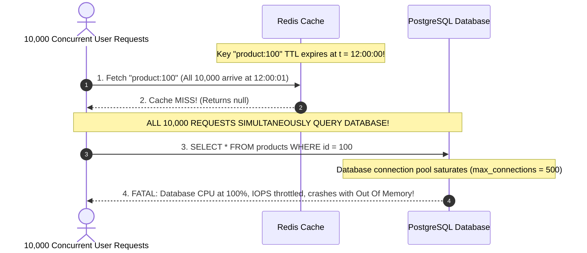
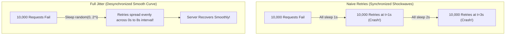

# Rabbit Hole 04: Distributed Systems Resiliency, Failures & Circuit Breakers

In simple monolithic systems, when a database query fails, an error is returned.

In distributed cloud microservices, **failures are contagious**. A minor 200ms latency increase in a tertiary recommendation service can trigger thread exhaustion, retry storms, and cascading outages that bring down your entire multi-million dollar platform.

Here is how distributed systems fail—and how Principal SREs engineer resiliency against them.

---

## 1. The Fallacies of Distributed Computing

In 1994, Sun Microsystems Fellow L. Peter Deutsch defined the **8 Fallacies of Distributed Computing**—false assumptions that developers unconsciously make when moving from single-machine code to cloud networks:

1. The network is reliable.
2. Latency is zero.
3. Bandwidth is infinite.
4. The network is secure.
5. Topology doesn't change.
6. There is one administrator.
7. Transport cost is zero.
8. The network is homogeneous.

Every resilience pattern in DevOps exists to protect systems against the violations of these 8 fallacies.

---

## 2. The Thundering Herd Problem & Cache Stampede

A **Cache Stampede** is a catastrophic failure mode that occurs in high-traffic read-heavy platforms (e.g., Twitter, Reddit, e-commerce product pages).



### The 3 Production Mitigations
1. **Mutex Locking (Single-Flight Pattern)**:
   - When a cache miss occurs, the application process attempts to acquire a distributed lock (e.g., in Redis via `SET lock:product:100 NX EX 5`).
   - Only **one single request** is granted permission to query the database and repopulate the cache.
   - The other 9,999 requests wait for the lock to release and read the freshly cached value.
2. **Probabilistic Early Expiration (The XFetch Algorithm)**:
   - Instead of waiting for the key to expire, requests probabilistically recompute the cache before expiration based on compute delta $\Delta$ and remaining TTL:
     $$-\beta \times \Delta \times \ln(\text{random}()) > \text{Remaining TTL}$$
   - As expiration nears, the probability of a background refresh increases smoothly from $0\%$ to $100\%$, ensuring the key is refreshed before it ever expires!
3. **Never-Expire Cache with Background Asynchronous Workers**:
   - Cache keys never carry an expiration TTL. A dedicated background cron worker asynchronously queries the database every 60 seconds and updates Redis.

---

## 3. Cascading Failures & The Circuit Breaker Pattern

In microservice architectures, services depend on each other synchronously:

$$\text{API Gateway} \longrightarrow \text{Order Service} \longrightarrow \text{Inventory Service} \longrightarrow \text{Payment Gateway}$$

### The Failure Cascade
If the external **Payment Gateway** slows down (taking 30 seconds to respond instead of 200ms):
1. The **Inventory Service** keeps its HTTP connection open waiting for Payment.
2. The **Order Service** keeps its thread pool open waiting for Inventory.
3. The **API Gateway** runs out of available worker threads (`thread pool starvation`).
4. **Result**: The entire API Gateway collapses. Users cannot even load the homepage or browse unrelated static items, even though only payment processing was degraded!

---

### The Circuit Breaker Pattern (Netflix Hystrix / Resilience4j)

Named after electrical circuit breakers that trip to protect house wiring from electrical fires, the software **Circuit Breaker** wraps remote network calls in a state machine:

```mermaid
stateDiagram-v2
    [*] --> Closed: Initial Healthy State
    
    Closed --> Open: Failure Rate > Threshold (e.g., > 50% errors over 10s)
    Note right of Open: Requests FAIL FAST immediately!<br>Remote service is never called.<br>Fallback response returned to user.
    
    Open --> HalfOpen: Reset Timeout Elapsed (e.g., after 30 seconds)
    Note right of HalfOpen: Probe Mode: Send small sample of trial requests (e.g., 5 requests)
    
    HalfOpen --> Closed: All Probe Requests Succeed! (System Healed)
    HalfOpen --> Open: Any Probe Request Fails! (Service Still Dead)
```

1. **`CLOSED` (Normal Operation)**:
   - All network calls flow through to the downstream service.
   - The breaker maintains a rolling window tracking successes and failures.
2. **`OPEN` (Tripped / Broken)**:
   - When the failure rate exceeds a threshold (e.g., $50\%$ errors or timeouts over a 10-second window), the breaker **trips OPEN**.
   - **Fail-Fast**: For the next 30 seconds, all calls fail immediately *without ever sending packets over the network*.
   - A **Fallback method** executes (e.g., returning static cached items or a polite "Payment processing currently unavailable" message).
   - This relieves pressure on the downstream service, giving its database and CPUs room to recover.
3. **`HALF-OPEN` (Trial Probe)**:
   - After the reset timeout (30s) elapses, the breaker enters `HALF-OPEN`.
   - It permits a small trial batch (e.g., 5 requests) to pass through.
   - If all 5 succeed, the breaker resets to `CLOSED`. If any fail, it trips back to `OPEN` for another 30 seconds.

---

## 4. Rate Limiting Algorithms Compared

To protect infrastructure from DDoS attacks, runaway scrapers, and thundering herds, gateways enforce rate limits.

```mermaid
flowchart TD
    subgraph TokenBucket["1. Token Bucket (AWS & Stripe Standard)"]
        TB1["Tokens added to bucket at steady rate (e.g., 10 tokens/sec)"]
        TB2["Bucket holds max capacity (e.g., 50 tokens)"]
        TB3["Incoming request consumes 1 token"]
        TB4["Permits momentary traffic bursts up to bucket capacity!"]
        TB1 --> TB2 --> TB3 --> TB4
    end

    subgraph LeakyBucket["2. Leaky Bucket (Traffic Shaping)"]
        LB1["Requests enter bucket buffer"]
        LB2["Requests leak out at strict constant rate (e.g., 5 req/sec)"]
        LB3["If bucket overflows, excess packets dropped"]
        LB4["Eliminates all bursts; smooths traffic output"]
        LB1 --> LB2 --> LB3 --> LB4
    end
```



| Algorithm | Burst Handling | Memory Overhead | Complexity | Best For |
| :--- | :--- | :--- | :--- | :--- |
| **Token Bucket** | **Allows bursts** up to bucket capacity; replenishes steadily. | Minimal (stores token count + last timestamp). | Low | Web APIs, AWS API Gateway, user-facing endpoints. |
| **Leaky Bucket** | **Smooths out bursts**; emits requests at a fixed constant rate. | Moderate (requires FIFO request queue). | Medium | Egress traffic shaping, preventing downstream database saturation. |
| **Sliding Window Counter** | Prevents boundary-burst attacks at the minute rollover mark. | Low (stores counters for current and previous window). | Low-Medium | Production API rate limiters (Cloudflare / Kong). |

---

## 5. Exponential Backoff with Jitter (Mathematical Proof)

When a microservice call fails due to a network timeout, naive client code immediately retries:
```python
# THE DISASTROUS NAIVE RETRY LOOP:
while not success:
    try_request()
    time.sleep(1) # Bad! Synchronizes all retrying clients!
```

### The Problem: Synchronized Retry Storms
If 10,000 clients fail at $t = 0$, all 10,000 clients will sleep 1 second and retry at $t = 1\text{s}$, creating another massive spike that knocks the recovering server down again!



### The AWS Jitter Mathematics
AWS Architecture research proved that **Full Jitter** provides the fastest server recovery time with the lowest client competition:

$$\text{Sleep Time} = \text{random}\left(0, \; \min\left(M, \; B \times 2^i\right)\right)$$

Where:
- $B$: Base backoff interval (e.g., $100\text{ ms}$).
- $M$: Maximum backoff ceiling (e.g., $30\text{ seconds}$).
- $i$: Consecutive retry attempt number.
- $\text{random}(0, x)$: Uniform random distribution between 0 and $x$.

*By introducing randomness, the synchronized shockwave of retries is broken into a flat, manageable trickle of requests, allowing failing servers to recover.*
