# 📚 HN Hit Predictor — Complete Technology Learning Guide

> **Author:** Navdeep Singh | LPU | Reg: 12308217 | Roll: 43 | Section: K2O2313
> **Guide:** Arshiya | UID-29453
> **Project:** HN HIT Predictor — An MLOps Pipeline on AWS using CloudFormation, Jenkins & CloudWatch

---

## Table of Contents

1. [Project Overview & Architecture](#1-project-overview--architecture)
2. [Machine Learning — The Core Prediction Engine](#2-machine-learning--the-core-prediction-engine)
3. [FastAPI — The Inference Web Server](#3-fastapi--the-inference-web-server)
4. [Docker — Containerisation](#4-docker--containerisation)
5. [Docker Compose — Multi-Container Orchestration](#5-docker-compose--multi-container-orchestration)
6. [Jenkins — CI/CD Automation](#6-jenkins--cicd-automation)
7. [AWS CloudFormation — Infrastructure as Code](#7-aws-cloudformation--infrastructure-as-code)
8. [AWS EC2 — Compute Layer](#8-aws-ec2--compute-layer)
9. [AWS S3 — Artifact Storage](#9-aws-s3--artifact-storage)
10. [AWS CloudWatch — Observability & Monitoring](#10-aws-cloudwatch--observability--monitoring)
11. [AWS IAM — Identity & Access Management](#11-aws-iam--identity--access-management)
12. [DevSecOps — Security Built into the Pipeline](#12-devsecops--security-built-into-the-pipeline)
13. [Git & GitHub — Version Control](#13-git--github--version-control)
14. [Pydantic — Data Validation](#14-pydantic--data-validation)
15. [Joblib — Model Serialisation](#15-joblib--model-serialisation)
16. [The Complete End-to-End Flow](#16-the-complete-end-to-end-flow)
17. [Cost Architecture — AWS Free Tier](#17-cost-architecture--aws-free-tier)
18. [Glossary of MLOps Terms](#18-glossary-of-mlops-terms)

---

## 1. Project Overview & Architecture

### What Does This Project Do?

The HN Hit Predictor is a **production-grade MLOps system** that:
1. Trains a machine learning model to predict whether a Hacker News submission will reach the front page (score ≥ 50 points).
2. Serves that model as a live REST API on the cloud.
3. Automates the entire lifecycle — from code commit → testing → security scan → deployment — using a CI/CD pipeline.

### Why Is This Interesting?

Most ML tutorials stop at "train a model in a Jupyter notebook." Real-world ML engineering requires:
- Packaging the model into a **deployable artifact**.
- Serving it via a **web API** so other applications can query it.
- Running **automated tests** to catch regressions.
- Scanning for **security vulnerabilities** in the container.
- Deploying to **cloud infrastructure** reproducibly.
- Monitoring it in **production** via dashboards and alarms.

This project does all of the above on AWS Free Tier (cost = \$0).

---

### High-Level Architecture Diagram

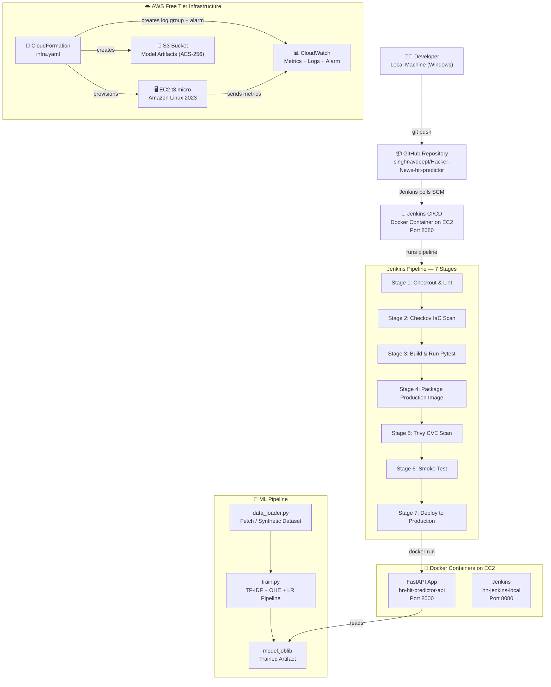

---

### Project Directory Structure

```
Hacker-News-hit-predictor/
├── app/                    ← FastAPI web application
│   ├── main.py             ← API routes, model loading, inference logic
│   ├── schemas.py          ← Pydantic request/response models
│   └── static/
│       └── index.html      ← Dark-themed browser dashboard
├── src/                    ← ML source code
│   ├── data_loader.py      ← Data ingestion, feature engineering
│   └── train.py            ← Model training, evaluation, artifact saving
├── tests/                  ← Pytest unit tests
├── docker/
│   └── Dockerfile          ← Container build instructions
├── docker-compose.yml      ← Multi-container local/EC2 orchestration
├── Jenkinsfile             ← Declarative CI/CD pipeline definition
├── cloudformation/
│   └── infra.yaml          ← AWS CloudFormation IaC template
├── requirements.txt        ← Python dependencies
├── models/                 ← (Generated at build time)
│   ├── model.joblib        ← Trained sklearn Pipeline
│   └── metrics.json        ← Accuracy, F1, AUC scores
└── docs/
    └── LEARNING_GUIDE.md   ← This file
```

---

## 2. Machine Learning — The Core Prediction Engine

### What We're Predicting

We predict whether a Hacker News post will score ≥ 50 points (binary classification: **hit** or **not a hit**).

### Why Machine Learning?

You could write hand-crafted rules ("if title contains 'Show HN' it might succeed"), but these rules are:
- **Brittle** — the HN community changes over time.
- **Incomplete** — there are hundreds of subtle signals.

ML learns statistical patterns from thousands of historical examples automatically.

---

### Feature Engineering

**Features** are the measurable properties we extract from each post:

| Feature | Type | How Computed | Why It Matters |
|---|---|---|---|
| `title` | Text | Raw string | The most important signal — word choice is everything |
| `domain_type` | Categorical | URL parsed → github / blogs / paper / tech_media / self / external | GitHub/research posts perform differently than SEO blogs |
| `submission_hour` | Numeric | `datetime.hour` | HN is most active 13:00–19:00 UTC (US working hours) |
| `submission_day` | Numeric | `datetime.weekday()` (0=Mon) | Weekday posts reach more readers |
| `title_len` | Numeric | `len(title)` | Very short (<15) or very long (>80) titles underperform |
| `title_word_count` | Numeric | `len(title.split())` | 5–12 word titles tend to do best |

**Code from `data_loader.py`:**

```python
def extract_domain_type(url: str) -> str:
    """Categorise the URL into one of 6 known domain types."""
    netloc = urlparse(url).netloc.lower()
    for cat, domains in DOMAIN_CATEGORIES.items():
        for d in domains:
            if d in netloc:
                return cat
    return "external"

def enrich_features(df: pd.DataFrame) -> pd.DataFrame:
    df["title_len"] = df["title"].apply(len)
    df["title_word_count"] = df["title"].apply(lambda t: len(t.split()))
    df["submission_hour"] = df["submission_time"].dt.hour
    df["domain_type"] = df["url"].apply(extract_domain_type)
    df["is_hit"] = (df["score"] >= 50).astype(int)
    return df
```

---

### The Scikit-learn Pipeline

A scikit-learn `Pipeline` chains preprocessing steps and the classifier into a single object. This prevents **data leakage** (the test set never influences the preprocessors' fitting) and makes deployment simple (you save one object, you load one object).

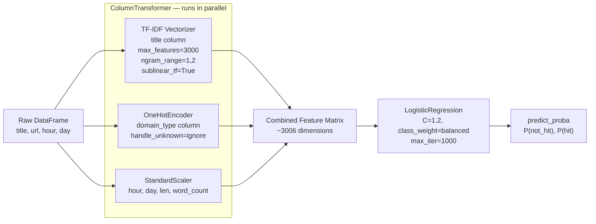

---

### Why Each Component Was Chosen

#### TF-IDF Vectorizer

**What it does:** Converts each title into a numeric vector. Each dimension = one word (or 2-word phrase). The score for each word = **Term Frequency × Inverse Document Frequency**.
- **TF:** How often the word appears in *this* title.
- **IDF:** Penalises words that appear in *every* title ("the", "a", "is"), giving more weight to rarer, more specific words.

- **`ngram_range=(1,2)`** — Captures 2-word phrases like "Show HN", "Open Source", "Machine Learning" which carry different meaning than individual words.
- **`sublinear_tf=True`** — Uses `log(1+tf)` instead of raw frequency — prevents one frequently repeated word from dominating.
- **`max_features=3000`** — Only keeps the 3000 most informative words to control model complexity.
- **Alternative:** Word2Vec or BERT embeddings (much more powerful for long text, but computationally expensive and overkill for 15-word titles).

#### OneHotEncoder

**What it does:** Converts categorical text (like `"github"`) into binary indicator columns:

```
domain_type="github" → [1, 0, 0, 0, 0, 0]
domain_type="blogs"  → [0, 1, 0, 0, 0, 0]
domain_type="paper"  → [0, 0, 1, 0, 0, 0]
```

**Why not label encoding?** Label encoding assigns integers (github=0, blogs=1, paper=2...) which implies a numeric ordering that doesn't exist. OHE avoids this.

**`handle_unknown='ignore'`** — If the model sees a domain type it has never seen during training, it outputs all zeros instead of crashing.

#### StandardScaler

**What it does:** Normalises numeric features to have **mean=0, standard deviation=1**.

Without scaling: `submission_hour=14` and `title_len=70` are on completely different scales. Logistic Regression would incorrectly treat them as comparably sized values.

**Alternative:** MinMaxScaler (scales to 0–1 range) — either works for Logistic Regression.

#### Logistic Regression

**What it does:** Learns a linear decision boundary in the high-dimensional feature space. Outputs a probability using the sigmoid function:

$$P(\text{hit}) = \frac{1}{1 + e^{-z}}, \quad z = w_1 x_1 + w_2 x_2 + \ldots + w_n x_n$$

- **`C=1.2`** — Regularisation strength (inverse of lambda). Higher C = less regularisation. 1.2 is a slight relaxation from the default 1.0.
- **`class_weight='balanced'`** — HN hit rate is ~28%. Without balancing, the model would predict "not a hit" for everything and be 72% accurate but totally useless. `balanced` weights the minority class (hits) higher during training.

**Why Logistic Regression over Random Forest or XGBoost?**
- **Interpretable** — you can read the coefficients and see which words matter most.
- **Fast to train** — important when it runs inside Docker during the build step.
- **Generalises well** for text classification on relatively small datasets.
- Random Forest / XGBoost would likely overfit on this synthetic dataset.

---

### Training: The 80/20 Split

```python
X_train, X_test, y_train, y_test = train_test_split(
    X, y, test_size=0.2, random_state=42, stratify=y
)
```

- **80% train / 20% test:** Standard ML convention. The test set is held out and never seen during training.
- **`stratify=y`** — Preserves the 28% / 72% hit / not-hit ratio in both splits. Without this, by random chance one split might have 40% hits — making metrics misleading.
- **`random_state=42`** — Makes the split deterministic — same result every run, so metrics are reproducible.

**Metrics computed after training:**

| Metric | Formula | What It Tells You |
|---|---|---|
| Accuracy | Correct / Total | Overall correctness — misleading on imbalanced data |
| Precision | TP / (TP + FP) | Of posts predicted as hits, how many actually were? |
| Recall | TP / (TP + FN) | Of actual hits, how many did we catch? |
| F1-Score | 2 × P × R / (P + R) | Harmonic mean of Precision and Recall |
| ROC-AUC | Area under ROC curve | Discrimination ability: 0.5 = random, 1.0 = perfect |

---

### Why Synthetic Data?

The HN Algolia API has rate limits and returns only recent posts. For reproducible training in a Docker container (no guaranteed network), we generate 3000 realistic synthetic posts based on observed patterns:

- **Hit posts:** "Show HN", open-source tools, research papers, major outage postmortems, database releases.
- **Flop posts:** SEO spam, job ads, marketing posts, non-technical content.

This ensures the Docker build **never fails due to network unavailability** while still teaching the model meaningful patterns. If the network is available during build, real live HN posts are merged with the synthetic ones.

---

## 3. FastAPI — The Inference Web Server

### What Is FastAPI?

FastAPI is a modern Python web framework for building REST APIs. It's built on top of:
- **Starlette** — the high-performance async web toolkit
- **Pydantic** — for request/response data validation
- **Uvicorn** — the ASGI server that actually handles HTTP connections

### Why FastAPI Over Alternatives?

| Framework | Speed | Auto-Docs | Type Safety | Why Not Used |
|---|---|---|---|---|
| **FastAPI** ✅ | Very Fast (async) | Yes (Swagger UI at /docs) | Full Pydantic | *Our choice* |
| Flask | Moderate | No | No | Manual validation, no async, no auto-docs |
| Django | Moderate | No (extra package) | Partial | Too heavyweight for a microservice |
| Flask-RESTful | Moderate | Partial | No | Boilerplate heavy |
| Tornado | Fast | No | No | Less ergonomic for ML serving |

FastAPI generates **automatic interactive documentation** at `/docs` — you can test predictions directly in the browser without writing a client application.

---

### Request → Response Flow

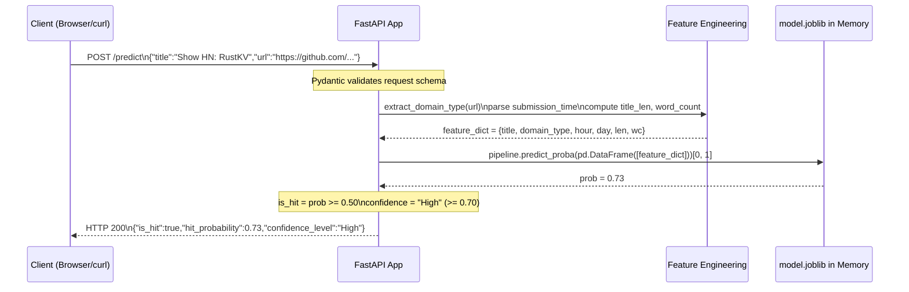

---

### Key FastAPI Concepts Used

#### Lifespan Context Manager

```python
@asynccontextmanager
async def lifespan(app: FastAPI):
    load_model()   # Runs ONCE at startup — loads model.joblib into RAM
    yield          # App runs here (handles all requests)
    # Cleanup code would go here on shutdown
```

**Why:** Loading a model from disk takes time (100ms–1s). If we loaded it on every request, the API would be 100× slower. By loading once at startup, all subsequent predictions are fast (sub-millisecond).

#### CORS Middleware

```python
app.add_middleware(CORSMiddleware, allow_origins=["*"], ...)
```

**What is CORS?** Cross-Origin Resource Sharing. Browsers block JavaScript from making requests to a different domain than the page loaded from (security feature). CORS headers tell the browser "it's OK for JavaScript from any domain to call this API." We set `*` (all origins) since this is a demo.

#### Health Check Endpoint

```python
@app.get("/health", response_model=HealthResponse)
def health_check():
    return HealthResponse(
        status="healthy",
        model_loaded=(model_pipeline is not None),
        ...
    )
```

**Why:** Docker, Jenkins, and load balancers need a quick way to verify the service is alive. The health endpoint returns HTTP 200 if healthy — this is what Jenkins' smoke test (`docker exec ... curl /health`) checks.

#### How Uvicorn Runs the App

```
uvicorn app.main:app --host 0.0.0.0 --port 8000
```

- `app.main` = Python module path (file `app/main.py`)
- `:app` = the FastAPI instance variable
- `--host 0.0.0.0` = listen on ALL network interfaces (not just localhost), so external traffic from the internet reaches it
- `--port 8000` = port number

---

## 4. Docker — Containerisation

### The Problem Docker Solves

**"It works on my machine."** — The most common problem in software deployment.

Your local Windows machine has: Python 3.11 at `C:\Python311`, specific package versions, Windows paths.
The AWS EC2 Linux server has: Python 3.9 at `/usr/bin/python3`, different package versions, Linux paths.

**Docker's solution:** Package the OS libraries, Python interpreter, packages, and your code into a single portable **container image**. This image runs identically everywhere.

---

### The Dockerfile — Annotated Line by Line

```dockerfile
FROM python:3.11-slim
```
Starts with an official Python 3.11 image on Debian Linux. `slim` = stripped of unnecessary packages (reduces size from ~900MB to ~130MB).

**Alternative:** `python:3.11-alpine` (even smaller, ~20MB) — but Alpine uses `musl` instead of `glibc`, and many scientific Python packages (numpy, scipy) don't have Alpine-compatible pre-built wheels, causing build failures.

```dockerfile
WORKDIR /workspace
```
Sets the working directory inside the container. All subsequent `COPY`, `RUN`, `CMD` commands operate from `/workspace`.

```dockerfile
ENV PYTHONDONTWRITEBYTECODE=1
ENV PYTHONUNBUFFERED=1
ENV PYTHONPATH=/workspace
```
- `PYTHONDONTWRITEBYTECODE=1` — Don't create `.pyc` compiled files (saves space)
- `PYTHONUNBUFFERED=1` — Print log output immediately without buffering (critical for seeing logs in `docker logs`)
- `PYTHONPATH=/workspace` — Tells Python to look for modules from `/workspace`, so `from app.main import ...` resolves to `/workspace/app/main.py`

> **This fixed our `ModuleNotFoundError: No module named 'app'` error.**

```dockerfile
RUN apt-get update && apt-get install -y --no-install-recommends \
    curl \
    && rm -rf /var/lib/apt/lists/*
```
Installs `curl` (needed for the Docker HEALTHCHECK). `--no-install-recommends` avoids unnecessary packages. `rm -rf /var/lib/apt/lists/*` removes the package manager cache to shrink the image layer.

```dockerfile
COPY requirements.txt .
RUN pip install --no-cache-dir -r requirements.txt
```
**Why copy `requirements.txt` before copying source code?** Docker builds in **layers**. If `requirements.txt` hasn't changed, Docker reuses the cached layer — skipping the slow `pip install` step. If you copied all source first, any code change would invalidate the cache and re-run `pip install` unnecessarily.

```dockerfile
RUN python -m src.train
```
**Trains the ML model during the Docker build.** The model artifact (`models/model.joblib`) is baked into the image — the container starts up instantly with the model already in RAM, without needing to train at runtime.

```dockerfile
HEALTHCHECK --interval=20s --timeout=5s --start-period=5s --retries=3 \
  CMD curl -f http://localhost:8000/health || exit 1
```
Docker periodically runs this command inside the container. If it fails 3 times consecutively, Docker marks the container as `(unhealthy)`. This integrates with `docker-compose`, Jenkins smoke tests, and AWS ECS.

---

### Docker Image Layers

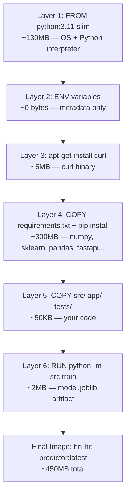

**Key insight:** Layers are cached. Only changed layers (and everything after them) rebuild. Putting stable dependencies (packages) before volatile code is crucial for fast rebuilds.

---

### Docker Networking — The Localhost Confusion (Critical Bug We Fixed)

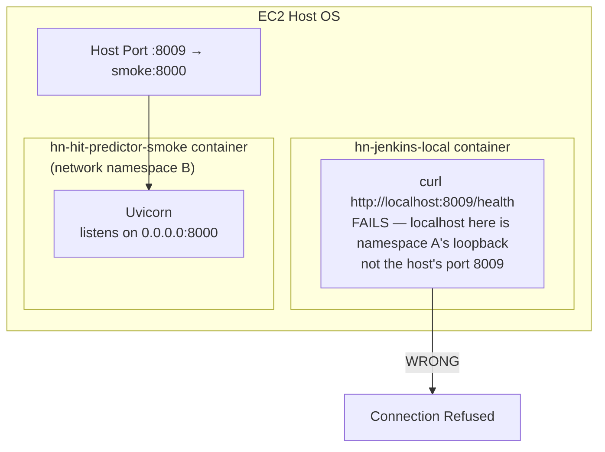

**The fix — `docker exec` runs inside the target container's namespace:**

```bash
# WRONG: curl runs inside Jenkins namespace, localhost:8009 not reachable
curl -s -f http://localhost:8009/health

# CORRECT: curl runs inside smoke container, localhost:8000 is Uvicorn
docker exec hn-hit-predictor-smoke curl -s -f http://localhost:8000/health
```

---

## 5. Docker Compose — Multi-Container Orchestration

### What Is Docker Compose?

Docker Compose defines and runs **multiple Docker containers** together from a single YAML file. It handles networking, volumes, port mapping, and startup configuration.

### Why Docker Compose?

Without Compose, you'd need two long manual commands every time you start the system. With Compose, it's:

```bash
docker compose up -d        # Start all containers
docker compose down         # Stop all containers
docker compose logs -f api  # Stream logs from API container
```

---

### docker-compose.yml — Annotated

```yaml
services:
  api:
    build:
      context: .              # Build context = project root
      dockerfile: docker/Dockerfile
    container_name: hn-hit-predictor-api
    ports:
      - "8000:8000"           # host_port:container_port
    environment:
      - ENV=production
    restart: unless-stopped   # Auto-restart on crash OR EC2 reboot
    healthcheck:
      test: ["CMD", "curl", "-f", "http://localhost:8000/health"]
      interval: 15s
      timeout: 5s
      retries: 3

  jenkins:
    image: jenkins/jenkins:lts-jdk17   # Pull pre-built image
    container_name: hn-jenkins-local
    privileged: true          # Required to run Docker inside Jenkins
    user: root
    ports:
      - "8080:8080"           # Jenkins UI
      - "50000:50000"         # Agent communication port (JNLP)
    volumes:
      - jenkins_home:/var/jenkins_home      # Persist config across restarts
      - /var/run/docker.sock:/var/run/docker.sock  # Give Jenkins Docker access

volumes:
  jenkins_home:               # Named volume (managed by Docker)
```

---

### The Docker Socket Mount — Docker-out-of-Docker (DooD)

```
volumes:
  - /var/run/docker.sock:/var/run/docker.sock
```

The Unix socket file `/var/run/docker.sock` is the communication channel to the Docker daemon. By mounting it into the Jenkins container, Jenkins can send Docker commands to the **host's Docker daemon**.

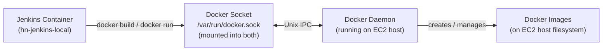

**Security note:** This grants the Jenkins container root-equivalent access to the host. Only use in trusted internal environments.

---

### Port Mapping

```
ports:
  - "8000:8000"
```

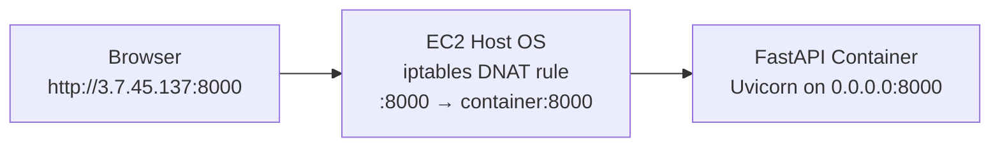

Format: `"host_port:container_port"`. Traffic on host port 8000 is forwarded to port 8000 inside the container.

---

## 6. Jenkins — CI/CD Automation

### What Is CI/CD?

**CI — Continuous Integration:** Every code commit automatically triggers a build and test run. This catches bugs before they reach production.

**CD — Continuous Deployment:** After tests pass, the new code is automatically deployed.

**Why automate this?** Without CI/CD, a developer must manually run tests, build Docker images, run security scans, SSH into the server, restart containers — slow, error-prone, and unscalable.

---

### Jenkins Architecture

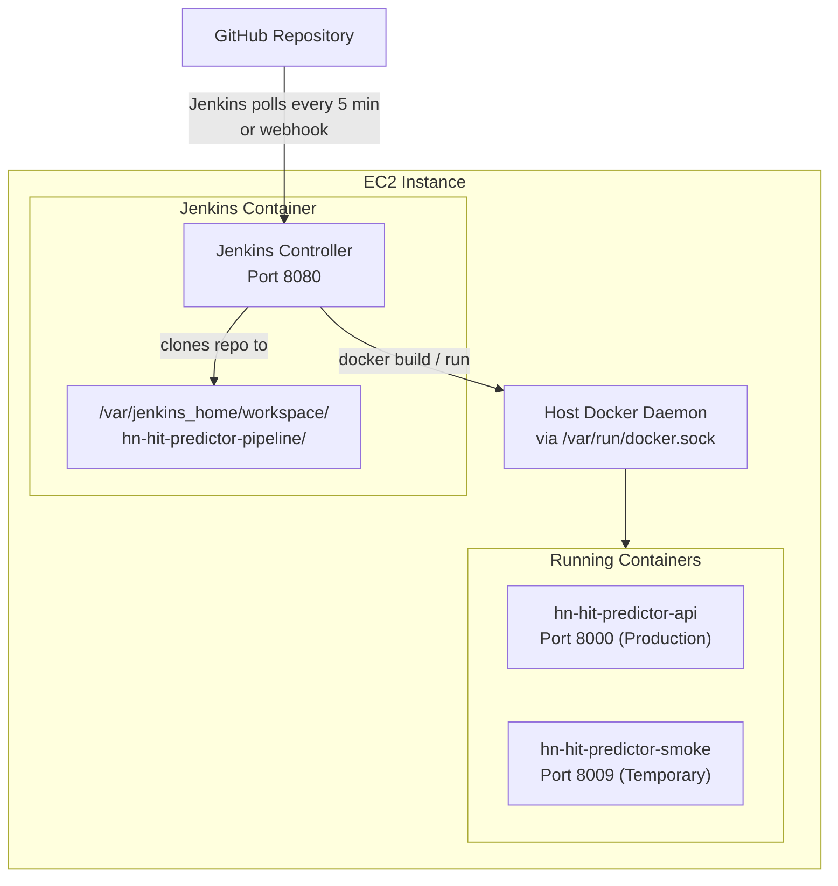

---

### The Jenkinsfile — All 7 Stages Explained

```groovy
pipeline {
    agent any
    environment {
        APP_NAME  = "hn-hit-predictor"
        IMAGE_TAG = "v${BUILD_NUMBER}"   // e.g., v1, v2, v7...
        LOCAL_IMAGE = "${APP_NAME}:${IMAGE_TAG}"
        TEST_PORT = "8009"
    }
```

`BUILD_NUMBER` is a Jenkins built-in variable that auto-increments with each run. It makes image tags unique and traceable for rollback.

**Stage 1 — Checkout & Lint:**
```groovy
sh '''
    test -f requirements.txt
    test -f docker/Dockerfile
    test -f app/main.py
    test -f src/train.py
    test -f cloudformation/infra.yaml
    echo "Project files validated."
'''
```
Validates that all required files exist before spending time on a build that would fail later.

**Stage 2 — Checkov IaC Security Scan:**
```groovy
docker run --rm -v $(pwd):/work bridgecrew/checkov:latest \
    -f /work/cloudformation/infra.yaml \
    --framework cloudformation \
    --soft-fail
```
Runs Checkov as an ephemeral Docker container — no installation needed on the host. Scans `infra.yaml` for AWS security misconfigurations.

**Stage 3 — Build & Run Tests:**
```groovy
docker build -t ${APP_NAME}-test -f docker/Dockerfile .
docker run --rm ${APP_NAME}-test pytest -v tests/
```
Builds the full Docker image (includes model training). Then runs Pytest inside a temporary container (`--rm` auto-removes it after tests complete).

**Stage 4 — Package Production Image:**
```groovy
docker tag ${APP_NAME}-test ${LOCAL_IMAGE}   # e.g., hn-hit-predictor:v7
docker tag ${APP_NAME}-test ${APP_NAME}:latest
```
Tags the same image with two labels: a version tag (for rollback) and `:latest` (used in deploy stage).

**Stage 5 — Trivy Container Scan:**
```groovy
docker run --rm -v /var/run/docker.sock:/var/run/docker.sock \
    aquasec/trivy:latest image \
    --severity HIGH,CRITICAL \
    --exit-code 0 \
    ${APP_NAME}:latest
```
Scans the production image for CVEs. `--exit-code 0` = informational only, doesn't fail the build. In strict production, you'd use `--exit-code 1` to block deployments with CRITICAL vulnerabilities.

**Stage 6 — Integration Smoke Test:**
```groovy
docker run -d --name ${APP_NAME}-smoke -p ${TEST_PORT}:8000 ${APP_NAME}:latest
sleep 7
# Test health directly inside the container (bypasses Docker network isolation)
docker exec ${APP_NAME}-smoke curl -s -f http://localhost:8000/health || \
    (docker logs ${APP_NAME}-smoke && exit 1)
docker exec ${APP_NAME}-smoke curl -s -X POST http://localhost:8000/predict \
    -H "Content-Type: application/json" \
    -d '{"title":"Show HN: My MLOps Pipeline","url":"https://github.com/test"}'
docker stop ${APP_NAME}-smoke && docker rm ${APP_NAME}-smoke
```
Spins up a temporary container, verifies the health and prediction endpoints work end-to-end, then cleans up.

**Stage 7 — Deploy to Production:**
```groovy
docker rm -f hn-hit-predictor-api || true   # Stop existing container
docker run -d --name hn-hit-predictor-api \
    --restart unless-stopped -p 8000:8000 ${APP_NAME}:latest
```
Replaces the running API container with the freshly built, tested, and scanned image. `|| true` prevents failure if no container was running (first deployment).

**Post-build Actions:**
```groovy
post {
    always {
        sh 'docker rm -f ${APP_NAME}-smoke || true'  // Always clean up smoke container
    }
}
```
`always {}` runs regardless of success or failure — critical for cleanup. Without it, a failed smoke test would leave the smoke container blocking port 8009 on the next build.

---

## 7. AWS CloudFormation — Infrastructure as Code

### What Is Infrastructure as Code (IaC)?

Traditionally, you'd provision AWS resources by clicking around the AWS Console. This is not reproducible, not auditable, and error-prone.

IaC means you describe infrastructure in code (YAML/JSON), and a tool provisions it automatically. CloudFormation is AWS's native IaC service.

### Why CloudFormation?

| Tool | Type | Why Not Used |
|---|---|---|
| **CloudFormation** ✅ | AWS-native YAML/JSON | *Our choice* — no external tools, free, full AWS support |
| Terraform | Multi-cloud HCL | Requires external CLI, state file management |
| AWS CDK | Python/TypeScript | Compiles to CloudFormation; more complex than needed |
| Pulumi | Python/TypeScript | Like CDK but multi-cloud |

---

### Template Structure

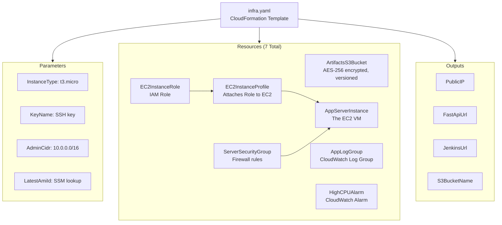

---

### Dynamic AMI Lookup

```yaml
LatestAmiId:
  Type: 'AWS::SSM::Parameter::Value<AWS::EC2::Image::Id>'
  Default: '/aws/service/ami-amazon-linux-latest/al2023-ami-kernel-default-x86_64'
```

Instead of hardcoding an AMI ID (which changes per region and over time), we use an **SSM Parameter** that AWS maintains. CloudFormation dynamically fetches the latest Amazon Linux 2023 AMI ID for the current region at stack creation time.

---

### UserData — Bootstrapping

```yaml
UserData:
  Fn::Base64: !Sub |
    #!/bin/bash
    dnf update -y
    dnf install -y docker git amazon-cloudwatch-agent
    systemctl enable docker && systemctl start docker
    usermod -aG docker ec2-user
```

`UserData` is a shell script that runs **once** when the EC2 instance first boots. `Fn::Base64` encodes it (AWS requirement). `!Sub` enables `${AWS::Region}` variable substitution in the script.

---

## 8. AWS EC2 — Compute Layer

### Why EC2 t3.micro?

| Compute Option | Best For | Why Not Used |
|---|---|---|
| **EC2 t3.micro** ✅ | Always-on web services, full control | *Our choice* |
| Lambda | Short functions (<15 min) | Cold starts on ML inference; loading model.joblib is too slow |
| ECS Fargate | Managed containers | No free tier; requires ECR |
| App Runner | Containerised web apps | No free tier |
| Lightsail | Simple VPS | Less AWS integration |

**Free Tier:** 750 hours/month of t3.micro = one instance running 24/7 for free.

---

### The 1 GB RAM Problem and Swapfile Fix

**t3.micro has only 1 GB RAM.** When building the Docker image (which runs `pip install numpy scipy scikit-learn` + `python -m src.train`), memory peaked above 1 GB, causing the OOM (Out of Memory) killer to terminate the process.

**Fix — 2 GB swapfile on EBS:**

```bash
sudo fallocate -l 2G /swapfile
sudo chmod 600 /swapfile
sudo mkswap /swapfile
sudo swapon /swapfile
echo '/swapfile none swap sw 0 0' | sudo tee -a /etc/fstab
```

Swap uses EBS disk space as overflow memory. It's slower than RAM (EBS I/O vs DRAM bandwidth) but prevents OOM crashes during infrequent high-memory operations like Docker builds.

---

### Security Groups — The EC2 Firewall

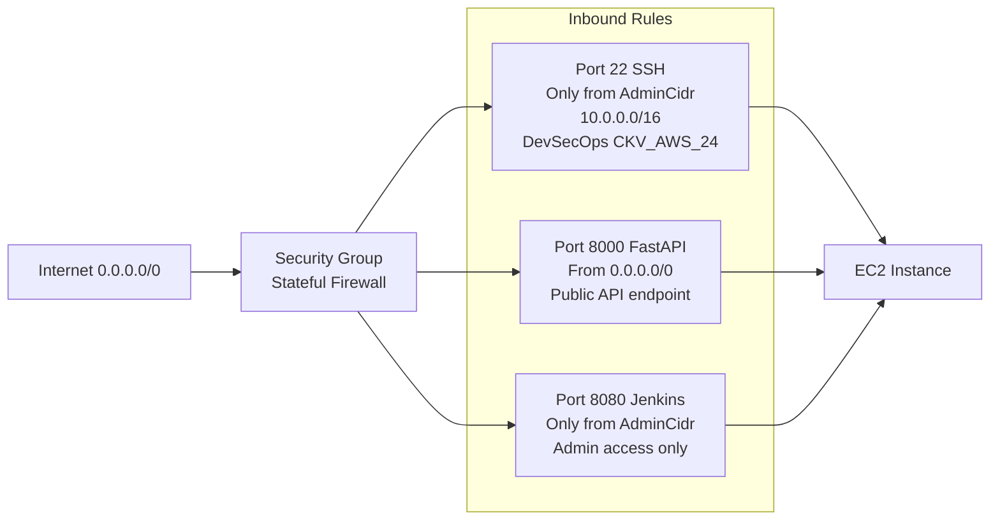

**Stateful** means: if you allow inbound traffic, the response traffic is automatically allowed — no separate outbound rule needed.

**Why restrict SSH?** SSH exposed to `0.0.0.0/0` means every bot on the internet can attempt brute-force attacks. This is **CIS AWS Benchmark CKV_AWS_24**, which Checkov validates.

---

## 9. AWS S3 — Artifact Storage

### What Is S3?

Simple Storage Service: object storage in the cloud. Like a file system but infinitely scalable, 99.999999999% durable, and globally accessible.

### Security Configuration

```yaml
BucketEncryption:
  ServerSideEncryptionConfiguration:
    - ServerSideEncryptionByDefault:
        SSEAlgorithm: AES256

PublicAccessBlockConfiguration:
  BlockPublicAcls: true
  BlockPublicPolicy: true
  IgnorePublicAcls: true
  RestrictPublicBuckets: true
```

- **AES-256** — Data encrypted at rest. Required by Checkov check `CKV_AWS_19`.
- **Public access block** — Prevents the bucket from ever being accidentally made public, even if someone adds a misconfigured bucket policy. The 2017 Equifax breach and Capital One breach both involved publicly accessible S3 buckets.

**Free Tier:** 5 GB storage, 20,000 GET requests, 2,000 PUT requests per month.

---

## 10. AWS CloudWatch — Observability & Monitoring

### The Three Pillars of Observability

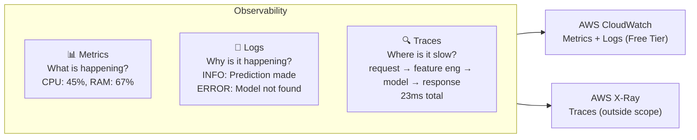

---

### What CloudWatch Collects

**Native EC2 Metrics (automatically collected, free):**
- `CPUUtilization` — % of allocated CPU being used
- `NetworkIn` / `NetworkOut` — bytes/second
- `DiskReadBytes` / `DiskWriteBytes` — EBS I/O activity
- `StatusCheckFailed` — 1 if the instance's OS is unresponsive

**Custom Metrics via CloudWatch Agent (every 60 seconds):**
- `mem_used_percent` — % of RAM in use
- `disk_used_percent` — % of EBS volume used

**Why doesn't AWS collect memory natively?** EC2 instances are VMs; AWS can see only what the hypervisor exposes at the hardware level. RAM usage requires a software agent running inside the OS to report to CloudWatch.

---

### The CloudWatch Alarm

```yaml
HighCPUAlarm:
  Properties:
    MetricName: CPUUtilization
    Period: 300          # 5-minute evaluation window
    EvaluationPeriods: 2 # Must breach for 2 consecutive periods = 10 min
    Threshold: 80        # 80% CPU
    ComparisonOperator: GreaterThanOrEqualToThreshold
```

The two-period requirement prevents false alarms from brief CPU spikes (e.g., a Docker build) triggering the alarm.

**States:**
- **OK** — CPU < 80% — normal
- **ALARM** — CPU ≥ 80% for 10+ minutes — investigate
- **INSUFFICIENT_DATA** — Not enough data points yet (first 10 minutes after creation)

---

### Where to View CloudWatch

1. **AWS Console → EC2 → Instances → Select Instance → Monitoring tab** — Quick CPU/Network graphs
2. **AWS Console → CloudWatch → Metrics → All metrics → EC2 → Per-Instance Metrics** — Full metric explorer
3. **AWS Console → CloudWatch → Metrics → CWAgent** — Custom memory/disk metrics (requires CloudWatch Agent running)
4. **AWS Console → CloudWatch → Alarms → All alarms** — HighCPUAlarm status
5. **AWS Console → CloudWatch → Logs → Log groups → `/aws/ec2/hn-hit-predictor`** — System logs
6. **http://3.7.45.137:8000/metrics** — Application-level ML metrics (FastAPI endpoint)

---

## 11. AWS IAM — Identity & Access Management

### The Principle of Least Privilege

IAM enforces the golden security rule: **give every entity only the permissions it needs, nothing more.**

### How IAM Works Here

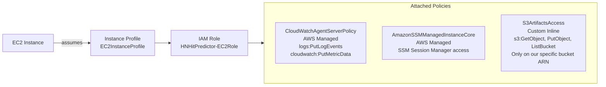

**Why use a Role instead of access keys?**

The old (insecure) way: Create an IAM User, generate an Access Key + Secret Key, SSH into EC2, run `aws configure`, paste the keys.

Problems:
- Keys can be accidentally committed to GitHub (happens very often!)
- Keys don't expire automatically
- If EC2 is compromised, attacker gets permanent keys

The IAM Role way: EC2 instances assume a Role automatically. Applications query the **Instance Metadata Service** at `http://169.254.169.254/latest/meta-data/iam/security-credentials/` to get temporary, rotating credentials. No keys to manage or accidentally expose.

---

## 12. DevSecOps — Security Built into the Pipeline

### What Is DevSecOps?

**Traditional security:** Security team reviews at the end, before release. ("Shift right")

**DevSecOps:** Security checks are automated and run on every commit. ("Shift left") — Security is everyone's responsibility, not a gate at the end.

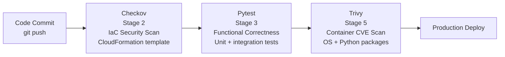

---

### Checkov — Infrastructure Security Scanner

**What it does:** Scans CloudFormation, Terraform, and Kubernetes YAML files for known security misconfigurations against hundreds of built-in policies.

**Checks it ran and fixes we applied:**

| Check ID     | Description                  | Our Fix                                     |
| ------------ | ---------------------------- | ------------------------------------------- |
| `CKV_AWS_24` | SSH exposed to 0.0.0.0/0     | Added `AdminCidr` parameter, restricted SSH |
| `CKV_AWS_19` | S3 bucket not encrypted      | Added `SSEAlgorithm: AES256`                |
| `CKV_AWS_54` | S3 public access not blocked | Added full `PublicAccessBlockConfiguration` |

We passed 24/24 checks after applying these fixes.

---

### Trivy — Container Vulnerability Scanner

**What it does:** Scans Docker images for CVEs in OS packages (Debian, Alpine), Python pip packages, and other language dependencies.

**What the CVE output means:**

```
bsdutils  CVE-2026-76642  HIGH  util-linux: failed external mount helper...
```

| Column | Meaning |
|---|---|
| Library | The vulnerable package (OS library, not our code) |
| Vulnerability | CVE identifier from the National Vulnerability Database |
| Severity | LOW / MEDIUM / HIGH / CRITICAL |
| Status | `affected` = no fix yet available upstream |

**Why are there HIGH CVEs and we still deployed?** These are OS library vulnerabilities in the Debian base image (`util-linux`), not in our Python code. `util-linux` manages filesystem mounting — not relevant to a web API. Because no fixed version exists and `--exit-code 0` is set, they're reported but don't block deployment.

---

### DevSecOps Principles Summary

| Principle | Implementation |
|---|---|
| Security as Code | Checkov, Trivy automated in Jenkinsfile |
| Least Privilege | IAM Role with minimal permissions |
| Defence in Depth | Security Group + IAM + Encryption + Monitoring |
| Encryption Everywhere | AES-256 on S3 |
| Audit Trail | CloudWatch Logs capture all system events |
| Immutable Infrastructure | Never modify running containers; always replace |

---

## 13. Git & GitHub — Version Control

### Why Git?

Git is a **distributed version control system**. Every developer has a complete copy of the history. This means you can work offline, multiple people can work on different branches simultaneously, and every change is traceable.

### How Jenkins Uses Git

Jenkins clones the repo into:
```
/var/jenkins_home/workspace/hn-hit-predictor-pipeline/
```

Every pipeline run checks out the **exact commit SHA** (like `3d1c76fcabf8ccf...`), ensuring builds are reproducible and traceable. If a bug is introduced, you can identify exactly which commit caused it.

### Key Commands Used in This Project

```bash
git commit -am "Fix smoke test: use docker exec instead of localhost curl"
# -a : Stage all modified tracked files
# -m : Commit message describing what changed and why

git push origin main        # Push commits to GitHub
git log --oneline           # View concise commit history
git diff                    # See what changed before committing
```

---

## 14. Pydantic — Data Validation

### What Is Pydantic?

Pydantic is a Python library for data validation using Python type annotations. It's the backbone of FastAPI's request/response handling.

### Why Use It?

Without Pydantic:
```python
@app.post("/predict")
def predict(body: dict):
    title = body.get("title")  # Could be None, integer, list, anything
    if not isinstance(title, str) or len(title) < 3:
        return {"error": "Invalid title"}
    # ...manual validation for every field...
```

With Pydantic:
```python
class PredictionRequest(BaseModel):
    title: str = Field(..., min_length=3, max_length=300)
    url: Optional[str] = Field(None)
    submission_time: Optional[str] = None
```

Pydantic automatically:
- Validates that `title` is a string with 3–300 characters
- Returns a detailed HTTP 422 Unprocessable Entity error if validation fails
- Generates the OpenAPI/Swagger schema (which powers the interactive `/docs` UI)
- Coerces compatible types (e.g., integer `123` → string `"123"` where appropriate)

---

## 15. Joblib — Model Serialisation

### What Is Serialisation?

After training, the scikit-learn Pipeline object lives in Python memory. When the Python process exits, it's gone. Serialisation converts the in-memory object into bytes saved to disk that can be reloaded later.

### Why Joblib Instead of Pickle?

Python's built-in `pickle` works but is slow for large numpy arrays (which form the learned weights of TF-IDF and Logistic Regression).

`joblib` is optimised for objects containing large numpy arrays — it uses memory-mapped files for fast loading and optionally compresses the output.

```python
# Save (runs during docker build, in src/train.py)
joblib.dump(pipeline, "models/model.joblib")

# Load (runs once at startup, in app/main.py)
model_pipeline = joblib.load("models/model.joblib")
```

The model is trained during `docker build` (baked into the image) and loaded once at container startup via the `lifespan` context manager. All subsequent predictions use the already-loaded in-memory object — zero disk I/O per request.

---

## 16. The Complete End-to-End Flow

### Developer to Production — Full Journey

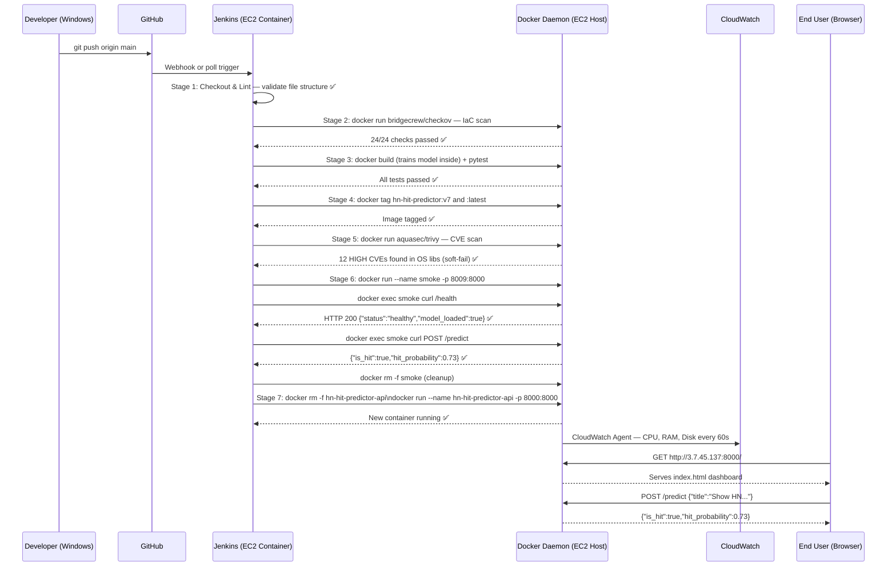

---

### Data Flow Through the ML Pipeline

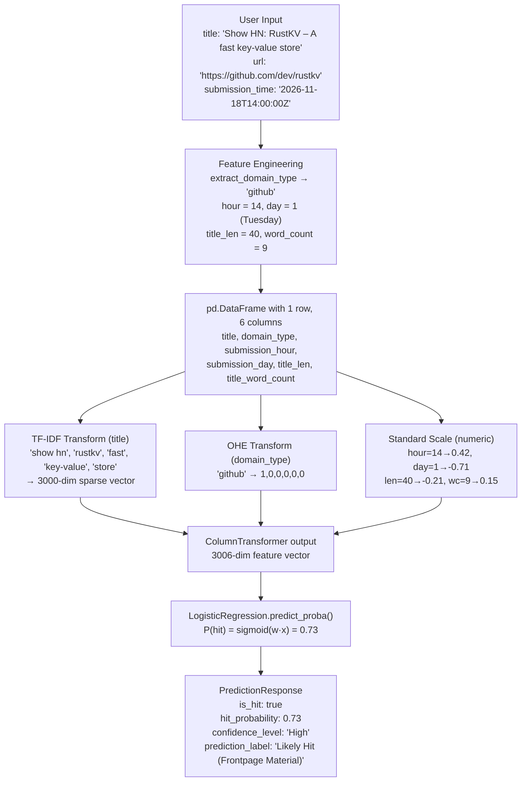

---

## 17. Cost Architecture — AWS Free Tier

### Monthly Cost Breakdown

| Service | Free Tier Allowance | Our Usage | Cost |
|---|---|---|---|
| EC2 t3.micro | 750 hrs/month (1 instance 24/7) | 744 hours | \$0.00 |
| EBS gp3 20GB | 30 GB/month | 20 GB | \$0.00 |
| S3 Storage | 5 GB/month | <100 MB | \$0.00 |
| CloudWatch Custom Metrics | 10 metrics/month | 2 metrics | \$0.00 |
| CloudWatch Logs | 5 GB ingestion/month | <100 MB | \$0.00 |
| CloudWatch Alarms | 10 alarms/month | 1 alarm | \$0.00 |
| Data Transfer Out | 1 GB/month | ~100 MB | \$0.00 |
| **TOTAL** | | | **\$0.00/month** |

> **Note:** Free Tier applies for 12 months from account creation. After 12 months, t3.micro costs ~\$8/month (on-demand, ap-south-1).

---

### Deployed Infrastructure Diagram

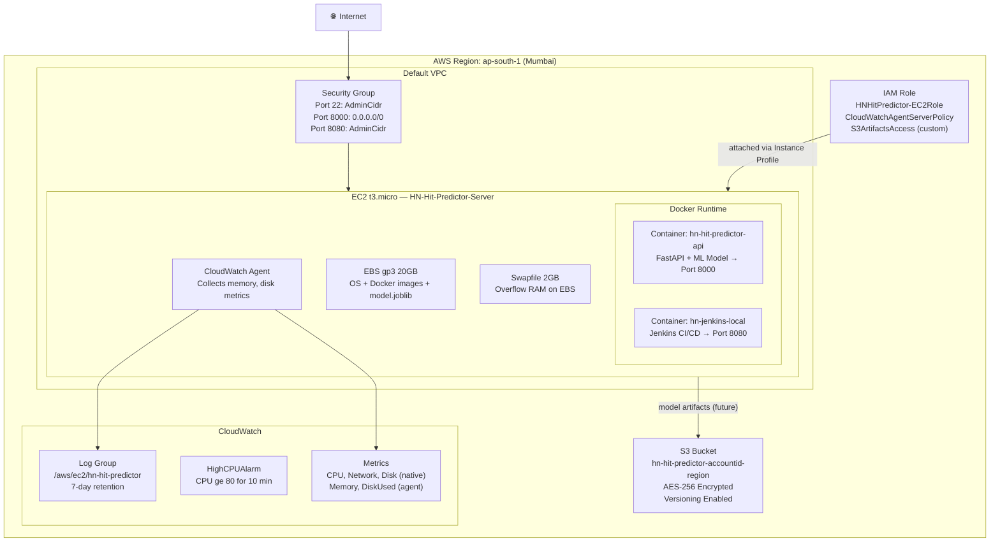

---

## 18. Glossary of MLOps Terms

| Term | Definition |
|---|---|
| **MLOps** | Machine Learning Operations — practices for deploying and maintaining ML systems in production reliably |
| **CI/CD** | Continuous Integration / Continuous Deployment — automated build, test, deploy pipelines |
| **IaC** | Infrastructure as Code — defining cloud resources in version-controlled code files |
| **DevSecOps** | Development + Security + Operations — integrating security into every CI/CD stage |
| **CVE** | Common Vulnerability and Exposure — a standardised ID for known security vulnerabilities |
| **Container** | A lightweight, isolated process running from a Docker image |
| **Image** | A read-only template for containers, like a snapshot of an OS + app |
| **Artifact** | A build output — in ML, the trained model file `model.joblib` |
| **Pipeline** | In scikit-learn: chain of preprocessing + classifier. In Jenkins: sequence of automated stages |
| **Feature Engineering** | Transforming raw data into numeric representations that ML models can learn from |
| **TF-IDF** | Term Frequency-Inverse Document Frequency — text vectorisation technique |
| **OHE** | One-Hot Encoding — converting categorical values into binary indicator columns |
| **Regularisation** | Penalty on model complexity to prevent overfitting |
| **Overfitting** | Model memorises training data and fails on new unseen data |
| **ROC-AUC** | Measure of model's discrimination ability; 1.0 = perfect, 0.5 = random |
| **Health Check** | Endpoint or Docker command verifying a service is functioning correctly |
| **Smoke Test** | Quick sanity check that a deployed service responds to basic requests |
| **IAM** | Identity and Access Management — AWS's permission system |
| **Security Group** | AWS virtual stateful firewall controlling EC2 inbound/outbound traffic |
| **DooD** | Docker-out-of-Docker — running Docker commands from inside a Docker container via socket mount |
| **CORS** | Cross-Origin Resource Sharing — browser security mechanism for cross-domain API calls |
| **ASGI** | Asynchronous Server Gateway Interface — Python standard for async web servers (FastAPI/Uvicorn) |
| **Namespace** | Isolated Linux environment for processes — Docker uses namespaces for container isolation |
| **Swapfile** | Disk space used as overflow memory when RAM is full — slower but prevents OOM crashes |
| **AMI** | Amazon Machine Image — snapshot of an OS used to launch EC2 instances |
| **SSM** | AWS Systems Manager — provides parameter store, session manager (browser SSH), and more |
| **Free Tier** | AWS's offer of limited free usage for 12 months after account creation |

---

*This guide covers every technology, decision, and mechanism in the HN Hit Predictor MLOps project.*

> **Repository:** https://github.com/singhnavdeept/Hacker-News-hit-predictor
> **Live API:** http://3.7.45.137:8000
> **Jenkins:** http://3.7.45.137:8080
> **CloudWatch:** AWS Console → CloudWatch → Metrics / Alarms / Logs


----
---
# Something left out of current version 


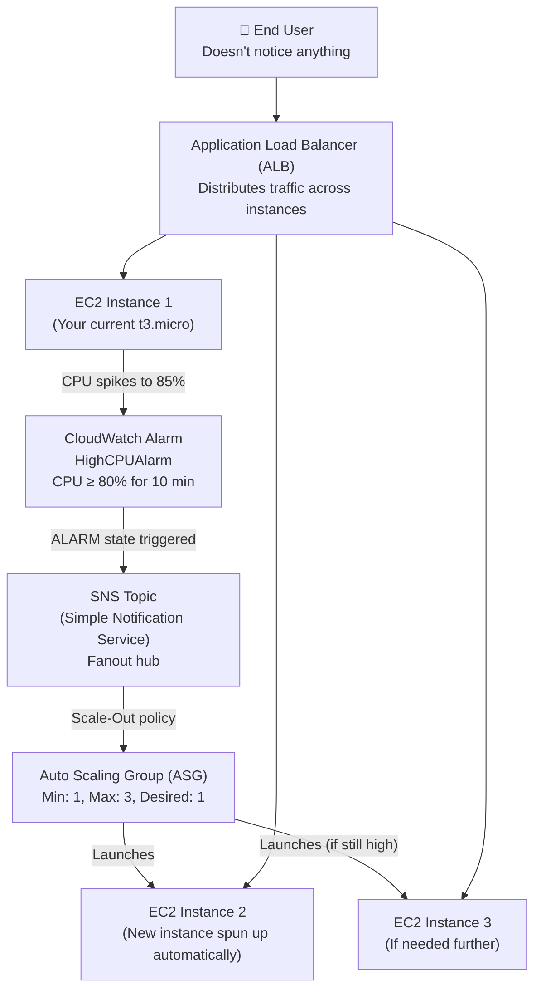

---

## The Three AWS Services That Make It Happen

### 1. Auto Scaling Group (ASG)
Manages a **fleet** of identical EC2 instances. You define:
- `MinSize: 1` — always keep at least 1 instance running
- `MaxSize: 3` — never spin up more than 3
- `DesiredCapacity: 1` — target count under normal load

The ASG uses a **Launch Template** (or Launch Configuration) — a blueprint describing exactly what each new instance should look like (AMI, instance type, security groups, IAM role, UserData bootstrap script).

### 2. Scaling Policy (attached to ASG)
Tells the ASG *when* and *how* to scale:

| Policy Type | How It Works | Example |
|---|---|---|
| **Simple Scaling** | Alarm fires → add N instances, wait cooldown | CPU ≥ 80% → add 1 instance, wait 300s |
| **Step Scaling** | Different alarm thresholds → different step sizes | CPU 70–80% → +1, CPU >90% → +2 |
| **Target Tracking** | ASG maintains a target metric automatically | "Keep average CPU at 60%" — ASG decides how many instances |

### 3. Application Load Balancer (ALB)
Routes incoming HTTP traffic across all healthy instances. When Instance 2 spins up, the ASG registers it with the ALB, and the ALB starts sending it traffic — **zero downtime for users**.

---

## What the CloudFormation Would Look Like

If we were to add auto-scaling to our existing `infra.yaml`:

```yaml
# Launch Template — blueprint for new instances
LaunchTemplate:
  Type: AWS::EC2::LaunchTemplate
  Properties:
    LaunchTemplateData:
      InstanceType: t3.micro
      ImageId: !Ref LatestAmiId
      IamInstanceProfile:
        Arn: !GetAtt EC2InstanceProfile.Arn
      SecurityGroupIds:
        - !GetAtt ServerSecurityGroup.GroupId
      UserData:
        Fn::Base64: !Sub |
          #!/bin/bash
          # Pull and start the Docker container
          docker run -d -p 8000:8000 --restart unless-stopped hn-hit-predictor:latest

# Auto Scaling Group
AppAutoScalingGroup:
  Type: AWS::AutoScaling::AutoScalingGroup
  Properties:
    MinSize: "1"
    MaxSize: "3"
    DesiredCapacity: "1"
    LaunchTemplate:
      LaunchTemplateId: !Ref LaunchTemplate
      Version: !GetAtt LaunchTemplate.LatestVersionNumber
    TargetGroupARNs:
      - !Ref ALBTargetGroup   # Register new instances with Load Balancer

# Scale OUT policy (triggered by our existing alarm)
ScaleOutPolicy:
  Type: AWS::AutoScaling::ScalingPolicy
  Properties:
    AutoScalingGroupName: !Ref AppAutoScalingGroup
    PolicyType: SimpleScaling
    AdjustmentType: ChangeInCapacity
    ScalingAdjustment: 1          # Add 1 instance
    Cooldown: 300                 # Wait 5 min before scaling again

# Scale IN policy (when CPU drops back down)
ScaleInPolicy:
  Type: AWS::AutoScaling::ScalingPolicy
  Properties:
    AutoScalingGroupName: !Ref AppAutoScalingGroup
    PolicyType: SimpleScaling
    AdjustmentType: ChangeInCapacity
    ScalingAdjustment: -1         # Remove 1 instance
    Cooldown: 300

# Our existing HighCPUAlarm now points to the ScaleOut policy
HighCPUAlarm:
  Type: AWS::CloudWatch::Alarm
  Properties:
    AlarmActions:
      - !Ref ScaleOutPolicy       # ← This is what triggers the new instance!
    MetricName: CPUUtilization
    Threshold: 80
    ...

# Low CPU alarm — triggers Scale IN
LowCPUAlarm:
  Type: AWS::CloudWatch::Alarm
  Properties:
    AlarmActions:
      - !Ref ScaleInPolicy
    MetricName: CPUUtilization
    ComparisonOperator: LessThanOrEqualToThreshold
    Threshold: 30
    ...
```

---

## The Full Auto-Scaling Lifecycle

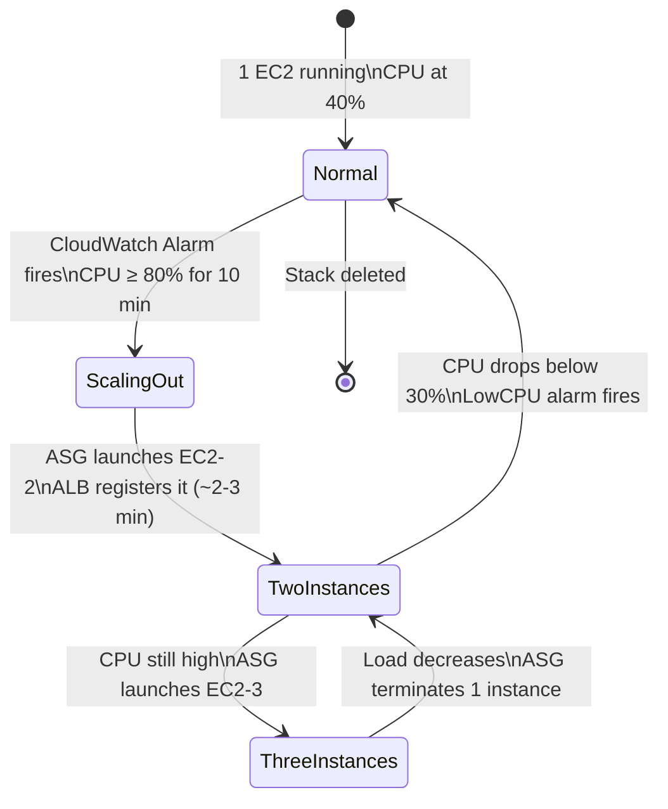


## The Production-Grade Version

In a real company this would look like:

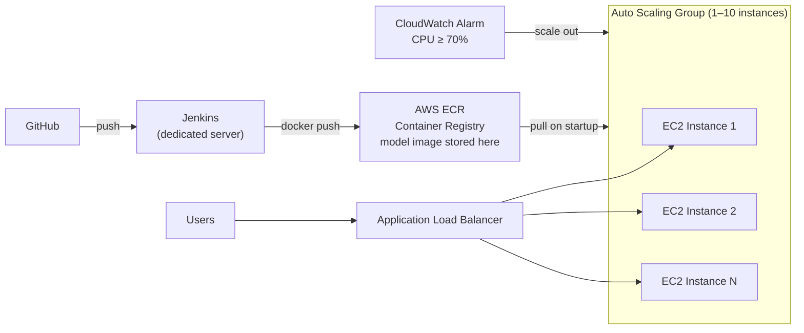

**Short answer:** Yes — `AlarmActions: [!Ref ScaleOutPolicy]` on the CloudWatch alarm is literally the one line that connects "alarm fires" → "new EC2 instance spins up." Everything else (ASG, Launch Template, ALB) is the supporting infrastructure. This is called **Reactive Auto Scaling**, and it's how Netflix, Amazon, and virtually every large-scale web service manages variable traffic.